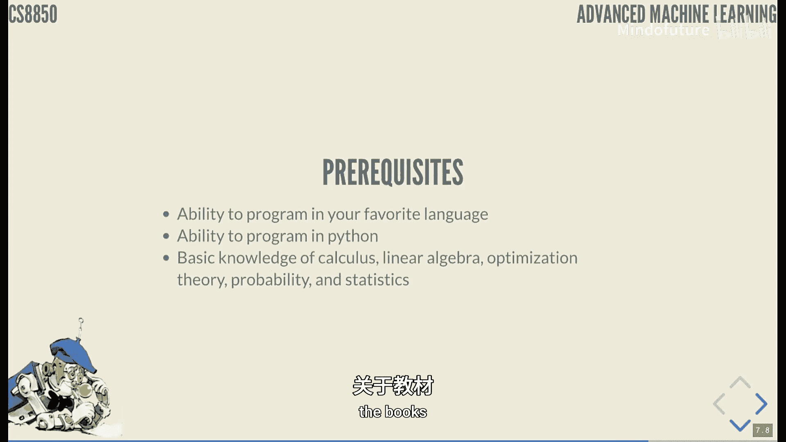
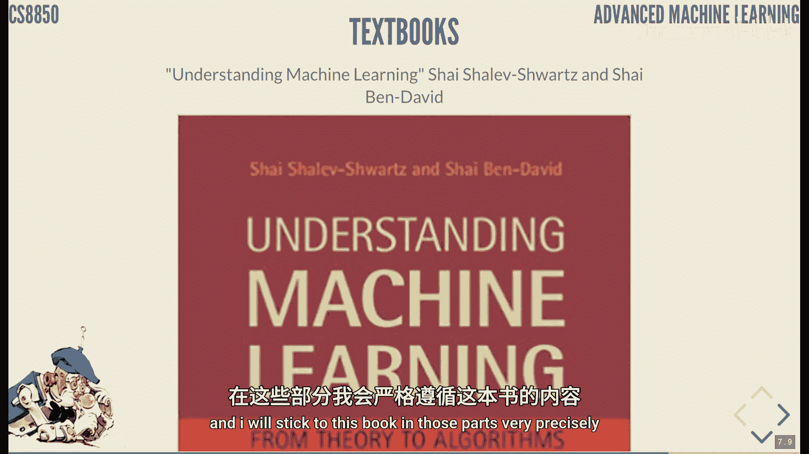
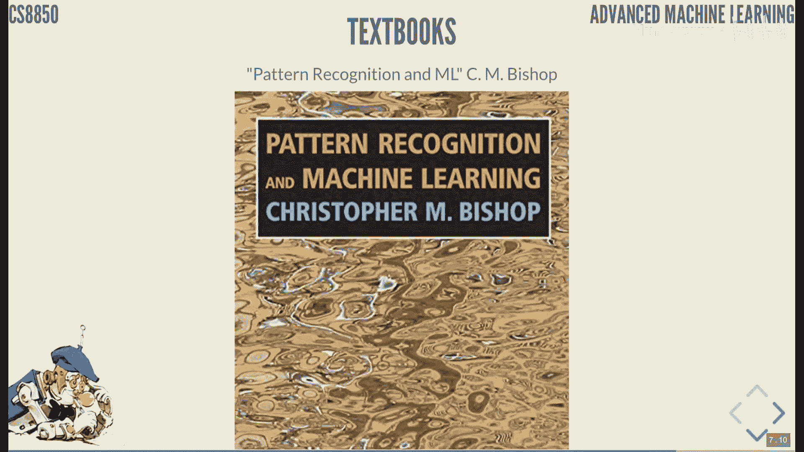
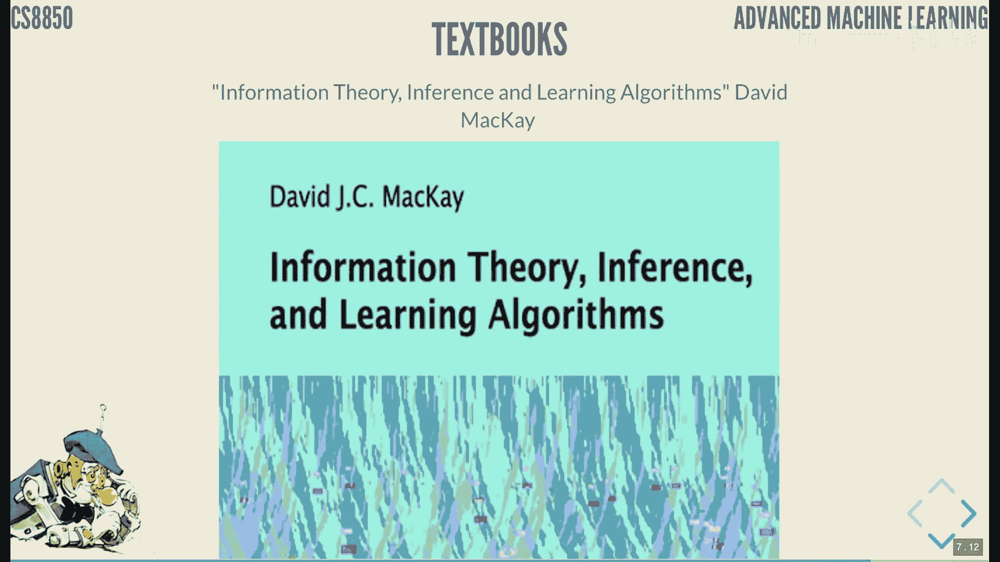
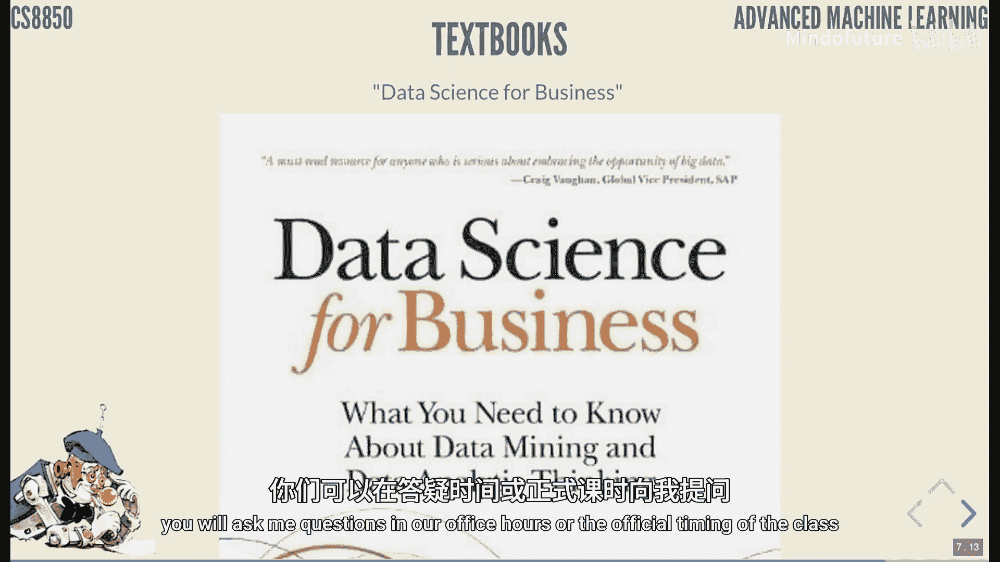

# 007：课程概述 📚

在本节课中，我们将了解这门高级机器学习课程的整体规划、涵盖的核心主题、课程结构以及评分方式。

## 课程内容概览

历史回顾到此为止。接下来，我们将聚焦于课程本身。本课程将涵盖哪些内容？

我计划讲解学习理论的基础知识，以便我们理解什么是学习，以及如何在机器学习中具体实现它。

我们还将深入探讨一系列我认为最重要或更高级的算法。理解这些算法的工作原理，对于你理解其他学习算法的推理和思考方式至关重要。

此外，我会穿插介绍该领域在经典机器学习方法基础上取得的最新进展。这包括一些你可能最近才接触到的概念。例如，随机梯度下降（SGD）可能是你现在唯一了解的优化方法，但请相信，它并非一直是首选或唯一的优化算法。

在优化方面，我们最近认识到，局部最小值这个“大敌”在过参数化模型中并不像看起来那么糟糕，只要我们能够保证收敛。另一个重要概念是偏差-方差权衡。我们最近发现，仅仅讨论偏差-方差权衡是一个不完整的故事。还有一点是，强化学习可能并不完全像人们想象的那样。除非我们进度非常快，否则本课程可能不会深入讲解强化学习，但了解它对你完成项目或许有帮助。

## 核心算法与技能

如果要用一张幻灯片列出所有基础核心算法，我会这样安排。

我们将花相当多的时间探讨“什么是学习？”这个问题，并深入学习理论。

我们将详细讲解各种学习算法，包括感知机、逻辑回归和支持向量机，以帮助你深入理解线性模型背后的原理。

我们还将讨论参数优化，包括梯度下降、最大似然估计和最大后验估计。我们会有一节专门讲解SGD，并探讨强大的梯度计算，这是所有使用过深度学习框架（如PyTorch或TensorFlow）的人都熟悉的。我推荐使用PyTorch进行研究，它更易于上手；但如果是工业部署，TensorFlow的优化更好。

需要强调的是，本课程不会教授编程或“乐高式”的代码拼接。我的目标是让你在课程结束后，理解现代机器学习、工业应用及研究背后的基本原理。了解算法决策和失败背后的驱动因素，对于你解决问题、成长为优秀的问题解决者至关重要，这无论对工业界还是学术界的职业发展都大有裨益。

此外，本课程还会讲解如何处理数据、各种主要的正则化算法，以及用于建模数据集的非线性模型、分类器和核密度估计等。

## 课程结构与评分

以下是讲座的概览和评分方式。如果你没读我的邮件，我需要再重复一遍：请尽快将你的成绩报告昵称发给我。

课程评分包含以下几个部分：测验、作业、项目和考试。我们将有两次考试、一个项目和大约五次作业。

**关于测验**
由于采用异步授课模式，为了确保大家学习了课程内容，我会设置简单的测验。这些测验主要考察对讲座基本内容的理解，并非深度考试。测验也给我机会加入一些“彩蛋”问题。测验成绩占总评的10%。总共有24次测验，采用二进制评分（即只有对错，没有部分分数）。如果答错超过30%的测验题目（即大约8次或更多测验不及格），你将在总评中失去这10%的分数，这意味着最高成绩可能仅为B。请认真对待测验。

**关于作业**
作业可以合作讨论，但严禁抄袭。一旦发现抄袭，将按教学大纲处理，成绩为零。作业是你理解知识、与同学交流解决问题的机会，请不要在截止前匆忙抄袭。作业需要使用Python完成，并使用LaTeX编写数学公式。

**关于考试**
理想情况下，考试应在无书无笔记的环境下进行，以检验真实掌握程度。考虑到异步授课，我可能会调整形式，但很可能仍会是限时答题或选择题形式。

**关于项目**
项目为你提供了应用课堂所学、并探索超越课程内容的方法的机会。它更具创造性，能帮助你理解理论如何映射到实践。项目应该是有趣的，具体细节我将在后续讲座中介绍。

**关于成绩排名**
请尽快将你的私人昵称发给我。我将公布按成绩排序的名单（仅显示昵称），以便你了解自己在班级中的相对位置。希望这能激发一些良性竞争，但请专注于自身的学习和进步。

## 先修要求与教材

**先修知识**
你需要具备使用编程语言（特别是Python）的能力、以及微积分、线性代数、优化理论、概率论与统计学的基础知识。我可能会安排一次复习讲座，但这不足以弥补相关知识的完全缺失。如果你对这些主题不熟悉，请提前复习。

**参考教材**
我不会只依赖一本教材，而是会综合多种资源，并在幻灯片中提供链接。课程理论部分主要参考《Understanding Machine Learning》一书。此外，还会参考Christopher Bishop的《Pattern Recognition and Machine Learning》、Goodfellow等人的《Deep Learning》、David MacKay的《Information Theory, Inference, and Learning Algorithms》（可免费获取PDF），以及《Data Science for Business》。最后一本对于想了解机器学习在工业界实际应用的同学非常有帮助。

---

本节课中，我们一起学习了本课程的整体框架、将要探讨的核心机器学习理论与算法、详细评分规则以及所需的先备知识与教材。希望这为你接下来的学习提供了清晰的路线图。