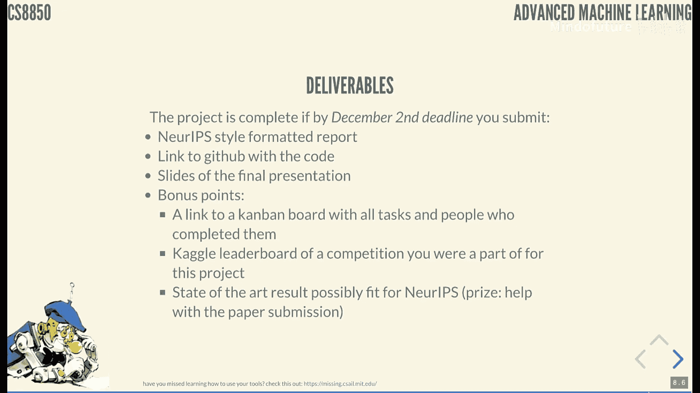

# 008：项目概述 🎯

在本节课中，我们将学习课程项目的核心目标、结构、流程与交付要求。项目旨在将理论知识应用于实践，通过团队协作解决真实的机器学习问题。

## 项目的重要性与理念

机器学习是一门理论与实践紧密结合的学科。仅仅理解**偏差-方差权衡**或知道需要划分测试集是不够的。项目中包含大量难以在课堂讲授的“隐性知识”，这些知识只能通过动手实践来掌握。项目正是为了让你“在做中学”，体验那些无法在常规课程中直接传授的经验。

上一节我们介绍了项目的核心理念，本节中我们来看看项目的具体运作模式。

一个典型的机器学习项目可以类比为“精益创业”或“科学方法”。其核心在于**持续的迭代开发与实验**。这个过程可以概括为一个循环：

1.  提出想法。
2.  快速构建一个可运行的模型。
3.  测试你的假设。
4.  测量性能。
5.  分析数据。
6.  从中学习。
7.  进行迭代改进。

项目就是让你反复经历这个实验循环。

## 项目流程详解

了解了迭代开发的概念后，我们来具体拆解一个机器学习项目的标准步骤。

以下是项目从开始到结束的完整流程：

1.  **定义任务**：明确你要解决的预测或识别问题。
2.  **收集数据**：获取原始数据。强烈建议选择**Kaggle**等平台的公开竞赛数据。
3.  **数据预处理与特征工程**：清洗数据，并将其转换为算法能够有效处理的格式（例如，处理**高维数据** `X ∈ ℝ^(n×d)`）。
4.  **建立基线模型**：首先构建一个简单的模型（例如，逻辑回归或支持向量机），以获得一个初步的性能基准。**切勿一开始就尝试最前沿的复杂模型**。
5.  **模型比较与选择**：尝试更优的模型，并使用统计方法（如假设检验）与基线模型进行严谨比较，确保性能提升不是噪声所致。
6.  **迭代优化**：将选出的更好模型作为新的基线，重复“优化-测试-分析”的循环。
7.  **模型部署与评估**：产出最终模型，并在测试集或竞赛平台上评估性能。
8.  **监控与重新定义**：根据评估结果，可能需要重新审视任务或收集新数据，开启新的循环。

## 项目执行指南

明确了流程后，我们需要知道如何具体组织和管理一个项目。

项目的具体执行应遵循以下步骤：

*   **始于一个有趣的预测问题**：将其形式化为监督学习任务。
*   **组建团队**：团队人数应为**4到6人**。目的是学习协作。
*   **创建团队GitHub仓库**：所有代码必须清晰、可复现，并托管在GitHub上。
*   **获取与预处理数据**：进行特征提取，将数据表示为适合算法的形式。
*   **选择基线模型**：使用一个简单、你熟悉的模型快速获得初步结果。
*   **实验、比较与迭代**：尝试更好的模型，与基线比较，不断优化。
*   **最终呈现与答辩**：向全班展示并答辩你们的最佳模型。

## 项目时间线与里程碑

为了确保项目顺利进行，我们设定了明确的时间节点。

以下是项目的重要截止日期与要求：

*   **9月10日**：提交个人项目构想（一页纸描述）。内容需包括：问题描述、数据来源、预测目标，以及为何该问题适合本课程。
*   **9月24日**：最终确定团队成员名单。
*   **10月8日**：项目中期检查，进行10分钟简短汇报。
*   **12月2日**：提交最终项目报告、代码和最终演示幻灯片。

## 项目交付物与评估

最后，我们来明确需要提交什么以及如何获得好成绩。

**必须提交的交付物包括：**

1.  **最终报告**：一篇按**NeurIPS会议格式**撰写的学术论文，包含摘要、引言、方法、实验、结论和参考文献。
2.  **代码仓库**：公开的GitHub仓库链接，展示清晰的版本控制记录（如使用分支、Pull Request和代码审查）。
3.  **最终演示幻灯片**：用于期末项目展示。

**额外加分项建议：**

*   **项目管理看板**：使用Trello、Jira等工具管理任务分工与进度。
*   **参与Kaggle竞赛**：强烈建议将项目与Kaggle竞赛结合。若能取得好名次或发现科学创新点，将是极大的亮点，甚至有机会共同撰写学术论文。

本节课中我们一起学习了机器学习课程项目的完整框架。我们明确了项目通过“迭代实验”连接理论与实践的核心理念，拆解了从定义问题到部署模型的标准流程，并了解了具体的时间安排、团队管理方法和最终交付要求。记住，从简单的基线模型开始，持续迭代，并善用团队协作与项目管理工具，是项目成功的关键。