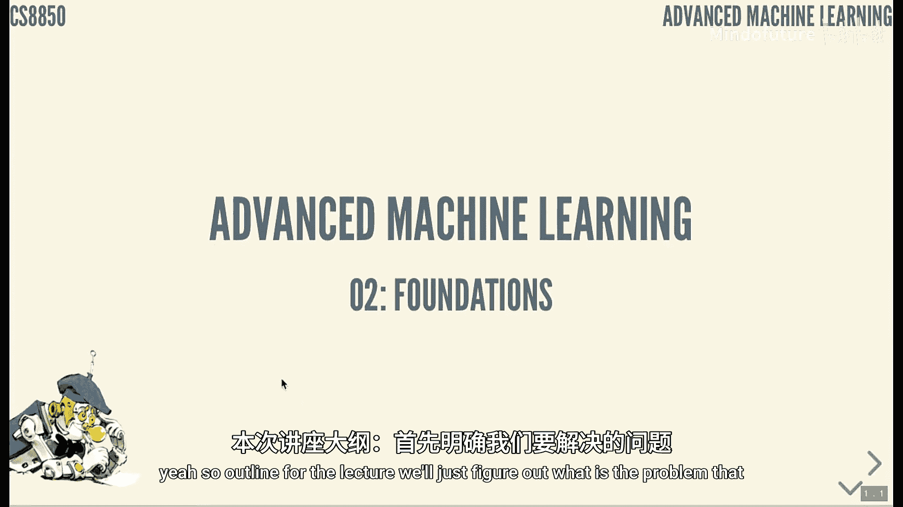
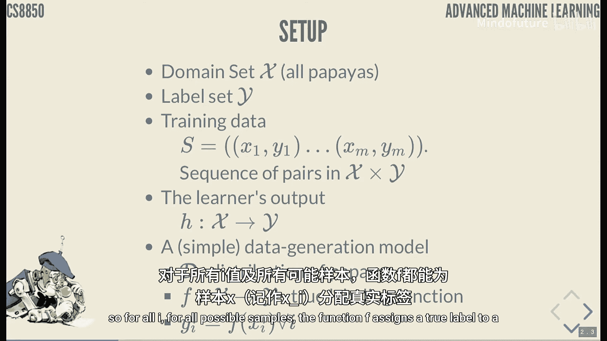
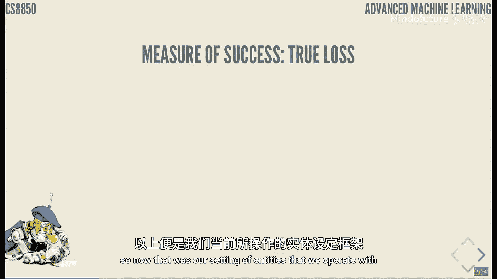
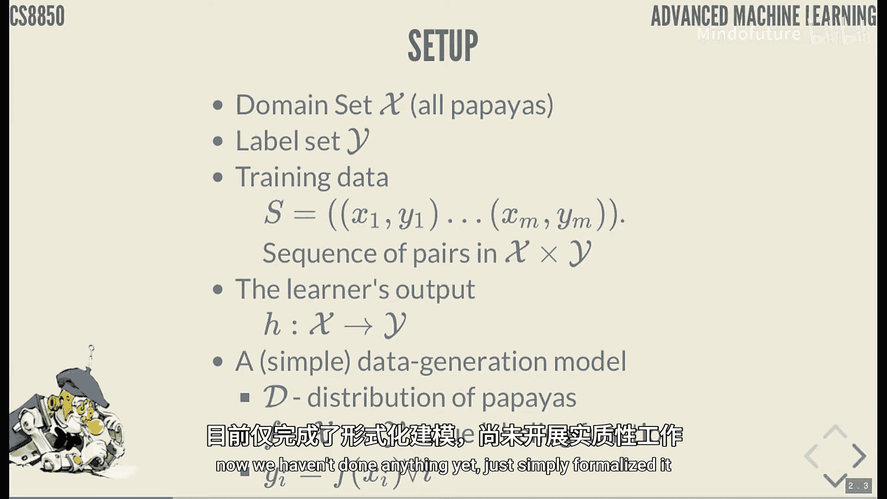
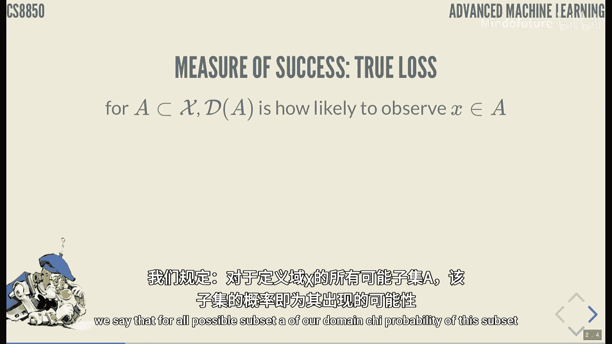
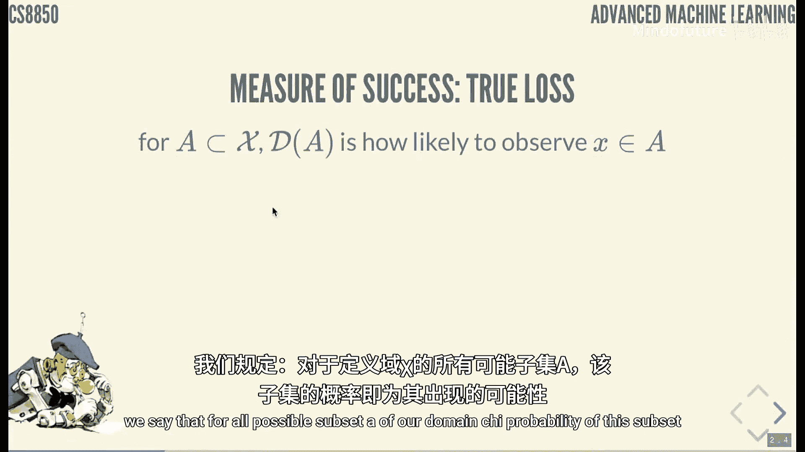
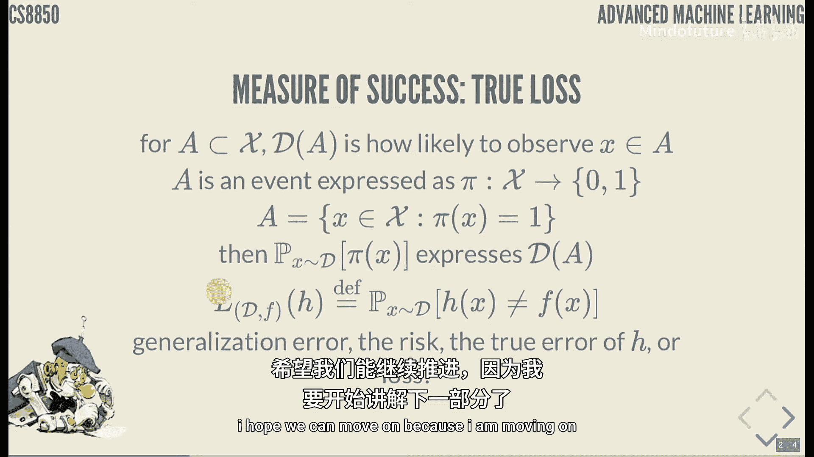
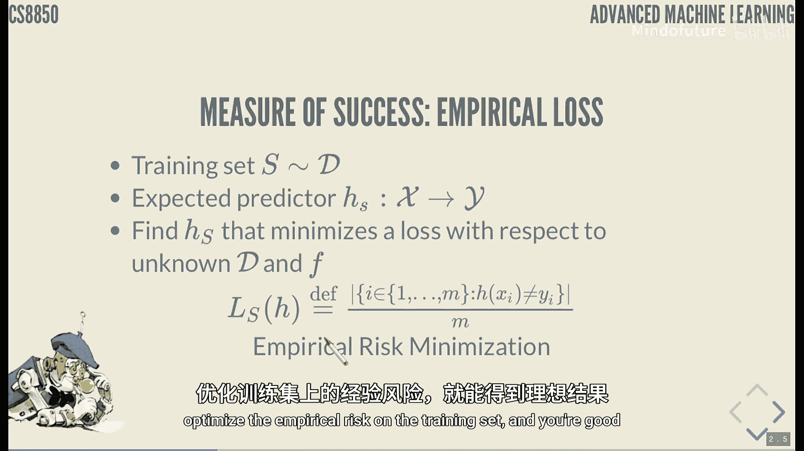
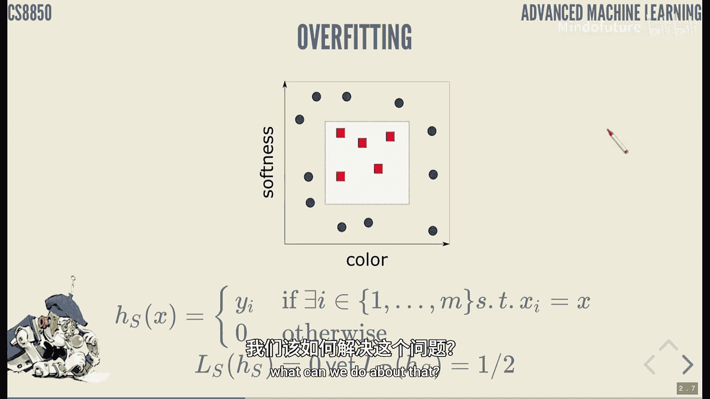

# 009：学习问题的形式化 🧠

在本节课中，我们将学习如何形式化一个机器学习问题。我们将从一个简单的例子出发，定义学习任务中的关键组成部分，并理解“真实损失”与“经验损失”的区别，以及为什么直接优化经验损失可能导致过拟合。

## 问题设定 🍈

想象你刚抵达一个太平洋小岛。你很快发现木瓜是当地饮食的重要食材。然而，你从未品尝过木瓜。你现在需要学习如何预测市场上看到的木瓜是否美味。

首先，你需要决定预测应基于木瓜的哪些特征。根据你之前对其他水果的经验，你决定使用两个特征来简化说明：**颜色**（从深绿到橙红再到深棕）和**软硬度**（从坚硬如石到软烂如泥）。

你的学习输入是一组你已经检查过颜色和软硬度、并品尝过以确定是否美味的木瓜样本。假设你尝试了大约10到15个木瓜。

## 任务分析 📝

我们的任务是学习一个木瓜分类器。通过分析这个任务，我们将看到学习理论的一些形式化概念。

### 形式化定义

以下是学习问题的数学形式化：

*   **域（Domain Set）**：记作 `X`。这是我们所有可能的数据样本（木瓜）的集合。
*   **标签集（Label Set）**：记作 `Y`。在我们的例子中，`Y = {0, 1}`，其中 `1` 代表美味，`0` 代表不美味。
*   **训练集（Training Data）**：记作 `S`。这是一个由 `m` 个样本-标签对组成的序列：`S = ((x1, y1), ..., (xm, ym))`。每个 `xi` 属于 `X`，每个 `yi` 属于 `Y`。
*   **学习器（Learner）**：这是一个算法或过程，其输入是训练集 `S`。
*   **假设/预测器/分类器（Hypothesis / Predictor / Classifier）**：记作 `h`。这是学习器的输出。它是一个从域 `X` 映射到标签集 `Y` 的函数：`h: X -> Y`。对于给定的木瓜特征 `x`，`h(x)` 预测其标签。
*   **数据生成模型（Data-Generation Model）**：我们假设数据由一个未知的分布 `D` 生成，并且存在一个未知的“真实标记函数” `f: X -> Y`，它能对任何可能的木瓜 `x` 给出绝对正确的标签 `f(x)`。

上一节我们介绍了学习问题的基本组成部分，本节中我们来看看如何衡量一个学习器的成功与否。

## 衡量成功：真实损失与经验损失 ⚖️

为了评估我们的分类器 `h` 的好坏，我们需要一个衡量标准。

### 真实损失（True Error / Generalization Error）

如果我们知道所有可能的数据和真实标记函数 `f`，我们可以定义 **真实损失** `L(D, f)(h)`。它衡量的是，当从分布 `D` 中随机抽取一个样本 `x` 时，我们的分类器 `h` 预测的标签 `h(x)` 与真实标签 `f(x)` 不同的概率。

用公式表示为：
`L(D, f)(h) = P(x ~ D)[h(x) ≠ f(x)]`

这个损失也称为泛化误差或风险。它是我们最终关心的指标，因为它反映了分类器在未知数据上的表现。

### 经验损失（Empirical Error）

然而，在现实中，我们无法获得全部数据，也不知道 `f` 和 `D`。我们只有有限的训练集 `S`。因此，我们只能计算在训练集 `S` 上的误差，即 **经验损失** `LS(h)`。

经验损失定义为分类器 `h` 在训练集 `S` 上犯错的样本比例：

`LS(h) = (1/m) * Σ_{i=1 to m} [h(xi) ≠ yi]`

其中 `[.]` 是指示函数（如果括号内条件为真则值为1，否则为0）。

一个自然的想法是：让学习器找到一个能在训练集 `S` 上最小化经验损失 `LS(h)` 的假设 `h`。这个过程称为 **经验风险最小化（Empirical Risk Minimization, ERM）**。

## 过拟合问题与归纳偏置 🚧

那么，直接进行经验风险最小化就足够了吗？让我们看一个例子。

假设所有美味的木瓜（标签为1）在特征空间（颜色 vs. 软硬度）中恰好落在一个正方形区域内，不美味的木瓜（标签为0）在区域外。这就是真实的 `f`。

现在我们收集了一个训练集 `S`，用蓝色方块（美味）和红色圆圈（不美味）表示。一个非常“灵活”的学习器可能会选择这样的分类器 `h`：**只有当新样本的特征与训练集中某个样本完全相同时，才输出该样本的标签；对于其他任何新样本，一律输出0**。

这个分类器在训练集 `S` 上的经验损失 `LS(h)` 是完美的 **0**。但是，它的真实损失 `L(D, f)(h)` 会非常高，因为它对所有不在训练集中出现的新样本（即使它们落在美味正方形内）都预测为0。这就是 **过拟合（Overfitting）**：分类器在训练数据上表现完美，但在未知数据上泛化能力很差。

为了解决过拟合，我们不能让学习器自由选择任何可能的函数 `h`。我们需要引入一些约束或偏好，引导学习器选择“更简单”或“更平滑”的假设。这种对假设空间的约束或偏好就称为 **归纳偏置（Inductive Bias）**。

例如，我们可能限制学习器只能选择“在特征空间中画一条直线（或一个矩形）来区分美味和不美味木瓜”的假设。这样，即使训练数据不是完美线性可分的，学习器也会找到一个在训练集上错误不太多、同时更可能泛化到新数据的假设。

## 总结 📚

本节课中我们一起学习了机器学习问题的形式化框架：
1.  我们定义了一个学习任务的核心要素：域 `X`、标签集 `Y`、训练集 `S`、学习器以及假设 `h`。
2.  我们区分了**真实损失**（在全部数据分布上的期望误差）和**经验损失**（在有限训练集上的观测误差）。
3.  我们了解到，直接最小化经验损失（ERM）可能导致**过拟合**，即模型记住了训练数据但未能捕捉潜在规律。
4.  为了解决过拟合，需要引入**归纳偏置**，即对学习器可以选择的假设类型施加合理的限制，以促进泛化。

理解这些基础概念是构建和评估有效机器学习模型的第一步。在接下来的课程中，我们将探讨如何设计具有良好归纳偏置的学习算法，并理论分析其泛化误差的边界。