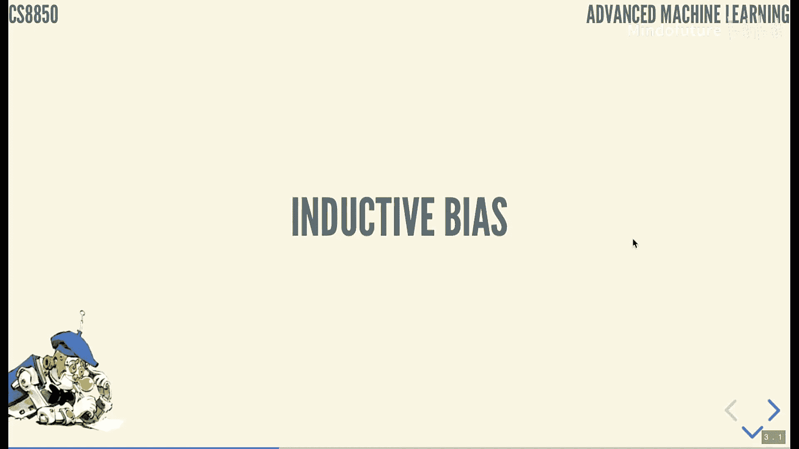
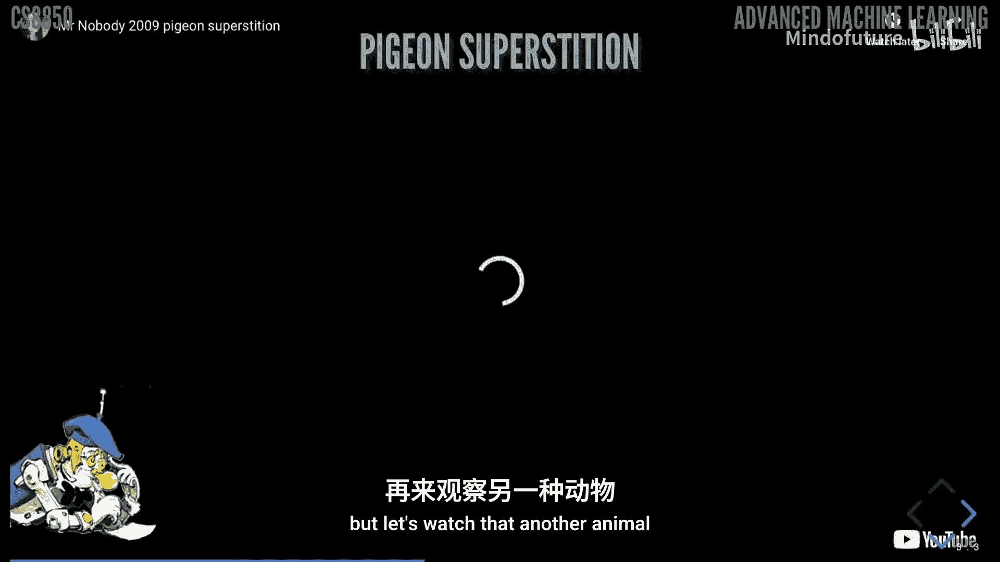
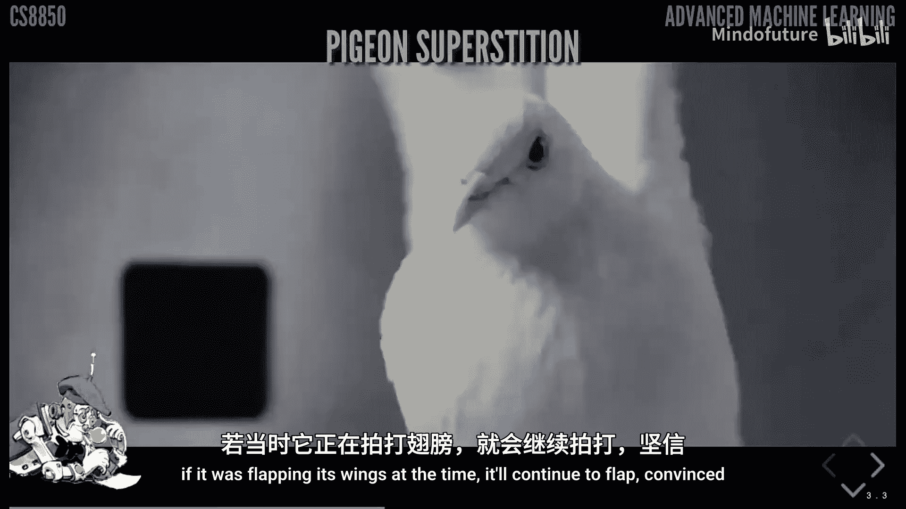
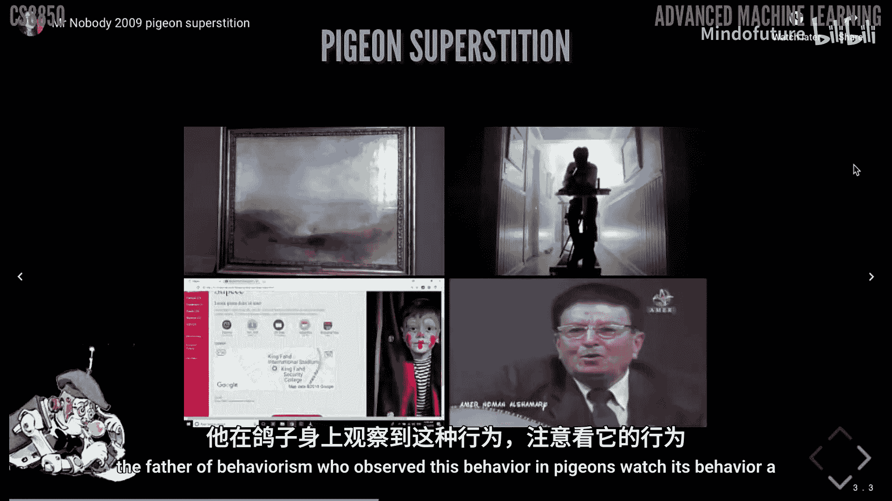
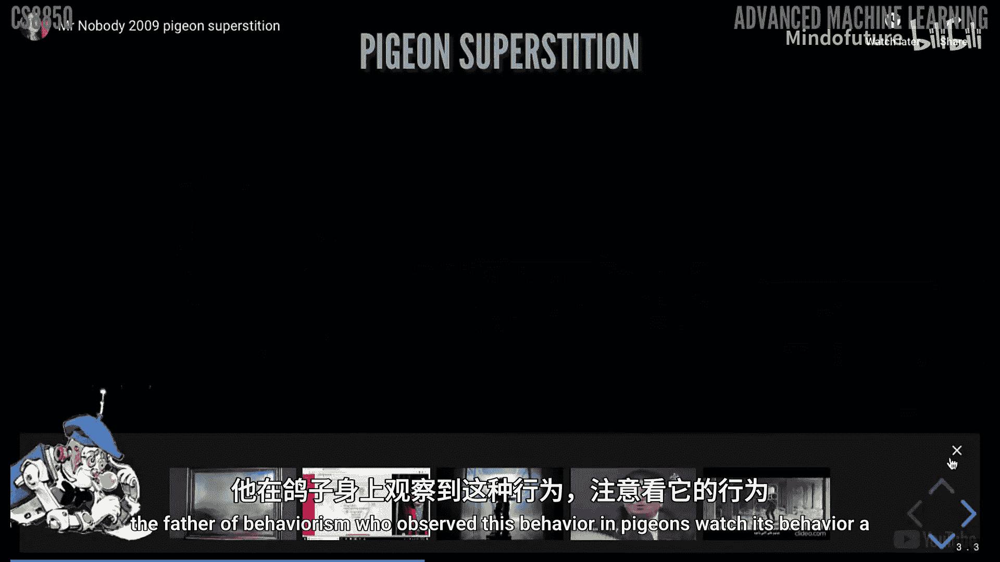
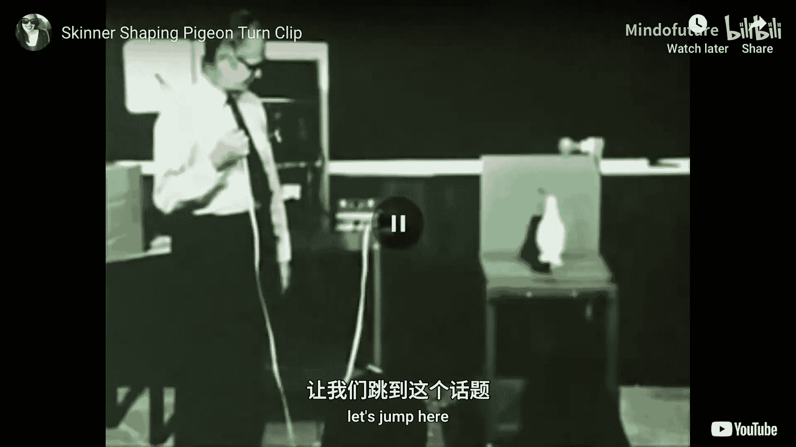
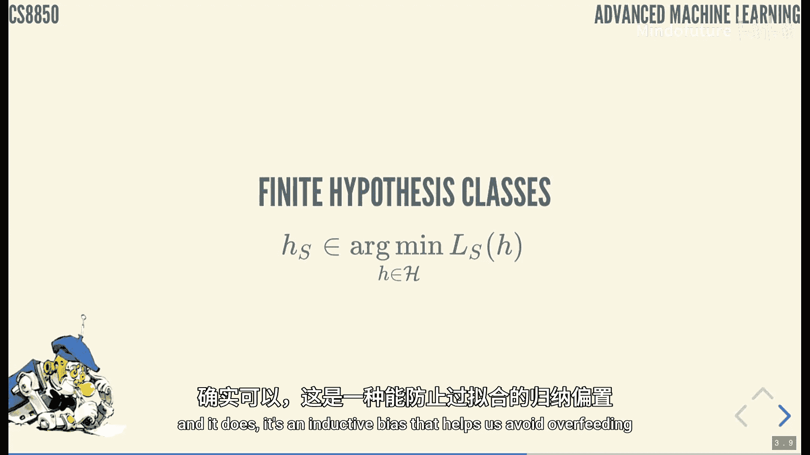

# 010：归纳偏置 🧠

在本节课中，我们将要学习一个核心概念——**归纳偏置**。我们将通过观察动物学习的行为来理解这个概念，并探讨如何在机器学习中应用归纳偏置来防止模型过拟合，从而提升其在未知数据上的表现。

## 什么是归纳偏置？

让我们从一些例子开始。有一种现象叫做“**味觉厌恶**”，在老鼠身上被观察到。我们正在构建学习器，关注动物或其他成功学习者的学习方式是有益的。根据维基百科，学习能力目前仅被人类和动物所证实。

当老鼠遇到一种新食物时，它会先尝试一点点，然后观察自身反应，比如是否会感到恶心或不适。如果感觉不好，它就再也不会碰那种食物了。这里存在一个试错学习过程。在开始大量进食前，它们通过先尝试少量来避免被坏食物毒害。

## 动物学习中的归纳推理

大多数生物都存在类似的学习行为。例如，鸽子能快速将按压杠杆与获得食物联系起来。但如果一个计时器每20秒自动释放一粒种子，鸽子就会开始疑惑：“我做了什么才得到了这个？”如果它当时正在拍打翅膀，它就会继续拍打，坚信自己的动作对结果有决定性影响。我们称之为“**鸽子迷信**”。

所以，老鼠尝试一点食物，然后对食物做出结论。鸽子（在这个实验中）也在尝试。它们也努力获取食物，但它们更多地是观察，而非主动尝试（尽管它们也会，它们是聪明的鸟）。关键点在于，这两种动物——老鼠和鸽子——都实践着一种叫做**归纳推理**的思维过程。

归纳推理类似于数学归纳法：从小的、局部的观察出发，假设情况不会发生进一步变化，从而得出普遍结论。老鼠的归纳推理是：如果尝试食物后感觉不好，它们就假设这类食物永远对它们有害。反之，如果食物美味无害，它们就认为这种食物永远是好吃的。鸽子的故事略有不同：它们会越来越多地重复在好事发生时所做的动作，试图强化这种关联。

## 行为塑造与条件反射

让我们切换到行为主义之父斯金纳观察鸽子行为的另一个视频。通过**即时强化**（例如给予食物奖励），可以塑造鸽子的行为，让它完成特定的动作，比如转圈。关键在于，通过立即添加某种条件或强化，可以让鸟学会有趣的把戏或行为。

那么，老鼠的迷信和条件反射呢？我们能否在它们尝试食物时电击它们，让它们不喜欢并避开那种食物？是的，实验室里可以进行各种负向条件反射实验。但研究人员观察到，只有当老鼠出现类似食物中毒的问题（如恶心）时，它们才会将食物与中毒负面关联起来。否则，即使研究人员对它们施加了不好的刺激，它们也会继续吃。这很有趣：鸽子容易“过拟合”（迷信无关动作），而老鼠在这个特定例子中却不会。

## 机器学习中的归纳偏置

那么，我们能从这两种动物身上学到什么？具体来说，能从老鼠身上学到什么？在我们的机器学习模型中，我们希望学习器不要对假设或分类器“过拟合”。一个解决方案，也是我们今天要考虑的方案，是**在受限的假设空间中进行搜索**。

我们将预先选择一个**假设类**。不是让学习器选择任何可能的最小化经验风险的分类器，而是规定：只能从这个特定的类别中选择一个预测器 `h`，使其最小化经验风险。

**公式：** `h* = argmin_{h ∈ H} R_emp(h)`

通过这种方式，我们引入了**归纳偏置**，将学习器限制在特定的预测器集合中。我们希望学习器学习到的预测器，在未见过的样本上能有更好的推理表现，这就是它被称为“偏置”的原因。

当然，还有其他形式的归纳偏置：
*   **最大条件独立性**：在贝叶斯框架中，尝试最大化条件独立性。朴素贝叶斯分类器就使用了这种偏置，我们将在本课程中涵盖。
*   **最小交叉验证误差**：这也是一种归纳偏置。
*   **最大间隔**：另一种归纳偏置，我们同样会在本课程中学习。
*   **最小描述长度**：可能是一种归纳偏置，类似于奥卡姆剃刀原理。
*   **最小特征数**：例如在特征选择中。
*   **最近邻**：k-近邻算法也隐含了一种归纳偏置。

目前，我们只需知道，**有限的假设类**将帮助我们避免过拟合。它是一种帮助我们避免过拟合的归纳偏置。

## 总结

本节课中，我们一起学习了**归纳偏置**的概念。我们通过老鼠和鸽子的学习行为，理解了归纳推理在生物学习中的作用。在机器学习中，归纳偏置是通过**限制模型的假设空间**（例如选择一个特定的假设类 `H`）来引入的，其核心目的是**防止过拟合**，引导模型学习到更具泛化能力的规律。除了有限假设空间，还有许多其他形式的归纳偏置（如最大间隔、条件独立性等），它们共同构成了机器学习算法设计中的重要指导思想。