# 011：我们能否限制错误概率？🔬

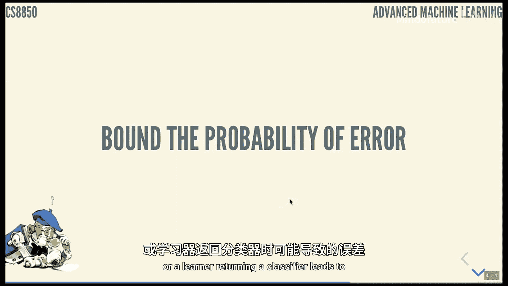

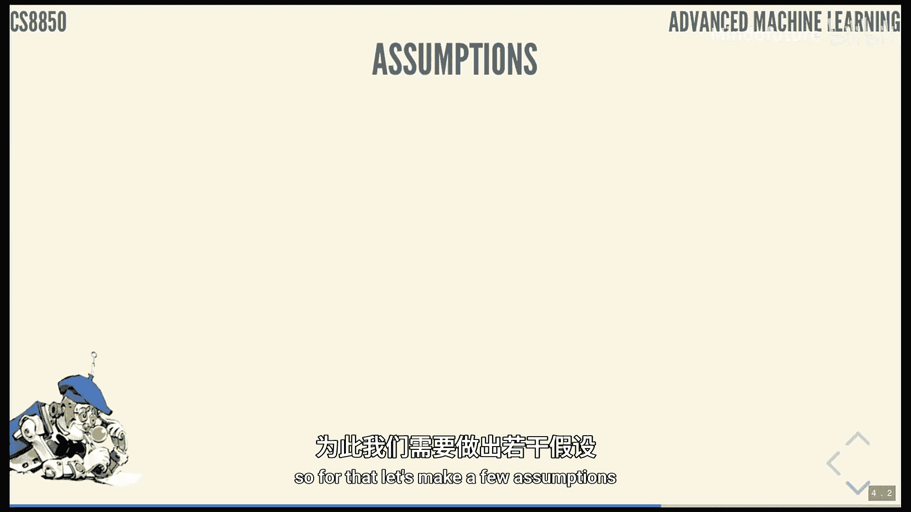

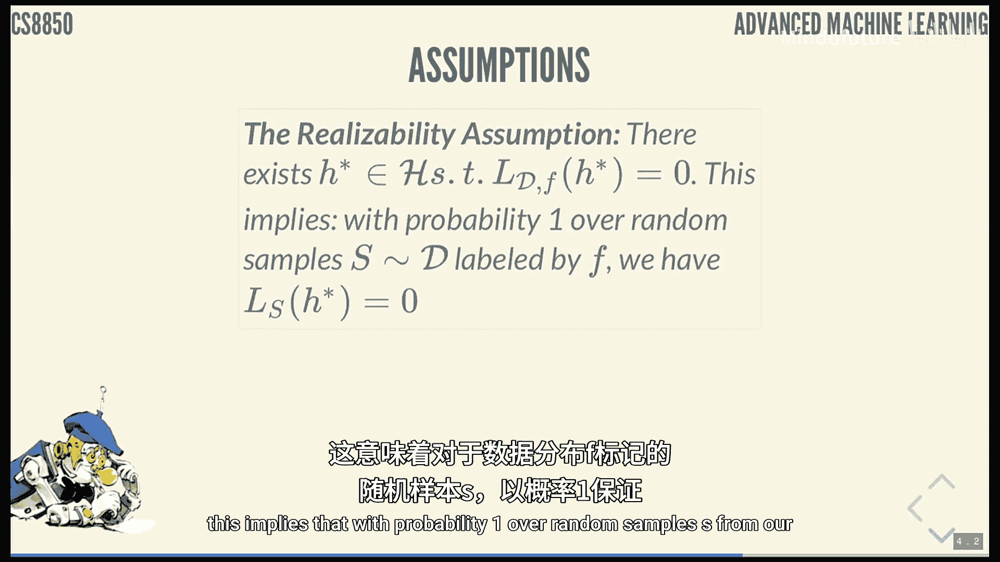

在本节课中，我们将探讨一个核心问题：在机器学习中，我们能否从理论上限制分类器的错误概率？我们将基于已建立的损失函数、归纳偏置和有限分类器集合等概念，推导出一个关键的概率上界。

---

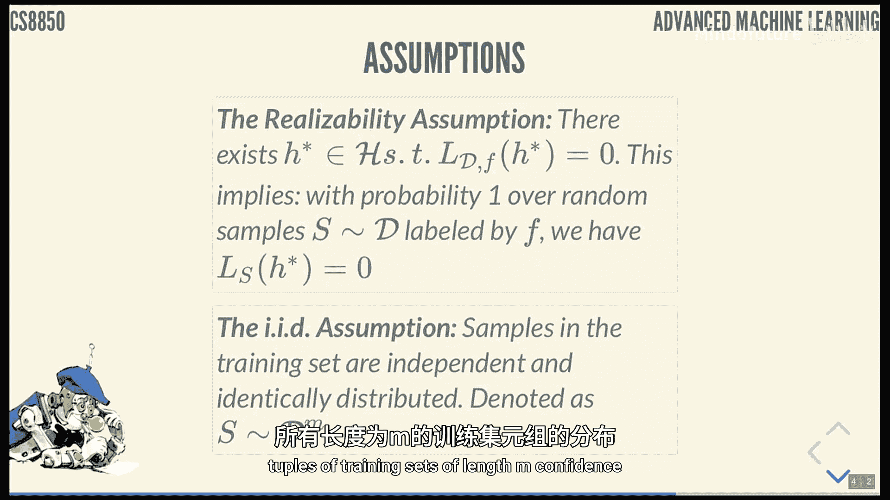

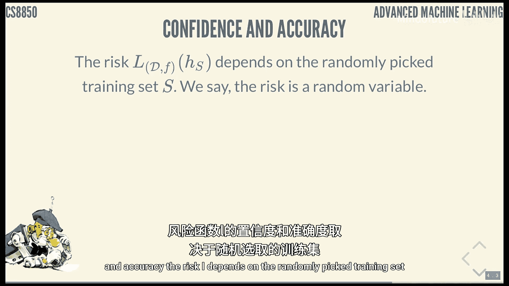

上一节我们介绍了学习问题的基本框架。本节中，我们来看如何为分类器的错误概率建立一个理论边界。为此，我们需要引入两个关键假设。

### 核心假设

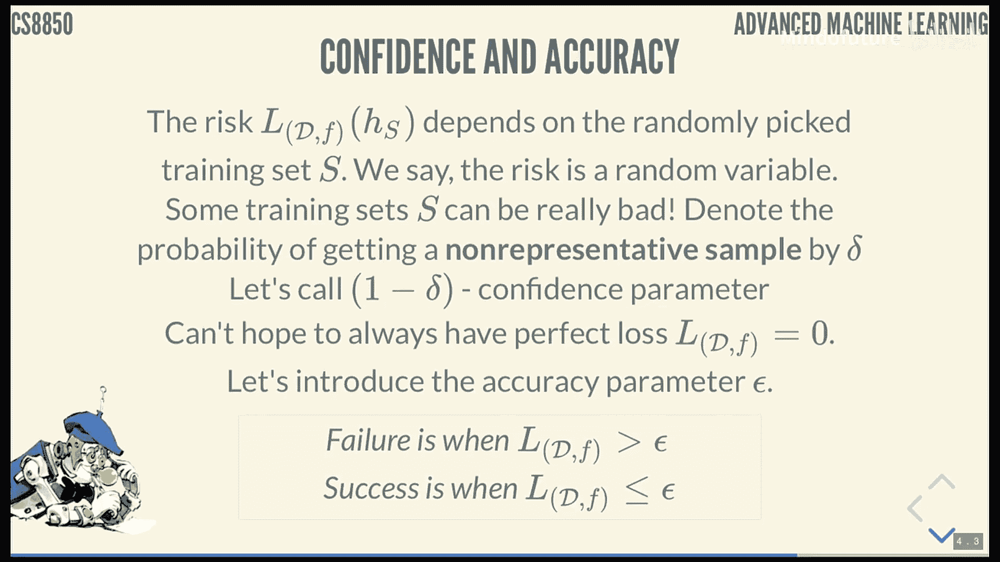

以下是推导所需的基本假设：

1.  **可实现性假设**：我们假设在有限的可能分类器集合 **H** 中，存在一个最优分类器 **h***，其真实损失为零。这意味着，对于从数据分布 **D** 中采样的、由真实标记函数 **f** 标记的样本，有 **L(h*) = 0**。这保证了在我们的假设类中存在一个完美的解。

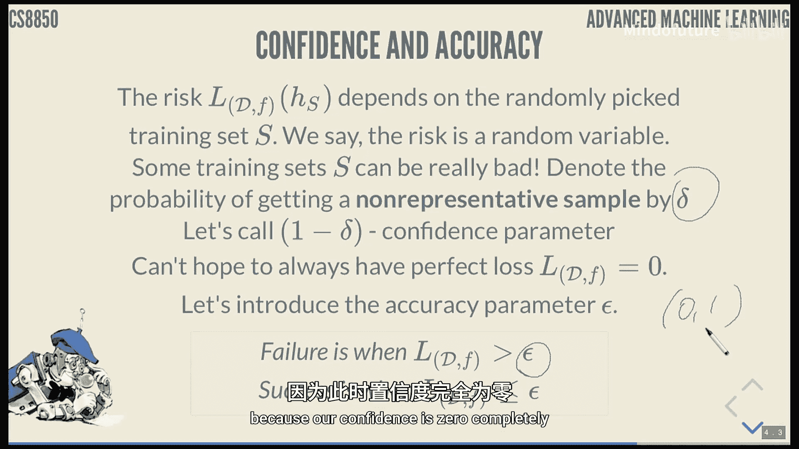

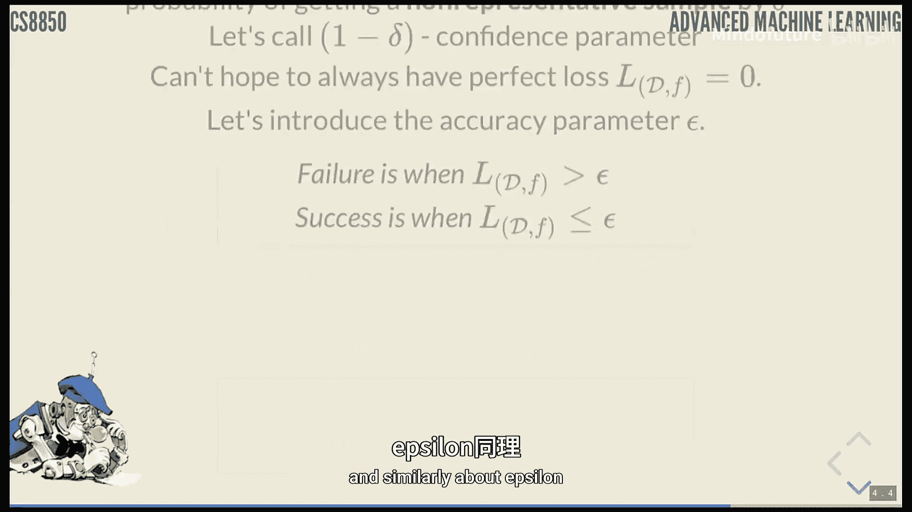

2.  **独立同分布假设**：训练集中的样本是独立同分布的。我们记训练集 **S** 是从分布 **D** 中独立采样 **m** 次得到的，即 **S ~ D^m**。

### 置信度与精度参数

由于风险 **L** 依赖于随机采样的训练集 **S**，它是一个随机变量。有些训练集可能不具有代表性（“坏”样本）。为此，我们引入两个参数：

*   **置信度参数 Δ**：我们以 **1 - Δ** 的概率确信能够从训练集中学到一个好的分类器。**Δ** 代表了得到“坏”训练数据（导致学习失败）的概率。
*   **精度参数 ε**：这是我们能容忍的错误上限。当损失 **L** 小于等于 **ε** 时，我们认为学习是成功的；当损失大于 **ε** 时，则认为失败。

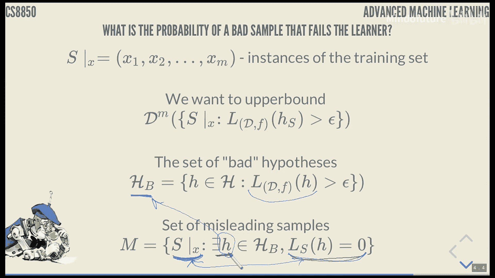

**Δ** 和 **ε** 都在区间 **(0, 1)** 内。

### 定义“坏”的集合

我们的目标是上界化得到一个“坏”训练集的概率，即导致学习到的分类器损失 **L > ε** 的训练集。

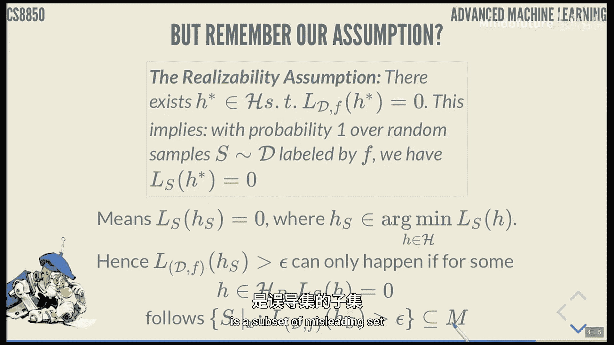

首先，定义“坏”假设的集合 **H_bad**：
**H_bad = { h ∈ H | L(h) > ε }**

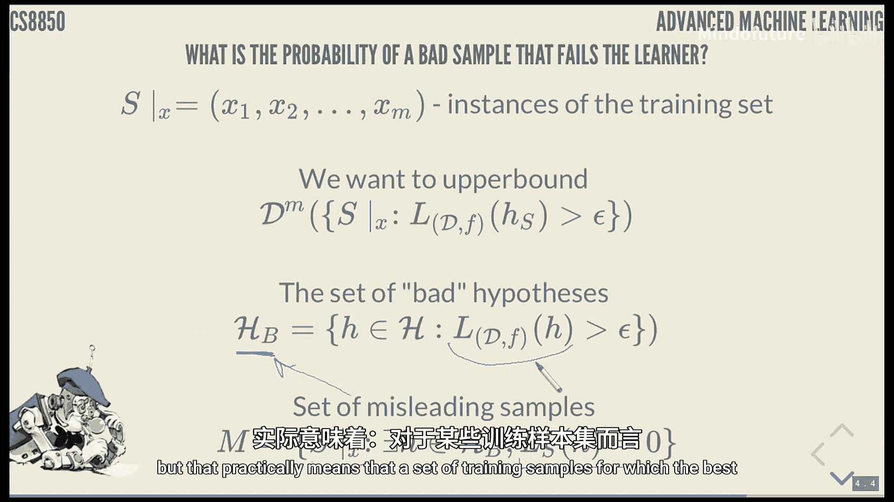

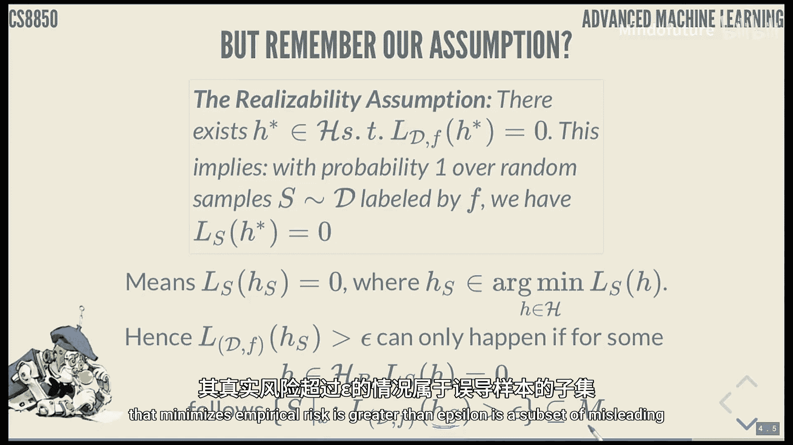

接着，定义“误导性”样本集 **M**。一个训练集 **S** 是误导性的，如果存在一个“坏”假设 **h ∈ H_bad**，但在 **S** 上的经验损失却为零：
**M = { S | ∃ h ∈ H_bad, L_S(h) = 0 }**

根据可实现性假设，存在一个 **h*** 使得 **L_S(h*) = 0**。因此，如果我们的学习算法（例如经验风险最小化）选择了一个假设，其经验损失为零但真实损失却 **> ε**，那么这个假设必然属于 **H_bad**，且其训练集 **S** 必然属于 **M**。

由此可得一个关键关系：导致失败（**L > ε**）的训练集集合，是误导性样本集 **M** 的一个子集。

### 推导概率上界

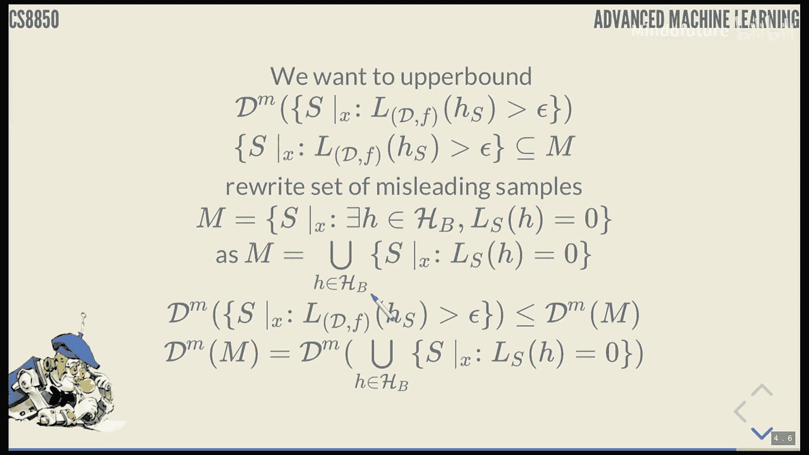

我们希望上界化 **P( L > ε )**。根据上述关系，有：
**P( L > ε ) ≤ P( M )**

现在，我们将 **M** 重写为所有“坏”假设对应的零经验损失事件之并集：
**M = ∪_{h ∈ H_bad} { S | L_S(h) = 0 }**

应用**并集上界**，可得：
**P( M ) ≤ Σ_{h ∈ H_bad} P( L_S(h) = 0 )**

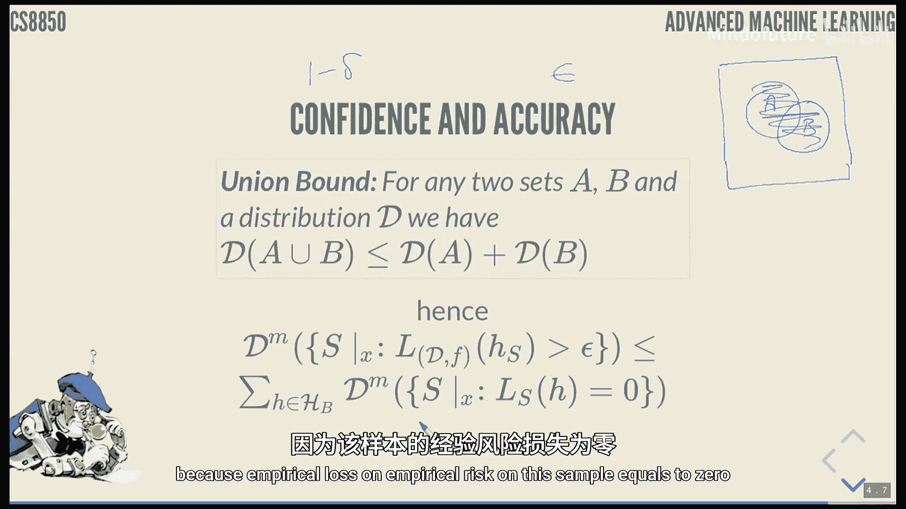

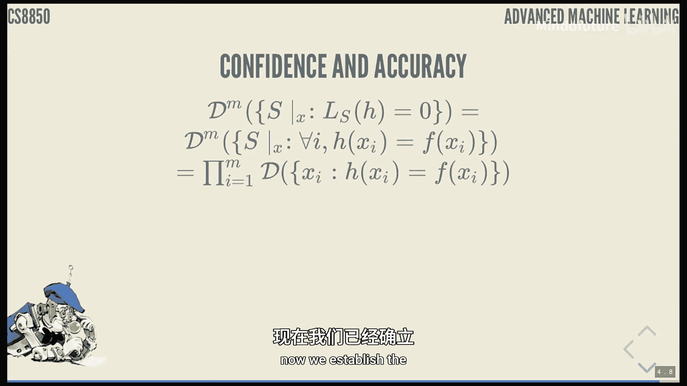

对于某个固定的“坏”假设 **h ∈ H_bad**，其经验损失为零的概率为：
**P( L_S(h) = 0 ) = P( ∀ i ∈ [m], h(x_i) = f(x_i) )**

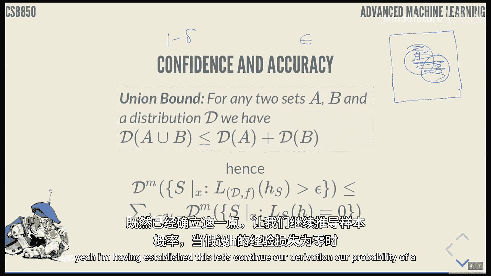

由于样本是独立同分布的，这个联合概率等于每个样本上概率的乘积：
**P( L_S(h) = 0 ) = Π_{i=1}^m P( h(x_i) = f(x_i) )**

对于“坏”假设 **h**，其预测正确的概率为 **1 - L(h)**。因为 **L(h) > ε**，所以 **1 - L(h) < 1 - ε**。因此：
**P( L_S(h) = 0 ) ≤ (1 - ε)^m**

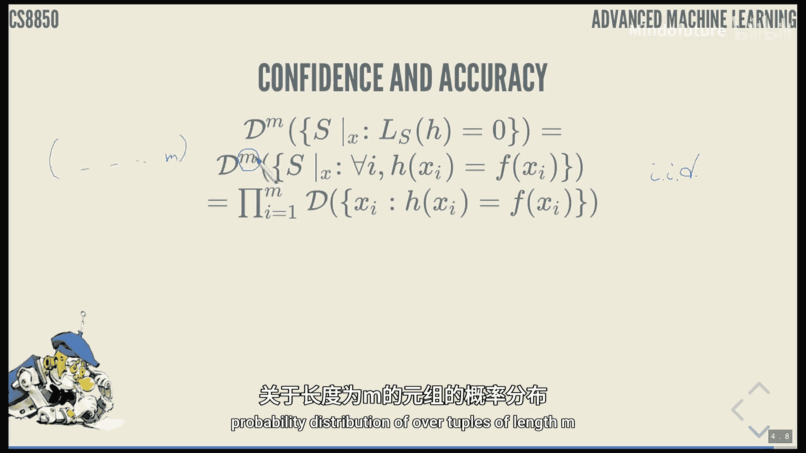

利用不等式 **1 - ε ≤ e^{-ε}**，我们可以得到一个更紧凑的上界：
**P( L_S(h) = 0 ) ≤ e^{-ε m}**

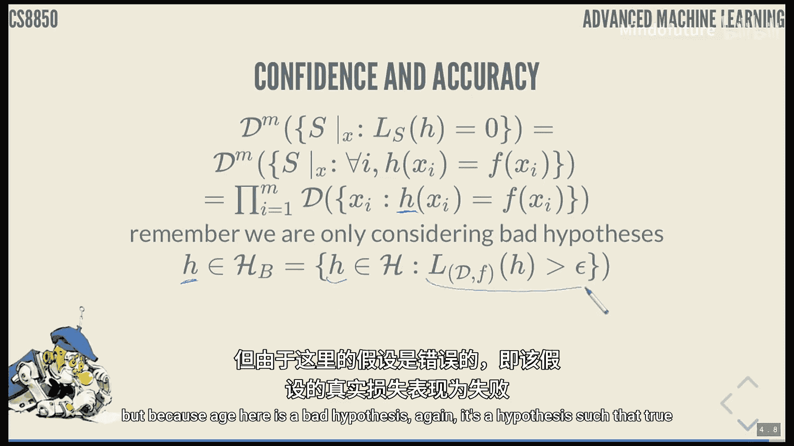

### 最终定理

将上述结果代回并集上界，并注意到假设类 **H** 的大小为 **|H|**，而 **H_bad** 是 **H** 的子集，我们得到最终的**概率上界**：

**P( L > ε ) ≤ |H| * e^{-ε m}**

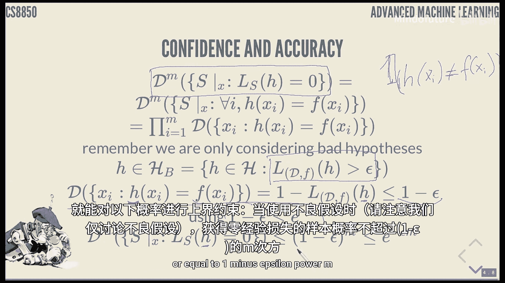

这个公式就是著名的**可学习性边界**（在有限假设类且满足可实现性假设下）。它表明，失败的概率被假设类的大小 **|H|**、我们期望的精度 **ε** 以及训练样本数量 **m** 所控制。

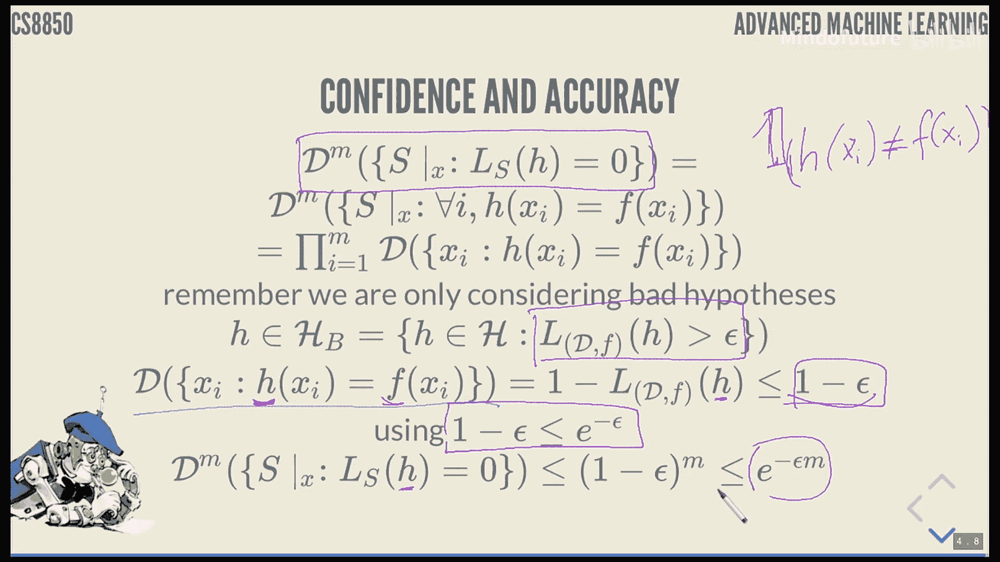

---

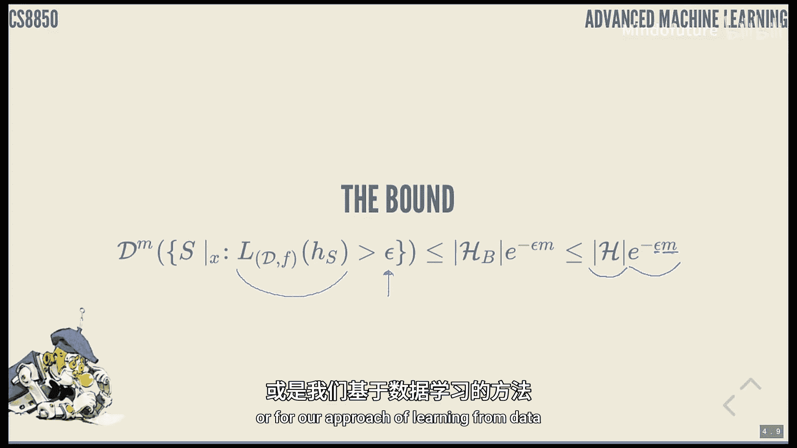

本节课中我们一起学习了如何为机器学习分类器的错误概率建立理论边界。我们引入了可实现性和独立同分布假设，定义了置信度与精度参数，并通过分析“坏”假设与“误导性”样本集的关系，最终推导出了关键的不等式：**P( L > ε ) ≤ |H| * e^{-ε m}**。这个边界清晰地展示了假设空间复杂度、样本数量与学习效果可靠性之间的权衡关系。在下一讲中，我们将探讨这个边界的重要性，以及如何利用它来指导我们从数据中学习模型。