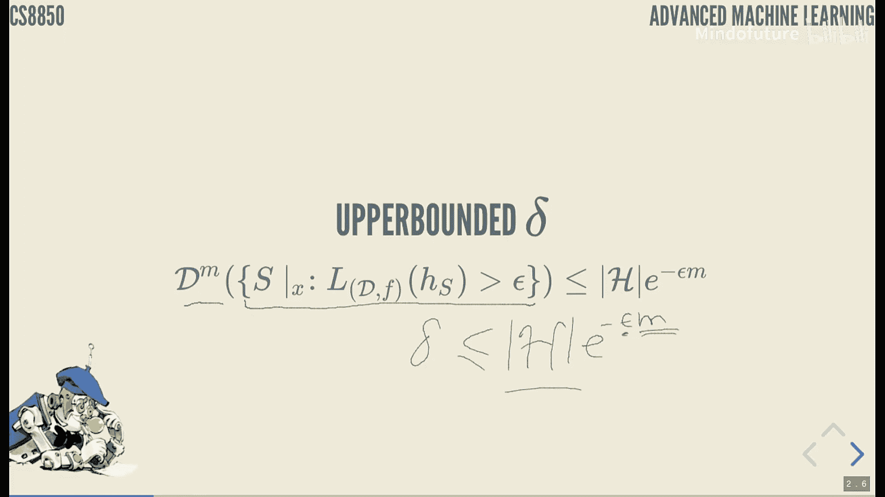

# 012：P12_讲座2的主要定义

在本节课中，我们将继续形式化学习问题。我们将介绍PAC学习模型，并探讨通过一致收敛进行学习的方法。

## 回顾基础 🧠

上一节我们形式化了学习问题。现在，我们来快速回顾一下上一讲的主要内容。

学习问题的设定包含以下核心概念：
*   **输入空间**：记作 `X`，是所有可能数据样本的集合。
*   **标签集**：记作 `Y`，是所有可能标签的集合，例如 `{0, 1}` 或 `{-1, +1}`。
*   **训练数据**：记作 `S`，是一个由 `m` 个样本-标签对组成的序列，即 `S = ((x_1, y_1), ..., (x_m, y_m))`，其中 `(x_i, y_i) ∈ X × Y`。
*   **学习器**：是我们的学习算法，它接收训练数据 `S` 并输出一个**假设** `h`。这个假设是一个函数（分类器或预测器），可以对新的输入 `x` 预测其标签 `h(x)`。
*   **数据生成模型**：我们假设存在一个数据分布 `D` 和一个未知的**真实标记函数** `f: X -> Y`。数据样本 `x` 由 `D` 生成，其真实标签为 `f(x)`。
*   **泛化误差**：记作 `L_D(h)`，是假设 `h` 相对于真实数据分布 `D` 和真实函数 `f` 的误差。其定义为 `L_D(h) = Pr_{x~D}[h(x) ≠ f(x)]`。
*   **经验误差**：记作 `L_S(h)`，是假设 `h` 在训练集 `S` 上的误差。其定义为 `L_S(h) = (1/m) * Σ_{i=1}^{m} 1_{h(x_i) ≠ y_i}`。

我们的目标是找到一个假设 `h`，使其泛化误差 `L_D(h)` 尽可能小。然而，我们只能直接计算和最小化经验误差 `L_S(h)`，这个过程称为**经验风险最小化**。

## 过拟合与假设 🎯

上一节我们还讨论了过拟合现象。过拟合是指学习器在训练集上表现完美（经验误差很低），但在新数据上表现不佳（泛化误差很高）。

为了应对过拟合并确保学习是可能的，我们引入了两个关键假设：
1.  **可实现性假设**：我们假设在假设集合 `H` 中存在一个完美的假设 `h*`，其泛化误差为零，即 `L_D(h*) = 0`。这意味着学习问题本身有解。
2.  **独立同分布假设**：训练集中的所有样本都是独立地从同一个数据分布 `D` 中抽取的。

此外，我们引入了两个参数来量化学习目标：
*   **精度参数 `ε`**：表示我们可接受的误差上限。我们希望学习到的假设 `h` 满足 `L_D(h) ≤ ε`。
*   **置信参数 `δ`**：表示算法失败（即输出一个泛化误差大于 `ε` 的假设）的概率上限。我们希望这个概率不超过 `δ`。

上一讲的结论是，获得非代表性样本（即导致学习失败）的概率 `δ`，其上界与假设集合的大小 `|H|`、样本数量 `m` 以及精度参数 `ε` 有关。

## 引入PAC学习模型 📚

基于以上回顾，本节我们将正式引入**可能近似正确**学习模型。

PAC学习模型为我们提供了一个严格的框架，用以衡量一个学习算法在概率意义下能否成功找到一个近似正确的假设。具体来说，一个算法是PAC可学习的，如果对于任意分布 `D` 和任意目标概念 `f`（在可实现性假设下），该算法能够以高概率（至少 `1 - δ`）输出一个假设 `h`，使得其泛化误差 `L_D(h)` 小于等于 `ε`。

以下是PAC学习的关键要素：
*   **样本复杂度**：为了达到 `(ε, δ)` 的保证，算法所需的最小训练样本数 `m`。
*   **计算效率**：算法在多项式时间内运行的能力。
*   **假设类**：算法从中选择假设的集合 `H`。`H` 的大小和复杂度直接影响学习的难度。

## 通过一致收敛进行学习 🔄

上一节我们介绍了经验风险最小化，但如何保证最小化经验风险能得到泛化性能好的假设呢？本节我们来看看**一致收敛**的概念。

一致收敛是指，当训练样本足够多时，**所有**假设 `h ∈ H` 的经验误差 `L_S(h)` 都会以高概率接近其真实泛化误差 `L_D(h)`。如果一致收敛成立，那么最小化经验误差的假设，其泛化误差也必然接近最优。

以下是保证一致收敛的条件：
*   **有限假设空间**：当假设集合 `H` 的大小有限时，我们可以推导出样本复杂度 `m` 的一个上界，该上界保证了对于给定的 `(ε, δ)`，一致收敛以高概率发生。
*   **霍夫丁不等式**：这是推导上述样本复杂度上界的核心概率工具。它描述了独立随机变量之和与其期望值偏差的概率界限。

利用一致收敛，我们可以证明，在有限假设空间且满足可实现性假设的条件下，经验风险最小化算法是一个PAC学习算法。

## 总结与展望 🏁

本节课我们一起学习了机器学习理论的基础。我们首先回顾了学习问题的形式化定义，包括输入空间、标签集、训练数据、学习器、泛化误差和经验误差等核心概念。

接着，我们探讨了过拟合问题，并引入了可实现性假设和独立同分布假设作为学习可行的前提。在此基础上，我们正式定义了PAC学习模型，该模型用精度参数 `ε` 和置信参数 `δ` 来量化学习算法的成功标准。

最后，我们介绍了通过一致收敛来保证学习理论可靠性的思路。当假设空间有限时，足够多的训练样本可以确保所有假设的经验误差都接近其泛化误差，从而使经验风险最小化成为一个有效的PAC学习策略。

在接下来的课程中，我们将探讨当假设空间无限时，如何利用如VC维等更复杂的工具来分析学习问题。