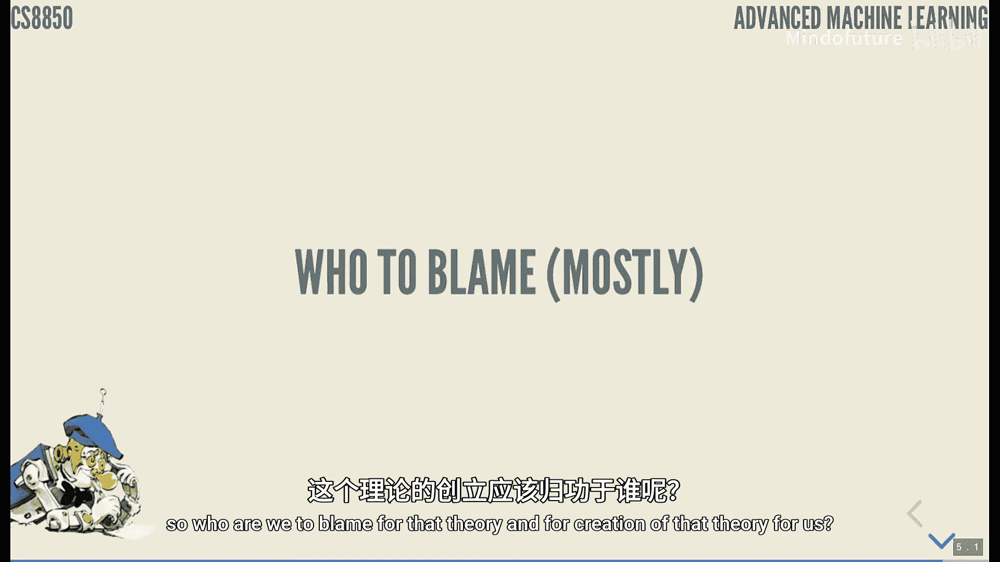
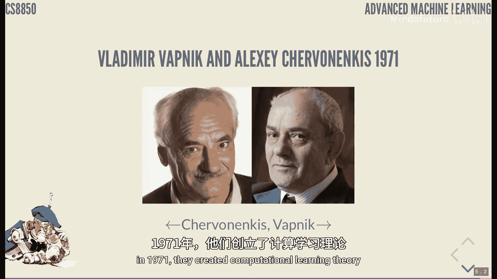

# 013：通过一致收敛学习

在本节课中，我们将学习一个称为“一致收敛”或“通过一致收敛学习”的重要工具。我们将了解如何确保经验风险是真实风险的良好近似，从而证明一个假设类是可学习的。

上一节我们介绍了有限假设类的可学习性，以及如何在更一般的损失函数下定义不可知PAC可学习类。本节中，我们来看看如何通过“一致收敛”这一通用工具来确保学习算法的有效性。

我们接收一个训练集 `S`。因为我们的假设类 `H` 是有限的，所以我们可以通过**暴力枚举**简单地遍历假设集中的所有可能假设 `h`，评估其经验损失，并返回使经验损失最小化的那个假设 `h`。原则上，我们希望经验损失的最小化器同时也是真实损失的最小化器，或者至少与之接近。

非正式地说，这相当于证明：对于有限假设类中的所有假设，其经验风险都是真实风险的良好近似。如果我们能证明这一点，那么我们就知道这个类是**可学习**的。

## 定义：ε-代表性样本

以下是ε-代表性样本的正式定义。

一个训练集 `S` 被称为关于域 `Z`、有限假设集 `H`、广义损失函数 `L` 和数据分布 `D` 的 **ε-代表性样本**，如果对于假设集 `H` 中的所有假设 `h`，其经验损失与真实损失之差的绝对值小于等于 ε。

用公式表示如下：
```
对于所有 h ∈ H， | L_S(h) - L_D(h) | ≤ ε
```

## 从代表性到可学习性

现在，假设我们的训练集 `S` 是 **(ε/2)-代表性** 的。那么，在该训练集 `S` 上输出的**经验风险最小化**解（记作 `h_S`）满足以下不等式：

```
L_D(h_S) ≤ min_{h' ∈ H} L_D(h') + ε
```

这正是**不可知PAC可学习性**的定义。我们来证明一下。

**证明**：
根据 (ε/2)-代表性样本的定义，对于所有 `h ∈ H`，有：
```
| L_S(h) - L_D(h) | ≤ ε/2
```
这意味着：
```
L_D(h) - ε/2 ≤ L_S(h) ≤ L_D(h) + ε/2
    (1)
```
令 `h*` 为真实损失的最小化器，即 `h* = argmin_{h ∈ H} L_D(h)`。
令 `h_S` 为经验损失的最小化器，即 `h_S = argmin_{h ∈ H} L_S(h)`。

根据不等式(1)，对于 `h_S` 有：
```
L_D(h_S) ≤ L_S(h_S) + ε/2
    (2)
```
因为 `h_S` 最小化了经验损失，所以对于任意 `h`（包括 `h*`），有 `L_S(h_S) ≤ L_S(h)`。特别地：
```
L_S(h_S) ≤ L_S(h*)
    (3)
```
再次根据不等式(1)，对于 `h*` 有：
```
L_S(h*) ≤ L_D(h*) + ε/2
    (4)
```
现在，将 (3) 和 (4) 串联起来：
```
L_S(h_S) ≤ L_S(h*) ≤ L_D(h*) + ε/2
```
再将此结果代入 (2)：
```
L_D(h_S) ≤ [L_D(h*) + ε/2] + ε/2 = L_D(h*) + ε
```
因此，我们证明了：
```
L_D(h_S) ≤ min_{h' ∈ H} L_D(h') + ε
```
证毕。

## 核心结论

为了确保经验风险最小化规则是一个**不可知PAC学习器**，只需证明：在随机选择训练集时，以至少 `1 - δ` 的概率，该训练集将是一个 **ε-代表性** 训练集。这为我们提供了一种证明可学习性的有力工具。

以上是对PAC可学习性和不可知PAC可学习性理论的简要介绍。

## 理论奠基者



以下是该理论的主要奠基人。



*   **弗拉基米尔·瓦普尼克** 和 **阿列克谢·切尔沃年基斯** 于1971年创立了计算学习理论。
*   **莱斯利·瓦利安特** 于1994年提出了PAC可学习性的精确定义，为可学习假设类提供了严格的数学框架。他因此在2010年获得了图灵奖（计算机科学的诺贝尔奖）。


本节课中，我们一起学习了“一致收敛”的概念，理解了如何通过确保训练集的ε-代表性来证明经验风险最小化的有效性，从而论证一个假设类的PAC可学习性。我们还简要回顾了该理论的发展历程。希望你对本节课的内容有了清晰的认识。