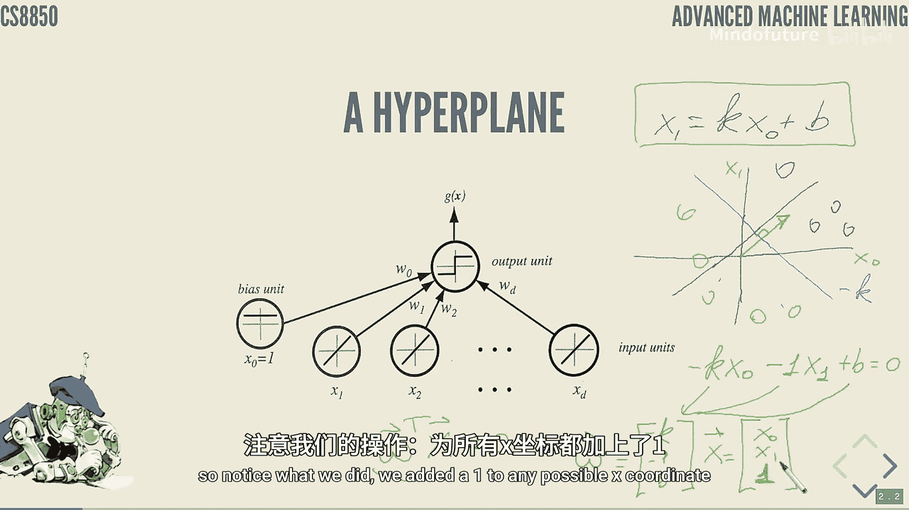
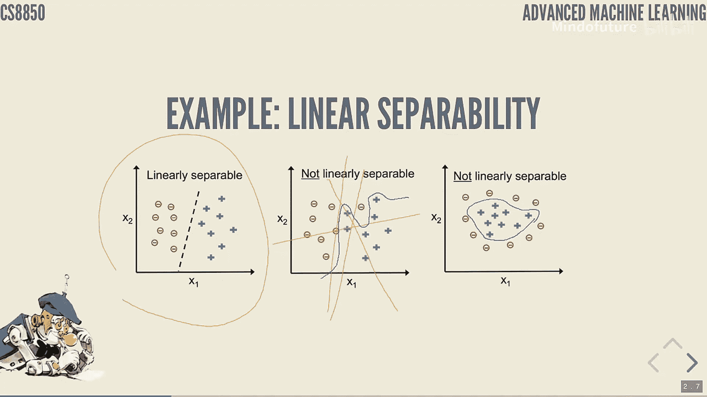

# 014：线性决策边界 👨‍🏫

在本节课中，我们将学习线性模型的核心概念，特别是线性决策边界。我们将从线性可分性的基本几何原理开始，介绍感知机这一经典算法，并探讨其在可分与不可分情况下的应用。

---

## 线性决策边界的几何原理 📐

上一节我们概述了课程内容，本节中我们来看看线性决策边界的数学基础。

一条在二维空间中的直线，通常可以用斜率加截距的形式表示：
`y = m*x + b`

为了将其推广到更高维度并简化表示，我们进行一个巧妙的变换。我们引入一个额外的常数维度，将数据点 `x` 表示为 `[x0, x1, 1]`，将参数 `w` 表示为 `[w0, w1, b]`。这样，直线方程可以重写为向量内积的形式：
`w^T * x = 0`

这个方程定义了一个超平面。其中，向量 `w` 被称为该超平面的**法向量**，它垂直于超平面本身。当数据点 `x` 满足 `w^T * x = 0` 时，该点位于超平面上。

通过增加一个恒为1的维度，我们将原始的截距 `b` 吸收进了参数向量 `w` 中。这使得超平面方程变得统一且优雅，无论维度如何，形式始终是 `w^T * x = 0`。这个变换后的超平面总是经过扩展空间的原点，但在原始空间中，它代表了一个可以任意平移的分离边界。

---

## 距离与符号：分类的关键 📏

理解了超平面的表示后，我们来看看如何用它进行分类。

对于一个归一化的法向量 `w`（即 `||w|| = 1`），点 `x` 到超平面的有符号距离 `r` 可以通过以下公式计算：
`r = w^T * x`

这个距离的符号具有重要的分类意义：
*   如果 `r > 0`，则点 `x` 位于法向量 `w` 所指的半空间。
*   如果 `r < 0`，则点 `x` 位于相反方向的半空间。
*   如果 `r = 0`，则点 `x` 恰好位于超平面上。

因此，我们可以利用这个有符号距离来构建一个线性分类器：为两个类别分配标签 `+1` 和 `-1`。对于一个数据点 `(x, y)`，其中 `y` 是其真实标签，如果 `y * (w^T * x) > 0`，则分类正确；如果小于0，则分类错误。

---

## 经典案例：鸢尾花数据集 🌸

理论需要联系实际，一个著名的线性可分数据集例子是**鸢尾花数据集**。

该数据集包含三种鸢尾花的150个样本，每个样本测量了四个特征：花萼长度、花萼宽度、花瓣长度和花瓣宽度。下图展示了其中两个特征构成的空间，可以看到 Setosa 类与其他两类是线性可分的。

通过这个例子，我们可以将抽象的高维空间概念具体化。数据点 `x` 的每个维度对应一个具体的物理测量值，而寻找最优的 `w` 就是在寻找一个能最好地区分不同类别的超平面。

---

## 线性可分与不可分情况 ⚖️

并非所有数据都能被一个超平面完美分开，这引出了两种核心情况。

以下是两种主要的数据分布类型：
1.  **线性可分**：存在至少一个超平面，能将所有不同类别的样本完全正确地划分到两侧。
2.  **线性不可分**：不存在任何一个超平面能完美分离所有类别的样本。

最初的感知机算法是为线性可分情况设计的。对于线性不可分的数据，我们需要对算法进行扩展或使用其他方法。

---

## 总结 📝

本节课中我们一起学习了线性决策边界的核心知识。我们从直线方程的向量化表示出发，理解了超平面、法向量以及点到超平面有符号距离的几何意义。我们看到了如何利用这些概念构建线性分类器，并区分了线性可分与线性不可分这两种基本的数据情况。这些概念是理解后续感知机等线性模型算法的基础。