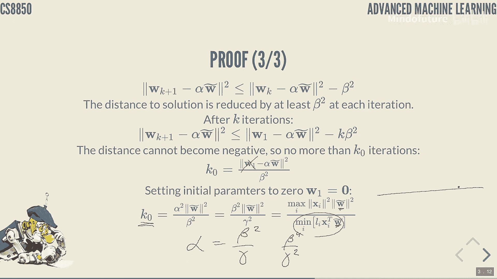

# 015：感知机作为线性分类器 🧠

在本节课中，我们将学习感知机算法。感知机是机器学习历史上一个里程碑式的模型，它首次展示了如何从数据中自动学习一个线性分类器。我们将从几何和生物学的角度理解其原理，并详细分析其学习算法的收敛性。

## 超平面与线性判别

上一节我们介绍了超平面的几何概念。在1960年代，Frank Rosenblatt等人开始思考：我们能否不仅仅手动设置超平面，而是从数据中**学习**它？这正是经验风险最小化的核心思想——我们只有数据样本，能否设计一个算法来学习权重向量 **W** 的值？

Frank Rosenblatt受神经元工作原理的启发，提出了**感知机**算法。下图展示了他与Mark 1感知机硬件实现的合影。

回到超平面方程 **W^T x = 0**。从另一个角度看，这个方程等价于一个计算图：输入 **x** 与权重 **W** 相乘后求和，然后与一个阈值（通常为0）比较。如果结果在阈值一侧，输出为正类；在另一侧，则为负类；等于阈值则位于超平面上。

## 生物学灵感 🧬

Frank Rosenblatt的灵感来源于神经元的发现。神经科学家Ramon y Cajal通过特殊的染色技术，首次在显微镜下观察到了哺乳动物大脑中的神经元结构。

一个生物神经元通过**树突**接收来自其他神经元轴突的信号。这些输入信号具有不同的强度（权重）。信号在**胞体**中汇总，一旦汇总的电势超过某个**动作电位**阈值，神经元就会通过**轴突**产生输出（“放电”）。

感知机正是模拟了这一过程：
*   **输入** 对应树突接收的信号。
*   **权重** 对应不同输入连接的重要性（可正可负）。
*   **求和与阈值比较** 对应胞体汇总信号并与动作电位比较。
*   **输出** 对应是否“放电”（即分类结果）。

这种将线性分类器“重新包装”为神经元的类比，极大地吸引了人们对人工智能领域的关注，并催生了机器学习这一领域。

## 感知机学习算法

那么，我们如何优化或学习感知机的权重呢？由于阈值函数不可微，我们无法直接使用梯度下降。首先，我们需要定义一个优化目标。

我们的目标是**最小化所有被错误分类的样本到当前超平面的（未归一化）距离**。对于一个样本点 **(x_i, y_i)**，其到超平面的带符号距离为 **y_i * (W^T x_i)**。对于正确分类的样本，该值为正；对于错误分类的样本，该值为负。因此，我们只对错误分类的样本计算损失，并希望最小化这些负值（即让它们变正）。

感知机有两种主要的学习算法。

### 批量感知机算法

以下是批量感知机算法的步骤，它每次迭代使用整个数据集中所有误分类的样本来更新权重。

1.  **初始化**：设置初始权重向量 **W**，学习率函数 **η(t)**，停止阈值 **θ**，迭代计数器 `t = 1`。
2.  **循环**：重复以下步骤，直到误分类样本的损失总和小于阈值 **θ**。
3.  **识别误分类**：找出当前权重 **W** 下所有误分类的样本集合。
4.  **更新权重**：使用所有误分类样本的信息更新权重：**W ← W + η(t) * Σ(误分类样本 y_i * x_i)**。
5.  **递增计数器**：`t ← t + 1`。
6.  **返回结果**：返回学习到的权重向量 **W**。

### 随机（在线）感知机算法

随机感知机算法逐个检查样本，并立即更新。

1.  **初始化**：设置初始权重向量 **W**，迭代计数器 `k = 0`。
2.  **遍历数据**：对数据集中的每个样本 **(x_k, y_k)** 顺序执行：
3.  **检查分类**：如果当前样本被误分类，即 **y_k * (W^T x_k) ≤ 0**。
4.  **立即更新**：则更新权重 **W ← W + y_k * x_k**。
5.  **循环**：重复遍历整个数据集，直到所有样本都被正确分类。

这个算法直观上就像在“修正”错误。想象一个随机的超平面，如果发现一个误分类的正类样本落在负侧，算法就会将权重向量 **W** 向该样本的方向调整一点，从而使超平面向正确分类该样本的方向旋转。

## 收敛性证明 📐

一个关键问题是：随机感知机算法一定会收敛吗？Frank Rosenblatt证明了，**如果训练样本是线性可分的**，那么该算法一定会在有限步内收敛到一个解向量。

让我们概述一下证明思路。假设存在一个完美的解向量 **W̃**，它能正确分类所有样本（即对于所有 i，有 **y_i * (W̃^T x_i) > 0**）。

在算法第4步的更新后，我们得到新权重 **W_{k+1} = W_k + y_k x_k**。我们想证明，新权重 **W_{k+1}** 比旧权重 **W_k** 更接近那个完美的解 **W̃**。

我们考察向量 **W_{k+1} - α W̃** 的范数平方（其中 α 是一个待定的正标量），并将其与 **W_k - α W̃** 的范数平方进行比较。

通过展开和代数运算，并利用更新只发生在误分类样本上（即 **y_k (W_k^T x_k) ≤ 0**）这一条件，我们可以推导出以下不等式：

**||W_{k+1} - α W̃||^2 ≤ ||W_k - α W̃||^2 + ||x_k||^2 - 2α y_k (W̃^T x_k)**

定义两个量：
*   **β^2 = max_i ||x_i||^2**，即所有样本中最大的范数平方。
*   **γ = min_i [ y_i (W̃^T x_i) ]**，即完美解 **W̃** 与所有样本的最小带符号距离（必定为正）。

由于 **y_k (W̃^T x_k) ≥ γ**，我们可以将不等式加强为：
**||W_{k+1} - α W̃||^2 ≤ ||W_k - α W̃||^2 + β^2 - 2αγ**

现在，巧妙的选择 **α = β^2 / γ**。代入上式，得到：
**||W_{k+1} - α W̃||^2 ≤ ||W_k - α W̃||^2 - β^2**

这个不等式表明，**每经过一次更新，当前权重向量与缩放后的完美解向量之间的距离平方至少减少 β^2**。

经过 k 次更新后，如果初始权重 **W_1 = 0**，则有：
**0 ≤ ||W_{k+1} - α W̃||^2 ≤ ||α W̃||^2 - k β^2 = α^2 ||W̃||^2 - k β^2**

为了使不等式左边保持非负，右边的项必须大于等于0，即 **k β^2 ≤ α^2 ||W̃||^2**。因此，最大的更新次数 **k** 有一个上界：

**k ≤ (α^2 ||W̃||^2) / β^2 = (β^2 / γ^2) * ||W̃||^2**

由于这个上界是一个有限值，算法不可能无限更新下去，因此必然在有限步内停止，即所有样本都被正确分类，算法收敛。

## 总结

本节课中，我们一起学习了感知机作为线性分类器的核心内容。

*   我们首先回顾了超平面的几何定义，并看到了Frank Rosenblatt如何受生物神经元启发，提出了感知机模型。
*   我们详细分析了感知机的两种学习算法：**批量更新**和**随机（在线）更新**。后者通过逐个样本检查和即时修正来学习。
*   最重要的是，我们探讨了随机感知机算法的**收敛性证明**。证明表明，只要训练数据是**线性可分的**，该算法就保证能在有限步内找到一个能将所有样本正确分类的超平面。证明的关键在于展示了每次权重更新都会使其更接近某个“完美”的解向量。

感知机是神经网络和支持向量机等现代模型的重要基础。理解其原理和局限性（如对线性可分数据的依赖）对于深入学习机器学习至关重要。