# 016：P16_感知机扩展 🧠

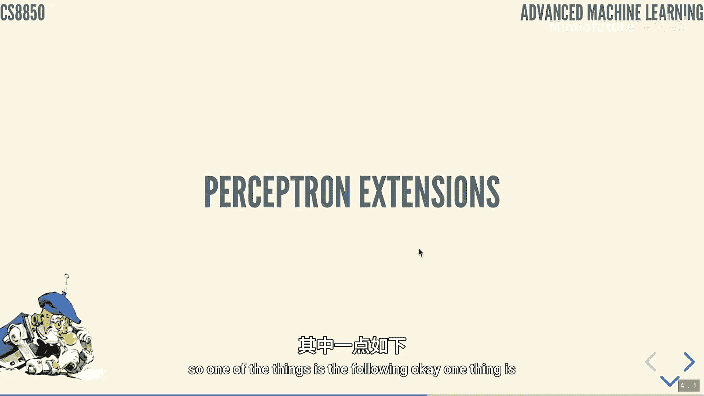

## 概述
在本节课中，我们将学习感知机算法的两个重要扩展。首先，我们将探讨引入“间隔”的概念如何使分类器更具鲁棒性。接着，我们将了解如何通过一个更平滑的损失函数来改进原始的、不连续的感知机目标函数，从而获得更好的优化性能。

---

## 感知机算法的局限性

感知机是一个有趣的算法，也是最早被证明能够收敛的学习算法之一。然而，它存在一些我们希望改进或修正的缺点。

其中一个问题是关于线性可分数据的。假设我们处于一个二分类场景中，数据是线性可分的。感知机可以找到无数个解，或者说，所有那些分离超平面都可能是感知机找到的第一个可行解。具体找到哪一个，取决于算法从何处开始初始化，这带有一定的随机性。

因此，有些解会过于接近红色类别，有些解则会过于接近绿色类别。我们能否找到一个更理想的解呢？直观上，我们希望找到一个位于两类数据“中间”的超平面。这样，即使我们收集的数据略有偏差或不足，分类器也能为两类数据留出一些“缓冲”空间，一些绿色点可能出现在这边，一些红色点可能出现在那边，从而提升模型的泛化能力。

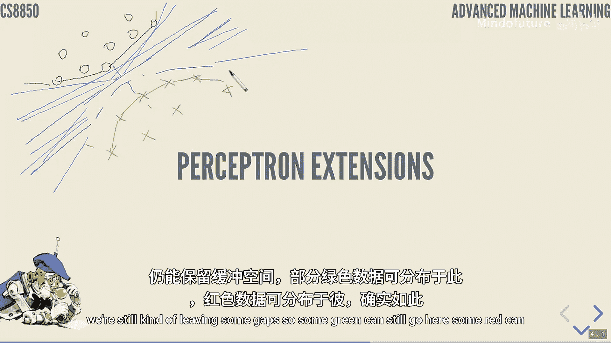

---

## 扩展一：间隔感知机

为了应对上述问题，我们引入了“间隔”的概念。间隔告诉我们，我们希望有一个区域，在这个区域内不允许存在任何数据点。

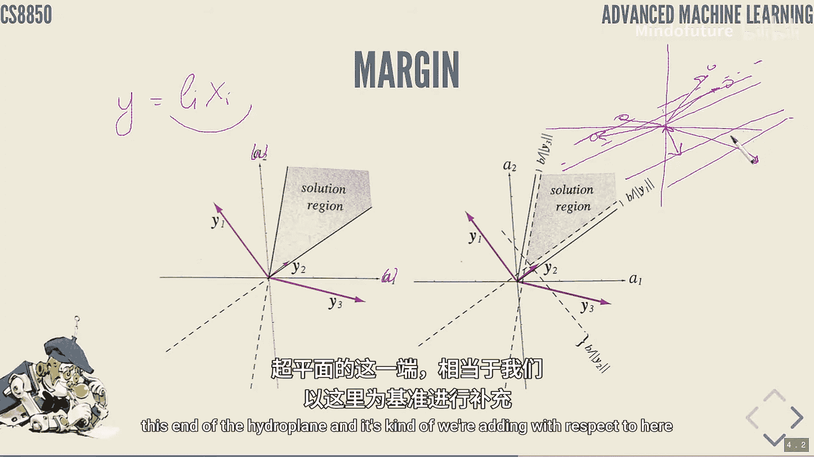

例如，在之前的例子中，如果这是一个分离超平面，并且我们的数据点 `y_i * (w^T x_i)` 最终落在这里。但如果我们设定了一个间隔 `B`，我们不希望任何点离超平面太近。我们会将超平面移动到这里，从而获得一个较大的间隔，并且确保这个间隔区域内没有数据点。实际上，如果我们翻转这些点的符号，它们会落在超平面的另一端。我们相当于在超平面周围添加了一个“缓冲区”或“条带”，在这个区域内对数据点进行了约束，这就是我们的间隔 `B`。

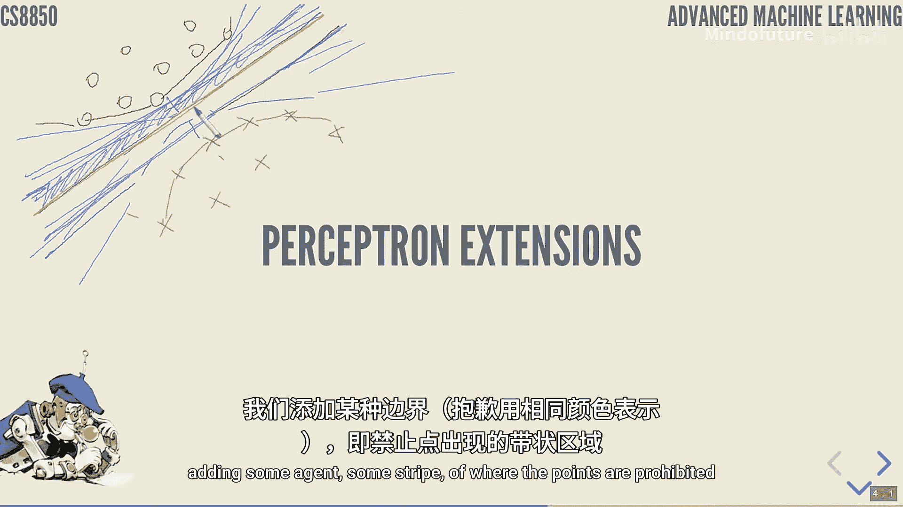

对于不同的权重向量 `w`，这些间隔看起来会有所不同。它定义了数据点被允许离分离超平面有多远。

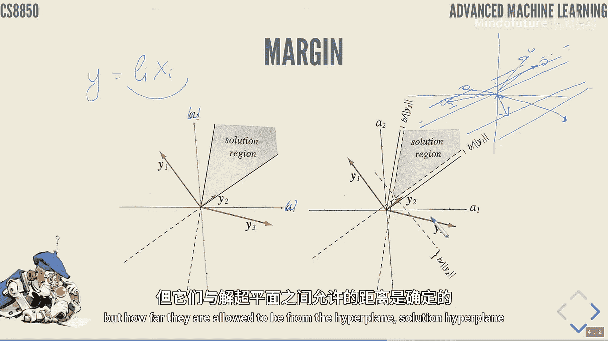

---

### 算法实现

因此，我们可以修改原始的随机感知机算法，使其能够处理间隔。我们定义希望间隔 `B` 有多大，即数据点不允许出现在分离超平面的 `B` 邻域内。我们定义学习率 `η` 和阈值，然后我们的“错误分类”样本就变成了那些离超平面距离小于设定间隔 `B` 的样本。

我们使用的超平面是 `w^T x`，我们希望如果它离训练数据不是太近（即存在一个大小为 `B` 的间隙），它的泛化能力会更好。判断条件不再是 `y_i * (w^T x_i) <= 0`，而是 `y_i * (w^T x_i) <= B`。无论是正类还是负类，如果它们被错误分类，或者即使分类正确但离超平面太近（即点离超平面太近），这个条件都会触发。

和之前一样，我们的目标函数 `J(w)` 是：
`J(w) = - Σ_{i ∈ M} y_i * (w^T x_i)`
其中 `M` 是错误分类样本的集合。这其实就是对于特定样本的目标函数关于 `w` 的梯度。我们通过梯度下降来最小化这个包含间隔 `B` 的目标函数。目前虽然没有理论保证，但我们希望在实践上能做得更好。我们的停止准则是：当所有样本都位于正确的一侧，并且远离分类器超平面加上间隔 `B` 的区域时。之前我们只有对于所有样本 `y_i * (w^T x_i) > 0` 的条件，这是第一种泛化改进。

---

## 扩展二：平滑感知机（感知机松弛）

第一种改进很巧妙且有效。另一种改进是审视我们原来的目标函数。它的问题在于它是**不连续**的。这种高度不连续性导致权重更新时会来回跳跃，步骤不稳定（我们将在下一节展示这一点）。这不理想，我们希望有更平滑的东西，并且希望能够优化除了简单的感知机准则之外的其他目标。

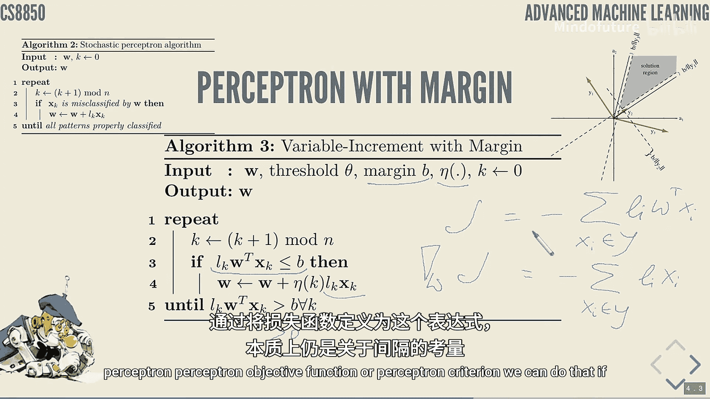

我们可以通过定义一个新的损失函数来实现这一点。我们仍然希望处理间隔，因为它对泛化有益。但这次，我们使用以下表达式作为损失：
`L_i = max(0, B - y_i * (w^T x_i))`
这其实就是我们之前准则的“合页损失”形式。之前的错误分类准则是 `y_i * (w^T x_i) <= B`，现在这个损失函数在 `y_i * (w^T x_i) < B` 时会产生一个线性惩罚。

这个损失函数关于权重 `w` 的梯度是：
`∇_w L_i = { -y_i * x_i, 如果 y_i * (w^T x_i) < B; 0, 否则 }`
这是一个关于 `w` 的分段线性函数。梯度是一个向量（或者说是标量乘以向量，正如我们之前讨论的）。

然后，我们只需使用随机梯度下降进行迭代更新：
`w_{t+1} = w_t - η * ∇_w L_i`
这与之前类似。我们之前的感知机更新是 `w_{t+1} = w_t + η * y_i * x_i`（当样本被错误分类时）。实际上，之前我们在最小化目标函数 `J(w)` 时，梯度是 `-y_i * x_i`，而更新中的 `+` 号是因为我们采用了负梯度方向并移除了负号。现在，我们有了一个带间隔的感知机，但使用了不同的、比原始版本更平滑的目标函数。

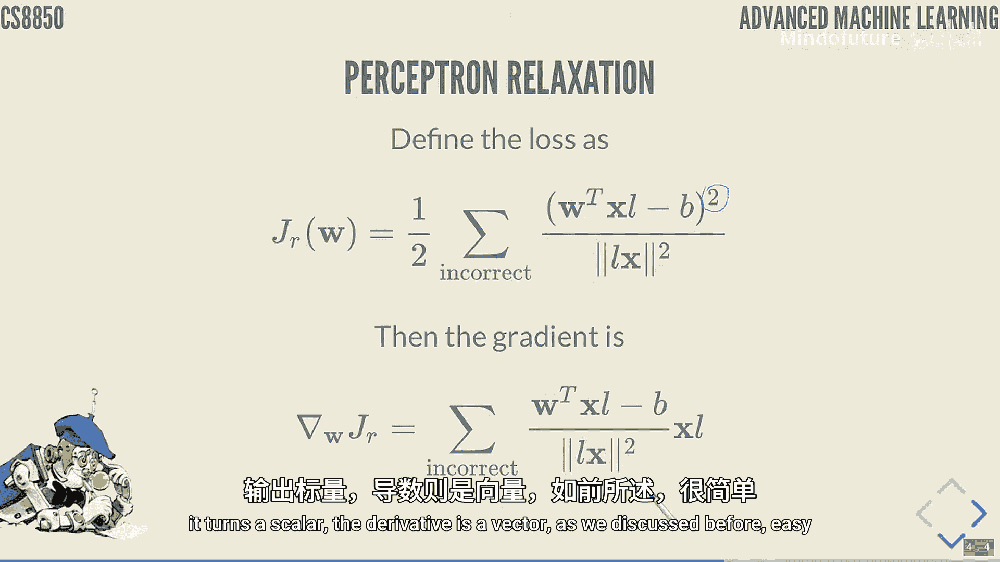

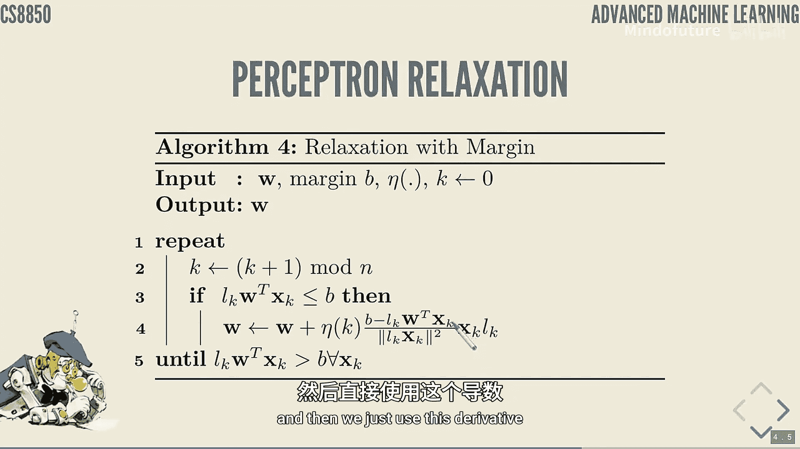

---

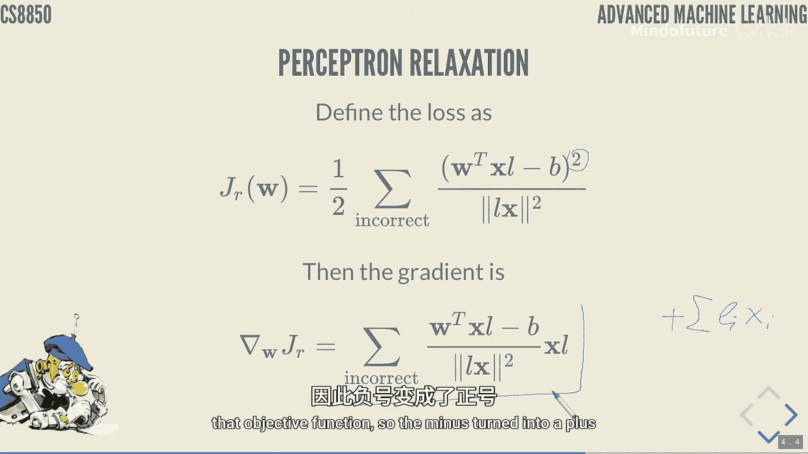

### 几何解释

这种平滑性有其几何意义。如果我们定义 `R_k = y_k * (w^T x_k)` 这个比值（注意，我们的 `y_k` 是标签乘以 `x_k`，即经过标签缩放后的数据样本，本质上是 `+1` 或 `-1`），那么 `R_k` 就是数据点到超平面的函数间隔。

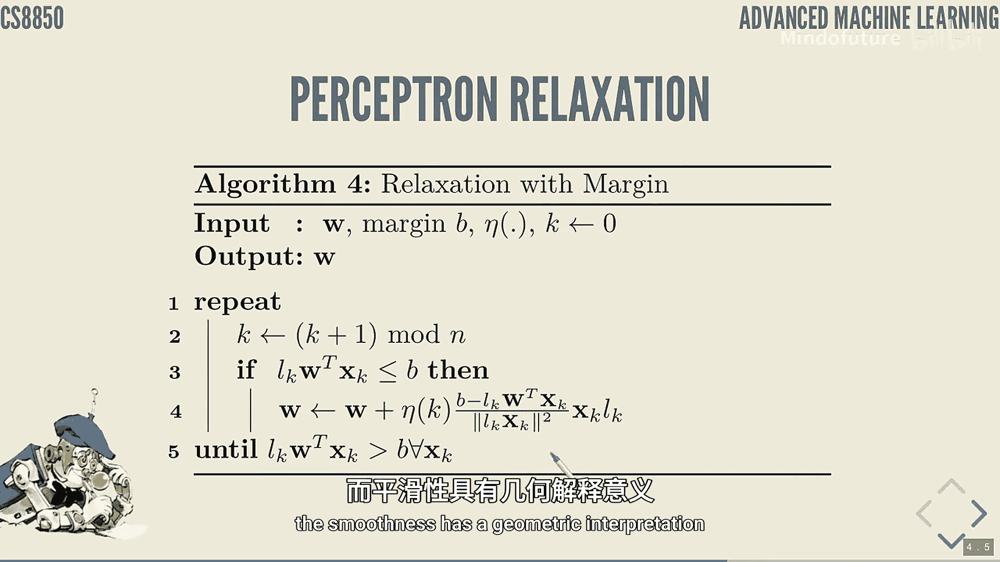

新的损失函数 `L_i` 是 `w` 的函数。超平面由 `y_k * (w^T x_k) = B` 定义。通过在这个损失函数上执行梯度下降，我们实际上是平滑地将当前的 `w` 向满足 `y_k * (w^T x_k) = B` 这个条件的超平面移动。在这个超平面上的任何 `w` 都会是对于该样本的一个“好”的解。

总之，这就是**感知机松弛**过程。它取代了原始感知机算法中离散、不平滑的目标函数，使其变得平滑，并且结合了间隔思想，从而使感知机具有更好的泛化性能。

---

## 总结
本节课中，我们一起学习了感知机算法的两个关键扩展：
1.  **间隔感知机**：通过引入间隔 `B`，要求分类超平面与所有训练数据保持至少 `B` 的距离，从而追求更具鲁棒性和泛化能力的解。
2.  **平滑感知机（感知机松弛）**：通过将不连续的 0-1 损失替换为连续的合页损失 `max(0, B - y_i * (w^T x_i))`，使优化过程更平滑、更稳定，同时保留了间隔思想。

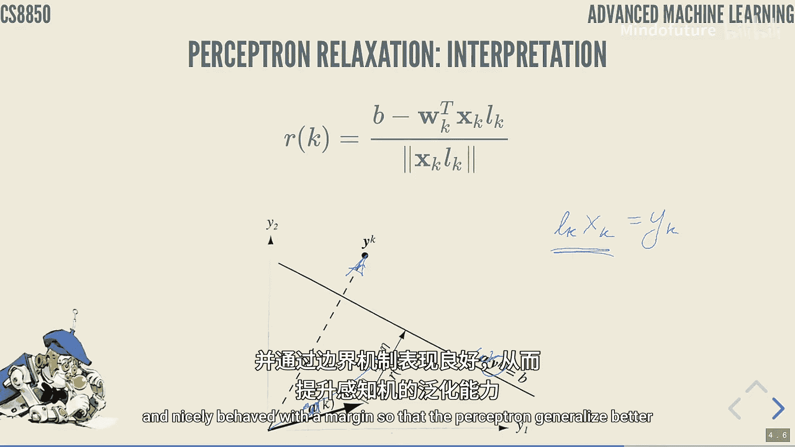

这两种扩展都在不同程度上改善了原始感知机的性能，为后续更复杂的线性分类器（如支持向量机）奠定了基础。