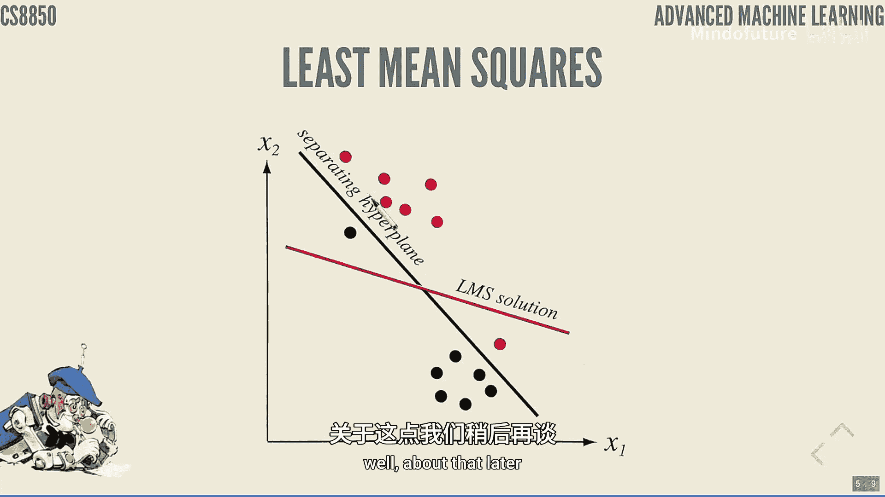

# 017：针对线性不可分类的线性分类器 🧠

在本节课中，我们将要学习线性分类器如何处理线性不可分的数据。我们将回顾感知机算法在可分情况下的表现，并探讨其在不可分情况下的局限性，最后介绍一种替代的优化准则。

## 概述

上一节我们介绍了感知机算法在线性可分数据集上的工作原理。本节中我们来看看当数据线性不可分时会发生什么。

感知机算法在可分情况下表现良好。它从一个随机的权重向量 **W** 开始，通过迭代修正错误分类的点来找到分离超平面。算法的核心更新规则是：
```
W_new = W_old + η * y_i * x_i
```
其中，`η` 是学习率，`y_i` 是样本 `x_i` 的真实标签。


以下是算法在可分情况下的典型运行步骤：
1.  初始化权重向量 **W**。
2.  遍历数据点。
3.  如果发现一个点被错误分类，则根据上述公式更新 **W**。
4.  重复步骤2-3，直到所有点都被正确分类。

该算法保证在线性可分的情况下收敛。

## 线性不可分的情况

然而，如果数据是线性不可分的，情况就不同了。考虑一个经典的“异或”问题。

这是一个实际的运行示例。算法运行了100步，但从未收敛。它持续运行，因为根本不存在一个完美的线性分离超平面。这是一个简单的玩具问题，我们通过肉眼就能看出它是不可分的。

马文·明斯基和西摩尔·派普特在他们出版的《感知机》一书中证明了感知机无法处理这类情况。这在当时导致了人工智能领域的“寒冬”，相关研究资金大幅减少。

## 处理近似可分的数据


但我们通常遇到的实际问题更像下图所示，并非像“异或”问题那样完全不可分。如果我们能容忍少数样本被错误分类，这通常是可以接受的。

那么，我们能否找到一个“足够好”的分离超平面呢？如果我们改变原始的优化准则。

原始的感知机准则旨在最小化错误分类的数量。如果我们将其改为最小化均方误差，然后进行梯度下降，理论上我们应该能够解决这个问题。

一个自然的问题是：为什么我们不从一开始就使用这种方法呢？这引出了一个实际问题：为问题选择合适的损失函数。

事实证明，即使存在一个解，最小均方误差准则也不能保证找到它。我们将在下一讲中详细讨论最小二乘法。

## 总结与要点

本节课中我们一起学习了线性分类器在不可分数据上的行为。以下是核心要点：

*   **线性可分性**：许多分类问题或分类器类别可以简化为线性分类器。
*   **线性分类器的子集**：支持向量机也是一种线性分类器，并且由于其强大性能，至今仍在广泛使用。
*   **本讲重点**：本讲的重点在于理解空间的几何特性。能够直观地理解和可视化数据空间的几何结构至关重要，这将帮助你理解算法发明者的思路。
*   **证明技巧**：请注意课程中涉及的证明技巧。你不需要记住所有细节，但需要理解证明的步骤。这些技巧将有助于你完成作业。
*   **解的接近性**：有时，算法可能非常接近最终解，但只有在解被找到后才能确认这一点。



感谢学习，我们课堂上再见。