# 018：线性回归与主成分分析

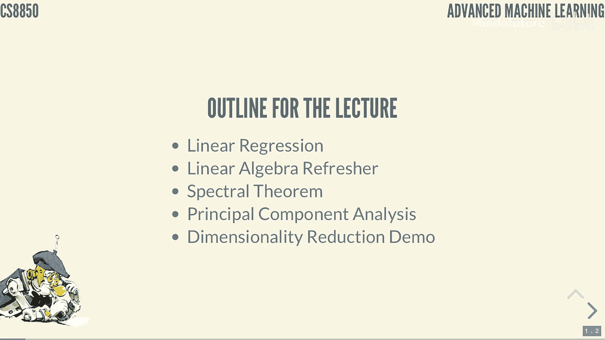

在本节课中，我们将要学习线性回归，并快速回顾线性代数基础。之后，我们将详细解释谱定理，并深入探讨主成分分析，最后通过一个降维演示来巩固理解。

## 线性回归

上一节我们介绍了课程概览，本节中我们来看看线性回归。线性回归是一种用于拟合数据点或超平面的方法。该方法由勒让德和高斯发明，称为最小二乘法。“回归”这一名称由弗朗西斯·高尔顿提出，源于对生物学中“均值回归”现象的观察，但该名称本身并未解释方法的内涵。

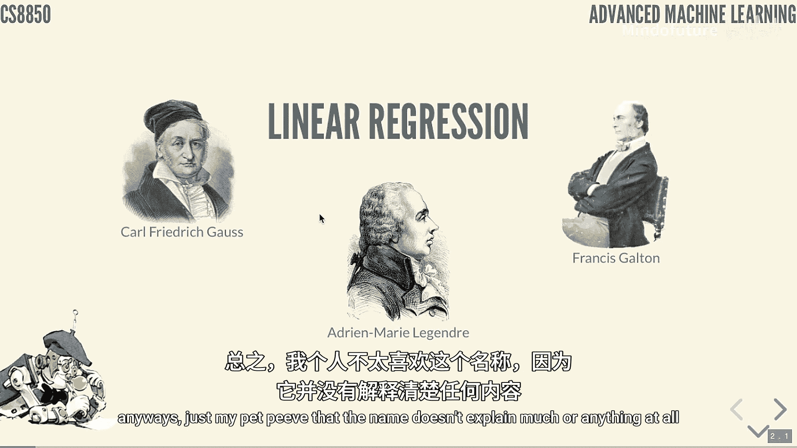

我们之前讨论过，在处理非线性可分数据时，最小二乘解并不总能找到一个分离超平面。然而，对于拟合穿过数据集的直线或超平面，最小二乘法效果很好。

例如，我们有一组测量值 **X** 和响应变量 **y**。我们希望找到一个超平面，使得预测值 **ŷ** 与真实值 **y** 之间的平方误差最小。这可以表示为最小化以下目标函数：

**公式：** `min_w Σ (y_i - w^T x_i)^2`

我们可以将其重写为矩阵形式。设 **X** 为设计矩阵，其中每一行是一个样本 **x_i^T**，**w** 为权重向量。那么预测向量为 **ŷ = X w**。最小二乘准则可以写成：

**公式：** `min_w || y - X w ||^2`

展开平方项并求导，我们可以找到使该表达式最小化的 **w**。将导数设为零，我们得到正规方程：

**公式：** `X^T X w = X^T y`

解出 **w**，得到最小二乘解：

**公式：** `w = (X^T X)^{-1} X^T y`

这里的 `(X^T X)^{-1} X^T` 被称为 **X** 的伪逆（Moore-Penrose 伪逆），记作 **X^†**。因此，解也可以写为：

**公式：** `w = X^† y`

当样本数多于特征维度且 **X^T X** 满秩时，该解是良定的。如果 **X^T X** 不可逆，我们可以通过添加一个小常数项（如 λI）来稳定求解，或者使用梯度下降等迭代方法。

## 求解方法

上一节我们推导了线性回归的解析解，本节中我们来看看如何通过迭代方法求解。

除了直接计算伪逆，我们还可以使用梯度下降法来最小化平方误差损失。损失函数关于权重 **w** 的梯度为：

**公式：** `∇_w L = -2 X^T (y - X w)`

以下是使用批量梯度下降的算法步骤：

**代码：**
```
初始化 w
设置学习率 α
设置停止条件（如迭代次数或梯度阈值）
循环直到满足停止条件：
    计算梯度 g = -2 * X^T (y - X w)
    更新权重 w = w - α * g
```

我们也可以使用随机梯度下降，每次只用一个样本更新权重。对于单个样本 **(x_i, y_i)**，梯度为：

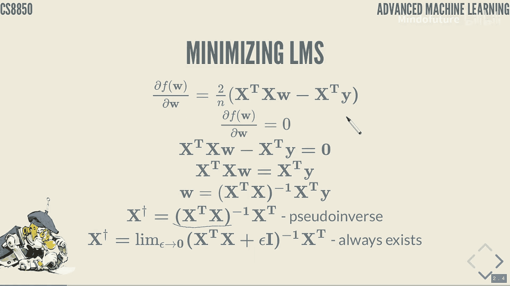

**公式：** `∇_w L_i = -2 (y_i - w^T x_i) x_i`

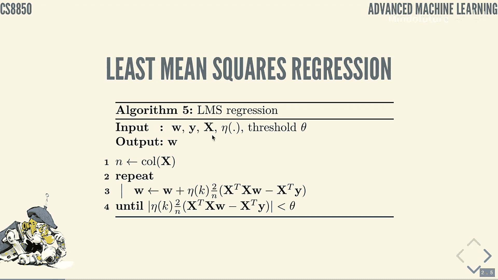

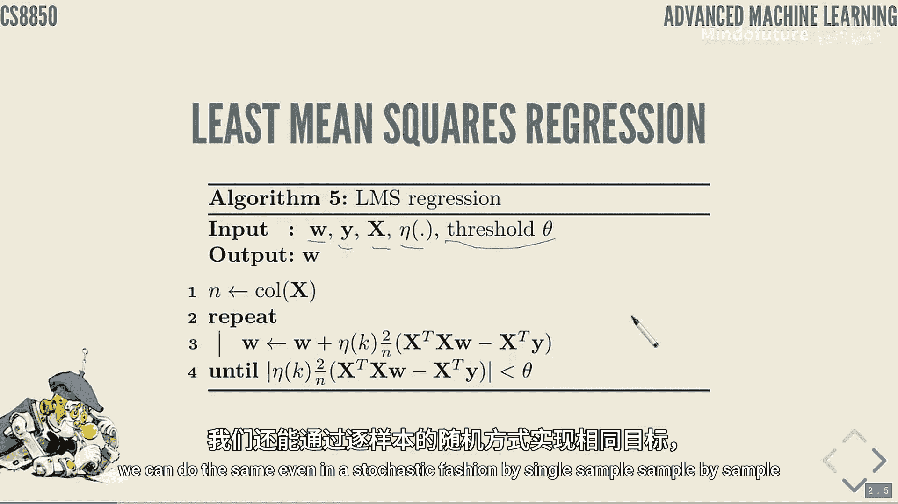

对应的更新规则为：

**代码：**
```
对于每个样本 (x_i, y_i)：
    计算预测值 ŷ_i = w^T x_i
    计算误差 e_i = y_i - ŷ_i
    更新权重 w = w + α * e_i * x_i  # 注意这里是加号，因为梯度是负的
```

需要注意的是，随机梯度下降对学习率 **α** 的设置非常敏感。

## 回归的假设与变体

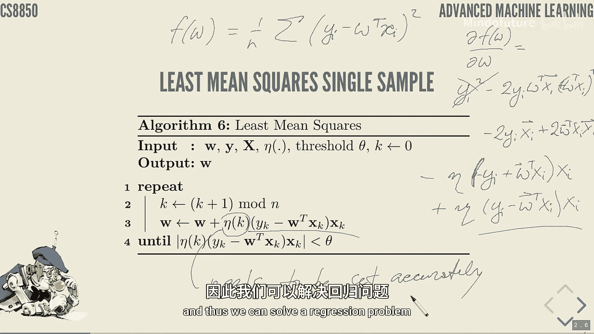

上一节我们介绍了线性回归的标准形式，本节中我们来看看其背后的假设和一些变体。

传统线性回归有一个强假设：所有误差或不确定性仅存在于因变量 **y** 中，自变量 **X** 被假设为精确测量、没有误差。然而，在实际问题中，这个假设往往不成立。

根据误差来源的不同，我们可以定义不同的“拟合”准则：
1.  **普通最小二乘法**：最小化 **y** 方向上的垂直距离平方和（假设误差仅在 **y**）。
2.  **正交回归/总最小二乘法**：最小化数据点到直线的垂直距离平方和（假设 **x** 和 **y** 都存在误差）。
3.  **主成分分析拟合**：寻找数据方差最大的方向（一种无监督方法，不区分 **x** 和 **y**）。

为了直观展示这些差异，我们进行了一个实验。当数据仅在 **y** 方向有噪声时，三种方法拟合的直线几乎相同。但当数据在 **x** 和 **y** 方向都有噪声，或者数据的固有坐标系与测量坐标系不一致时，结果会显著不同。

在许多现实世界的数据集中（如图像、传感器数据），我们测量的坐标系可能并非数据内在的低维流形所在的坐标系。此时，PCA拟合通常能更好地捕捉数据的本质结构，因为它寻找的是数据方差最大的方向，而不依赖于特定的输入-输出假设。

## 主成分分析原理

上一节我们通过实验看到了PCA拟合的优势，本节中我们来深入探讨其数学原理——谱定理。

主成分分析的核心是找到一组新的正交基，使得数据在这些新基上的投影方差最大化。这涉及到数据协方差矩阵的特征分解。

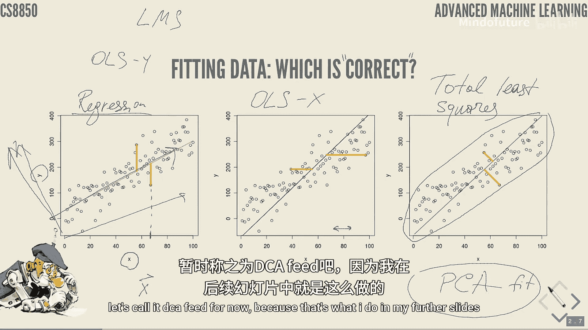

设我们有一个零均值的数据矩阵 **X**（每行一个样本）。其协方差矩阵为：

**公式：** `Σ = (1/n) X^T X`

谱定理指出，任何实对称矩阵（如协方差矩阵 **Σ**）都可以被正交对角化。即存在一个正交矩阵 **U** 和对角矩阵 **Λ**，使得：

**公式：** `Σ = U Λ U^T`

其中，**U** 的列向量是 **Σ** 的特征向量，**Λ** 对角线上的元素是相应的特征值（通常按降序排列：λ₁ ≥ λ₂ ≥ ... ≥ λ_d）。

这些特征向量就是主成分方向。第一主成分方向 **u₁** 是数据投影方差最大的方向；第二主成分方向 **u₂** 是与 **u₁** 正交且投影方差次大的方向，依此类推。

数据在新空间（主成分空间）中的表示可以通过投影得到：

**公式：** `Z = X U`

其中，**Z** 的每一列是一个主成分得分。如果我们只取前 **k** 个主成分（对应最大的 **k** 个特征值），就可以实现从 **d** 维到 **k** 维的降维。

## 降维演示

上一节我们介绍了PCA的数学基础，本节中我们通过一个演示来看其降维效果。

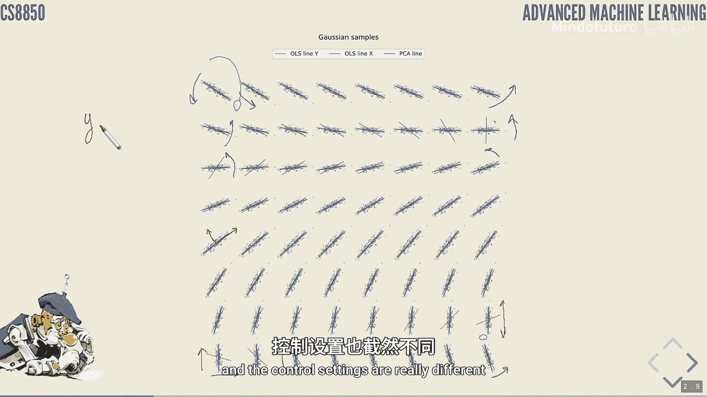

假设我们有一个高维数据集，但其本质信息存在于一个更低维的子空间中。PCA可以帮助我们：
1.  **降维**：保留前 **k** 个主成分，去除噪声和冗余。
2.  **可视化**：将高维数据投影到前两个或三个主成分上，以便于观察。
3.  **特征提取**：主成分可以作为新的、不相关的特征用于后续的机器学习任务。

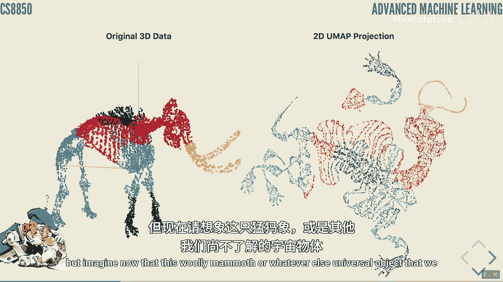

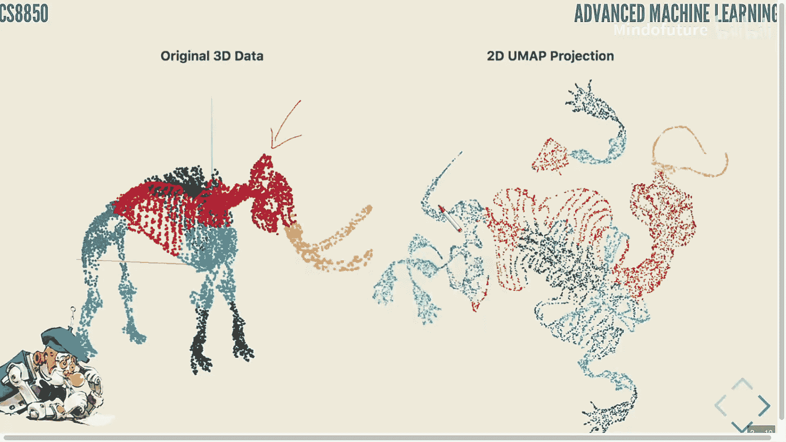

演示中，我们生成了一个本质上近似一维（沿一条线分布）但被测量在二维空间中的数据集。普通最小二乘回归（假设y有误差）的拟合线严重偏离了数据的真实走向。而PCA拟合线则准确地捕捉了数据分布的主要方向，因为它致力于寻找数据本身方差最大的轴，而不对误差来源做先验假设。

当数据具有更复杂的结构（如非线性流形）时，线性PCA可能不够用，需要考虑核PCA或流形学习等方法。但其核心思想——寻找数据分布的主要模式——是共通的。

## 总结

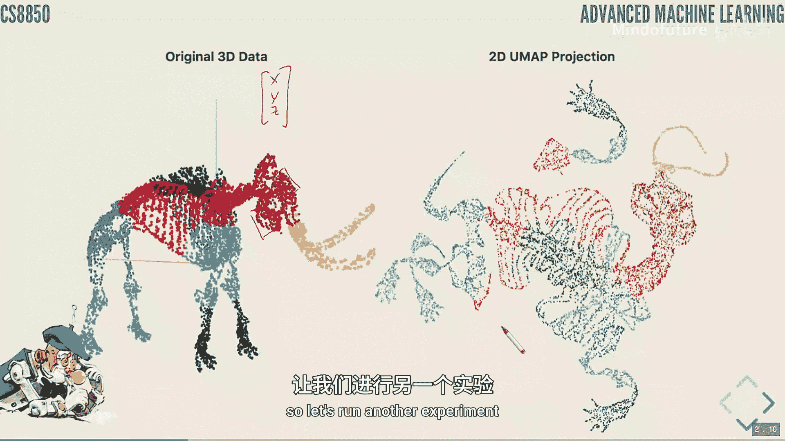

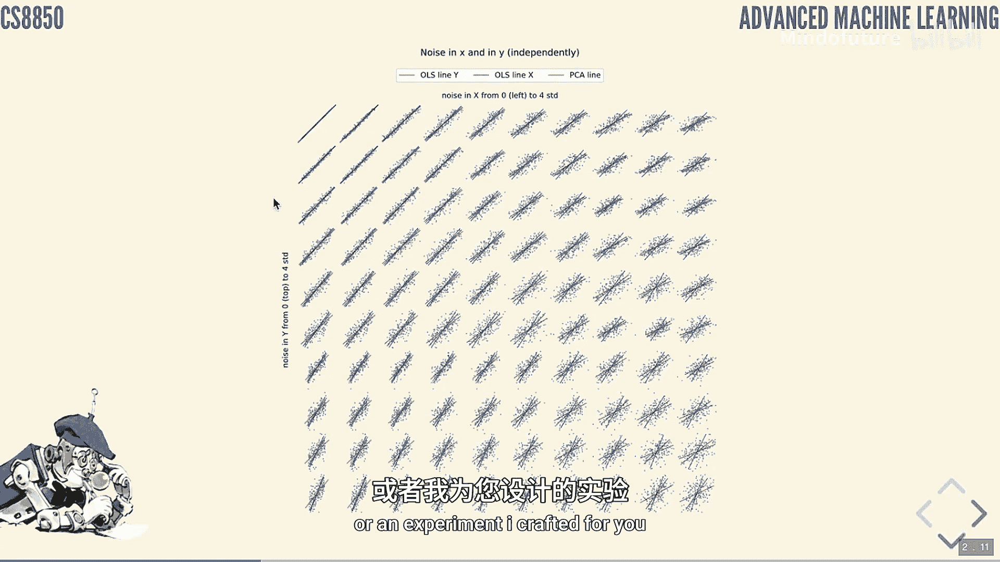

本节课中我们一起学习了线性回归与主成分分析。我们从线性回归的最小二乘解及其矩阵形式出发，讨论了其求解方法（解析解和梯度下降）。然后，我们探讨了线性回归中关于误差来源的假设，并比较了普通最小二乘、正交回归和PCA拟合在不同数据场景下的表现。

通过谱定理，我们深入理解了PCA的原理：通过对数据协方差矩阵进行特征分解，找到数据方差最大的正交方向（主成分）。PCA是一种强大的无监督降维和特征提取工具，尤其适用于当我们对数据的误差结构或内在维度缺乏先验知识时。

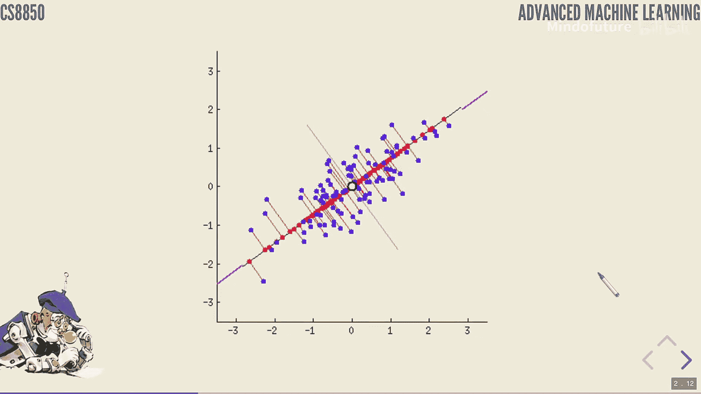

最后，我们通过演示看到，在许多情况下，尤其是当测量坐标系与数据固有结构不一致时，PCA提供了一种更鲁棒、更能反映数据本质的拟合与降维方式。