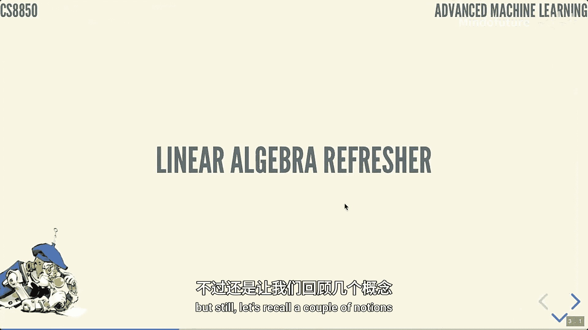
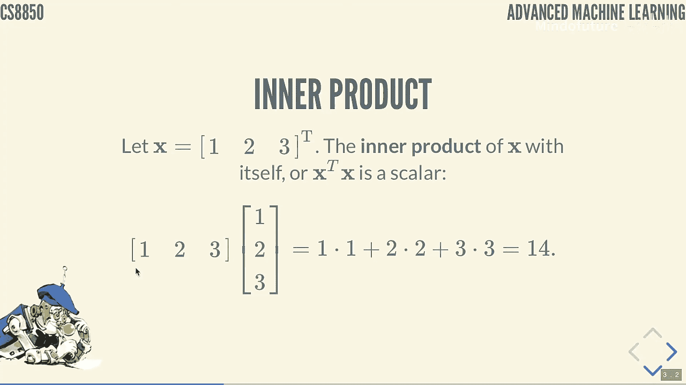
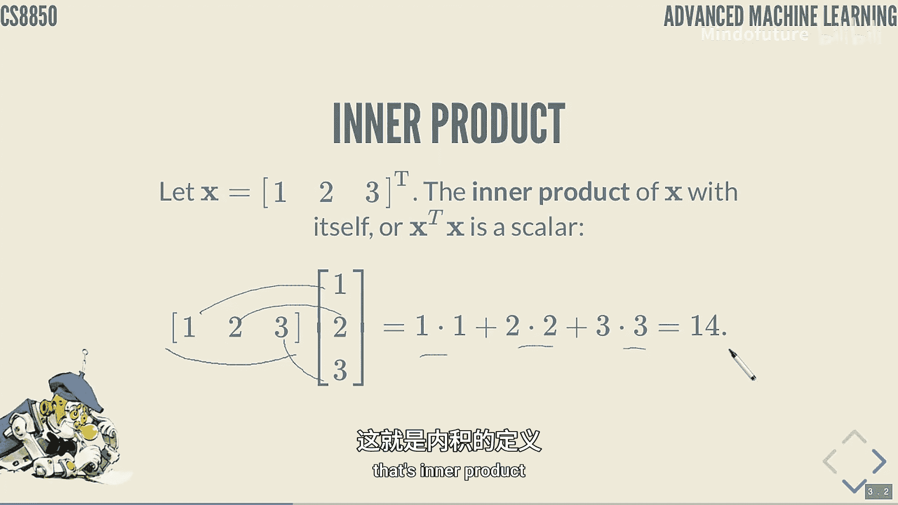
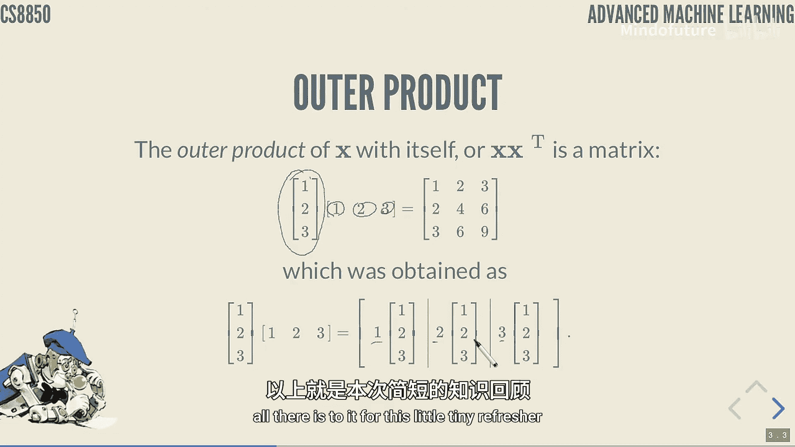

# 019：P19 线性代数微型复习 📚

在本节课中，我们将快速回顾几个关键的线性代数概念，为后续的机器学习学习打下基础。这些概念包括内积、外积以及它们与向量范数的关系。

---

上一节我们介绍了本课程的整体框架，本节中我们来看看几个基础的线性代数运算。

首先，我们回顾向量的内积。如果有一个三维向量 **x** = [1, 2, 3]^T，那么它与自身的内积 **x^T x** 是一个标量。

其计算过程是：将向量转置后，与自身对应元素相乘再求和。

**x^T x** = 1×1 + 2×2 + 3×3 = 14

这个结果恰好是向量 **x** 的 **L2范数** 的平方。公式表示为：

**x^T x** = ||**x**||₂²

---

接下来，我们看看向量的外积。与内积不同，向量 **x** 与自身的外积 **x x^T** 的结果是一个矩阵。

其计算过程是：将列向量与行向量相乘。对于 **x** = [1, 2, 3]^T，其外积矩阵为：

**x x^T** = [1, 2, 3]^T × [1, 2, 3] = [[1, 2, 3],
                                         [2, 4, 6],
                                         [3, 6, 9]]

从效果上看，外积相当于用原向量的每个元素作为权重，生成并拼接多个向量副本，最终构成一个矩阵。

---

本节课中我们一起学习了两个核心的线性代数运算：**内积**与**外积**。我们明确了内积（**x^T x**）的结果是一个标量，等于向量L2范数的平方；而外积（**x x^T**）的结果是一个矩阵。理解这两者的区别对后续学习机器学习中的协方差矩阵、主成分分析等概念至关重要。