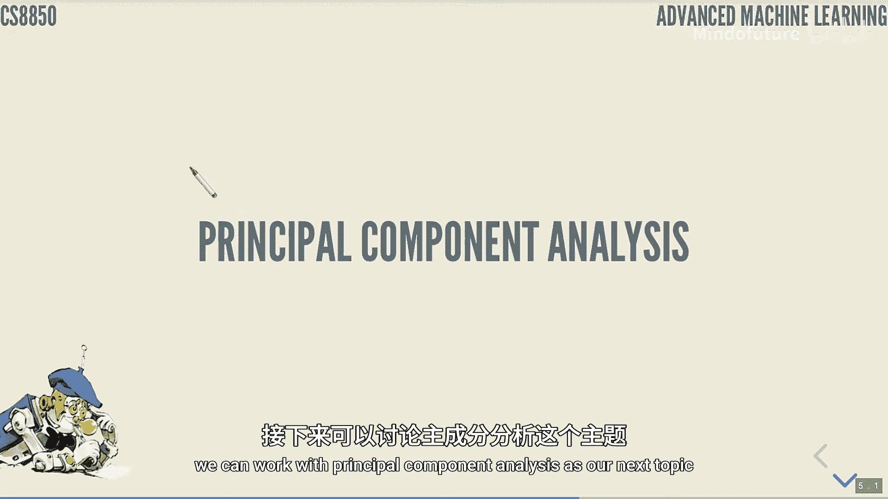

# 020：P20_谱定理 📐

在本节课中，我们将要学习谱定理。谱定理是线性代数中的一个核心结果，它描述了对称矩阵如何通过其特征值和特征向量进行分解。理解谱定理是学习主成分分析等高级机器学习方法的基础。

## 基变换 🔄

上一节我们介绍了线性变换的基本概念，本节中我们来看看如何在不同基下表示同一个向量。

首先，考虑基变换。我们有一个线性变换 **P_B** 及其逆变换 **P_B^{-1}**。它们将一个向量在其标准基下的表示与其在基 **B** 下的表示之间进行相互映射。

向量 **u** 在标准基下的表示就是其本身。标准基向量 **e_i** 是第 **i** 个位置为1，其余位置为0的向量。

要从标准基变换到基 **B**，我们应用变换 **P_B**。要从基 **B** 的表示变回标准基，我们应用其逆变换 **P_B^{-1}**。

用公式表示这个关系如下：

**u = P_B * u_B**
**u_B = P_B^{-1} * u**

其中，**u_B** 是向量 **u** 在基 **B** 下的坐标表示。

那么，基 **B** 应该由 **n** 个基向量 **b_1** 到 **b_n** 组成。由于 **u_B** 是 **u** 在基 **B** 下的表示，因此 **u** 可以表示为基向量的加权和，权重就是 **u_B** 的分量。

**u = Σ (u_B)_i * b_i**

这本质上是一个投影操作。矩阵 **P_B**（我们之前称之为投影到 **B** 的矩阵）其实就是将基向量作为列向量并置在一起形成的矩阵。

**P_B = [b_1, b_2, ..., b_n]**

这个矩阵 **P_B** 将向量从基 **B** 的表示映射回标准基（规范基）的表示。

## 相似变换 🔁

上一节我们讨论了向量的基变换，本节中我们来看看线性变换本身在不同基下的表示。

考虑一个在标准基下由矩阵 **A** 表示的线性变换。例如，这个变换可能是将空间旋转20度。我们想知道，当所有向量都用基 **P** 表示时，这个变换看起来是什么样的？换句话说，我们想找到在基 **P** 下具有相同效果的等价变换 **A_B**。

在标准基下，变换 **A** 作用于 **u** 得到 **A u**。我们可以将 **A u** 通过乘以 **P^{-1}** 投影到基 **B** 下。同时，我们知道从基 **B** 下的表示 **u_B** 回到标准基是应用变换 **P**。

我们想要求解的是变换 **A_B**，它接收 **u_B** 并输出 **A u** 在基 **B** 下的表示 **(A u)_B**。

以下是推导过程：

1.  从 **u_B** 出发，用 **P** 变换到标准基：**u = P * u_B**
2.  在标准基下应用变换 **A**：**A u = A * (P * u_B)**
3.  将结果 **A u** 变换回基 **B** 的表示：**(A u)_B = P^{-1} * (A * P * u_B)**

因此，我们寻找的变换 **A_B** 就是：

**A_B = P^{-1} * A * P**

这个变换称为相似变换。矩阵 **A_B** 和 **A** 关于基 **P** 是相似的。

## 对称矩阵的对角化 ⚖️

现在让我们思考以下情况：设 **A** 是一个在标准基下表示的对称矩阵，并设矩阵 **X** 的列是 **A** 的特征向量。

因为 **A** 是对称的，其特征向量是正交的。对于正交基，**X^T** 就是 **X^{-1}**，因为 **X^T * X = I**（单位矩阵）。

我们通过 **X^T** 从标准基变换到 **A** 的特征向量基，并通过 **X** 从特征向量基变回标准基。

矩阵 **Λ**（读作 Lambda）将向量 **u** 在 **A** 的特征基下的表示，映射为 **A u** 在同一个特征基下的表示。根据相似变换的定义，我们可以得到：

**Λ = X^T * A * X**

这里有一个有趣的性质：**Λ** 是一个对角矩阵，其对角线上的元素正是矩阵 **A** 的特征值。

## 对称矩阵的谱定理 📊

上一节我们推导了对角化的形式，本节中正式阐述谱定理。

对称矩阵的谱定理指出：任何具有 **n** 个不同特征值的 **n x n** 对称矩阵 **A** 可以分解如下：

**A = X Λ X^T**

其中：
*   **Λ** 是一个 **n x n** 的对角矩阵，对角线元素是 **A** 的特征值 **λ_i**。
*   **X** 是一个 **n x n** 的矩阵，其第 **i** 列 **x_i** 是对应于特征值 **λ_i** 的特征向量。
*   **X^T** 是 **X** 的转置，其第 **i** 行是 **x_i^T**。

特征向量的定义是：矩阵 **A** 作用于特征向量 **x_i**，结果只是将该向量缩放对应的特征值 **λ_i**。

**A x_i = λ_i x_i**

注意，当 **i ≠ j** 时，特征向量 **x_i** 与 **x_j** 正交。这意味着 **X^T X = I**，因此 **X^T = X^{-1}**。

## 谱分解 🧩

谱定理为我们提供了一种强大的矩阵分解视角，称为谱分解。

让我们使用矩阵乘法的定义以及 **Λ** 是对角矩阵这一事实，来重写 **A = X Λ X^T**。

通过分量形式的计算（详细代数过程可自行推导），我们可以将 **A** 的第 **i** 行第 **j** 列元素 **A_ij** 表示为：

**A_ij = Σ_k λ_k * (x_k)_i * (x_k)_j**

其中 **(x_k)_i** 是第 **k** 个特征向量 **x_k** 的第 **i** 个分量。

更重要的是，我们可以将整个矩阵 **A** 重写为一系列矩阵的和：

**A = Σ_k λ_k * (x_k * x_k^T)**

这里，**x_k * x_k^T** 是向量 **x_k** 与其自身的外积，结果是一个秩为1的矩阵。

以下是谱分解的关键点：
*   我们将原始的对称矩阵 **A** 表示为一组加权和。
*   求和中的每一项是：一个特征值 **λ_k** 乘以一个对应的秩为1的矩阵 **x_k * x_k^T**。
*   这些秩为1的矩阵 **x_k * x_k^T** 构成了矩阵 **A** 的一个“基”，而特征值 **λ_k** 是相应的权重。

这就好比声音的频谱分解，我们将任何波形分解为不同频率和功率的正弦波之和。在这里，我们将矩阵 **A** 分解为其特征向量外积所张成的基。

如果我们将和式中的每一项记作 **A_k = λ_k * x_k * x_k^T**，那么显然有：

**A_k * x_k = λ_k * x_k**

因为 **x_k^T * x_k = 1**（假设特征向量已归一化）。这表明，矩阵 **A_k** 作用在其对应的特征向量 **x_k** 上，效果仅仅是缩放，且缩放因子正是 **λ_k**。**x_k** 是 **A_k** 唯一的特征向量，**λ_k** 是其唯一的特征值。

## 总结 📝

本节课中我们一起学习了谱定理及其相关概念。
1.  我们首先回顾了**基变换**，理解了向量在不同坐标系下的表示转换。
2.  接着，我们引入了**相似变换**的概念，它描述了同一个线性变换在不同基下的矩阵表示之间的关系。
3.  然后，我们聚焦于**对称矩阵**，发现其特征向量可以构成正交基，从而可以对其进行**对角化**。
4.  基于此，我们正式阐述了**谱定理**：任何对称矩阵都可以分解为 **A = X Λ X^T** 的形式。
5.  最后，我们探讨了**谱分解**的深刻含义：对称矩阵可以表示为一系列秩为1矩阵（由其特征向量外积得到）的加权和，权重就是对应的特征值。

掌握谱定理为我们接下来学习**主成分分析**这一强大的降维工具奠定了坚实的理论基础。