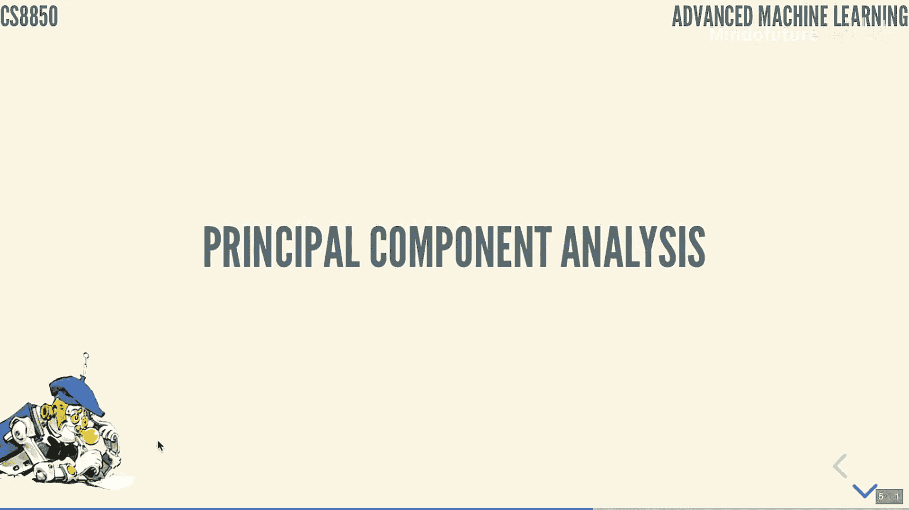
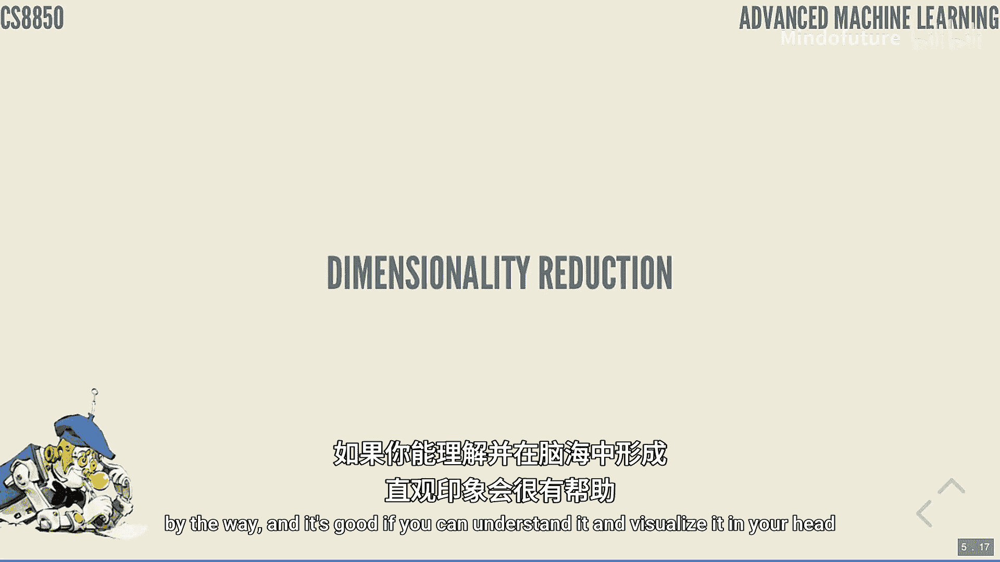

# 021：主成分分析 📊




在本节课中，我们将学习主成分分析的核心数学基础。我们将从二次型开始，逐步理解协方差矩阵、多元高斯分布以及Karhunen-Loève变换，最终揭示PCA如何通过特征向量找到数据的主要变化方向。

## 二次型与矩阵

首先，我们考虑二次型。二次型是一个向量函数 **F(x)**，它以一个向量作为输入，并返回一个标量。其定义为 **xᵀAx**，其中 **A** 是一个对称矩阵。

在二维情况下，矩阵 **A** 由四个值定义，因为对称性，非对角线元素相等。例如，给定向量 **x = [x, y]ᵀ**，我们可以计算 **Ax**，然后计算 **xᵀAx**，最终得到一个关于 **x** 和 **y** 的多项式。

当矩阵 **A** 是正定时，这个二次型是一个抛物面，其等高线是椭圆。一个矩阵是正定的，当且仅当其所有特征值均为正。

以下是二次型的一个例子：
```math
A = \begin{bmatrix} 5 & -2 \\ -2 & 5 \end{bmatrix}
```
对应的二次型为：
```math
xᵀAx = 5x² - 4xy + 5y²
```
这个方程描述了一个倾斜的椭圆。然而，如果我们转换到由椭圆主轴定义的 **u** 和 **v** 坐标系，方程会变得简单，椭圆看起来是“平”的。

## 多元高斯分布

现在，我们来看多元高斯分布的概率密度函数。其表达式如下：
```math
g(x) = \frac{1}{(2\pi)^{k/2} |\Sigma|^{1/2}} \exp\left(-\frac{1}{2} (x - \mu)^T \Sigma^{-1} (x - \mu)\right)
```
其中，**k** 是维度，**Σ** 是一个 **k × k** 的协方差矩阵。

在二维情况下，协方差矩阵包含 **x** 和 **y** 的方差以及它们的协方差。请注意，有时人们用 **σ²** 表示方差，但这里我们使用 **Σ** 来强调多维情况。

如果协方差矩阵 **C** 是对称且正定的，那么它的逆矩阵 **C⁻¹** 也是对称且正定的。这可以通过对角化来证明：如果 **C** 的特征值均为正，那么 **C⁻¹** 的特征值是其倒数，同样为正。

## 样本协方差矩阵

假设我们有 **n** 个来自高斯分布的样本，排列成矩阵 **X**，其中每一行是一个样本。样本协方差矩阵可以通过以下方式计算：
```math
\Sigma \approx \frac{1}{n} X^T X
```
这里，我们假设样本均值为零。**XᵀX** 本质上是所有样本外积的和。对于零均值向量，这个和近似于期望值，即协方差。

## 等高面与主轴定理

多元高斯分布的等高面（或等密度面）是椭球体。如果我们令概率密度函数等于一个常数，取对数并整理，会发现等高面由二次型描述，其右侧为常数。

椭球体有主轴。对于球体，任何正交基都可以作为主轴。但对于一个“压扁”的椭球体，主轴是预先确定的，由协方差矩阵的特征向量给出。

**主轴定理**指出：多元高斯分布等高面形成的椭球体的主轴，由其协方差矩阵的特征向量给出。我们将特征值按降序排列，对应的特征向量依次定义了第一主轴、第二主轴等。

在二维情况下，最大的特征值对应的特征向量定义了椭圆的长轴，而较小的特征值对应的特征向量定义了短轴。

## Karhunen-Loève变换

由于协方差矩阵 **C** 是实对称矩阵，假设我们有足够的样本使其满秩，那么它可以被对角化：
```math
C = W D W^T
```
其中，**W** 的每一列是 **C** 的特征向量，**D** 是对角矩阵，对角线元素为对应的特征值。

Karhunen-Loève变换（KL变换）就是将高斯分布随机变量 **x** 的样本，投影到由其协方差矩阵的特征向量构成的基上。变换后的变量 **u = Wᵀx**。

这个变换有什么好处？想象一下，我们有一个狭长的数据分布。在原始坐标系中，点由 **(x1, x2)** 表示。在KL变换后的新基下，点由 **(w1, w2)** 表示，其中 **w1** 的值通常很大，而 **w2** 的值接近于零。这是一种更紧凑的表示。

更重要的是，变换后变量 **u** 的分布仍然是多元高斯的，但其协方差矩阵变成了对角矩阵 **D**。由于协方差矩阵是对角的，联合分布可以分解为各个边缘分布的乘积。这意味着变换后的变量是**统计独立**的。

## 总结



本节课我们一起学习了主成分分析的数学基础。我们从二次型和正定矩阵出发，理解了它们如何描述椭球面。接着，我们探讨了多元高斯分布及其协方差矩阵，并学习了如何从样本中估计它。通过主轴定理，我们知道了数据分布的主要方向由协方差矩阵的特征向量决定。最后，我们介绍了Karhunen-Loève变换，它通过将数据投影到特征向量基上，不仅实现了降维，还使得新特征之间变得统计独立。这些概念是理解主成分分析如何提取数据主要成分并简化数据结构的关键。