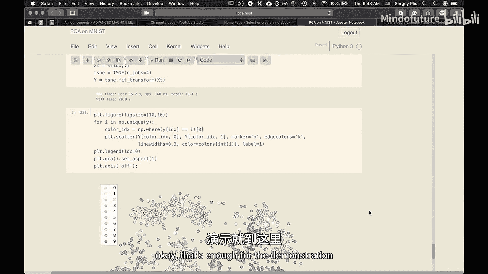

# 022：PCA与KL变换演示 🎯

在本节课中，我们将通过具体的例子来演示主成分分析和KL变换的实际应用。我们将从向量表示开始，逐步深入到高维空间中的数据处理，并展示如何利用PCA进行数据压缩和特征提取。

---

## 向量表示与特征空间

首先，我们从一个简单的数据集开始。假设我们有一个关于汽车的数据集，其中包含速度、酒精含量、是否分心等特征。每个特征都是一个数值，所有特征共同构成了一个向量空间。

我们可以将这些变量分类，它们将存在于相应的子空间中。通过绘制特征之间的散点图，我们可以观察不同特征子空间之间的相关性。

以下是数据表示的核心概念：
- **向量表示**：每个数据点（如一辆车）由一组特征值构成，形成一个向量。
- **特征空间**：所有可能的特征组合构成的空间。

---

## 高维空间中的数据处理

现在，让我们考虑一个更高维度的空间：4096维的人脸图像空间。每张人脸图像由4096个像素的灰度值表示，因此每张图像可以看作是4096维空间中的一个点。

我们在这个空间中选取两个点，分别代表两张不同的人脸图像。通过在这两点之间进行线性插值，我们可以沿着连接它们的直线“行走”，并观察中间点的图像。

**线性插值公式**：
给定两个点 **A** 和 **B**，中间点 **P** 可以表示为：
\[
P = A + t(B - A)
\]
其中 \( t \) 是一个介于0和1之间的参数。

有趣的是，当我们在这条线上移动时，所有的中间图像看起来都像是真实的人脸，而不是随机噪声。这说明了人脸在4096维空间中并不是随机分布的，而是聚集在一个相对紧凑的区域。

---

## 矩阵操作与特征分解

接下来，我们演示一些基本的矩阵操作，如转置和求逆。这些操作在理解数据的线性变换时非常重要。

**转置操作**：将矩阵的行和列互换。
**矩阵求逆**：找到一个矩阵，使得与原矩阵相乘得到单位矩阵。

在某些情况下，原始空间和其逆空间是相互对偶的。例如，当原始空间是稠密的时，其逆空间可能是稀疏的，反之亦然。

---

## 主成分分析与特征脸

现在，我们将PCA应用于人脸数据集。首先，我们计算数据的协方差矩阵，然后找到其特征值和特征向量。这些特征向量（在图像上下文中称为“特征脸”）代表了数据变化的主要方向。

**协方差矩阵**：
\[
\Sigma = \frac{1}{n} \sum_{i=1}^{n} (x_i - \mu)(x_i - \mu)^T
\]
其中 \( x_i \) 是数据点，\( \mu \) 是均值。

**特征值与特征向量**：
满足 \( \Sigma v = \lambda v \) 的向量 \( v \) 和标量 \( \lambda \)。

我们绘制了前16个特征脸，它们对应着最大的特征值。这些特征脸代表了人脸空间中的主要变化模式。

---

## 数据压缩与重建

PCA的一个重要应用是数据压缩。通过只保留最重要的特征向量（即对应最大特征值的特征脸），我们可以用更少的维度来近似表示原始数据。

以下是重建过程的步骤：
1. 选择前 \( k \) 个特征向量。
2. 将原始数据投影到这些特征向量张成的子空间上。
3. 使用投影系数重建数据。

**重建公式**：
\[
\hat{x} = \mu + \sum_{i=1}^{k} (v_i^T (x - \mu)) v_i
\]
其中 \( \hat{x} \) 是重建后的数据点，\( \mu \) 是均值，\( v_i \) 是第 \( i \) 个特征向量。

我们尝试用不同数量的特征向量来重建人脸图像：
- 使用前2个特征向量：重建效果较差，图像模糊。
- 使用前10个特征向量：重建效果有所改善，但细节仍不清晰。
- 使用前50个特征向量：重建效果良好，图像可识别。
- 使用前150个特征向量：重建效果优秀，细节丰富。

这表明，仅用150个数字（而不是原始的4096个像素）就可以相当准确地重建一张人脸图像。

---

## MNIST数据集上的应用

同样的方法也可以应用于其他数据集，如MNIST手写数字数据集。MNIST图像通常表示为784维的向量（28x28像素）。

我们计算了MNIST数据的特征值和特征向量，并绘制了对应的“特征数字”。与特征脸类似，这些特征数字代表了手写数字变化的主要模式。

**特征数字**：对应MNIST数据协方差矩阵特征向量的图像。

通过只保留前30个特征向量，我们可以重建手写数字图像，且重建质量相当不错。

---

## 数据可视化与聚类

最后，我们使用前两个主成分将高维数据投影到二维平面上，以便可视化。每个点代表一个MNIST数字，颜色表示其对应的数字标签。

**二维投影**：
\[
\text{投影坐标} = [v_1^T x, v_2^T x]
\]
其中 \( v_1 \) 和 \( v_2 \) 是前两个特征向量。

在二维投影中，我们可以看到相同数字的点倾向于聚集在一起。这表明，在高维空间中，语义上相似的数据点确实彼此接近。

---

## 总结

在本节课中，我们一起学习了：
1. 如何将数据表示为向量，并理解特征空间的概念。
2. 在高维空间中进行线性插值，观察数据的连续性。
3. 使用PCA找到数据的主要变化方向，并通过特征脸和特征数字进行可视化。
4. 利用PCA进行数据压缩，仅用少量特征向量重建原始数据。
5. 将高维数据投影到低维空间进行可视化，观察数据的聚类情况。

通过这些演示，我们深入理解了PCA和KL变换在实际问题中的应用，为后续学习更复杂的机器学习方法打下了坚实的基础。