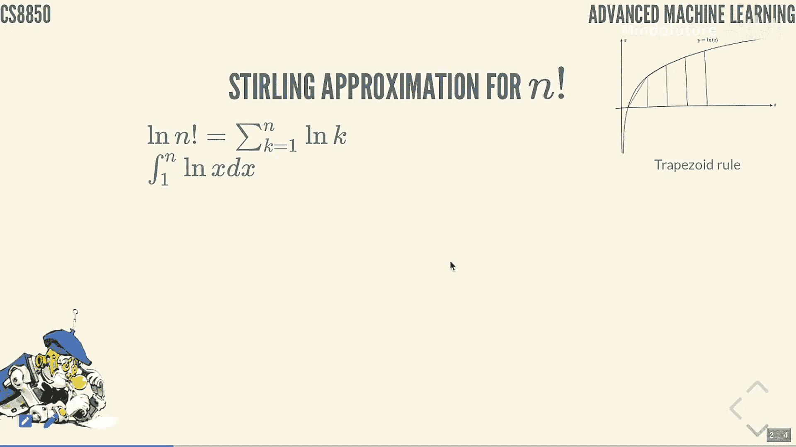
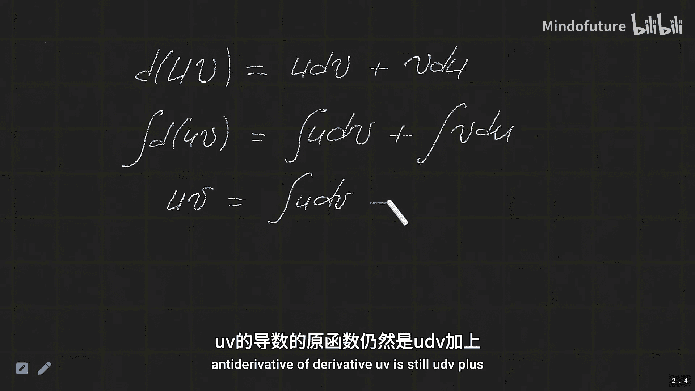
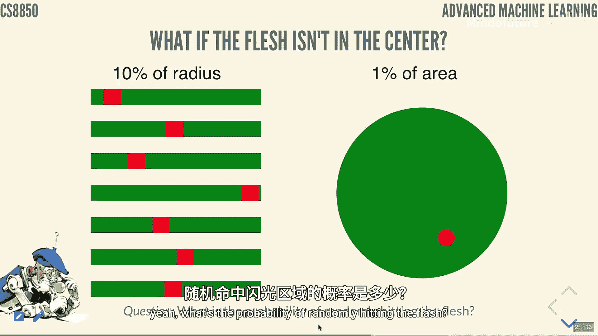
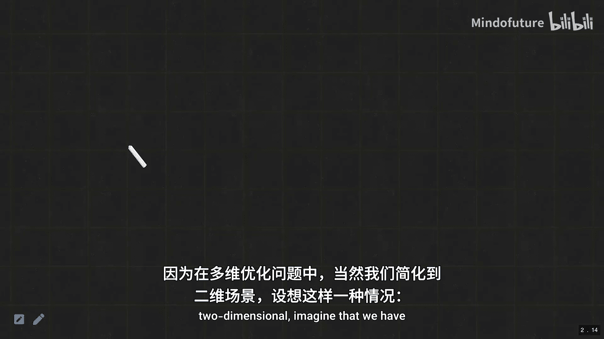
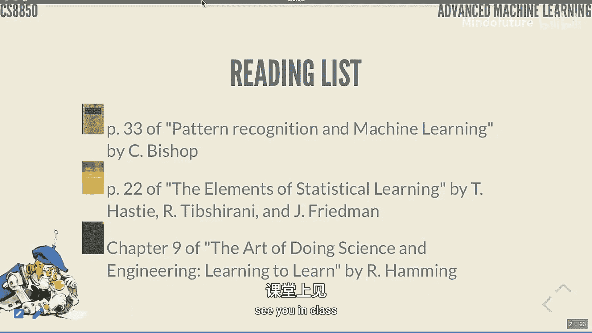

# 023：维度诅咒 📚

在本节课中，我们将深入探讨一个在机器学习与数据分析中无处不在，却又常被简略提及的核心问题：**维度诅咒**。我们将从基础概念出发，通过严谨的数学推导和直观的实例，逐步揭示高维空间的诸多反直觉特性。理解这些特性，对于正确应用分类器、降维算法或聚类方法至关重要。

---

## 从西瓜问题看高维空间 🍉

让我们从一个日常例子开始，直观感受维度增加带来的影响。

假设你在市场挑选西瓜。你不想要太多白色的瓜瓤（Rind），而想要更多红色的瓜肉（Flesh）。如果瓜皮的厚度仅占西瓜半径的15%，情况会如何？

以下是不同维度下的瓜皮占比：
*   **一维切片**：瓜皮占半径的 **15%**。
*   **二维切片**：瓜皮占面积的 **28%**。
*   **三维西瓜**：瓜皮占体积的 **39%**。

由此可见，即使瓜皮很薄，在高维物体中，它所占的体积比例也会急剧增加。你购买的三维西瓜中，近40%是你想扔掉的瓜皮。这个例子初步展示了维度增加可能带来的反直觉结果。

---

## 基础准备：从对角线到斯特林公式 📐

为了深入理解高维几何，我们需要一些数学工具。首先，回顾一下多维空间中对角线长度的计算。

在一个D维立方体中，从原点到点 $(x_1, x_2, ..., x_D)$ 的对角线长度 $L$ 由广义勾股定理给出：
$$ L = \sqrt{x_1^2 + x_2^2 + ... + x_D^2} $$

接下来，我们将推导**斯特林公式**，它用于近似计算阶乘 $n!$，这在后续计算中非常有用。

我们从 $n!$ 的对数开始：
$$ \log(n!) = \sum_{k=1}^{n} \log(k) $$
这个求和可以用积分来近似。利用**分部积分法**，我们可以计算定积分 $\int_1^n \log(x) dx$。

分部积分公式为：
$$ \int u \, dv = uv - \int v \, du $$
令 $u = \log(x)$, $dv = dx$，则 $du = \frac{1}{x}dx$, $v = x$。代入公式：
$$ \int_1^n \log(x) dx = [x \log(x)]_1^n - \int_1^n x \cdot \frac{1}{x} dx = n\log(n) - n + 1 $$

为了获得更好的近似，我们使用**梯形法则**进行数值积分。最终，对两边取指数，我们得到斯特林公式：
$$ n! \approx \sqrt{2\pi n} \left( \frac{n}{e} \right)^n $$
随着 $n$ 增大，近似值与真实值的**比率**趋近于1，尽管它们的**差值**可能变大。

---

## 伽马函数与超球体体积 🌌

上一节我们介绍了阶乘的近似，本节我们将认识**伽马函数**，它是阶乘在实数域上的推广，对于计算高维球体体积至关重要。

伽马函数定义为：
$$ \Gamma(n) = \int_0^\infty x^{n-1} e^{-x} dx $$
通过分部积分，可以证明它满足递推关系：$\Gamma(n) = (n-1) \cdot \Gamma(n-1)$，且 $\Gamma(1)=1$。因此，对于正整数 $n$，有 $\Gamma(n) = (n-1)!$。

一个关键值是 $\Gamma(\frac{1}{2}) = \sqrt{\pi}$。其计算技巧（通过平方后转化为极坐标下的二重积分）将直接用于推导超球体体积公式。

---

## 高维球体的体积与“外壳”悖论 🎱

现在，我们利用伽马函数来探究高维空间的核心谜题之一：超球体的体积特性。

一个 $n$ 维超球体的体积公式为：
$$ V_n(R) = C_n R^n $$
其中 $C_n$ 是依赖于维度 $n$ 的常数。通过将体积视为无穷多个球壳面积的和，并联系到伽马函数，我们可以精确求出：
$$ C_n = \frac{\pi^{n/2}}{\Gamma(\frac{n}{2} + 1)} $$

分析这个公式，我们会发现两个反直觉的结论：

1.  **体积趋于零**：对于固定的半径 $R$，当维度 $n$ 无限增加时，超球体的体积 $V_n(R) \to 0$。
2.  **体积集中于外壳**：考虑一个半径为 $R$ 的球和一个半径为 $(1-\epsilon)R$ 的内层球（$\epsilon$ 是一个很小的正数）。外壳（两个球之间的部分）体积与总体积的比为：
    $$ 1 - (1-\epsilon)^n $$
    当 $n$ 很大时，即使 $\epsilon$ 很小，这个比值也趋近于1。这意味着，**几乎所有的体积都集中在球体表面附近的外壳里**，中心部分几乎是“空”的。

回到西瓜的例子，如果瓜皮（外壳）厚度占半径的15%，在90维空间中，瓜皮将占据西瓜体积的95%以上。

---

## 对机器学习与优化的启示 🤖

上述几何特性对数据科学和机器学习有着深远的影响。

**1. 高斯分布与均值点**
在高维空间中，一个多元高斯分布的样本点几乎不可能落在均值点附近。概率质量主要分布在一个远离均值的“壳”上。这意味着，在高维中，“平均情况”实际上是一种非常罕见的情况。

**2. 随机初始化的困境**
在优化问题中（如神经网络的训练），我们常希望找到全局最优解（“瓜肉”），但它可能只存在于参数空间的一个很小区域内。在低维空间，随机初始化有较大概率落入这个区域。但在高维空间，由于体积集中于外壳，且目标区域体积占比极小，随机初始化策略几乎注定失败。

**3. 向量几乎正交**
在高维空间中随机抽取两个向量，它们几乎总是近似正交的。具体来说，对于由 $+1$ 和 $-1$ 组成的随机向量，随着维度增加，它们之间夹角的余弦值趋近于0。这表明高维空间中有极其丰富的方向，也解释了为什么寻找精确的正交基在数值计算中如此困难。

**4. 数据稀疏性与采样需求**
要估计一个 $D$ 维空间中的概率分布，如果每个维度需要 $B$ 个区间（bin），那么总共需要 $B^D$ 个区间。所需的数据样本量随维度指数级增长，这就是“维度诅咒”在统计学中的直接体现，导致许多在低维有效的方法（如直方图）在高维失效。

---

## 历史案例与不同距离度量 🛩️

一个著名的历史案例发生在1950年代。美国空军发现战机事故频发，调查发现驾驶舱是根据飞行员的“平均”身体尺寸设计的。一位统计学家测量了4063名飞行员的10项身体指标，然后检查有多少人的所有指标都落在平均值的30%范围内。结果是：**0人**。这个“平均”驾驶舱并不适合任何人。这正是高维空间中“平均点”不代表任何典型个体的生动例证。

最后需要指出，我们讨论的悖论基于**欧几里得距离**（L2范数）。在实际应用中，可以根据问题选择不同的距离度量，例如：
*   **曼哈顿距离**（L1范数）：适用于稀疏特征。
*   **切比雪夫距离**（L∞范数）：适用于比较由最大差异主导的对象。
任何有效的距离度量都需要满足非负性、同一性、对称性和三角不等式。

---

## 总结 📝

本节课我们一起深入探讨了**维度诅咒**。我们从切西瓜的直观例子出发，逐步推导了斯特林公式和伽马函数，并严格计算了高维球体的体积，从而揭示了高维空间的核心特性：
1.  高维球体体积随维度增加而趋近于零。
2.  高维球体的体积几乎全部集中于表面薄壳内。
3.  这些几何特性导致高维数据极其稀疏，使得均值失去代表性、随机搜索效率低下、数据采样需求爆炸式增长。

理解维度诅咒，能帮助我们在面对高维数据时保持警惕，审慎选择模型、算法和评估方法，避免陷入直觉的误区。