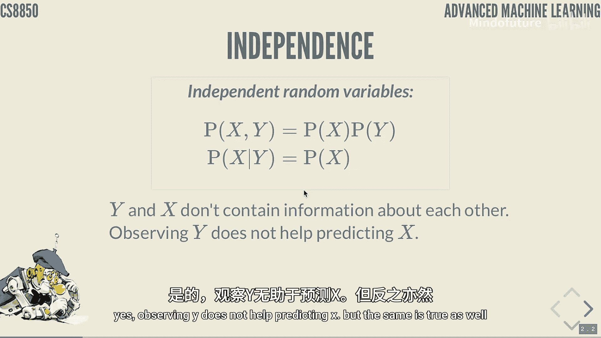
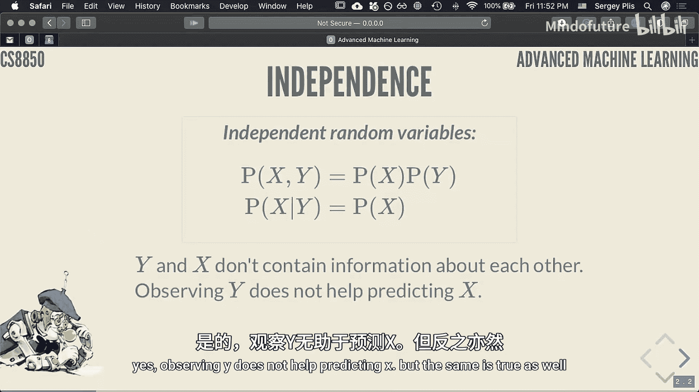
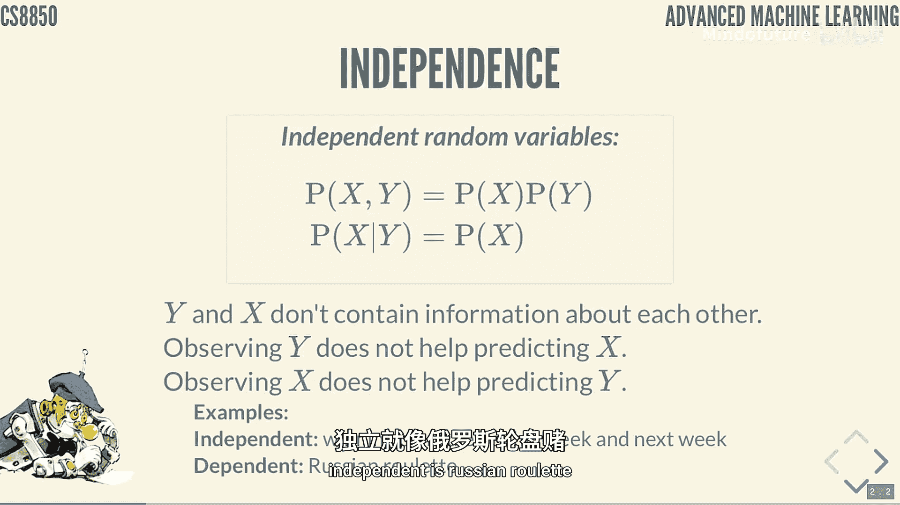
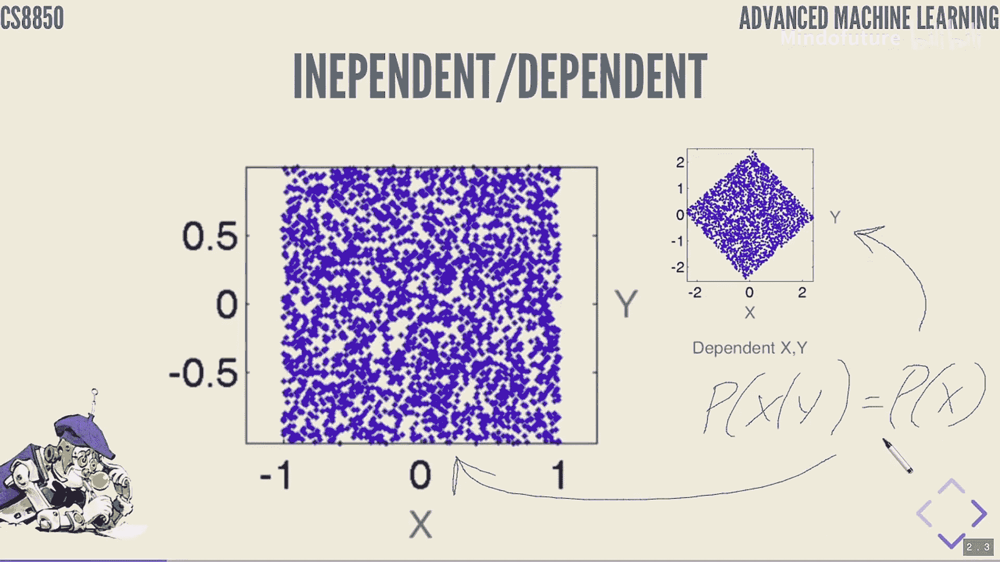
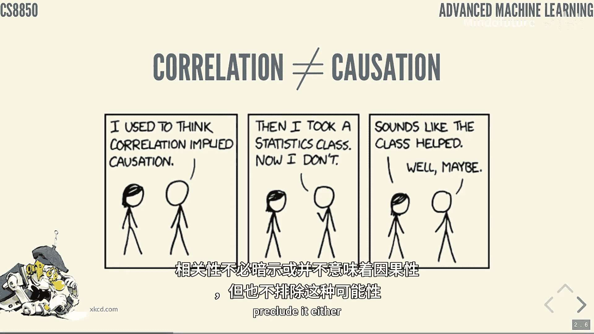

# 024：最大似然估计与独立性 📊

在本节课中，我们将学习两个核心概念：统计独立性与最大似然估计。独立性是理解变量间关系的基础，而最大似然估计则是从数据中学习模型参数的关键方法。我们将首先探讨独立性的定义与含义，然后深入讲解最大似然估计的原理与应用。

## 统计独立性 🔗

上一节我们介绍了本课程的主题，本节中我们来看看统计独立性的定义。在概率论中，如果两个变量的联合分布可以分解为它们各自边缘分布的乘积，则称变量X独立于变量Y。

**公式**：`P(X, Y) = P(X) * P(Y)`

独立性的一个等价定义是，给定Y的条件下，X的条件分布等于X的边缘分布。

**公式**：`P(X | Y) = P(X)`





这两个公式的含义是，Y和X不包含关于彼此的额外信息。更直白地说，无论Y取什么值，X的概率分布都不会改变。反之亦然，观察X也无助于预测Y。例如，本周的轮盘赌结果与下周的结果是独立的。

以下是独立性与依赖性的图示说明：




在左侧图中，变量是非信息性的，联合分布就是边缘分布的乘积。如果你知道Y的值，X的分布不会改变。在右侧图中，变量是依赖的。例如，如果你知道Y的值为0，你对X的了解不多；但如果你知道Y的值为2，你就能大致确定X的位置。因此，X和Y的值之间存在依赖关系，彼此具有预测能力。

## 条件独立性 🔄

理解了无条件独立性后，我们进一步探讨条件独立性。当我们谈论纯粹独立性时，指的是无论观察到什么变量，关系都成立。而条件独立性讨论的是，在给定第三个变量Z的条件下，X和Y的联合概率是否可分解。

**公式**：`P(X, Y | Z) = P(X | Z) * P(Y | Z)`



如果上述公式成立，那么在已知Z的情况下，X和Y是独立的。这意味着，Z是一个共同因素。如果我们用图形表示，X和Y都依赖于Z。但如果我们没有观察到Z，只观察X和Y，那么它们就不是独立的，因为Z向X和Y都添加了信息。

以下是条件独立性的一个经典例子：

*   **现象**：儿童的鞋码大小与阅读能力之间存在明显的依赖关系（相关性）。
*   **解释**：鞋码越大的孩子，阅读能力往往越好。
*   **共同原因（Z）**：年龄。
*   **条件独立性**：在固定儿童的年龄（例如，所有7岁儿童）的条件下，比较鞋码和阅读能力，它们之间将不再有依赖关系。

另一个有趣的例子是关于鹳鸟数量与欧洲人类出生率的研究。数据显示两者存在高度显著的统计相关性，但这并不意味着鹳鸟送子。其背后的共同原因是国家规模：更大的国家通常有更多的鹳鸟和更多的新生儿。当忽略国家规模这个共同原因时，就会产生虚假的相关性解释。

伦敦出租车司机的事故与穿外套之间的相关性是另一个例子。调查最初认为外套妨碍行动导致事故，并准备立法禁止。后来人们意识到，司机穿外套是因为下雨，而下雨时路面湿滑，事故本就更多。这再次说明，**相关性不等于因果性**。



## 最大似然估计 🎯

在理解了数据中的独立性关系后，我们来看看如何从数据中估计模型参数。最大似然估计是参数估计的核心方法。

其核心思想是：给定一个由参数θ定义的模型和一组观测数据D，我们希望找到能使观测数据出现“可能性”最大的参数值θ。

**公式**：`θ_MLE = argmax_θ P(D | θ)`

这里的 `P(D | θ)` 被称为似然函数。通常，我们假设数据点是独立同分布的，因此联合似然可以写成每个数据点似然的乘积。

**公式**：`P(D | θ) = Π_i P(x_i | θ)`

在实际计算中，我们通常最大化对数似然函数，因为乘积取对数后会变成求和，更便于数学处理和计算。

**公式**：`θ_MLE = argmax_θ Σ_i log P(x_i | θ)`

以下是执行最大似然估计的基本步骤：

1.  **定义模型**：根据问题选择一个概率模型 `P(x | θ)`。
2.  **写出似然函数**：基于观测数据，写出似然函数 `L(θ) = P(D | θ)`。
3.  **取对数**：得到对数似然函数 `l(θ) = log L(θ)`。
4.  **求导并设为零**：对 `l(θ)` 关于参数θ求导，令导数等于零。
5.  **求解方程**：解出使导数等于零的参数值θ，即为最大似然估计值。

例如，对于服从正态分布 `N(μ, σ^2)` 的数据，其参数的最大似然估计就是样本均值和样本方差。

**代码示例（概念性伪代码）**：
```python
# 假设数据 data 来自某个分布 P(x|θ)
def log_likelihood(theta, data):
    # 计算对数似然 Σ_i log P(data[i] | theta)
    ...

# 使用优化算法（如梯度下降）找到最大化 log_likelihood 的 theta
theta_mle = optimize.maximize(log_likelihood, initial_guess, args=(data,))
```

## 总结 📝


本节课中我们一起学习了统计独立性与最大似然估计。独立性定义了变量间缺乏信息关联的状态，而条件独立性揭示了在控制共同因素后变量关系的变化，这有助于我们避免将相关性误判为因果性。最大似然估计为我们提供了一种基于数据寻找最可能模型参数的强大工具，它是许多机器学习算法的基础。理解这两个概念，对于构建和解释机器学习模型至关重要。