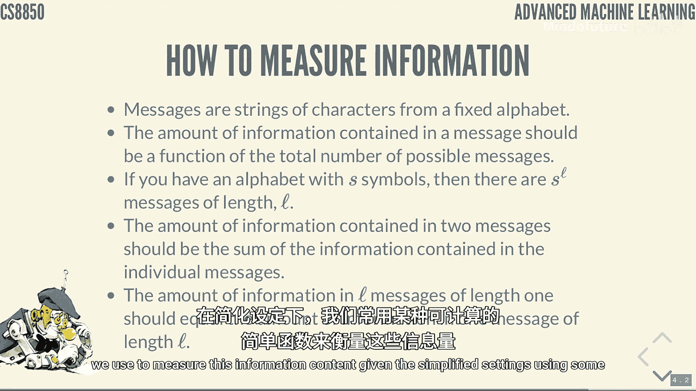
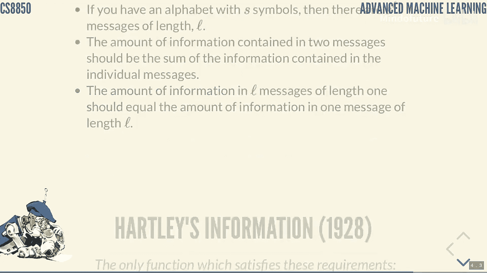
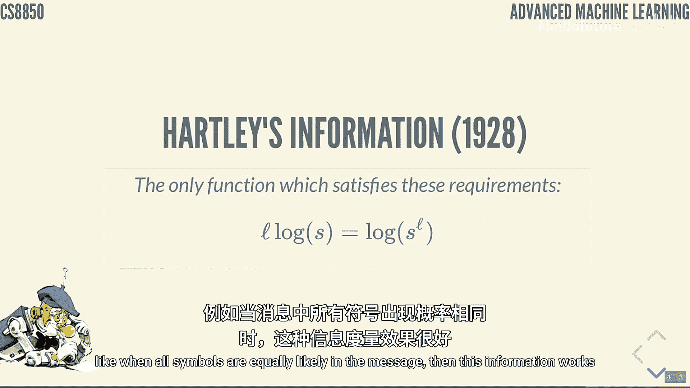
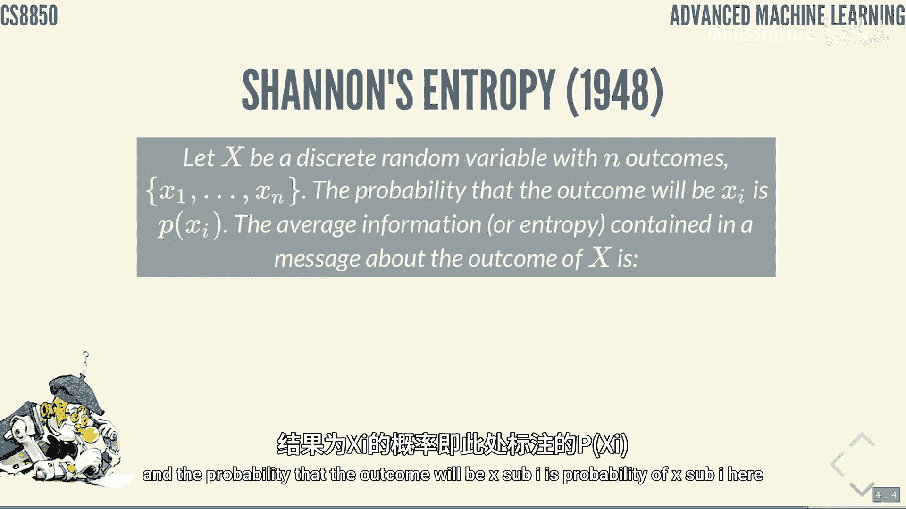
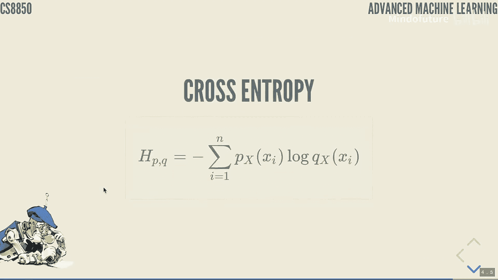
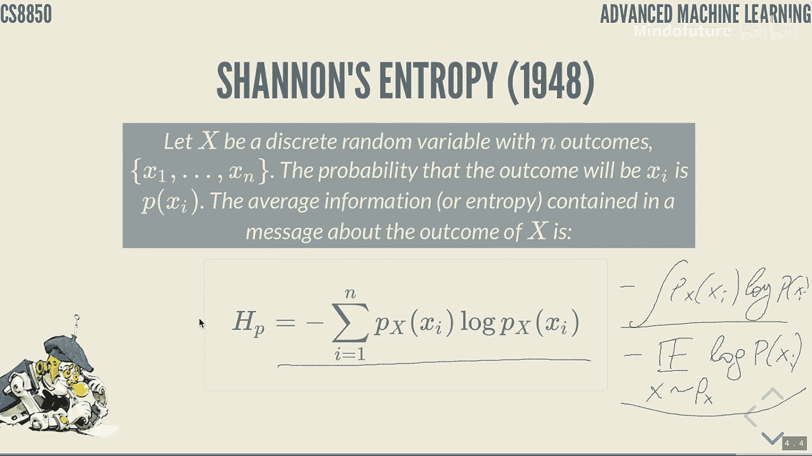
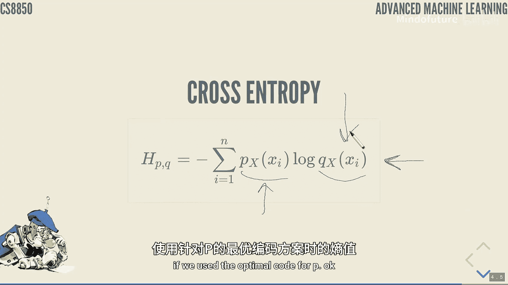
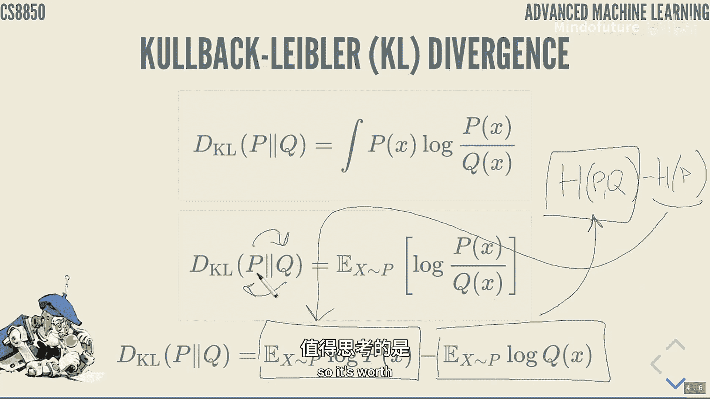
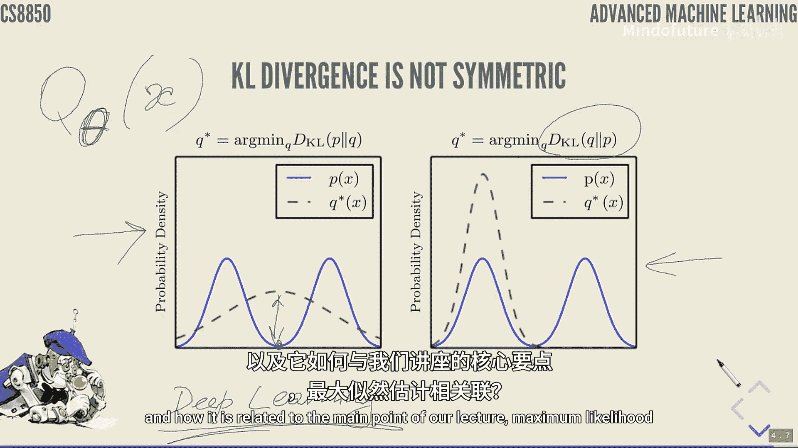
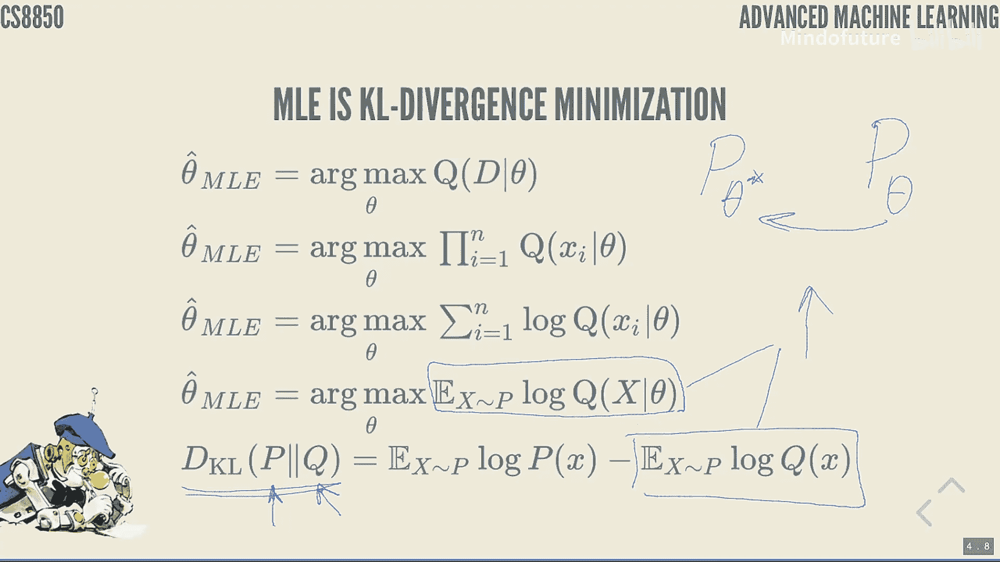

# 026：MLE作为KL散度最小化 🧠

在本节课中，我们将探讨最大似然估计与KL散度之间的深刻联系。我们将从信息论的基础概念出发，逐步理解如何量化信息，并最终揭示MLE本质上是在最小化两个概率分布之间的KL散度。

## 信息与熵的度量 📏

上一节我们介绍了最大似然估计的基本概念。本节中，我们来看看如何从信息论的角度理解它。首先，我们需要一个方法来度量信息。

在通信中，我们通过交换信号来传递消息。“信息”这个词本身很模糊，只是一个直观的概念。直观上，一个消息并不总是等于另一个消息。我们通常会说一个消息“包含信息”，但如何度量消息和信息呢？

经过长时间的思考，研究人员为信息的度量设定了以下要求。这些要求基于以下假设：

*   消息是由固定字母表中的字符组成的字符串。
*   消息所包含的信息量应该是所有可能消息总数的函数。如果一个字母表有 **S** 个符号，那么长度为 **L** 的消息总数是 **S^L**。
*   两条消息所包含的总信息量，应该是各自信息量的和。
*   **L** 条长度为1的消息的信息量，应该等于一条长度为 **L** 的消息的信息量。

在这些简化的设定下，我们可以用什么来计算信息量呢？

1928年，哈特利提出了以下度量。他声称，并且我们现在也同意，唯一满足所有这些要求的函数是 **L log S**，或者 **log (S^L)**。其中 **S** 是字母表中的符号数量，**L** 是消息的长度。

这个信息度量方法有一个需要注意的地方：它隐含地假设了所有符号出现的可能性是相等的。当所有符号等可能出现在消息中时，这个度量方法效果很好。

20年后，香农在此基础上更进一步。他考虑的情况略有不同：如果符号具有不同的概率呢？

设 **X** 是一个具有 **N** 种结果的离散随机变量，这些结果就是我们字母表中的 **N** 个符号 **x1** 到 **xN**。结果 **xi** 出现的概率是 **P(xi)**。

关于 **X** 结果的一条消息所包含的平均信息量是：

**H(X) = - Σ_{i=1}^{N} P(x_i) log P(x_i)**

这也可以写成微分信息的形式。这实际上是 **-log P(x)** 的期望。对于连续信号，其连续形式的熵（微分熵）有时会有一些棘手的行为，但它仍然是一个很好的度量。对于离散字母表 **X**，香农就是这样定义信息度量的。

与哈特利的信息度量一样，我们仍然使用对数函数来平滑变化。在概率密度均匀的情况下，即每个符号 **xi** 等可能时，我们就得到了哈特利信息。

那么，为什么我们称之为“熵”呢？物理学家冯·诺依曼曾对香农说：“你应该叫它熵，原因有两点：第一，你的不确定性函数在统计力学中已经用了这个名字。第二，更重要的是，没人真正知道熵到底是什么，所以在辩论中你总能占上风。”

## 交叉熵与KL散度 🔀

现在，我们考虑另一种情况。如果信号是根据概率分布 **P** 生成的，但我们却使用为概率分布 **Q** 构造的最优编码来编码，会发生什么？

我们测量的是，当使用为 **Q** 设计的编码时，发送一条包含从 **P** 中抽取的符号的消息所需的比特数。这被称为**交叉熵**。

显然，由于编码是为 **Q** 设计的，它对 **P** 来说是次优的。因此，交叉熵会高于我们使用为 **P** 设计的最优编码时的熵。

现在我们有了理解KL散度所需的一切。KL散度定义为：

**D_KL(P || Q) = E_{x~P} [ log (P(x) / Q(x)) ]**

或者写成积分形式。如果你想计算两个分布之间的差异（不是距离，而是一种不相似性的度量），就可以用它。当 **P** 和 **Q** 完全相同时，KL散度为0。KL散度的一个好性质是非负，最小值是0。但它的坏性质是不对称。

如果我们重写这个公式，对数的比值就是 **log P - log Q**，然后利用期望的线性性质，我们可以得到：

**D_KL(P || Q) = E_{x~P} [log P(x)] - E_{x~P} [log Q(x)]**

从这里我们看到，KL散度可以解释为：当我们使用为分布 **Q** 设计的编码时，发送一条包含从分布 **P** 中抽取的符号的消息所需的额外比特数。换句话说，就是 **P** 和 **Q** 的交叉熵减去 **P** 的熵。

因为这个编码是次优的，当 **P** 不等于 **Q** 时，交叉熵大于熵，所以KL散度为正。

现在你知道了KL散度是什么，并且可以看到，如果我们交换 **P** 和 **Q** 的位置，结果将不同，所以它是不对称的。值得思考一下，这种差异会是什么。

## MLE与KL散度最小化的联系 ⛓️

我告诉你所有这些关于熵和KL散度的内容，它与我们这堂课的主题——最大似然估计——有什么关系呢？

事实上，最大似然估计就是KL散度最小化。我现在来快速展示一下。

回想一下，我们的MLE估计 **θ_MLE** 是：

**θ_MLE = argmax_θ Π_{i=1}^{N} P(x_i | θ)**

另一种写法是，用 **Q_θ** 表示我们参数化的模型分布。MLE就是寻找能最大化似然函数的 **θ**。因为我们假设数据集 **D** 是独立同分布采样的，所以似然等价于各个样本概率的乘积。

当 **N** 很大时，所有这些值都小于1，许多小于1的数的乘积会因为下溢错误等问题而难以处理。因此，我们通常转而取对数。由于对数函数是单调递增的，最大化原函数与最大化其对数函数，所得到的 **θ** 是相同的。

引入对数后，公式开始变得熟悉：

**θ_MLE = argmax_θ Σ_{i=1}^{N} log Q_θ(x_i)**

当数据量很大时，根据大数定律，这个求和近似于期望：

**θ_MLE ≈ argmax_θ E_{x~P_data} [ log Q_θ(x) ]**

这几乎等同于我们之前看到的：我们在计算 **log Q_θ** 相对于真实数据分布 **P_data** 的期望。这是什么？这正是**负的交叉熵**。

因此，当我们最大化这个量时，我们实际上是在最小化真实数据分布 **P_data** 与我们试图拟合数据的模型分布 **Q_θ** 之间的KL散度。想象数据是从同一个分布族中生成的，比如 **Q_θ***。我们从一个随机的 **θ** 开始，MLE所做的就是最小化这两个分布之间的KL散度，从而将我们的 **θ** 估计值推向 **θ***。

这就是一个简洁的联系和解释：**最大化似然（MLE）实际上就是在最小化KL散度**。

---

本节课中，我们一起学习了信息论中熵与交叉熵的概念，深入理解了KL散度作为衡量两个概率分布差异的工具。最重要的是，我们揭示了最大似然估计的本质：它并非一个孤立的参数估计方法，而是在最小化模型分布与真实数据分布之间的KL散度。这一观点为理解许多机器学习算法（尤其是在深度学习中的损失函数设计）提供了统一的理论基础。