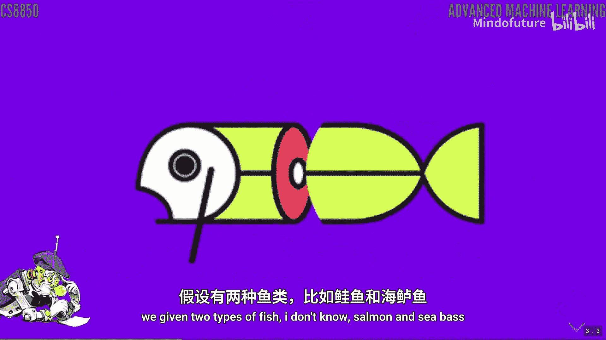
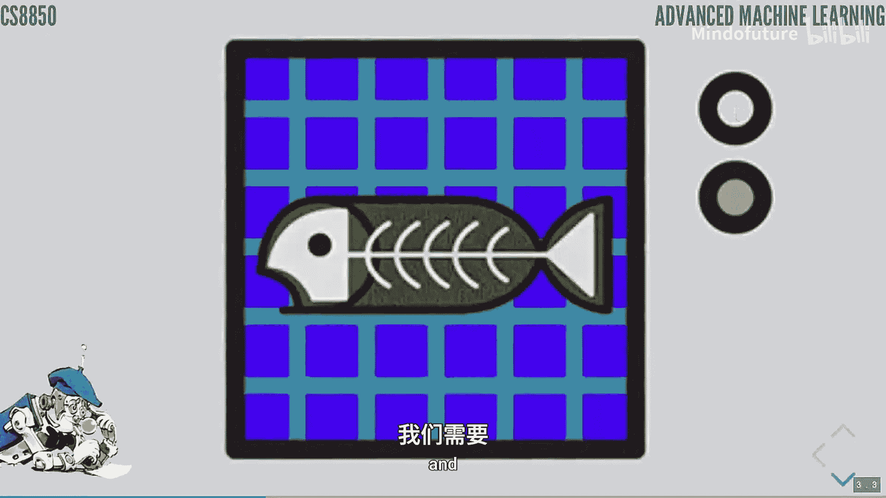
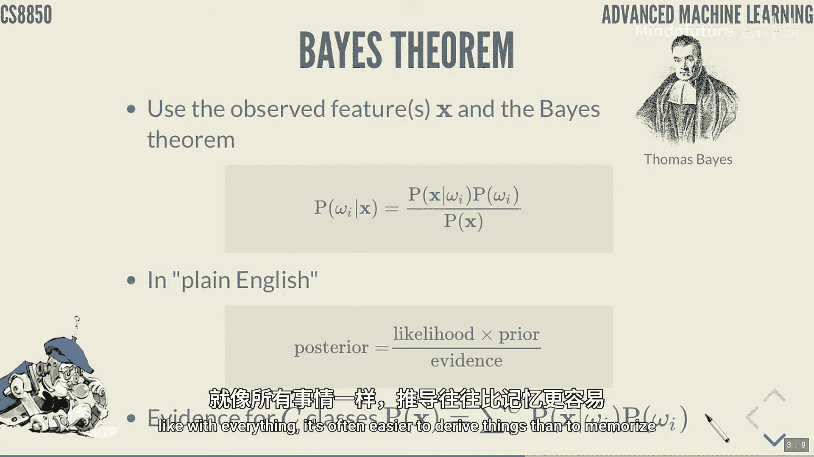
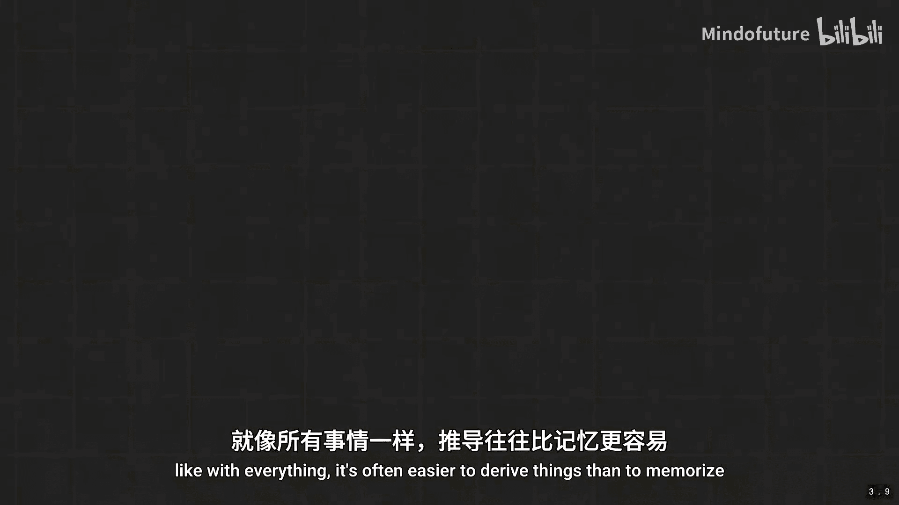
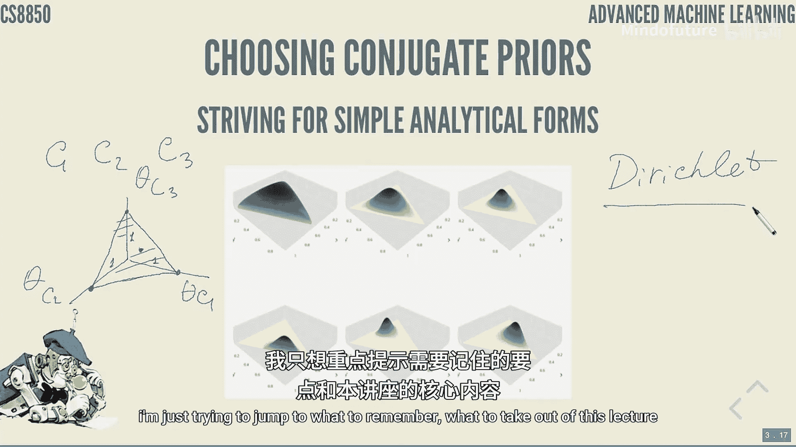

# 027：贝叶斯决策理论 🎯

在本节课中，我们将要学习贝叶斯决策理论。这是一种基于概率和代价来权衡不同分类决策的方法。我们将从一个简单的鱼类分类工厂的例子开始，逐步理解贝叶斯世界观的核心思想，并学习如何利用先验知识、观测数据和贝叶斯定理来做出最优决策。

## 贝叶斯世界观 🌍

上一节我们介绍了从数据直接进行预测的经典方法。本节中我们来看看贝叶斯方法有何不同。

贝叶斯方法的核心思想是：我们面对的世界本质上是概率性的。因此，我们不仅承认数据具有不确定性，还希望对所有我们处理的参数和变量都赋予一个概率分布。这意味着，我们假设每个参数都有其对应的概率分布形状，尽管我们很少能确切知道它，但有一些技巧可以帮助我们量化这种不确定性。

## 什么是贝叶斯决策理论？ 🤔

贝叶斯决策理论是一种基于概率和伴随决策的代价来量化各种分类决策之间权衡的方法。它基于几个关键假设：决策问题以概率形式提出，并且所有相关的概率值都是已知的。

让我们考虑一个简单的例子：一个鱼类加工厂。

我们有两种鱼：三文鱼和海鲈鱼。我们希望自动化整个分类过程。渔民将鱼倒入接收装置，然后系统需要将鱼分类为三文鱼或海鲈鱼，并据此贴上不同的价格标签。

我们如何做到这一点？

## 先验知识与决策规则 📊

首先，假设我们对渔民每天捕获的鱼类比例有一些先验知识。我们用随机变量 ω 表示鱼的种类，它属于一个两类变量：ω1 代表三文鱼，ω2 代表海鲈鱼。

*   **先验概率 P(ω1)**：表示一条鱼是三文鱼的先验概率。
*   **先验概率 P(ω2)**：表示一条鱼是海鲈鱼的先验概率。

这些先验概率是在我们观察任何具体鱼之前就已知的知识。如果我们只知道先验概率，如何构建决策规则？

我们可以遵循一个简单的规则：如果三文鱼的先验概率高于海鲈鱼，则将所有鱼都判定为三文鱼；反之，则全部判定为海鲈鱼。这个规则基于我们已知的信息，可以最小化犯错的概率。然而，这是一个非常粗糙的规则。如果两类先验概率相等，那么这相当于随机猜测，正确率只有50%。

## 引入观测特征：似然与后验 🔍

为了改进决策，我们可以观察鱼的具体特征。例如，设 x 为观测到的鱼的亮度（明暗程度）。

如果我们知道**类条件概率密度**，即给定类别下观测到某个特征的概率，我们就能做出更好的决策。例如：
*   `P(x | ω1)`：如果是一条三文鱼，其亮度为 x 的概率。
*   `P(x | ω2)`：如果是一条海鲈鱼，其亮度为 x 的概率。

但我们真正想要的是**后验概率**：给定观测到特征 x，这条鱼属于某个类别的概率。即 `P(ω | x)`。

**贝叶斯定理**（又称逆概率定理）帮助我们实现这个转换。其公式如下：

`P(ω | x) = [P(x | ω) * P(ω)] / P(x)`

其中：
*   `P(ω | x)` 是**后验概率**。
*   `P(x | ω)` 是**似然**。
*   `P(ω)` 是**先验概率**。
*   `P(x)` 是**证据**（对所有类别的边际似然求和）。

对于 C 个类别，证据的计算公式为：`P(x) = Σ P(x | ω_i) * P(ω_i)`。

## 贝叶斯定理的直观推导 🧮

记住公式可能很难，但推导它却相对简单。让我们通过一个二维变量 (X, Y) 的联合分布来直观理解。

我们从联合概率 `P(X, Y)` 开始。通过对其中一个变量（如 Y）进行**边际化**，我们可以得到另一个变量（X）的边际分布：`P(X) = ∫ P(X, Y) dY`。

现在，假设我们固定 `X = c`，我们想知道 Y 的条件分布 `P(Y | X=c)`。这可以通过在 `X=c` 这条“线”上查看联合分布来获得，但这条“线”本身可能不积分为1。为了使其成为一个有效的概率分布，我们需要用 `X=c` 处的边际概率 `P(X=c)` 对其进行归一化。因此：

`P(Y | X) = P(X, Y) / P(X)`

通过对称性，同样有：`P(X | Y) = P(X, Y) / P(Y)`。

将这两个等式结合，我们可以得到贝叶斯定理的形式：`P(Y | X) = [P(X | Y) * P(Y)] / P(X)`。

## 贝叶斯定理的应用示例：疾病检测 🦠

我们可以用贝叶斯公式来修正直觉。考虑一个疾病检测的例子：
*   已知一种罕见疾病 PML 的患病率（先验）为 1/200,000。
*   诊断测试的准确率为 99%（即，如果患病，测试为阳性的概率 `P(阳性|患病) = 0.99`；如果未患病，测试为阴性的概率也是 0.99，所以 `P(阳性|未患病) = 0.01`）。
*   问题：如果一个人的检测结果为阳性，他实际患病的概率 `P(患病|阳性)` 是多少？

使用贝叶斯公式计算：
`P(患病|阳性) = [P(阳性|患病) * P(患病)] / P(阳性)`
其中 `P(阳性) = P(阳性|患病)*P(患病) + P(阳性|未患病)*P(未患病)`。

代入数值计算后，会发现 `P(患病|阳性)` 只有大约 **5%**。这说明即使测试非常准确，但由于疾病本身极其罕见，一个阳性结果更可能是假阳性。这展示了贝叶斯推理的强大之处。

## 构建最优决策规则 🏆

回到我们的鱼类工厂问题。我们测量每条鱼的亮度 x，并计算其后验概率 `P(ω1 | x)` 和 `P(ω2 | x)`。

最优决策规则是：选择后验概率更高的那个类别。
*   如果 `P(ω1 | x) > P(ω2 | x)`，则判定为三文鱼 (ω1)。
*   否则，判定为海鲈鱼 (ω2)。

遵循此规则，在任意观测点 x 上，我们的错误概率是 `min(P(ω1 | x), P(ω2 | x))`。这是理论上可能达到的平均最优性能。

## 广义贝叶斯决策理论 ⚙️

现在让我们将理论一般化，以处理更复杂的情况：
*   **多特征**：特征 x 可以是多维向量。
*   **多类别**：类别 ω 可以多于两个。
*   **多种行动**：除了分类，还可以选择“拒绝判断”或其他行动。
*   **损失函数**：引入更一般的损失函数 `λ(α_i | ω_j)`，表示当真实类别为 ω_j 时采取行动 α_i 所造成的代价（而不仅仅是错误概率）。

定义**条件风险**：给定观测 x 采取行动 α 的期望损失。
`R(α_i | x) = Σ_j λ(α_i | ω_j) * P(ω_j | x)`

贝叶斯决策规则的目标是选择那个能最小化条件风险的行动。**总风险**则是所有可能观测上条件风险的期望。

## 最大后验概率估计 🎲

在纯粹的贝叶斯观点中，答案是一个完整的概率分布（后验分布）。但有时我们只需要一个点估计。**最大后验概率估计** 就是选择后验概率最大的那个参数值作为估计。

例如，在抛硬币问题中，我们想估计正面朝上的概率 θ。我们有一个先验分布 `P(θ)`（例如 Beta 分布）和似然函数 `P(数据 | θ)`（二项分布）。通过贝叶斯定理得到后验分布 `P(θ | 数据)`。MAP 估计就是找到使 `P(θ | 数据)` 最大的 θ 值。

**共轭先验** 是一个有用的概念：如果我们为某个似然函数选择特定形式的先验分布（如 Beta 分布对于二项似然），那么后验分布将保持与先验相同的形式，这大大简化了计算。

## 决策规则的简化：似然比与对数似然比 ➗

在实际比较两个类别的后验概率时，我们经常使用简化形式。决策规则是比较 `P(ω1 | x)` 和 `P(ω2 | x)`。

利用贝叶斯公式，我们可以得到**似然比**：
`[P(ω1 | x)] / [P(ω2 | x)] = [P(x | ω1) * P(ω1)] / [P(x | ω2) * P(ω2)]`

注意，证据项 `P(x)` 被约掉了。决策规则变为：如果似然比大于1，则选择 ω1，否则选择 ω2。

进一步，取对数得到**对数似然比**，并与0比较：
`log [P(x | ω1) / P(x | ω2)] + log [P(ω1) / P(ω2)] > 0 ? ω1 : ω2`
这在实际计算中常常更方便。

## 总结 📝

本节课中我们一起学习了贝叶斯决策理论的核心内容。我们从贝叶斯世界观出发，理解了先验概率、似然函数、证据和后验概率的概念。通过贝叶斯定理，我们可以将先验知识与观测数据结合，得到用于决策的后验概率。我们学习了如何构建最小化错误概率或期望损失的最优决策规则，并探讨了其一般化形式。最后，我们了解了最大后验概率估计作为贝叶斯点估计的方法，以及共轭先验和似然比检验等实用技巧。掌握这些概念是理解更高级贝叶斯机器学习方法的基础。