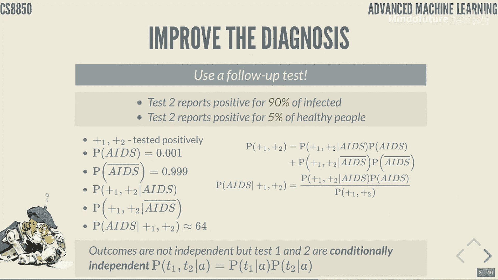

# 028：朴素贝叶斯与最大后验估计 🧠

在本节课中，我们将学习两种重要的概率估计方法：最大后验估计和朴素贝叶斯分类器。我们将从理解最大后验估计开始，然后探讨如何将其应用于构建一个简单而强大的分类器。

## 最大后验估计

上一节我们介绍了最大似然估计，它完全由数据决定参数。本节中我们来看看当数据量不足时，如何利用先验知识来改进估计，这就是最大后验估计。

假设你怀疑一枚硬币是有偏的。你抛掷它并记录结果。最大似然估计会给出一个估计值。如果抛掷次数足够多，它可能会收敛到真实的均值。但如果你只能看到很少几次抛掷结果呢？你能否利用已有的知识？这就是最大后验估计要解决的问题。

在贝叶斯的世界观中，我们不以确定性看待事物，而是用概率来量化知识或参数的不确定性。如果我们怀疑硬币接近50/50的公平状态，如何表达这种“怀疑”或“先验信念”？贝叶斯主义者建议使用概率作为科学的逻辑基础。

遵循贝叶斯方法，我们不是估计一个单一的参数值θ，而是获得一个关于θ可能取值的概率分布。θ是我们似然函数的参数。对于给定的参数θ，观测到特定数据的概率就是似然函数。

在现实中，我们不会说某个概率绝对是1。我们会说，我们相当确定它是1/2，但也存在一些不确定性，它可能稍低或稍高。这就是先验分布，它代表了在看到任何数据之前，我们对参数θ的期望。后验分布则会在看到数据后，根据数据更新我们的先验信念。

### 如何选择先验分布？

以下是选择先验分布的两种主要思路：
*   **哲学方法**：我们希望先验分布能够代表专家知识或我们自己的知识，并将其编码为概率密度形式。这通常能带来最好的结果。
*   **工程或实用方法**：我们希望选择一个能使后验分布形式简单、易于处理的先验。其中一种重要的先验是**共轭先验**。

共轭先验能保证后验分布具有闭式解，并且与先验分布属于同一函数族。这意味着后验概率 `P(θ|数据)` 会有一个易于处理的解析形式。

### 贝叶斯定理与链式法则

托马斯·贝叶斯在1763年发表了《论机会学说中一个问题的解》，其中核心思想后来发展为贝叶斯定理。

链式法则指出，对于联合分布 `P(X, Y)`，我们可以将其分解为条件概率和边缘概率的乘积：`P(X, Y) = P(X|Y)P(Y)`。反之，也可以写成 `P(Y|X)P(X)`。

从链式法则可以推导出贝叶斯定理：`P(Y|X) = P(X|Y)P(Y) / P(X)`。贝叶斯定理的重要性在于其“反向条件化”的特性。如果我们知道如何计算 `P(X|Y)`，就可以利用这个规则反过来计算 `P(Y|X)`。

### MLE 与 MAP 的对比

在贝叶斯学习中，我们有数据 `D`（一组样本）。我们希望最大化后验概率 `P(θ|D)`。根据贝叶斯定理：
`P(θ|D) = P(D|θ)P(θ) / P(D)`
由于 `P(D)` 是与θ无关的归一化常数，在最大化时我们可以忽略它。因此，我们通常处理比例关系：`P(θ|D) ∝ P(D|θ)P(θ)`，即**似然 × 先验**。

现在，对比最大似然估计和最大后验估计：
*   **最大似然估计**：选择使观测数据概率最大的值。`θ_MLE = argmax_θ P(D|θ)`
*   **最大后验估计**：选择在给定观测数据和先验信念下最可能的值。`θ_MAP = argmax_θ P(θ|D) = argmax_θ P(D|θ)P(θ)`

引入先验 `P(θ)` 后，即使在没有足够数据进行精确MLE估计的情况下，我们也能得到更有用的参数估计。当先验是均匀分布（无信息先验）时，MAP估计就退化为了MLE估计，因为此时 `P(θ)` 是常数。

### 实践：硬币抛掷的MAP估计

我们从一个具体例子开始：估计有偏硬币正面朝上的概率θ。
*   **似然函数**：我们使用二项分布似然。`P(D|θ) = θ^{#正面} (1-θ)^{#反面}`
*   **先验选择**：我们选择Beta分布作为θ的先验。Beta分布定义在[0,1]区间上，正好适合表示概率参数θ的分布。其概率密度函数为：`P(θ) ∝ θ^{α-1}(1-θ)^{β-1}`，其中α和β是形状参数。

如果我们选择Beta先验，一个美妙的事情会发生：后验分布 `P(θ|D)` 也将是一个Beta分布。这正是共轭性的体现。计算后验时，我们得到：
`P(θ|D) ∝ θ^{#正面 + α - 1} (1-θ)^{#反面 + β - 1}`
新的Beta分布参数变成了 `α' = #正面 + α` 和 `β' = #反面 + β`。

此时，最大后验估计为：
`θ_MAP = (#正面 + α - 1) / (#正面 + #反面 + α + β - 2)`
注意，它不再是简单的正面频率，而是融合了先验信息（通过α和β）。α和β可以理解为我们对“虚拟”正面和反面次数的先验信念。

### 先验的影响与贝叶斯学习

让我们看看后验分布如何随数据变化。
*   **起点**：假设我们先验认为硬币是公平的，设置 `α = β = 2`，先验分布集中在0.5附近。
*   **过程**：随着我们抛掷硬币次数增加，观测到的正面和反面次数被加到α和β上。
*   **结果**：后验分布变得越来越集中。当数据量很大时（例如抛掷300次），先验参数（2和2）的影响就微乎其微了。后验分布主要由数据主导。

这就是**贝叶斯学习**：我们通过先验知识编码初始信念，然后根据新数据更新信念。对于小数据，先验起到正则化作用，防止过拟合或产生荒谬的估计。对于大数据，先验的影响会被“洗掉”，数据占据主导。即使使用非正常的无信息先验，一旦有数据进入，后验也会变得正常，这是贝叶斯学习的一个良好性质。

### 扩展到多项分布：掷骰子

如果我们不是抛硬币，而是掷一个有K个面的骰子呢？这时我们使用**多项分布**作为似然函数。
`P(D|θ) ∝ ∏_{k=1}^{K} θ_k^{n_k}`
其中 `θ_k` 是第k面朝上的概率，`n_k` 是观测到的第k面朝上的次数。

为了进行MAP估计，我们选择**狄利克雷分布**作为先验。狄利克雷分布是Beta分布在多维上的推广，定义在概率单纯形上（即所有 `θ_k` 满足 `θ_k > 0` 且 `∑θ_k = 1`）。
`P(θ) ∝ ∏_{k=1}^{K} θ_k^{β_k - 1}`

狄利克雷分布也是多项分布的共轭先验。后验分布同样是狄利克雷分布：
`P(θ|D) ∝ ∏_{k=1}^{K} θ_k^{n_k + β_k - 1}`
新的参数为 `β_k' = n_k + β_k`。`β_k` 可以解释为我们对第k类结果出现次数的先验信念。

## 贝叶斯定理应用练习

在进入朴素贝叶斯分类器之前，我们先通过两个例子巩固对贝叶斯定理的理解。

### 练习1：水果盒子问题

假设有三个颜色的盒子：
*   红盒：3个苹果，2个橙子，3个酸橙
*   绿盒：2个苹果，4个橙子，1个酸橙
*   蓝盒：2个苹果，1个橙子，0个酸橙

随机选择一个盒子的概率为：P(绿)=0.2， P(红)=0.2， P(蓝)=0.6。
然后从选中的盒子中均匀随机抽取一个水果，发现是橙子。
**问题**：这个橙子来自绿盒的概率是多少？

**解答**：这正是贝叶斯定理“反向条件化”的应用。我们想知道 `P(绿盒 | 橙子)`。
根据贝叶斯定理：
`P(绿盒 | 橙子) = P(橙子 | 绿盒) * P(绿盒) / P(橙子)`
其中：
*   `P(橙子 | 绿盒) = 4/7` （绿盒中4个橙子，共7个水果）
*   `P(绿盒) = 0.2`
*   `P(橙子) = P(橙子|绿盒)P(绿盒) + P(橙子|红盒)P(红盒) + P(橙子|蓝盒)P(蓝盒)`
    *   `P(橙子|红盒) = 2/8 = 1/4`， `P(红盒)=0.2`
    *   `P(橙子|蓝盒) = 1/3`， `P(蓝盒)=0.6`
计算 `P(橙子)` 并代入，即可得到 `P(绿盒 | 橙子) ≈ 0.314`。

### 练习2：艾滋病检测问题

假设一种艾滋病检测试纸：
*   人群感染率（先验）：`P(患病) = 0.1% = 0.001`
*   检测准确性：如果患病，检测必为阳性（无假阴性）：`P(阳性 | 患病) = 1`
*   检测特异性：如果健康，有1%的假阳性率：`P(阳性 | 健康) = 0.01`

**问题**：如果一个人检测结果为阳性，他实际患病的概率是多少？

**解答**：应用贝叶斯定理计算 `P(患病 | 阳性)`。
`P(患病 | 阳性) = P(阳性 | 患病)P(患病) / P(阳性)`
`P(阳性) = P(阳性|患病)P(患病) + P(阳性|健康)P(健康) = 1*0.001 + 0.01*0.999 ≈ 0.01099`
因此，`P(患病 | 阳性) ≈ (1 * 0.001) / 0.01099 ≈ 0.091 ≈ 9%`

尽管这个检测看起来非常完美（不漏检），但由于疾病本身发病率极低，检测结果为阳性的人中，真正患病的概率也只有9%左右。

**进阶思考**：如果我们使用**两次独立的检测**呢？
假设有第二种检测方法：
*   `P(阳性 | 患病) = 0.9` （有10%假阴性）
*   `P(阳性 | 健康) = 0.05` （有5%假阳性）

**问题**：如果同一个人两次检测结果都是阳性，他实际患病的概率是多少？

**解答**：我们需要计算 `P(患病 | 阳性1, 阳性2)`。关键在于，在给定患病与否的条件下，两次检测的结果可以认为是条件独立的。因此：
`P(阳性1, 阳性2 | 患病) = P(阳性1 | 患病) * P(阳性2 | 患病) = 1 * 0.9 = 0.9`
`P(阳性1, 阳性2 | 健康) = P(阳性1 | 健康) * P(阳性2 | 健康) = 0.01 * 0.05 = 0.0005`
再次应用贝叶斯定理：
`P(患病 | 阳性1, 阳性2) = P(阳性1, 阳性2 | 患病)P(患病) / P(阳性1, 阳性2)`
分母 `P(阳性1, 阳性2) = P(阳性1, 阳性2 | 患病)P(患病) + P(阳性1, 阳性2 | 健康)P(健康) = 0.9*0.001 + 0.0005*0.999 ≈ 0.0013995`
因此，`P(患病 | 阳性1, 阳性2) ≈ (0.9 * 0.001) / 0.0013995 ≈ 0.643 ≈ 64%`

通过结合两次不完美的检测，我们将确诊信心从9%大幅提升到了64%。这个例子展示了结合多个（条件独立）证据的强大力量，也引出了我们下一节的核心——朴素贝叶斯分类器的基本思想。

## 总结

本节课中我们一起学习了：
1.  **最大后验估计**：一种融合了先验知识和观测数据的参数估计方法。当数据稀缺时，它比最大似然估计更稳健。
2.  **共轭先验**：为了计算方便而选择的一种先验分布，它能保证后验分布与先验属于同一家族，从而得到闭式解。例如，Beta分布是二项分布的共轭先验，狄利克雷分布是多项分布的共轭先验。
3.  **贝叶斯学习**：通过先验分布表达初始不确定性，然后利用数据更新为后验分布的过程。随着数据量增大，先验的影响逐渐减弱。
4.  **贝叶斯定理的应用**：我们通过水果盒子和艾滋病检测的例子，练习了如何利用贝叶斯定理进行“反向概率”计算，这是理解后续朴素贝叶斯分类器的基础。关键启示是，结合多个条件独立的证据可以显著提高判断的准确性。