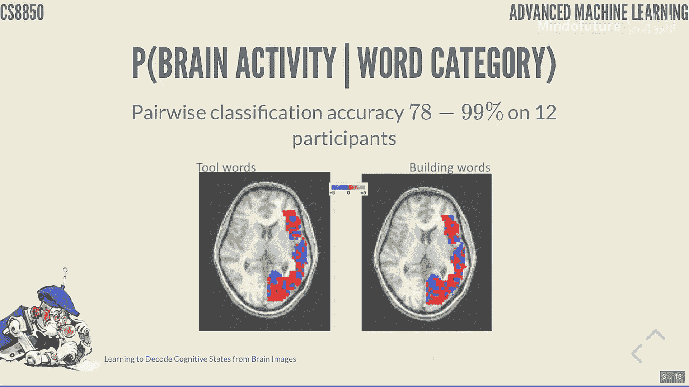

# 029：朴素贝叶斯分类器 🧠


在本节课中，我们将学习朴素贝叶斯分类器。这是一种基于贝叶斯定理的简单而强大的分类方法，尤其适用于文本分类（如垃圾邮件过滤）等任务。我们将了解其核心假设、工作原理、参数估计方法以及在实际应用中的优缺点。

---

## 核心概念与假设

朴素贝叶斯分类器的核心思想是：在给定类别标签 `Y` 的条件下，所有特征 `X_i` 都是**条件独立**的。这意味着，如果我们知道一封邮件是垃圾邮件（`Y=spam`），那么邮件发送时间、长度、特定词汇的出现等特征之间是相互独立的。

这个条件独立性假设可以用以下公式表示：
```
P(X_1, X_2, ..., X_D | Y) = ∏_{i=1}^{D} P(X_i | Y)
```
其中，`D` 是特征的数量。这个假设极大地简化了模型，因为它允许我们将复杂的联合概率分布分解为多个简单条件概率的乘积。

---

## 分类器决策规则

基于上述假设和贝叶斯定理，朴素贝叶斯分类器的决策规则是：对于给定的特征向量 `X`，选择使后验概率 `P(Y | X)` 最大的类别 `Y`。由于 `P(X)` 对于所有类别是相同的，这等价于最大化联合概率：
```
y_pred = argmax_{y} P(Y=y) * ∏_{i=1}^{D} P(X_i | Y=y)
```
这里，`P(Y)` 是类别的**先验概率**，`P(X_i | Y)` 是每个特征的**条件似然**。

---

## 参数估计：以离散特征为例

为了使用朴素贝叶斯分类器，我们需要从训练数据中估计先验概率 `P(Y)` 和条件似然 `P(X_i | Y)`。对于离散特征，这可以通过简单的计数来完成。

以下是估计步骤：
1.  **估计先验概率 `P(Y)`**：计算每个类别在训练集中出现的频率。
    ```
    P(Y = k) = (数据集中类别为 k 的样本数) / (总样本数 N)
    ```
2.  **估计条件似然 `P(X_i | Y)`**：对于每个特征 `i` 和每个类别 `k`，计算该特征取特定值 `v` 的频率。
    ```
    P(X_i = v | Y = k) = (在类别 k 中，特征 i 取值为 v 的样本数) / (类别 k 的总样本数)
    ```

这种基于计数的最大似然估计方法非常直观且易于计算。

---

## 实际应用：文本分类与词袋模型

朴素贝叶斯在文本分类中应用广泛，例如垃圾邮件检测。直接将每个单词在文本中的位置作为特征会导致参数爆炸（例如，`词汇表大小^邮件长度`）。

为了解决这个问题，我们引入**词袋模型**。它做出两个简化假设：
1.  特征独立性（朴素贝叶斯本身）。
2.  **词序无关性**：只关心某个词是否在邮件中出现，而不关心其出现的位置和顺序。

在词袋模型中，我们将每封邮件表示为一个长度为 `V`（词汇表大小）的**二进制向量**。向量中的每一位对应词汇表中的一个词，如果该词在邮件中出现，则对应位为1，否则为0。这样，需要估计的参数数量就从天文数字减少到了 `V * K`（`K` 为类别数），变得可行。

---

## 潜在问题与解决方案

尽管朴素贝叶斯非常有效，但在实际应用中需要注意两个主要问题：

1.  **零概率问题**：如果训练集中从未出现某个特征与某个类别的组合（例如，“奢侈品”这个词从未出现在“非垃圾邮件”中），那么根据最大似然估计，`P(“奢侈品” | 非垃圾邮件) = 0`。这将导致整个联合概率乘积为零，使得模型无法对该类别做出任何预测。
    *   **解决方案：拉普拉斯平滑**。在计数时，为每个可能的特征值组合都预先加一个小的计数（通常为1）。这确保了即使未在训练集中观察到，概率估计也不会为零。

2.  **数值下溢**：由于需要计算许多小于1的概率的乘积，当特征数量 `D` 很大时，最终乘积会是一个极其接近0的小数，可能导致计算机浮点数下溢。
    *   **解决方案：使用对数概率**。我们对目标函数取对数，将乘积转化为求和：`log(P(Y) * ∏ P(X_i|Y)) = log(P(Y)) + ∑ log(P(X_i|Y))`。最大化原函数等价于最大化其对数函数，且避免了数值下溢。

---

## 扩展到连续特征

朴素贝叶斯并不局限于离散特征。对于连续特征（如图像像素强度），我们可以为每个特征 `X_i` 选择适合的概率分布形式，例如**高斯分布**。

此时，条件似然 `P(X_i | Y)` 可以建模为一个高斯分布：
```
P(X_i = x | Y = k) = N(x; μ_{ik}, σ_{ik}^2)
```
其中，`μ_{ik}` 和 `σ_{ik}^2` 是类别 `k` 下第 `i` 个特征的均值和方差。这些参数可以从训练数据中估计（例如，计算类别 `k` 下所有样本在第 `i` 个特征上的均值和方差）。这种方法在简单图像分类（如手写数字识别MNIST）上也能获得不错的基线效果。

---


## 总结


本节课我们一起学习了朴素贝叶斯分类器。我们首先了解了其核心的**条件独立性假设**，它使得模型得以简化。接着，我们推导了分类器的**决策规则**，即最大化后验概率。


我们详细探讨了如何使用**计数方法**估计离散特征的参数，并介绍了在文本分类中至关重要的**词袋模型**。我们还讨论了模型可能遇到的**零概率问题**和**数值下溢问题**，并给出了**拉普拉斯平滑**和**对数概率**的解决方案。最后，我们看到了如何将朴素贝叶斯扩展到**连续特征**，例如使用高斯分布进行建模。



朴素贝叶斯的强大之处在于其简单性、高效性以及良好的可解释性。虽然其“朴素”的独立性假设在现实中很少完全成立，但它往往在实践中表现得出人意料地好，是许多分类任务一个优秀的基准模型。请记住，作为模型的设计者，你可以根据具体问题灵活选择先验分布和似然函数的形式。