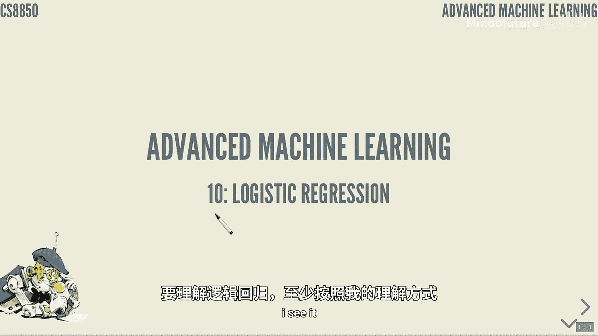
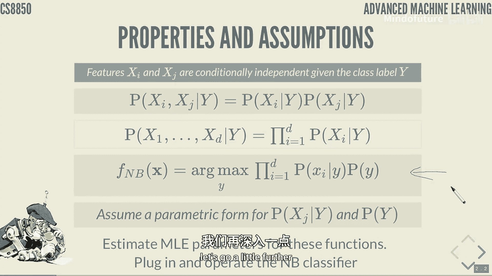
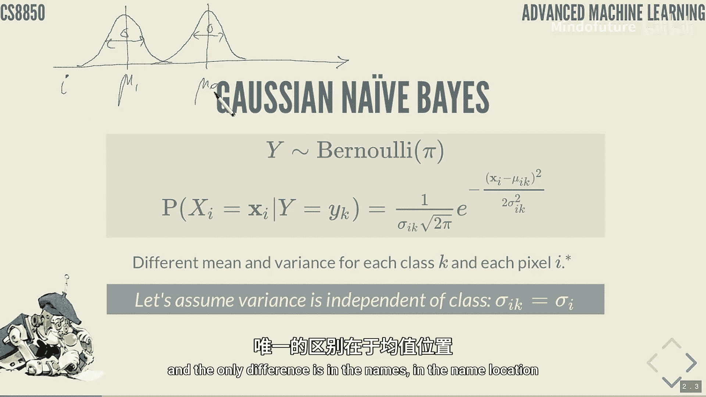
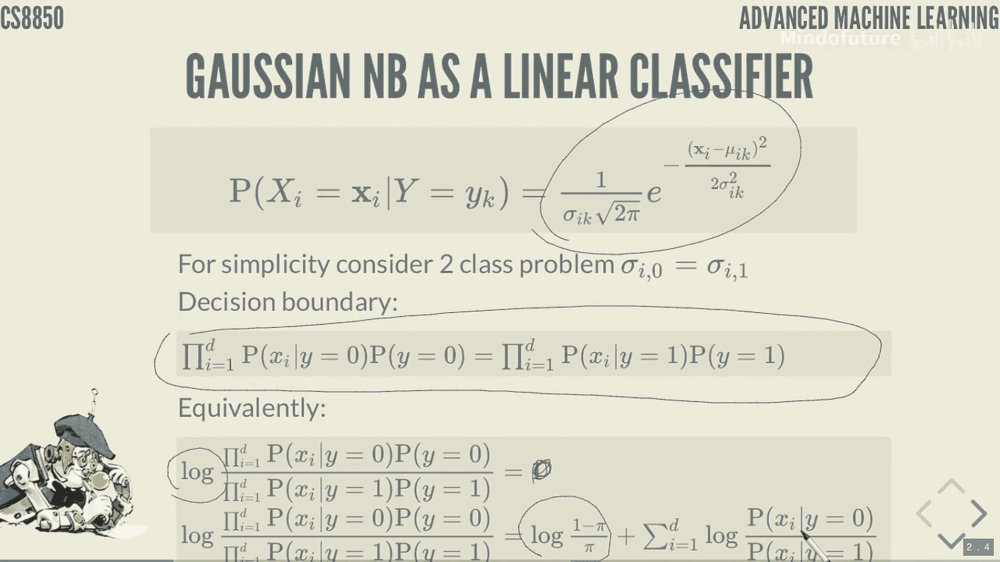
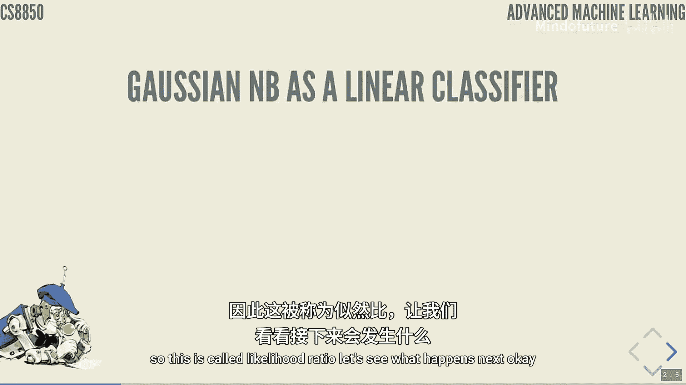
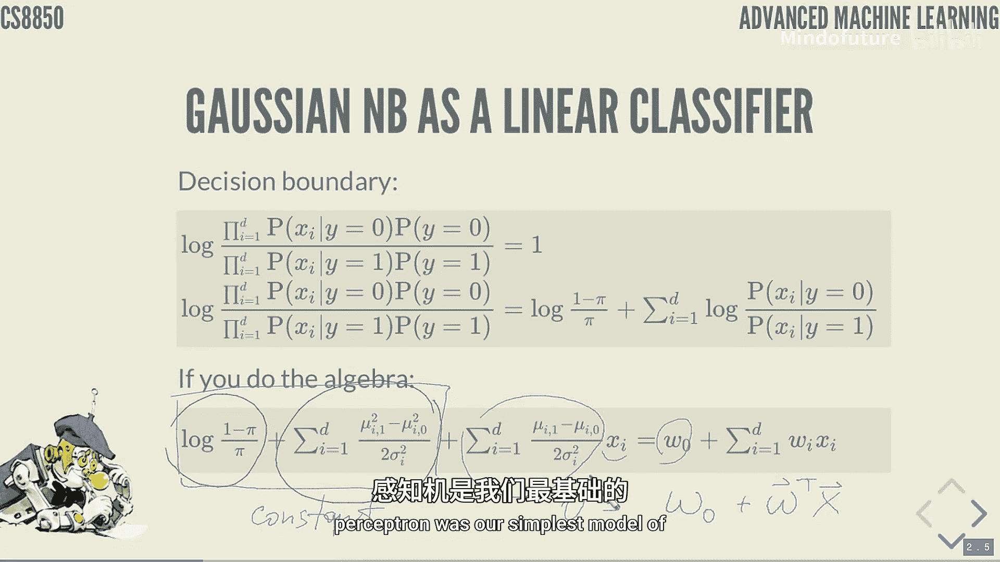
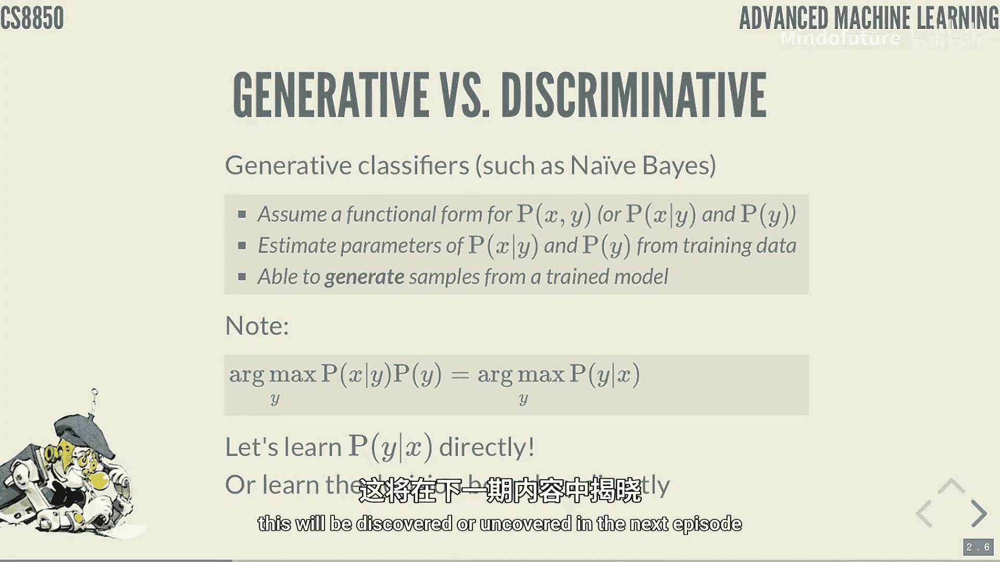

# 030：从朴素贝叶斯到逻辑回归 🧠➡️📈



在本节课中，我们将学习逻辑回归模型。为了清晰地理解逻辑回归，我们需要先从另一个角度审视朴素贝叶斯分类器，然后定义逻辑回归模型并探讨其求解方法。

---

## 回顾朴素贝叶斯

上一节我们介绍了分类模型的基础。本节中，我们首先回顾朴素贝叶斯分类器的核心假设。

朴素贝叶斯分类器基于以下关键假设：在给定类别标签 Y 的条件下，特征 X_i 和 X_j 是条件独立的。对于一个两类问题，给定类别 Y 时，特征的联合条件分布可以分解为各个特征的边缘条件分布的乘积。

**公式表示如下：**
```
P(X_1, X_2, ..., X_n | Y) = ∏ P(X_i | Y)
```

这意味着，例如，在垃圾邮件分类中，给定邮件是垃圾邮件或正常邮件这个类别后，邮件发送时间与邮件中是否包含“奢侈品”等词语这两个特征被视为相互独立。

朴素贝叶斯的决策过程是：选择使后验概率 P(Y | X) 最大的类别 Y。根据贝叶斯定理，这等价于最大化似然 P(X | Y) 与先验 P(Y) 的乘积。

**决策规则如下：**
```
Ŷ = argmax_Y [ P(Y) * ∏ P(X_i | Y) ]
```



在实际操作中，我们需要为似然 P(X_i | Y) 和先验 P(Y) 假设一个参数化形式。然后，使用训练数据和最大似然估计（MLE）来估计这些参数，最后将估计值代入上述公式进行分类。

---

## 高斯朴素贝叶斯与线性决策边界

现在，我们来看一个具体的参数化假设：高斯朴素贝叶斯。

我们假设给定类别 Y 时，每个特征 X_i 服从一维高斯（正态）分布。该分布具有类别特定和特征特定的均值 μ_{i,y}。此外，我们假设类别先验 P(Y) 服从伯努利分布（对于两类问题）。



**似然函数公式：**
```
P(X_i | Y=y) = N(X_i; μ_{i,y}, σ_i²)
```

为了简化推导并引出关键结论，我们进一步做一个重要假设：特征 X_i 的方差 σ_i² 与类别 Y 无关，即方差是特征特定的，而非类别特定的。

这意味着，对于每个特征，类别0和类别1对应的分布是方差相同、均值不同的高斯分布。

接下来，我们探讨在这种假设下的决策边界。决策边界是使得两个类别的后验概率相等的点集。对于两类问题，这等价于后验概率的比值为1，或其对数比值为0。

**决策边界条件：**
```
log( P(Y=0 | X) / P(Y=1 | X) ) = 0
```

将我们的高斯似然和伯努利先验代入这个对数比值公式。经过代数运算后，先验项会变成一个常数，而与数据 X 相关的部分会呈现出一个线性形式。





**推导后的决策函数：**
```
log( P(Y=0 | X) / P(Y=1 | X) ) = w₀ + ∑ w_i * X_i
```
其中，w₀ 和 w_i 是由高斯分布的参数（均值和方差）以及先验概率计算得到的常数和系数。

这个结果表明，在“方差与类别无关”的假设下，高斯朴素贝叶斯分类器本质上是一个**线性分类器**。其决策边界是一个超平面。当上述线性函数值大于0时，样本被分类为类别0；小于0时，被分类为类别1。这让我们回想起了之前学过的感知机模型。

---

## 生成式分类器 vs. 判别式分类器

基于前面的讨论，我们现在可以区分两种建模思路。



朴素贝叶斯是**生成式分类器**的一个例子。生成式分类器为数据和标签的联合分布 P(X, Y) 假设一个参数化形式（通常分解为 P(Y) * P(X | Y)）。然后，从训练数据中估计这些分布的参数。

生成式模型的优点是，在估计参数后，不仅可以对新样本进行分类，还可以**生成**新的数据样本。因为它建模了整个数据生成过程：可以先从 P(Y) 中采样一个类别，再根据 P(X | Y) 采样生成特征数据。

然而，我们的最终目标通常是分类，即找到决策边界。我们注意到，最大化联合分布 P(X, Y) 等价于最大化后验概率 P(Y | X)。那么，为什么不直接学习后验概率 P(Y | X) 或者决策边界本身呢？

这就是**判别式分类器**的思路。判别式模型直接对决策边界或条件概率 P(Y | X) 进行建模，而不对数据的生成过程 P(X | Y) 做出假设。感知机就是一个直接学习决策边界的非概率判别式模型。

那么，能否在保留概率解释的框架内，直接学习决策边界呢？答案是肯定的，这就是我们接下来要介绍的逻辑回归模型。

---

## 总结



本节课中我们一起学习了：
1.  回顾了朴素贝叶斯分类器的条件独立性假设和基于后验概率最大的决策规则。
2.  探讨了在高斯似然、且特征方差与类别无关的假设下，高斯朴素贝叶斯会推导出一个线性决策边界。
3.  区分了生成式分类器（如朴素贝叶斯，建模联合分布 P(X, Y)）和判别式分类器（直接建模决策边界或条件分布 P(Y | X)）。
4.  提出了一个问题：如何构建一个既能直接进行概率判别，又无需对数据生成过程进行完整建模的模型？这为引入逻辑回归做好了铺垫。