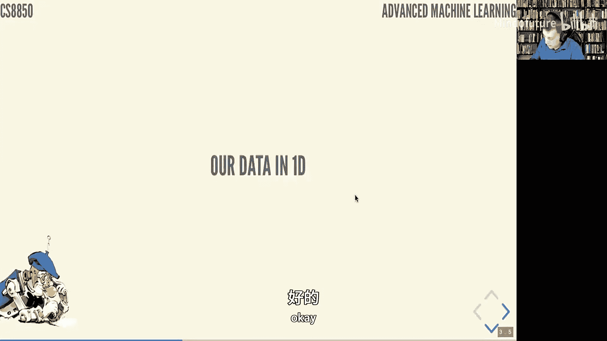
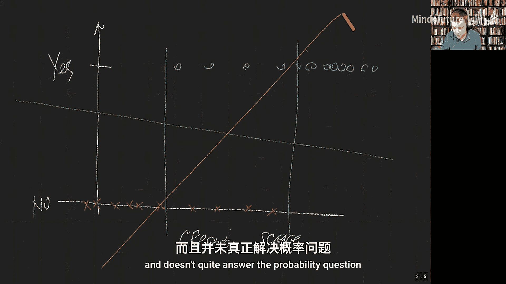
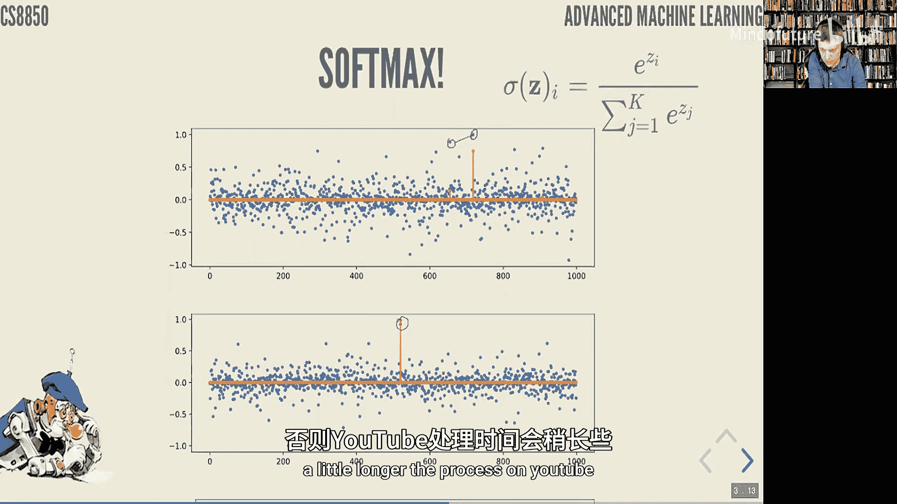

# 031：定义逻辑回归 🧠

在本节课中，我们将学习逻辑回归的定义及其来源。逻辑回归是一个有趣的概率分类器案例，它虽然简单，但在实践中表现优异，是机器学习工具箱中的重要工具。

## 概述

逻辑回归旨在解决一个核心问题：如何根据一个或多个自变量（可以是分类变量或连续变量）来建模某个事件发生的概率。与感知机等仅寻找线性决策边界的分类器不同，逻辑回归的目标是直接输出概率估计。

上一节我们介绍了朴素贝叶斯生成式分类器，本节中我们来看看另一种强大的分类方法——逻辑回归。

## 逻辑回归的优异表现

逻辑回归是一种非常简单的线性分类器，但其表现常常出人意料地好。在实际应用中，例如在脑成像或遗传学等多个领域的数据集上，逻辑回归的性能常能与随机森林、神经网络等复杂模型相媲美。因此，理解其工作原理并将其作为解决问题的工具之一至关重要。

## 问题定义与挑战

逻辑回归试图解决以下问题：
1.  根据自变量的值，建模事件发生的概率。
2.  估计一个新观测事件发生与不发生的概率。
3.  预测一系列变量对二元响应变量的影响。
4.  对观测进行分类（例如，批准贷款与不批准贷款）。

然而，直接建模概率存在挑战。以一个简单的贷款审批为例，我们只有客户的信用分数这一个特征。

以下是直接使用线性回归或线性分类器会遇到的问题：
*   如果我们像感知机一样画一条直线来分割“批准”和“拒绝”两类，这只是一个硬性分类，无法给出“批准概率”。
*   如果我们用线性回归拟合一条直线来预测概率，这条直线可能会超出合理的概率范围 [0, 1]，并且无法很好地描述两类数据点的分布。

## 从几率到逻辑斯蒂函数

为了解决上述问题，统计学家引入了“几率”的概念。几率是事件发生概率与不发生概率的比值。然而，几率的范围是 0 到正无穷，且不对称。

为了获得一个范围在负无穷到正无穷的对称度量，我们取几率的对数，得到“对数几率”。现在，我们可以尝试用线性模型来拟合对数几率。

假设我们有一个特征 `x`（如信用分数），我们建立如下线性关系：
`log(odds) = w * x + b`
其中 `w` 是权重，`b` 是偏置。

通过代数变换，我们可以将对数几率的表达式转换回概率形式。令 `z = w * x + b`，我们得到事件发生的概率为：
`P(y=1|x) = 1 / (1 + exp(-z))`

这个函数就是**逻辑斯蒂函数**，因其形状像字母“S”，也称为S型函数。它将线性组合 `z` 映射到 (0, 1) 区间，完美地表示了概率。

## 扩展到多分类：Softmax函数

在二分类问题中，我们使用逻辑斯蒂函数。对于多分类问题，逻辑回归可以自然扩展。

我们选择其中一个类别作为参考类别（基线），然后为其他每个类别 `k` 建模其与参考类别的对数几率，同样使用线性模型：
`log(P(Y=k|x) / P(Y=基线|x)) = w_k * x + b_k`

通过类似的代数推导，并假设参考类别的线性部分为0，我们可以得到每个类别的预测概率公式：
`P(Y=k|x) = exp(z_k) / (sum_{j=1}^{K} exp(z_j))`
其中 `z_k = w_k * x + b_k`。

这个函数正是**Softmax函数**。它将 `K` 个线性输出转化为一个概率分布。Softmax 函数会“放大”最大值，抑制较小的值，形成一种“赢家通吃”的效果，使得概率最大的类别更加突出。

在深度学习中，Softmax 常被用作神经网络的最后一层激活函数，配合交叉熵损失进行训练。这意味着，当你训练一个带有Softmax输出层的神经网络时，其最后一层本质上就是一个逻辑回归分类器。

## 总结

本节课中我们一起学习了逻辑回归的核心思想。我们从建模概率的需求出发，遇到了直接用线性模型拟合概率的困难。通过引入**几率**和**对数几率**的概念，我们得以用线性模型 `w*x + b` 来拟合对数几率，再通过**逻辑斯蒂函数**将其映射回概率空间，从而解决了二分类的概率预测问题。对于多分类，我们通过选择基线类别并建模多个对数几率，最终推导出了**Softmax函数**，它不仅是逻辑回归多分类的核心，也深深嵌入在现代深度学习的架构之中。逻辑回归因其模型简单、解释性强且性能稳健，始终是机器学习中一个不可或缺的基础工具。