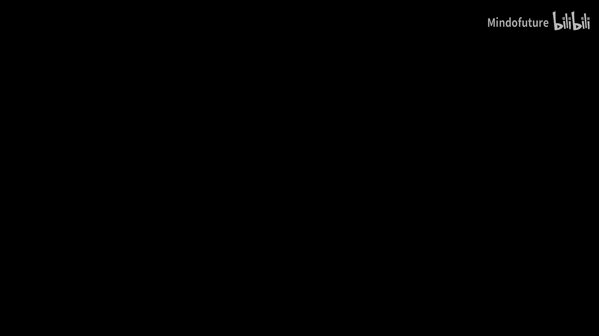
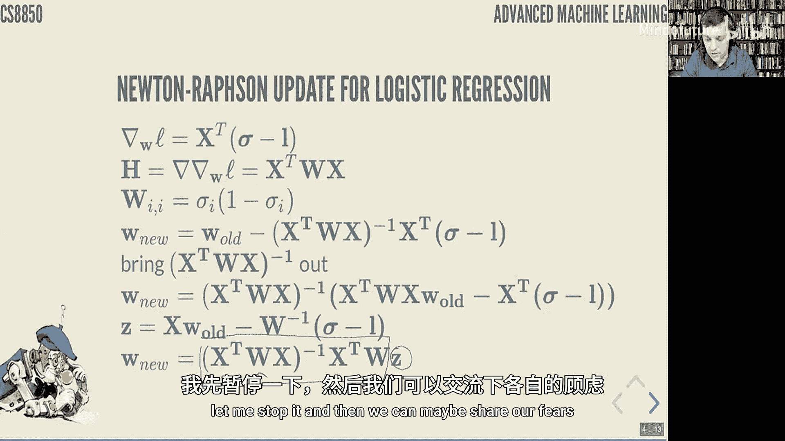

# 032：P32_训练逻辑回归模型 🧠

在本节课中，我们将学习如何训练逻辑回归模型。我们将从理解逻辑回归如何建模概率分布开始，然后探讨如何通过最大似然估计来找到最优的模型参数。最后，我们会介绍一种比标准梯度下降更快的优化方法——牛顿-拉夫森法。

---

## 问题建模与参数求解

上一节我们介绍了逻辑回归如何将分类问题转化为对概率分布的建模。现在，我们面临的核心问题是：如何找到那个最优的参数向量 **W**（即模型系数）？

我们知道，逻辑回归直接对后验概率 `P(类别 | 数据)` 进行建模。这与朴素贝叶斯等生成式模型不同，后者是先对类别的先验概率和数据的似然概率进行建模。逻辑回归的决策边界由**对数几率**（log odds）决定，其形式是一个线性函数。

更一般地，无论数据的先验分布和似然函数具体是什么形式，其后验概率之比的对数（即决策边界值 `A`）与后验概率本身之间，都存在一个确定的关系：后验概率是 `A` 的**逻辑斯蒂（S型）函数**。这个函数就是 `σ(A) = 1 / (1 + e^{-A})`。

这个性质凸显了逻辑回归和逻辑斯蒂函数的重要性：它们具有普适性，而不仅仅是工具箱里的另一个工具。

---

## 逻辑斯蒂函数的优良性质

逻辑斯蒂函数 `σ(x)` 具有一些优良的数学性质，这使得模型训练更加高效。

*   **导数易于计算**：逻辑斯蒂函数的导数可以用其自身表示，公式为 `σ‘(x) = σ(x) * (1 - σ(x))`。这意味着在神经网络的反向传播等计算中，我们只需在前向传播时计算一次 `σ(x)`，就可以几乎“免费”地得到其导数值。
*   **与交叉熵损失的关联**：逻辑回归的训练目标（最大似然估计）最终等价于最小化**交叉熵损失**。这个损失函数在现代机器学习中无处不在。

---

## 通过最大似然估计进行训练

现在，让我们回到强大的**最大似然估计**框架来求解参数 **W**。

我们假设数据样本是独立同分布的。对于整个数据集，我们希望找到参数 **W**，使得所有样本的预测概率乘积（即似然函数 `L`）最大。为了计算方便，我们通常取对数，得到对数似然函数。

以下是推导的关键步骤：

1.  **似然函数**：对于二分类问题，每个样本的预测可以看作一个伯努利试验。整个数据集的似然函数是每个样本预测概率的乘积。
2.  **对数似然**：取对数后，乘积变为求和。经过整理，对数似然函数可以写成两项和的形式。
3.  **出现交叉熵**：这个形式正是**二元交叉熵**。其中一项是真实标签的分布，另一项是我们的模型预测分布 (`σ` 函数)。因此，最大化似然等价于最小化预测分布与真实分布之间的交叉熵。

所以，当我们训练逻辑回归（以及大多数现代分类模型）时，我们实际上是在最小化交叉熵损失。

---

## 优化方法：从梯度下降到牛顿法

得到损失函数（负对数似然）后，我们需要通过优化算法来最小化它。最基础的方法是梯度下降。

*   **梯度下降**：它基于函数的一阶泰勒展开。我们在当前参数点 `W` 处，沿着损失函数梯度的反方向（即切线方向）移动一小步。这需要多次迭代才能接近最优解。

然而，我们可以做得更好。如果我们不仅使用一阶导数（梯度），还使用二阶导数信息，就能对函数进行更精确的二次近似。

*   **牛顿-拉夫森法**：该方法利用了函数的二阶泰勒展开。通过求解二次近似的极值点，往往能用一个更大的步长直接跳到更接近最优解的位置。在多参数情况下，二阶导数信息包含在**海森矩阵**（Hessian Matrix）中。牛顿法的更新公式涉及梯度与海森矩阵逆的乘积。

为了直观理解，想象优化一个凸函数。梯度下降（线性近似）需要沿着“之”字形路径多次小步移动。而牛顿法（二次近似）则能更直接地指向谷底，通常收敛得更快。

---

## 牛顿法在线性与逻辑回归中的应用

让我们看看牛顿法如何应用于具体的回归模型。

**在线性回归中的应用**：
线性回归的损失函数是均方误差。我们可以写出其矩阵形式，计算梯度和海森矩阵。应用牛顿法更新公式后，经过巧妙的代数推导，**只需一步迭代**就能得到最优解——即我们熟悉的**伪逆解** `W* = (X^T X)^{-1} X^T y`。这展示了牛顿法在理想情况下的威力。

**在逻辑回归中的应用**：
对于逻辑回归，我们同样可以写出损失函数（交叉熵）的梯度 `g` 和海森矩阵 `H`。海森矩阵有一个很好的性质：它是一个对角矩阵，其对角线元素与当前参数 `W` 下的预测概率 `σ(XW)` 有关。

将 `g` 和 `H` 代入牛顿法更新公式 `W_new = W_old - H^{-1} g`，并进行推导。虽然由于海森矩阵 `H` 本身依赖于待优化的参数 `W`，我们无法像线性回归那样一步得到解析解，但**这个迭代过程仍然比普通梯度下降收敛快得多**。它通常被称为**迭代重加权最小二乘法**。

---

## 总结与要点 📝

本节课我们一起学习了逻辑回归模型的训练全过程：

1.  **核心思想**：逻辑回归通过逻辑斯蒂函数直接对后验概率建模，其训练目标等价于最小化交叉熵损失。
2.  **优化基础**：我们使用最大似然估计框架来推导损失函数。
3.  **优化算法**：介绍了梯度下降及其改进版——牛顿-拉夫森法。牛顿法利用损失函数的二阶导数（海森矩阵）信息，能实现更快的收敛。
4.  **方法应用**：详细对比了牛顿法在线性回归（可一步求解）和逻辑回归（需迭代但高效）中的应用。

逻辑回归是一个影响深远的基础模型。它本身就是一个强大而有效的分类器，同时也是构成现代深度学习模型的关键组件（通常作为神经网络的最后一层）。理解其原理和训练方法，对掌握机器学习至关重要。