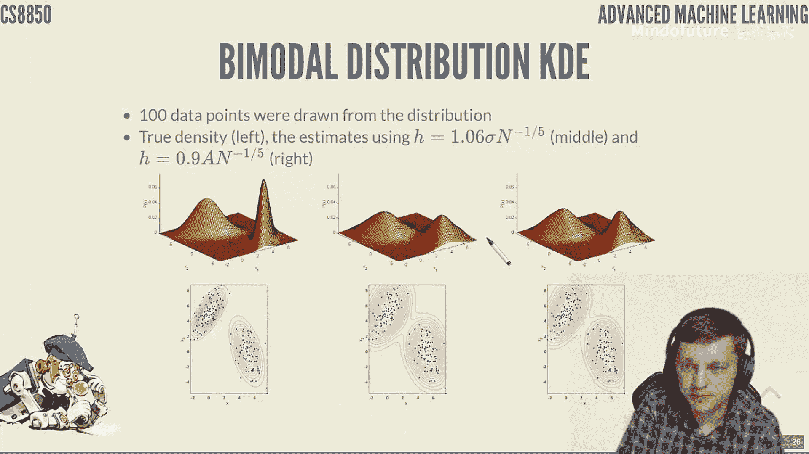

# 033：P33_非参数密度估计 📊

在本节课中，我们将要学习非参数密度估计。这是一种不预先假设数据分布具体形式（例如高斯分布）的方法，仅依靠数据本身来估计其概率密度。我们将从回顾贝叶斯决策边界开始，逐步介绍直方图法的局限性，并深入探讨两种核心的非参数方法：核密度估计和K近邻法。

## 回顾：贝叶斯决策边界

上一节我们介绍了基于决策边界的分类方法。本节中我们来看看其背后的密度估计基础。

我们有两个类别的似然分布：类别1和类别2。如果给定数据点 `x` 后，类别1的后验概率大于类别2的后验概率，我们就将其判定为类别1。反之，则判定为类别2。

观察上图，红色曲线代表类别2的后验概率。在红色曲线更高的区域，我们决定为类别2；在其他区域，则决定为类别1。这样做的本质是**最小化贝叶斯错误率**。我们为每个数据点选择后验概率更高的类别，以最小化预测误差。

决策边界就是两个类别的后验概率相等的点构成的曲线或曲面。由于直接使用后验概率等式作为决策边界较为困难，我们通常使用**似然比**。通过对似然比取对数，当两个后验概率相等时，对数似然比为0，这便构成了我们的决策边界。

到目前为止，我们讨论的参数化密度估计都假设似然分布的形式已知，或者至少其参数形式已知，从而可以通过最大似然估计等方法进行。但如果**我们只有数据，并且不想对分布形式做任何假设**，该怎么办？这就是非参数密度估计要解决的问题。

## 从直方图到非参数估计

当面对只有数据、没有预设分布形式的挑战时，首先想到的可能是直方图。直方图是最简单的非参数密度估计方法。

以下是构建直方图的步骤：
1.  将样本空间划分为若干个区间（称为“箱”）。
2.  用落入每个箱的训练数据比例来近似该区域的概率密度。

对于一个新数据点 `x`，其概率密度估计值为：落入 `x` 所在箱的训练样本数，除以箱的宽度，再除以总训练样本数 `N`。

直方图在一维或二维情况下直观易懂，但在高维空间中存在严重问题。

直方图的主要问题包括：
*   **对起始位置敏感**：密度估计结果依赖于第一个箱的起始位置。
*   **估计不连续**：估计值在箱的边界处存在跳跃，这是人为划分的 artifact，并非数据的真实特性。
*   **维数灾难**：箱的数量随维度增加呈指数级增长。在高维空间中，大多数箱子是空的，导致无法有效估计概率密度。

因此，直方图除了用于一二维数据的快速可视化外，并不适合大多数实际应用。

## 非参数密度估计的核心思想

那么，我们应该怎么做呢？让我们明确非参数密度估计的目标：我们试图估计一个从真实概率密度 `p(x)` 中抽取的样本 `x` 落入样本空间中某个区域 `R` 的概率。

根据概率论，这个概率是密度函数在区域 `R` 上的积分。当我们有 `N` 个独立同分布的样本时，恰好有 `k` 个样本落入区域 `R` 的概率服从二项分布。随着样本数 `N` 趋于无穷大，`k/N` 的方差会减小，从而可以对概率 `P` 做出良好估计。

现在，假设区域 `R` 非常小，以至于概率密度 `p(x)` 在其中变化不大，可以近似为常数。那么，区域 `R` 内的概率近似等于密度值 `p(x)` 乘以区域 `R` 的体积 `V`。同时，这个概率又可以用 `k/N` 来估计。

由此，我们得到了密度 `p(x)` 的估计公式：
`p(x) ≈ k / (N * V)`

为了获得准确的估计，我们需要：当 `N → ∞` 时，`V → 0`，同时 `k → ∞`。这意味着我们需要无限多的样本，并考察围绕 `x` 的无穷小邻域内的样本数。

在实际中，样本是有限的。如果 `V` 太小，可能没有任何样本落在里面，导致估计失败。因此，我们需要在 `V` 的大小上找到一个折衷方案。

有两种主要方法来实现这种折衷：
1.  **固定体积 `V`，估计样本数 `k`**：这就是**核密度估计**。
2.  **固定样本数 `k`，估计体积 `V`**：这就是**K近邻**方法。

上图从左到右展示了样本量增加时，两种方法如何逐渐逼近真实的概率密度函数（蓝色曲线）。左侧是固定体积的核密度估计，右侧是固定K值的K近邻估计。

## K近邻分类器简介

K近邻方法不仅可以用于密度估计，还可直接用于分类。其概念非常简单：对于一个新样本，查看其最近的 `K` 个训练样本（邻居），然后将新样本归为这 `K` 个邻居中占多数的类别。

当数据量非常大时，K近邻分类器可以取得非常好的效果。但它也存在两个主要问题：
*   **计算成本高**：每次分类都需要计算新样本与所有训练样本的距离，并找出最近的 `K` 个。当数据量和维度很高时，计算非常昂贵。
*   **存储需求大**：需要保存全部训练数据。

尽管有KD树等数据结构可以加速近邻搜索，但在大数据和高维场景下仍面临挑战。尽管如此，K近邻和逻辑回归等简单模型仍然是许多问题的优秀基线模型。

## 核密度估计详解

接下来，我们重点学习第一种方法：核密度估计。我们从最简单的核函数——**帕森窗**开始。

假设我们围绕感兴趣的点 `x` 构建一个边长为 `h` 的D维超立方体区域 `R`。我们定义一个**窗函数**（或核函数）`K(u)`，它是一个指示函数：如果点 `u` 的每个维度坐标绝对值都小于1/2，则函数值为1，表示点在单位超立方体内；否则为0。

为了将这个以原点为中心的单位核函数应用到任意点 `x`，我们进行缩放和平移。对于训练样本 `x_i`，我们计算 `(x - x_i) / h`。如果结果向量的每个分量绝对值都小于1/2，则说明 `x_i` 在以 `x` 为中心、边长为 `h` 的超立方体内。

那么，落入该体积内的样本数 `k` 就是所有训练样本的核函数值之和。因此，在 `x` 点的密度估计为：
`p(x) = 1/(N * h^D) * Σ_{i=1}^{N} K( (x - x_i) / h )`

其中，`h^D` 是D维超立方体的体积。

### 帕森窗计算示例

让我们通过一个一维数据的例子来具体计算。假设训练数据为 `{4, 5, 5, 6, ...}`，我们需要估计点 `x=3`, `x=10`, `x=15` 处的密度，设定窗宽 `h=4`。

对于 `x=3`：
*   计算每个数据点 `x_i` 对应的 `(3 - x_i)/4`。
*   只有满足 `|(3 - x_i)/4| < 0.5` 的点，核函数输出为1。
*   经计算，只有 `x_i=4` 满足条件（因为 `|(3-4)/4| = 0.25 < 0.5`）。
*   所以 `k=1`。
*   体积 `V = h^1 = 4`。
*   密度估计 `p(3) = 1 / (N * 4)`。

对于 `x=15`，用同样方法会发现有多个点满足条件，从而得到更高的密度估计值。

### 从帕森窗到平滑核

帕森窗（超立方体）存在两个问题：
1.  估计结果仍然不连续。
2.  它对超立方体内的所有点一视同仁，无论该点离中心 `x` 是近还是远。直觉上，更近的点应该具有更高的权重。

因此，我们通常使用**平滑的核函数**，例如高斯核（径向基函数）。平滑核需要满足两个条件：
*   非负性：`K(u) >= 0`。
*   积分为1：`∫ K(u) du = 1`。这保证了密度估计 `p(x)` 本身也积分为1，是一个合法的概率密度。

常用的高斯核函数形式为：
`K(u) = (1/(2π)^{D/2}) * exp( -||u||^2 / 2 )`
在实际估计中，我们同样会引入带宽参数 `h` 来控制缩放：`K( (x - x_i) / h )`。

使用平滑核的密度估计可以理解为：在每个训练数据点 `x_i` 上放置一个“小山包”（核函数），最终的密度估计是所有这些小山的叠加。带宽 `h` 控制了每个小山的宽度：`h` 越大，山越宽越平缓；`h` 越小，山越窄越尖锐。

### 带宽选择与偏差-方差权衡

带宽 `h` 的选择至关重要，它直接导致了机器学习中一个核心概念：**偏差-方差权衡**。

*   **带宽 `h` 太大**：核函数过于平缓，密度估计曲线过于平滑。这会**掩盖数据中的真实结构**，导致**高偏差**（估计的系统性误差大）。但不同数据样本得到的估计曲线变化不大，即**低方差**。
*   **带宽 `h` 太小**：核函数非常尖锐，密度估计曲线会围绕每个数据点出现尖峰，显得**崎岖不平且噪声很大**。这虽然可能使**偏差较低**（如果能捕捉每个细节），但会导致**高方差**（对训练样本的微小变化非常敏感，估计不稳定）。

我们的目标是选择一个适中的 `h`，在偏差和方差之间取得最佳平衡，使总体误差最小。

如何选择带宽 `h` 呢？
1.  **主观选择**：对于低维数据，可以绘制不同 `h` 下的估计曲线，根据对数据的先验理解选择看起来最合理的那个。这不适用于高维数据。
2.  **经验法则**：如果假设数据近似服从高斯分布，可以使用一些经验公式，例如**斯科特法则**或**西尔弗曼法则**。例如，对于一维高斯数据，最优带宽近似为 `h* = 1.06 * σ * N^{-1/5}`，其中 `σ` 是样本标准差。这些法则在数据非高斯时可能效果很差。
3.  **交叉验证**：更通用的方法是使用交叉验证来选择一个在未知数据上表现最好的 `h`。

### 多维数据与各向异性

在多维数据中，如果不同特征具有不同的尺度或方差，使用同一个带宽 `h` 可能不合适。例如，特征A的值范围是[0, 1]，而特征B的范围是[0, 1000]。用相同的 `h` 会使得特征B的方向上核函数的影响被过度拉伸。

解决方法包括：
*   **预处理缩放**：在核密度估计之前，对每个特征进行标准化（例如，缩放到均值为0，方差为1）。
*   **使用更灵活的核**：采用**乘积核**，即为每个维度设置独立的带宽参数 `h_d`，总的核函数是各维度核的乘积。这允许模型适应不同维度上的不同尺度。
*   **使用全协方差矩阵**：最灵活的方法是使用具有完整协方差矩阵的高斯核，但这会引入大量需要估计的参数。

上图展示了使用高斯核和西尔弗曼法则估计的二维密度，以及真实密度。可以看到，在合适的带宽下，核密度估计能够较好地捕捉数据的分布结构。

## 总结

本节课中我们一起学习了非参数密度估计。
*   我们从贝叶斯决策边界出发，引出了当分布形式未知时进行密度估计的需求。
*   我们指出了直方图法的局限性，特别是在高维空间中的维数灾难问题。
*   我们推导了非参数密度估计的一般公式 `p(x) ≈ k/(N*V)`，并引出了实现它的两种策略：固定V估计k（核密度估计）和固定k估计V（K近邻）。
*   我们详细介绍了核密度估计，从简单的帕森窗到更实用的平滑核（如高斯核）。
*   我们深入探讨了带宽选择的关键性，并将其与机器学习核心的偏差-方差权衡概念联系起来。
*   最后，我们简要讨论了处理多维数据时带宽选择的注意事项。

核密度估计是一种强大的工具，它完全由数据驱动，无需对底层分布进行假设。它的主要代价是需要存储所有训练数据并在预测时进行计算。除了密度估计和分类，类似的核方法思想也可用于回归问题。