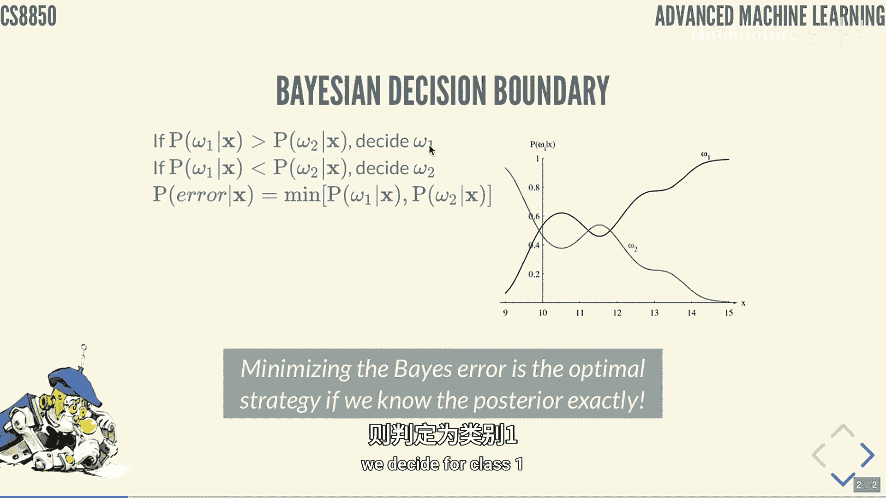
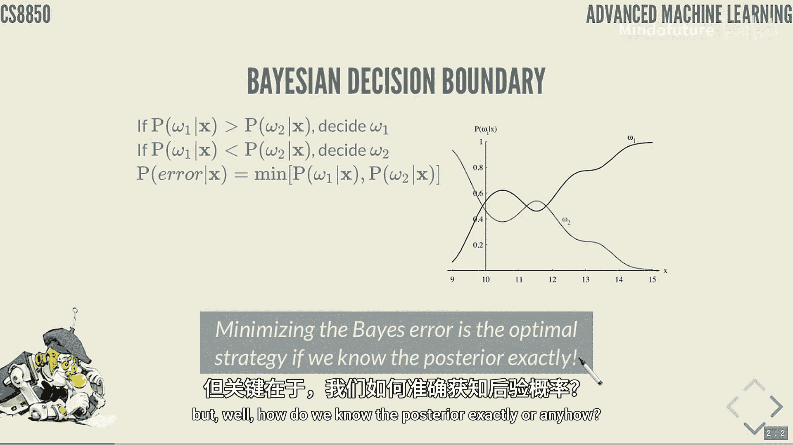
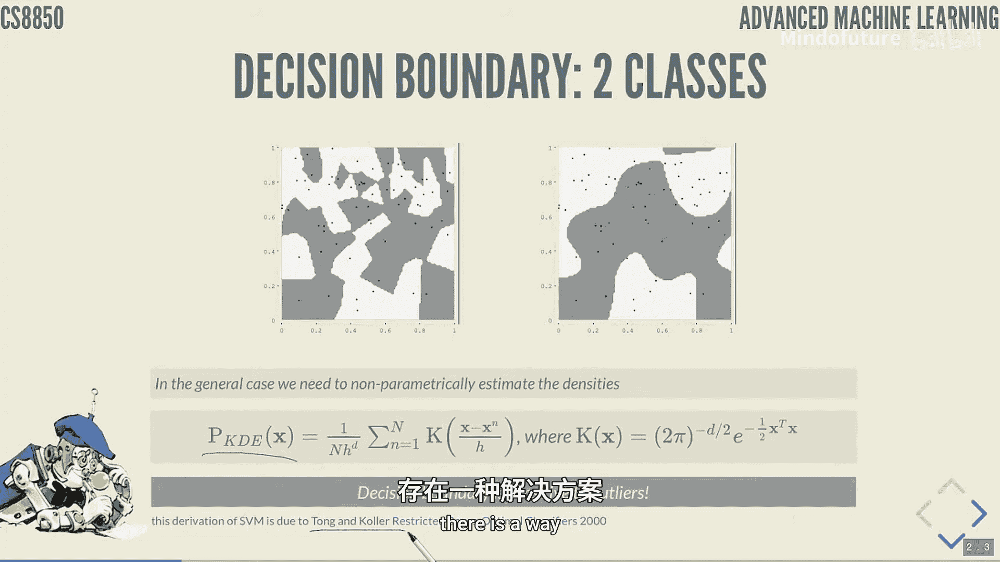
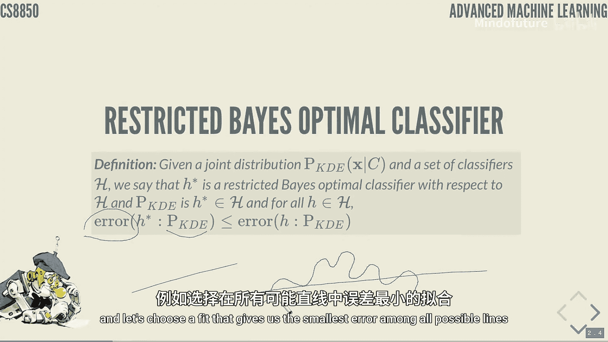
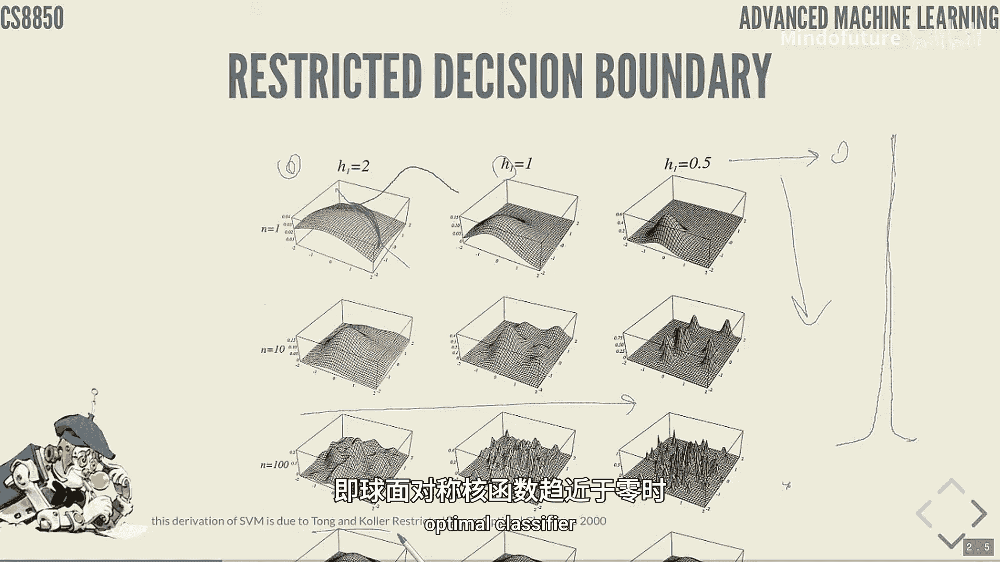
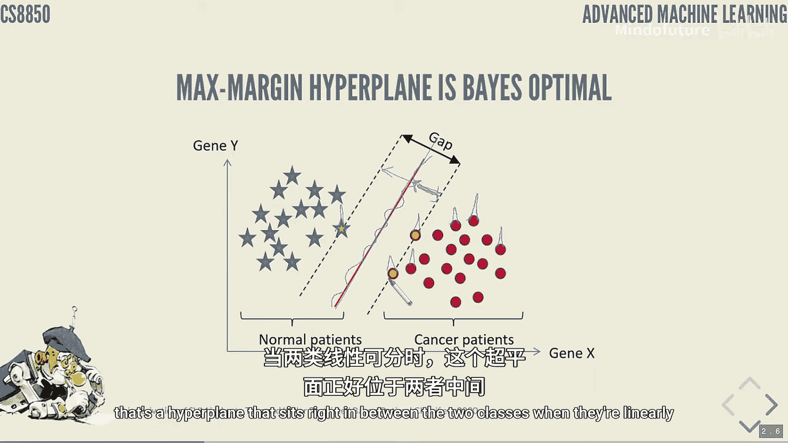
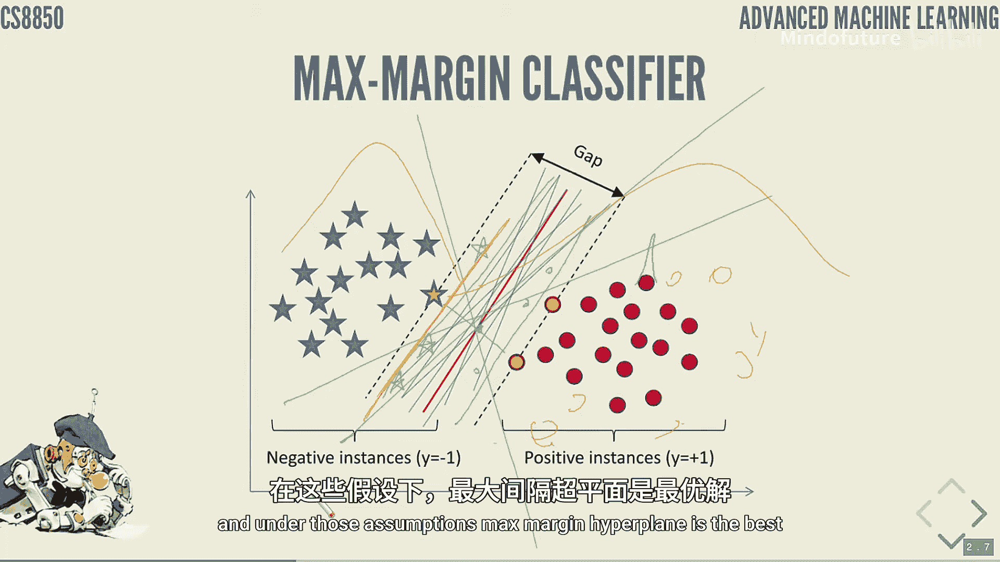
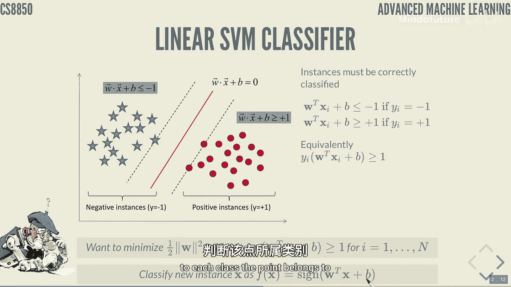
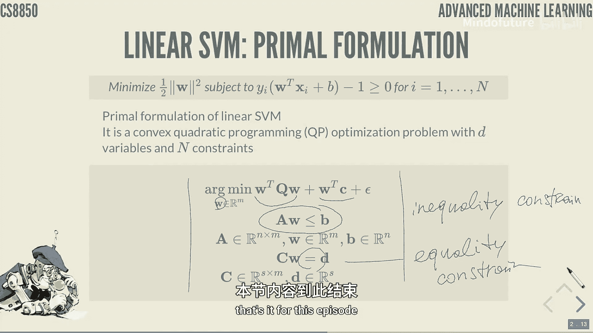

# 034：最大间隔分类器 📏

在本节课中，我们将学习最大间隔分类器的核心概念。我们将从贝叶斯最优决策边界出发，探讨其在实际应用中的局限性，并引出限制性贝叶斯最优分类器的概念。最终，我们将看到，在特定条件下，限制性贝叶斯最优分类器等价于最大间隔超平面，并推导出其数学形式。

## 贝叶斯最优决策边界回顾

上一节我们介绍了基于决策理论和贝叶斯最优的决策边界。让我们先回顾一下核心思想。

回忆一下，我们有两个类别的后验概率分布，例如黑色代表类别1，红色代表类别2。我们的决策规则是：如果类别1的后验概率大于类别2的后验概率，则决策为类别1；反之则决策为类别2。

从本质上讲，我们是在最小化贝叶斯错误率。贝叶斯错误率是两个后验概率中较小者的最小值。如果我们确切知道后验概率，那么最小化贝叶斯错误率就是最优策略。

## 后验概率估计的挑战

然而，我们如何确切知道后验概率呢？在一般情况下，我们需要非参数化地估计密度。

还记得我们在核密度估计课程中的内容吗？根据你选择的核函数带宽（例如高斯核的宽度 `h`），决策边界会发生显著变化。当 `h` 较小时，边界会变得非常复杂；当 `h` 较大时，边界则更为平滑。

核密度估计本身是一个不错的估计器。但问题在于，根据所选带宽的不同，以及数据中异常点的存在，决策边界会受到不利影响。因为我们的估计是对真实后验的近似，所以决策边界对异常值非常敏感。

换句话说，当我们基于对真实分布的估计来建模时，决策边界具有**高方差**。我们不希望决策边界出现这种任意波动。

## 引入限制性贝叶斯最优分类器

为了应对高方差问题，Tong 和 Koller 提出了**限制性贝叶斯最优分类器**的概念。

给定数据的估计分布（即给定类别的条件概率估计）和一个分类器集合 `H`（例如所有线性分类器），我们定义 `H*` 为关于集合 `H` 和估计分布的限制性贝叶斯最优分类器。

`H*` 满足两个条件：
1.  `H*` 属于分类器集合 `H`。
2.  对于集合 `H` 中的所有其他分类器，`H*` 在估计分布下的贝叶斯错误率是最小的。

这意味着，我们不再试图精确拟合基于估计分布的最优决策边界（那会导致高方差），而是**只考虑一个特定类别的分类器（如线性分类器）**，并从中选择一个在估计分布下错误率最小的那个。

## 从限制性最优到最大间隔

那么，限制性贝叶斯最优分类器与最大间隔有什么关系呢？

考虑我们之前核密度估计的例子。当我们使用一个非常宽的带宽（`h` 很大）进行平滑估计时，决策边界可能位于某个位置。如果我们用一个线性分类器去近似这个边界，它可能位于那里。

现在，让我们持续减小核函数的带宽 `h`，减少我们对数据分布的先验假设（因为带宽 `h` 本质上就是我们对分布形态的先验假设）。当 `h` 趋近于0时，每个数据点上的核函数会变成一个脉冲函数。

Tong 和 Koller 在他们的论文中证明：**对于二分类问题，如果你采用线性分类器作为限制类别，并将核密度估计器的带宽推向零，那么得到的限制性贝叶斯最优线性分类器，就会变成最大间隔超平面。**

最大间隔超平面，就是那个位于两个**线性可分**类别正中间的超平面。

## 最大间隔的直观理解

为什么最大间隔是好的？让我们从直觉上理解。

以前我们用感知机处理两类线性可分数据时，感知机会给出**任何一个**能正确分类所有训练样本的超平面。问题解决了，感知机就会收敛。

但是，贝叶斯最优（或限制性贝叶斯最优）边界试图**最大化类别间的间隔**。这样，对于那些我们尚未观测到的数据点，模型仍有较大的容错空间，能将其正确分类。

因此，对于一个好的、基于线性可分数据的分类器，我们希望将超平面放在分隔间隙的中间，而不是紧挨着某一类。这是一种基于“未知土地中立划线”的常识性判断。

## 最大间隔的数学形式化

现在，让我们从数学上定义这个最大间隔超平面。

回忆一下，我们如何定义一个超平面。我们有一个法向量 **w** 和一个偏置项 **b**。超平面是所有满足以下方程的点 **x** 的集合：
`f(x) = w^T x + b = 0`

考虑超平面附近的一个点 **x**，它到超平面的垂直距离 `r` 是多少？这可以通过计算 **x** 在法向量 **w** 方向上的投影来得到。

距离公式为：
`r = |w^T x + b| / ||w||`
其中 `||w||` 是 **w** 的欧几里得范数（长度）。

对于被正确分类的点，我们可以利用其标签 `y`（+1 或 -1）来简化。因为对于正确分类的点，`y * (w^T x + b)` 总是正的。所以距离可以写为：
`r = y (w^T x + b) / ||w||`

当我们说“最大化间隔”时，我们指的是最大化**离超平面最近的点**的距离。也就是说，我们想最大化最小距离。

设所有训练样本为 `(x_i, y_i)`。那么，所有样本中到超平面的最小距离是：
`margin = min_i [ y_i (w^T x_i + b) / ||w|| ]`

我们的目标是找到参数 **w** 和 **b**，使得这个 `margin` 最大。

## 推导优化问题

观察距离公式 `r = y (w^T x + b) / ||w||`。如果我们按比例缩放 **w** 和 **b**（例如同时乘以常数 `k`），距离 `r` 不会改变，因为分子和分母中的 `k` 会抵消。

这个缩放自由度允许我们进行一个关键的简化：**我们可以固定对于离超平面最近的那些点（称为支持向量），有 `y (w^T x + b) = 1`。**

做出这个约定后，对于所有正确分类的训练样本，我们就有：
`y_i (w^T x_i + b) >= 1`，对于所有 `i`

同时，在这些支持向量上，间隔（即两个平行支撑超平面之间的距离）就等于 `2 / ||w||`。

因此，**最大化间隔 `2 / ||w||`，等价于最小化 `||w||`。** 为了后续优化方便，我们通常最小化 `(1/2) ||w||^2`。

于是，我们得到了最大间隔分类器的标准优化形式，也称为**线性支持向量机（SVM）的原问题**：

**最小化：** `(1/2) ||w||^2`
**约束条件：** `y_i (w^T x_i + b) >= 1`，对于所有训练样本 `i = 1, ..., n`

这是一个**凸二次规划问题**，具有 `d` 个变量（**w** 的维度）和 `n` 个线性不等式约束，可以通过标准的优化算法高效求解。

找到最优的 **w** 和 **b** 后，对于新的数据点 **x_new**，我们通过观察 `sign(w^T x_new + b)` 的符号来进行分类。

## 总结

本节课中，我们一起学习了最大间隔分类器的由来和形式化过程。

1.  我们从**贝叶斯最优决策边界**出发，认识到直接基于估计分布寻找边界会导致**高方差**，对异常值敏感。
2.  为了获得更稳健的边界，我们引入了**限制性贝叶斯最优分类器**的概念，即在一个受限的分类器集合（如线性分类器）中寻找最优者。
3.  Tong 和 Koller 证明，当使用线性分类器且核密度估计带宽趋于零时，限制性贝叶斯最优分类器就是**最大间隔超平面**。
4.  最大间隔的直觉是：在类别间的“无人地带”正中划界，为未来的未知数据留出最大容错空间。
5.  我们最终推导出了线性支持向量机的**原优化问题**：最小化 `(1/2)||w||^2`，并满足所有样本都被正确分类且间隔至少为1的约束。这是一个可求解的凸二次规划问题。

