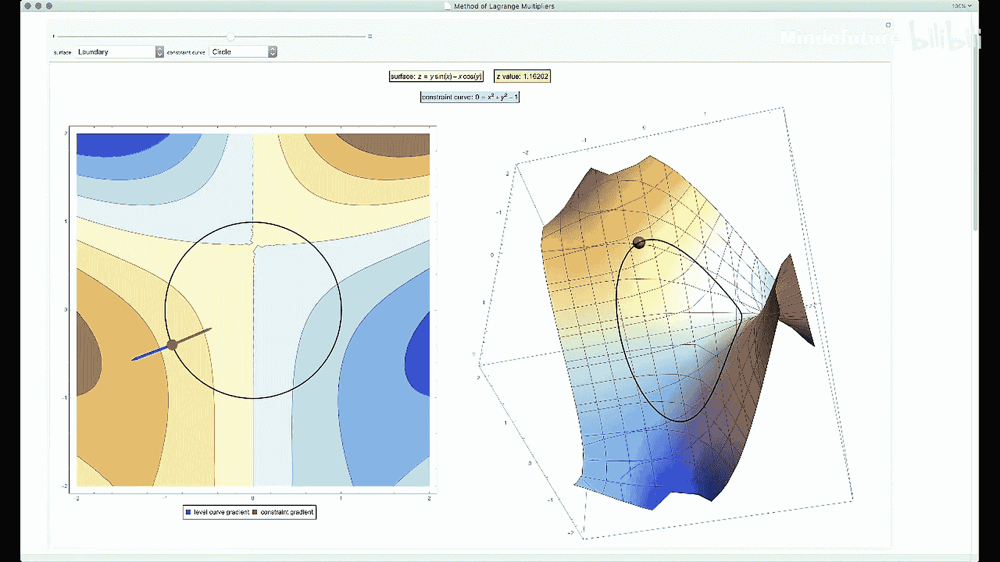
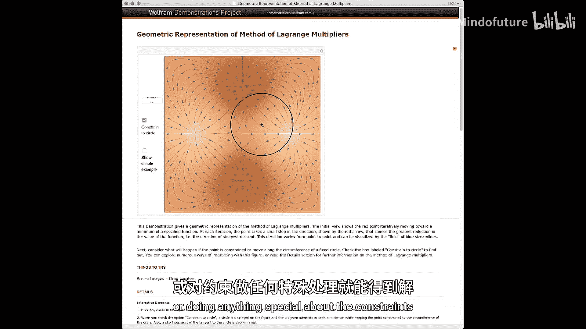
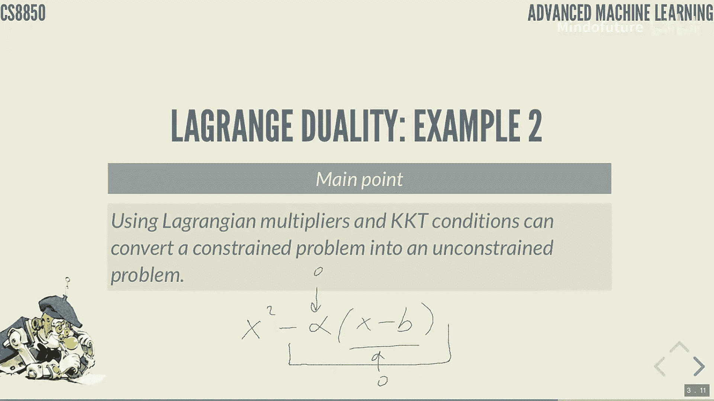

# 035：拉格朗日乘数法 📐

在本节课中，我们将学习如何解决带有约束的优化问题。核心方法是使用拉格朗日乘数法，它可以将一个复杂的约束优化问题，转化为一个更容易处理的无约束优化问题。

## 概述

在机器学习和许多工程领域，我们经常需要找到某个函数在特定约束条件下的最优解。例如，在支持向量机中，我们需要最大化分类间隔，同时确保所有数据点都被正确分类。拉格朗日乘数法正是解决这类问题的强大工具。本节我们将学习其基本思想、数学形式以及如何应用。

## 拉格朗日乘数法的基本形式

上一节我们介绍了约束优化问题的概念。本节中，我们来看看如何用拉格朗日乘数法将其转化。

一个标准的约束优化问题通常表述为：最小化某个函数 `f(x)`，同时满足一系列不等式约束 `g_i(x) >= 0` 和等式约束 `h_j(x) = 0`。

拉格朗日乘数法的核心思想是，将原约束问题重写为一个无约束的拉格朗日函数 `L`。这个新函数引入了额外的变量，称为拉格朗日乘子，每个约束对应一个。

**拉格朗日函数公式：**
`L(x, α, λ, μ) = f(x) - Σ α_i * g_i(x) + Σ λ_j * h_j(x)`
其中：
*   `x` 是原始变量。
*   `α_i` 是对应于不等式约束 `g_i(x) >= 0` 的乘子（通常要求 `α_i >= 0`）。
*   `λ_j` 是对应于等式约束 `h_j(x) = 0` 的乘子（符号可正可负）。

转化后的问题变为：对 `x` 最小化拉格朗日函数 `L`，同时对乘子 `α` 最大化 `L`。这个“最小-最大”问题的解（一个鞍点）就对应着原约束问题的最优解。

## 卡罗需-库恩-塔克条件

当我们通过拉格朗日乘数法将问题转化后，如何找到最优解呢？这需要用到卡罗需-库恩-塔克条件。

KKT条件是拉格朗日乘数法在不等式约束下的推广。它指出，在最优解处，必须满足以下一系列条件：

以下是KKT条件的主要内容：
1.  **平稳性：** 拉格朗日函数 `L` 对原始变量 `x` 的梯度必须为零。`∇_x L = 0`
2.  **原始可行性：** 原始约束必须得到满足。`g_i(x) >= 0` 且 `h_j(x) = 0`
3.  **对偶可行性：** 对应于不等式约束的乘子必须非负。`α_i >= 0`
4.  **互补松弛条件：** 对于每个不等式约束，其乘子 `α_i` 和约束函数 `g_i(x)` 至少有一个为零。`α_i * g_i(x) = 0`

这意味着，如果一个不等式约束在最优解处是严格成立的（`g_i(x) > 0`，称为非活跃约束），那么对应的乘子 `α_i` 必须为0，该约束对解没有影响。反之，如果乘子 `α_i > 0`，则该约束在最优解处必须取等号（`g_i(x) = 0`，称为活跃约束）。

## 几何直观理解

KKT条件看起来有些抽象，让我们通过几何图像来直观理解它，特别是对于等式约束的情况。

想象我们在一个三维空间中，有一个需要最大化的函数 `f(x)`（比如一个抛物面），同时有一个等式约束 `g(x)=0`（比如一个平面或曲线）。我们的目标是找到约束曲面上使 `f(x)` 最大的点。

在最优解处，函数 `f(x)` 的梯度向量 `∇f` 和约束函数 `g(x)` 的梯度向量 `∇g` 是平行的（方向相同或相反）。为什么？

因为 `∇g` 始终垂直于约束曲面 `g(x)=0`。如果 `∇f` 在约束曲面上有任何“横向”分量，就意味着我们可以沿着约束曲面移动，从而继续增大 `f(x)`，这说明当前点还不是最优解。只有当 `∇f` 也垂直于约束曲面（即与 `∇g` 平行）时，我们才无处可去，达到极值点。拉格朗日乘子 `λ` 的数值就表示了这两个梯度之间的比例关系。

**核心关系公式：**
在等式约束 `g(x)=0` 下的极值点处，存在标量 `λ`，使得：
`∇f(x*) = λ ∇g(x*)`

## 应用示例

理解了基本原理后，我们通过两个简单的例子来看看拉格朗日乘数法如何具体应用。

### 示例一：简单不等式约束

考虑问题：最小化函数 `f(x) = x²`，约束条件为 `x >= b`。

**1. 构造拉格朗日函数：**
我们将约束写为 `g(x) = x - b >= 0`。拉格朗日函数为：
`L(x, α) = x² - α * (x - b)`，其中 `α >= 0`。

**2. 应用KKT条件求解：**
以下是求解步骤：
*   **平稳性：** ∂L/∂x = 2x - α = 0  =>  `x = α/2`
*   **互补松弛：** α * (x - b) = 0
*   **对偶可行性：** α >= 0

我们需要分情况讨论：
*   **情况1：** 约束非活跃 (`α = 0`)。
    由平稳性得 `x = 0`。将其代入互补松弛条件：`0 * (0 - b) = 0` 恒成立。但还需检查原始可行性 `x >= b`，即 `0 >= b`。所以，当 `b <= 0` 时，最优解是 `x* = 0`。
*   **情况2：** 约束活跃 (`α > 0`，则 `x - b = 0`)。
    由 `x = b` 和 `x = α/2`，可得 `α = 2b`。由于 `α > 0`，这要求 `b > 0`。所以，当 `b > 0` 时，最优解是 `x* = b`。

这个结果很直观：如果约束边界 `b` 在原函数最小值点 (`x=0`) 的左边，约束不影响，最优解仍是0；如果约束边界在0的右边，最优解就被“推”到了边界 `b` 上。

### 示例二：椭圆内接最大矩形

考虑问题：在椭圆 `x²/a² + y²/b² = 1` 内，寻找面积最大的内接矩形。

**1. 问题建模：**
设矩形顶点在 `(x, y)`，则其面积为 `A = 4xy`。约束条件是顶点在椭圆上：`x²/a² + y²/b² = 1`。我们要最大化 `A`。

**2. 构造拉格朗日函数：**
`L(x, y, λ) = 4xy - λ * (x²/a² + y²/b² - 1)`

**3. 应用KKT条件求解：**
以下是求解步骤：
*   ∂L/∂x = 4y - (2λx)/a² = 0  =>  `2y = (λx)/a²` ... (1)
*   ∂L/∂y = 4x - (2λy)/b² = 0  =>  `2x = (λy)/b²` ... (2)
*   ∂L/∂λ = -(x²/a² + y²/b² - 1) = 0  =>  `x²/a² + y²/b² = 1` ... (3)

由 (1) 和 (2) 可以联立消去 `λ`，得到 `x²/a² = y²/b²`。结合 (3) 式，可得：
`x²/a² = y²/b² = 1/2`
因此，最优解为 `x = a/√2`, `y = b/√2`。最大矩形面积为 `A_max = 4 * (a/√2) * (b/√2) = 2ab`。

这个例子展示了拉格朗日乘数法如何优雅地解决几何优化问题。我们不需要显式地求出乘子 `λ` 的值，它在这个过程中是一个辅助变量。

## 总结

本节课中我们一起学习了拉格朗日乘数法这一重要的优化工具。
*   我们首先了解了如何利用拉格朗日函数，将带有等式和不等式约束的优化问题转化为无约束的“最小-最大”问题。
*   接着，我们学习了更一般的KKT条件，它是最优解必须满足的一组必要条件，特别是互补松弛条件清晰地描述了约束的“活跃”与“非活跃”状态。
*   通过几何直观，我们理解了在最优解处，目标函数的梯度与约束函数的梯度是平行的。
*   最后，通过两个计算示例，我们实践了如何应用拉格朗日乘数法和KKT条件来求解具体的优化问题。

掌握拉格朗日乘数法对于理解支持向量机、最大熵模型等机器学习算法的核心原理至关重要。