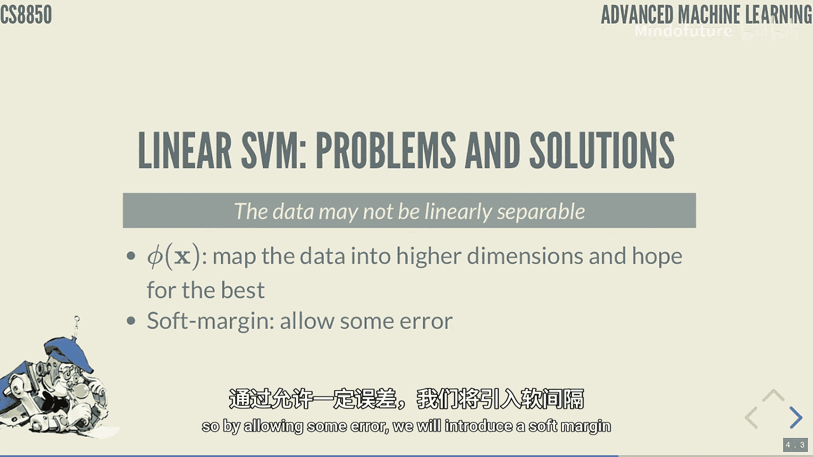

# 036：P36_线性支持向量机的对偶形式

在本节课中，我们将要学习线性支持向量机的对偶形式。我们已经从拉格朗日乘子法和KKT条件中了解了关于对偶性所需的一切知识。现在，我们可以推导支持向量机的对偶形式。这是因为原始形式并不总是容易求解，并且对偶形式会带来一个额外的好处，这个好处非常强大，值得我们为之努力。

## 回顾原始形式

上一节我们介绍了对偶性的基础知识，本节中我们来看看如何将其应用于支持向量机。首先，让我们再次回顾一下线性支持向量机的原始形式。

原始形式的目标是**最小化**分离超平面的法向量 **w** 的范数，即 **minimize ½||w||²**。

同时，它需要满足以下约束条件，即所有样本都被正确分类：对于每个样本 **i**，有 **y_i (w·x_i + b) ≥ 1**。

## 构建拉格朗日函数

现在，我们可以将这个约束优化问题重新表述为对偶形式。有趣的是，对偶形式也是一个凸二次规划问题，但现在优化变量是拉格朗日乘子 **α_i**。

以下是构建拉格朗日函数的步骤。由于我们处理的是不等式约束，并且在最小化目标函数，这里会有一个负号。对于数据集中的每个样本，我们引入一个拉格朗日乘子 **α_i ≥ 0**。

拉格朗日函数 **L(w, b, α)** 可以写为：
**L(w, b, α) = ½||w||² - Σ_i α_i [ y_i (w·x_i + b) - 1 ]**

## 求解最优条件

为了将对偶问题分离出来，我们需要对拉格朗日函数关于原始变量 **w** 和 **b** 求导，并令其为零。

首先，对 **w** 求偏导并令其为零：
**∂L/∂w = w - Σ_i α_i y_i x_i = 0**
由此我们得到：
**w = Σ_i α_i y_i x_i**

接着，对 **b** 求偏导并令其为零：
**∂L/∂b = - Σ_i α_i y_i = 0**
由此我们得到：
**Σ_i α_i y_i = 0**

## 推导对偶问题

现在，我们将求得的 **w** 和 **b** 的关系代回拉格朗日函数中，消去原始变量。

将 **w = Σ_i α_i y_i x_i** 代入 **L**，经过化简，我们得到只关于 **α** 的对偶优化问题。

对偶问题的目标是**最大化**以下函数：
**maximize Σ_i α_i - ½ Σ_i Σ_j α_i α_j y_i y_j (x_i · x_j)**

同时，需要满足以下约束条件：
1.  **α_i ≥ 0**，对于所有 **i**。
2.  **Σ_i α_i y_i = 0**。

## 对偶形式的优势与决策函数

对偶形式的支持向量机有一个显著的优点：尽管训练点的数量 **n** 可能很大，但解是稀疏的。

在最优解中，大多数 **α_i** 的值会为零。只有那些对应约束条件处于“激活”状态（即位于分类间隔边界上）的样本，其 **α_i** 才大于零。这些样本被称为**支持向量**。

因此，我们只需要存储这些支持向量，而不是整个数据集。这使得模型在预测时非常高效。

最终的分类决策函数为：
**f(x) = sign( Σ_i α_i y_i (x_i · x) + b )**

其中，求和仅对支持向量（即 **α_i > 0** 的样本）进行。**b** 可以通过任意一个支持向量计算得出：**b = y_j - Σ_i α_i y_i (x_i · x_j)**，其中 **j** 是任意一个支持向量的索引。

## 面临的挑战与扩展

然而，对偶形式也带来了新的挑战。原始问题的复杂度依赖于特征维度 **d**，而对偶问题的复杂度则依赖于样本数量 **n**。当处理大规模数据时，求解涉及 **n×n** 矩阵的二次规划问题会变得计算密集。

此外，我们目前讨论的是数据线性可分的情况（即“硬间隔”SVM）。但在现实中，数据往往不是线性可分的。

以下是解决非线性可分问题的两种主要思路：
1.  **特征映射**：通过一个映射函数 **Φ**，将数据映射到更高维的特征空间，希望在新的空间中数据变得线性可分。
2.  **软间隔**：允许一些样本被错误分类，引入“软间隔”概念，这将在后续课程中详细讨论。

## 总结

本节课中，我们一起学习了线性支持向量机的对偶形式推导。我们从原始问题出发，通过构建拉格朗日函数并利用KKT条件，得到了只依赖于拉格朗日乘子 **α** 的对偶优化问题。对偶形式的关键优势在于其解的稀疏性，最终模型仅由少数支持向量决定，这使得预测非常高效。同时，我们也认识到对偶形式在处理大规模数据时的计算挑战，并简要了解了处理非线性问题的方向，为后续学习核方法和软间隔SVM奠定了基础。