# 037：核技巧与软间隔 🧠

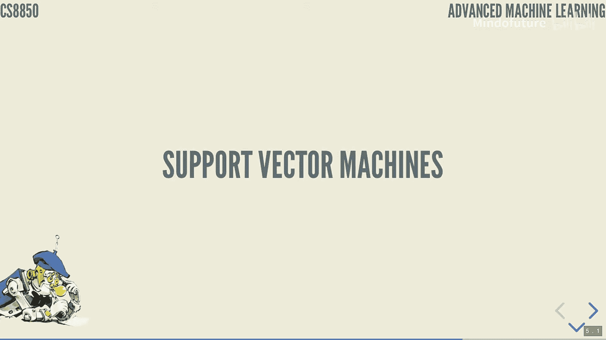

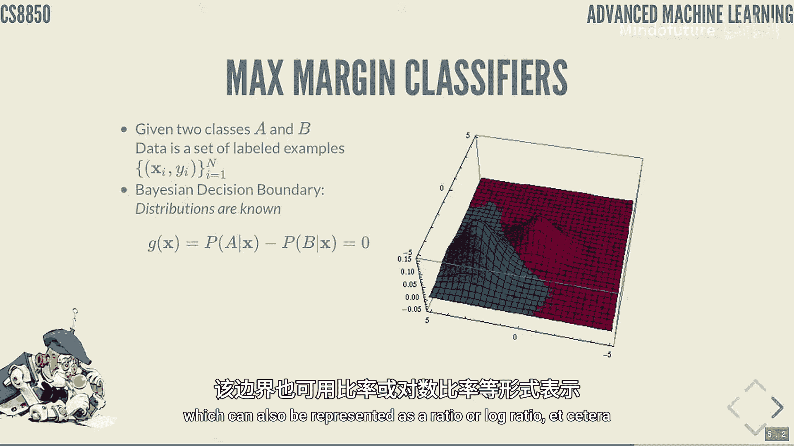

在本节课中，我们将要学习支持向量机（SVM）的两个核心扩展：核技巧与软间隔。我们将从线性SVM的回顾开始，逐步探讨如何处理非线性可分数据以及如何容忍分类错误，最终理解完整的SVM框架。

## 线性SVM回顾

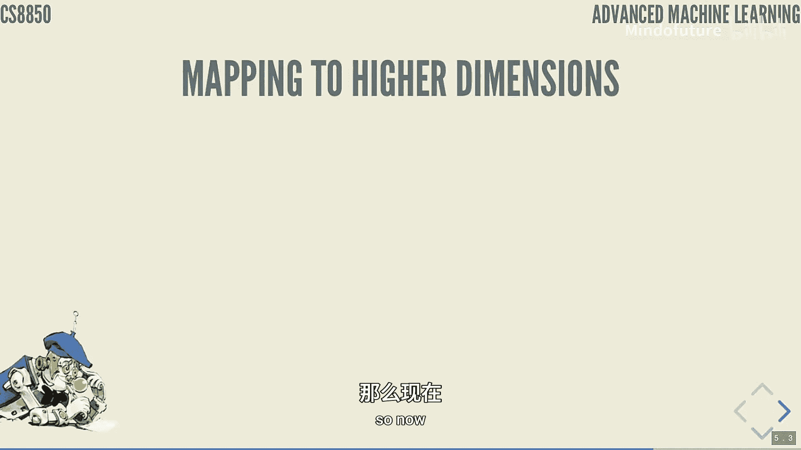

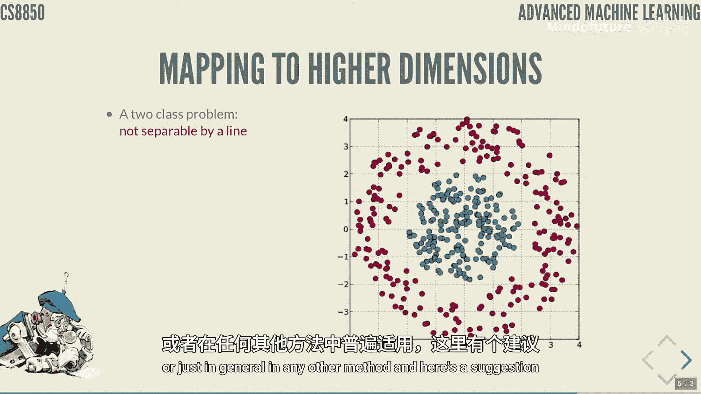

上一节我们介绍了线性SVM。现在让我们快速回顾一下其核心思想。

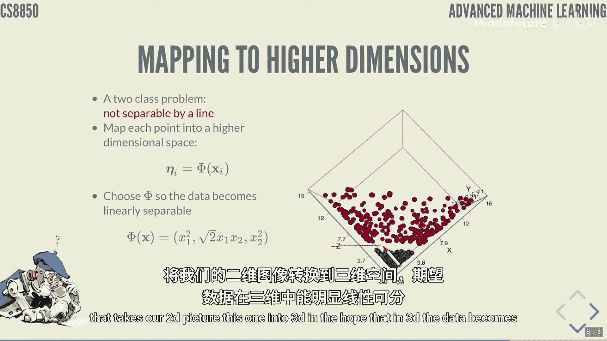

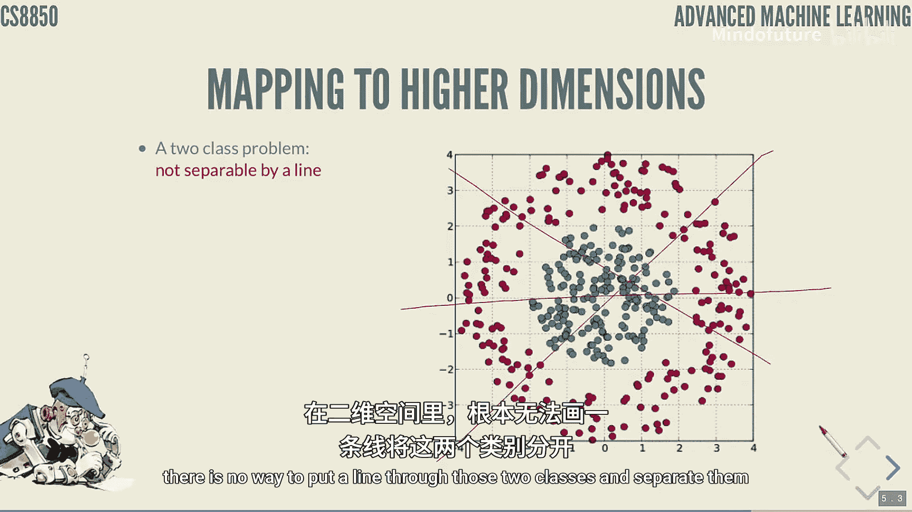

最大间隔分类器处理两类数据A和B。数据是一组带标签的样本，其中 **X** 是特征，**y** 是标量标签。当已知分布时，最优边界由后验概率决定，即后验概率差为0的曲面。这个在多维空间中的曲面就是我们的决策边界，它也可以表示为概率比或其对数。

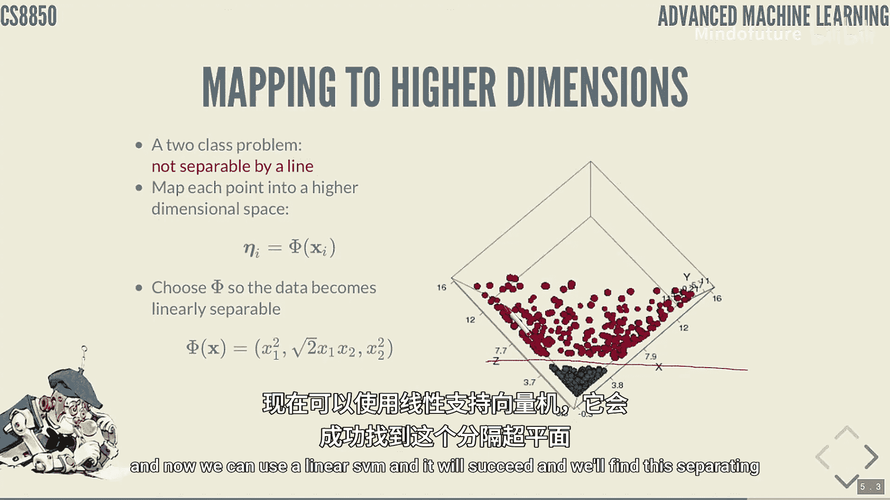

在构建最大间隔超平面时，我们遵循类似的原则，但限制在**线性分类器**的假设空间中。当我们不想使用任何先验信息，而希望将所有分布信息集中在样本点上时，我们就能得到最大间隔超平面。

## 处理非线性可分数据

上一节我们介绍了线性SVM。本节中我们来看看当数据**不是线性可分**时，在支持向量机或任何其他方法中该怎么办。

这里有一个建议：我们可以将每个点从二维空间映射到更高维的空间。通过一些巧思或简单的暴力枚举函数 **Φ**，我们可以构造一个映射，将我们的二维数据图映射到三维空间，希望数据在三维空间中变得**线性可分**。虽然在二维空间中，我们无法画一条线来分隔这两个类别。

以下是一个例子：
*   在二维空间中，数据点混杂在一起，无法用直线分隔。
*   使用多项式核函数（例如，取 **x1** 和 **x2** 并构造一个三维空间），数据变得可分。
*   现在我们可以使用线性SVM，它将成功找到一个分隔超平面。

## 核技巧

这个过程可能有些繁琐。我们需要找到合适的映射，而构造合适的映射很困难。在这种情况下我们该怎么做？维度可能很高，甚至是无限的，并且我们必须计算非常昂贵的内积。

首先，我们必须将数据映射到特征空间，然后进行计算。但技巧在于，与其计算原始数据点的内积，我们开始处理**变换后的数据点**（即向量）。例如，我们的内积现在是特征映射后数据的内积：**K(x, y) = Φ(x)·Φ(y)**。

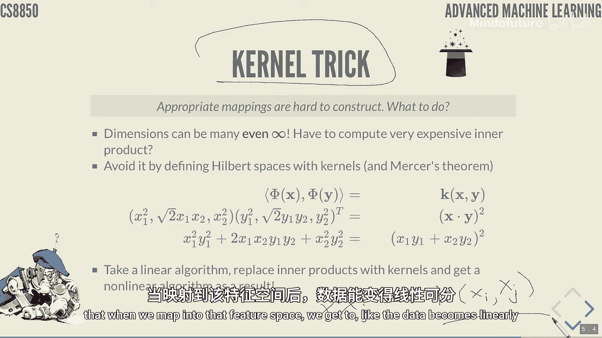

但如果特征映射到无限维空间（例如径向基核函数），这仍然很昂贵。我们可以通过定义带有核的希尔伯特空间并利用默瑟定理来避免先映射到特征空间再计算核函数。希尔伯特空间是一个定义了内积的线性空间。

我们可以**直接定义内积**，而不是定义映射。例如，对于多项式特征映射，我们可以先映射向量 **x** 和 **y**，然后计算它们的内积。但事实上，如果你进行代数运算，你会发现这个内积就是 **K(x, y) = (x·y + 1)^2** 这样的表达式。直接计算这个表达式比先映射再计算要简单得多。

**核技巧**的核心是：取一个线性算法，用核函数替换其中的所有内积。如果数据在算法中仅以内积形式出现，那么核技巧就有效。只需将所有形如 **x·y** 的内积替换成形如 **K(x, y)** 的核函数。神奇的是，你现在就在高维、非线性的特征空间中操作了。对于支持向量机，我们希望映射到这个特征空间后，数据能变得线性可分。

## 将核技巧应用于SVM

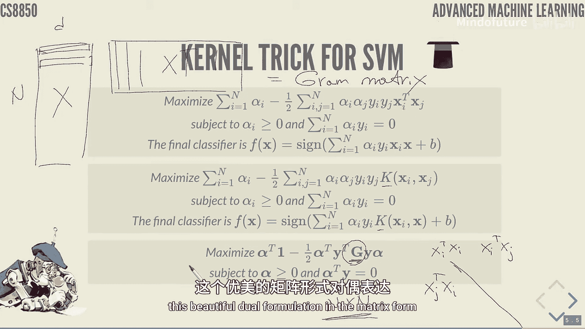

让我们看看将核技巧应用于线性支持向量机时会发生什么。

回顾一下原始的SVM对偶形式。注意，在优化问题和最终的分类器中，数据（无论是新样本还是旧样本）都只以**内积**的形式参与整个计算过程。

因此，我们可以用核函数替换这些内积。如果我们用矩阵形式书写，一切会变得更清晰。**G** 是一个实际的矩阵，称为格拉姆矩阵，它是内积矩阵。**G_ij = x_i · x_j**。你可以通过将样本排列成矩阵 **X**（n个样本，d维），然后计算 **G = X X^T** 来得到它。

现在，我们得到了这个优美的矩阵形式对偶公式，可以准备讨论默瑟定理了。

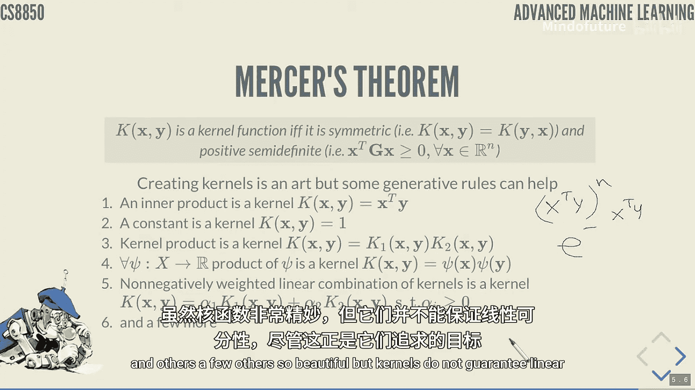

## 默瑟定理与核函数

那么，什么是核函数？一个函数 **K(x, y)** 接受两个向量，返回一个标量。它是一个有效的核函数，当且仅当它满足：
1.  **对称性**：**K(x, y) = K(y, x)**
2.  **半正定性**：对于任意数据点集合，其对应的格拉姆矩阵 **G**（其中 **G_ij = K(x_i, x_j)**）是半正定的。

检验半正定性是困难的。因此，为特定问题（如文本分类、图分类）设计新核函数是一门艺术。在2000年代，仍有大量论文为不同应用引入新核函数。

不过，一些生成规则可以帮助我们：
*   任何内积都是核。
*   常数是核。
*   核的乘积是核。
*   映射向量到标量的函数的乘积是核。
*   核的非负加权线性组合也是核。

我们可以利用这些规则，从已有的流行核（如**多项式核**和**径向基核**）出发，构造新的核。

## 软间隔SVM

然而，核函数并不能保证线性可分性。这就像神经网络：深度学习可以被视为可学习的、复杂的非线性映射（核），然后在顶部应用一个最大间隔分类器或逻辑回归。手动选择核函数可能出错。

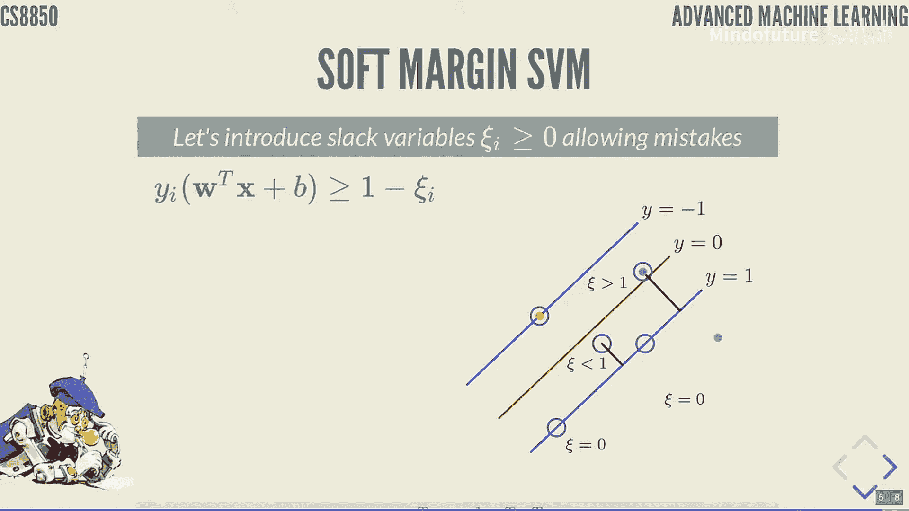

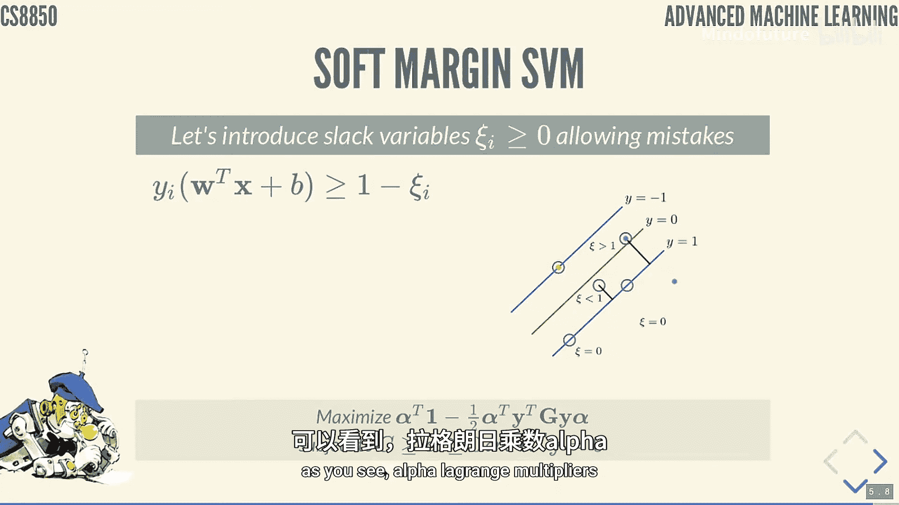

如果即使我们尝试了所有核函数，数据仍然不是线性可分的，该怎么办？到目前为止，我们讨论的都是**硬间隔SVM**。现在让我们谈谈**软间隔SVM**。

我们引入一些**松弛变量 ξ_i ≥ 0**。这样，我们将允许错误发生。原本我们希望所有样本都满足约束（在正确的一侧且间隔外）。现在，对于每个样本，我们允许一点错误。
*   对于正确分类且在间隔外的样本，ξ_i = 0。
*   对于正确分类但在间隔内的样本，0 < ξ_i < 1。
*   对于错误分类的样本，ξ_i > 1。

将这个新约束代入我们的对偶形式并进行推导后，松弛变量会消去，我们最终得到所谓的**盒约束**：**0 ≤ α_i ≤ C**。拉格朗日乘子 **α** 被限制在一个边长为 **C** 的“盒子”里。

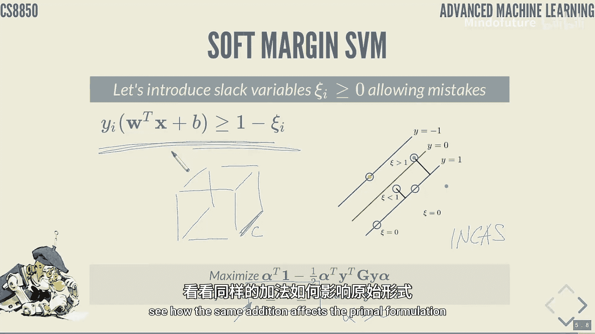

通过引入松弛变量，我们从简单的非负拉格朗日乘子，变成了带有盒约束的乘子。其中，超参数 **C** 需要通过交叉验证等方法确定。

## 软间隔的原始形式

现在让我们看看同样的修改如何影响原始形式。

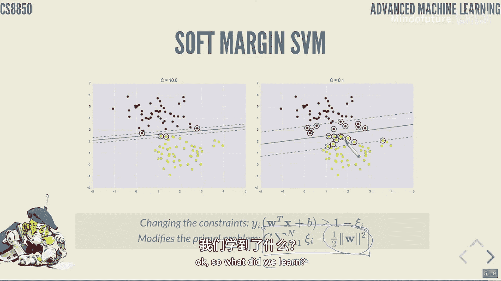

在原始形式中，我们原本是最大化间隔（即最小化 **||w||**）。现在，我们需要最小化这个表达式：**(1/2)||w||^2 + C * Σξ_i**。**C** 是松弛变量的权重，错误越多，求和项越大。如果没有错误，这项为0，我们就回到了原始的硬间隔形式。

如果我们想完全禁止错误（即施加无限惩罚），可以将 **C** 设为无穷大，这样就得到了最初定义的硬间隔SVM。这个例子表明：
*   **C 越大**，解越接近最大间隔解（对错误容忍度低）。
*   **C 越小**，间隔与数据的重叠越大（对错误容忍度高）。

## 总结与要点

本节课中我们一起学习了支持向量机的核技巧与软间隔。

**SVM 的优点包括：**
*   具有单一最优解的二次规划问题非常高效（尽管对于大数据仍需线性或次线性方法）。
*   基于支持向量的稀疏解很好处理，且预测速度极快。
*   由于大间隔，泛化能力很好。

**SVM 的缺点包括：**
*   对噪声和异常值敏感。
*   为任务选择或设计核函数是一门艺术，这也是SVM最大的问题之一，也是深度学习在许多领域取代它的原因之一。
*   依赖软间隔超参数 **C**，需要额外估计。

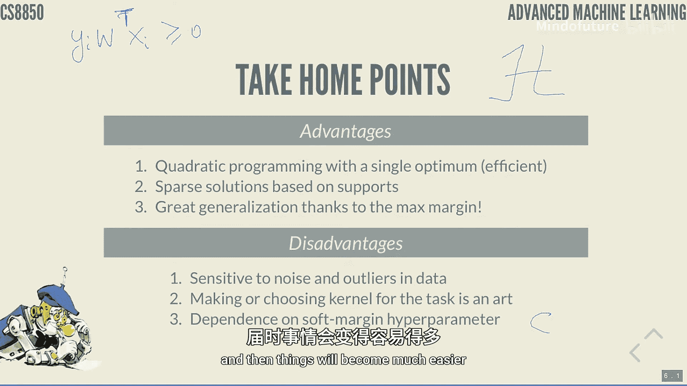

最后需要强调的是，感知机、逻辑回归和支持向量机都在寻找一个**分隔超平面**，它们的假设空间是相同的。但它们是不同的学习器，优化了**不同的目标函数**。作为研究者或工程师，关键是要弄清楚哪个目标函数最符合你的实际问题。机器学习算法本身并不“解决”问题，它只是优化一个数学目标。将现实问题与合适的算法及目标函数对齐，是我们的核心任务。