# 038：矩阵分解

在本节课中，我们将学习几种重要的矩阵分解技术。这些方法是无监督学习的重要组成部分，能够帮助我们理解数据的底层结构、进行降维、特征提取和信号分离。我们将从独立成分分析开始，然后探讨非负矩阵分解，最后介绍字典学习的基本概念。

## 独立成分分析

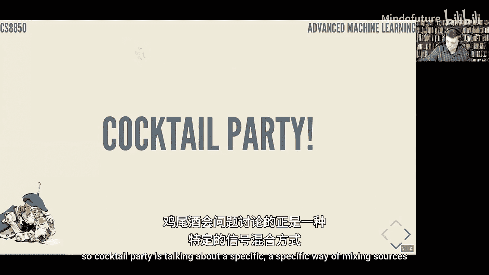

上一节我们介绍了矩阵分解的基本形式。本节中我们来看看独立成分分析。ICA旨在解决盲源分离问题，其核心思想是从混合信号中恢复出统计上相互独立的源信号。

### 问题定义与动机

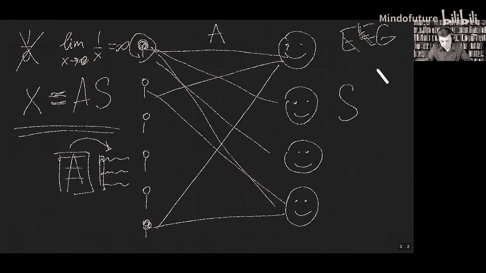

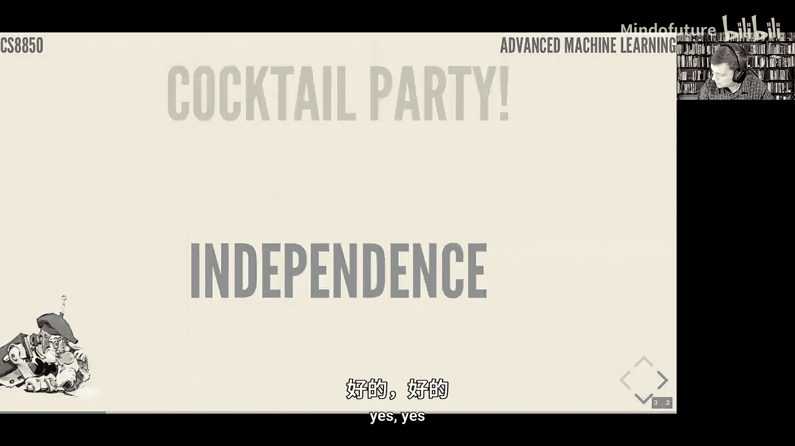

ICA通常用“鸡尾酒会问题”来形象化地解释。假设在一个房间里有多个说话者和多个麦克风。每个麦克风记录到的是所有说话者声音的混合。我们的目标是从这些混合录音中分离出每个说话者的独立声音信号。

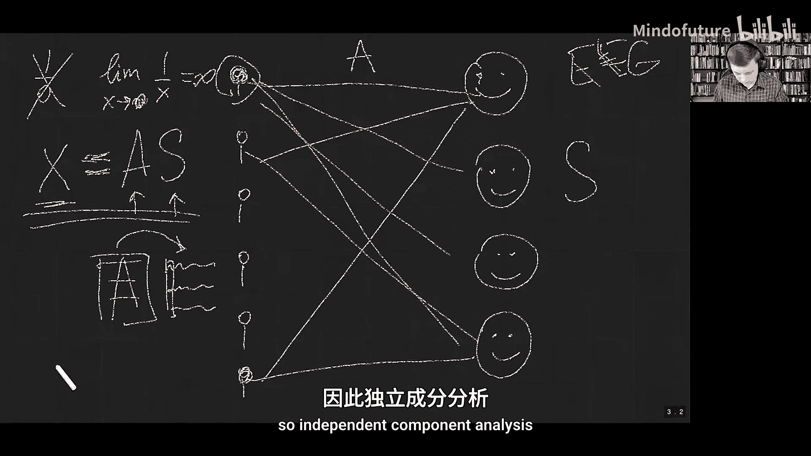

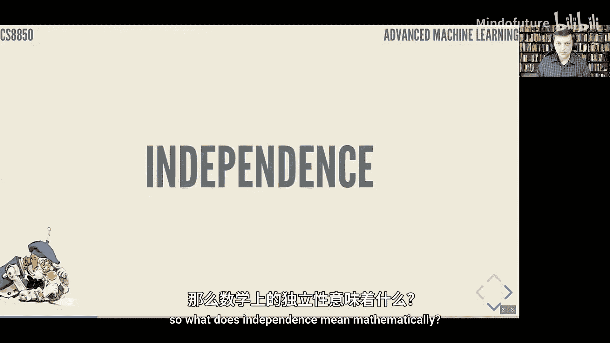

数学模型如下：我们观测到的混合信号矩阵 **X** 可以表示为源信号矩阵 **S** 与混合矩阵 **A** 的乘积：
**X = A S**

我们的目标是在仅知道 **X** 的情况下，估计出 **A** 和 **S**。这是一个病态问题，存在多种可能的解。ICA通过引入“源信号统计独立”的假设来约束解空间。

### 核心概念：统计独立性

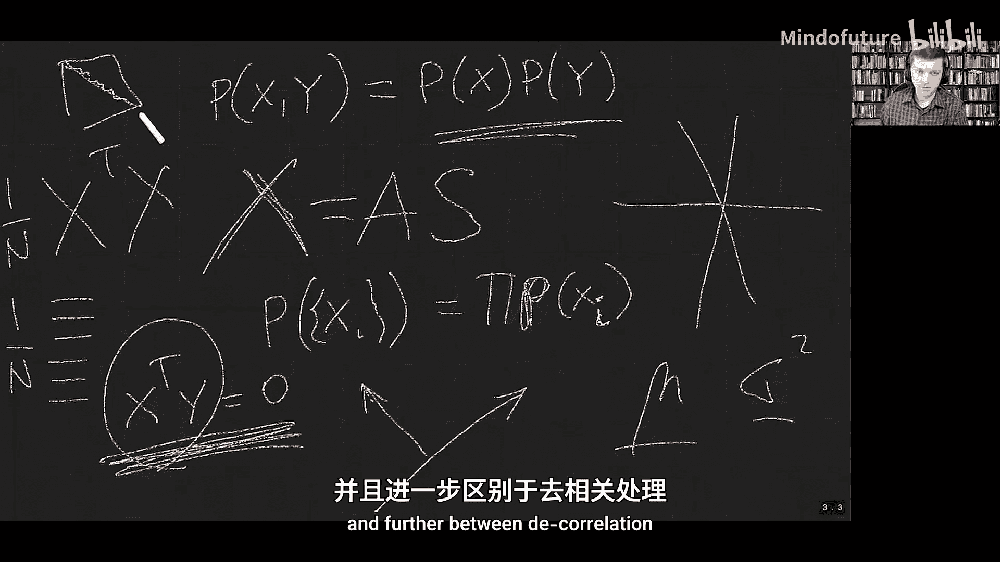

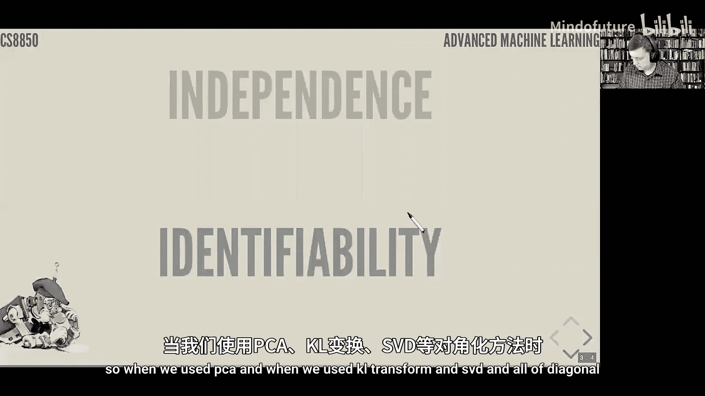

统计独立性是ICA的基石。对于两个随机变量，独立性意味着它们的联合概率分布等于各自边缘概率分布的乘积：
`P(x, y) = P(x) * P(y)`

这与主成分分析中使用的“不相关”概念不同。不相关只要求协方差为零（二阶统计量），而独立性是更强、更根本的条件，涉及所有阶的统计量。对于高斯分布，不相关即意味着独立。但ICA要求源信号是非高斯的，因为高斯信号的混合无法仅通过二阶统计量进行分离。

### 算法思路

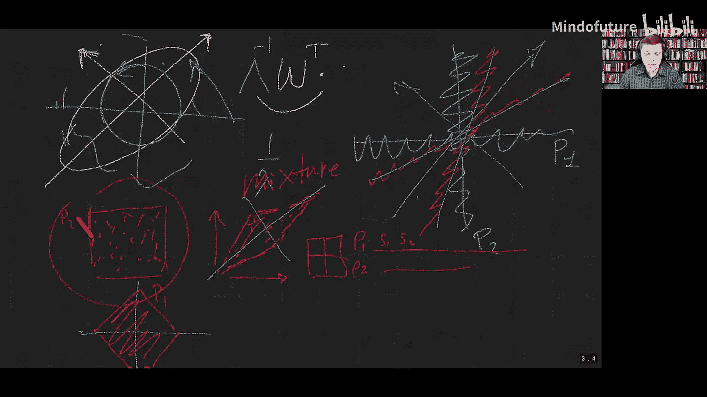

由于直接优化独立性比较困难，实际算法通常采用一些代理目标。以下是两种经典方法：

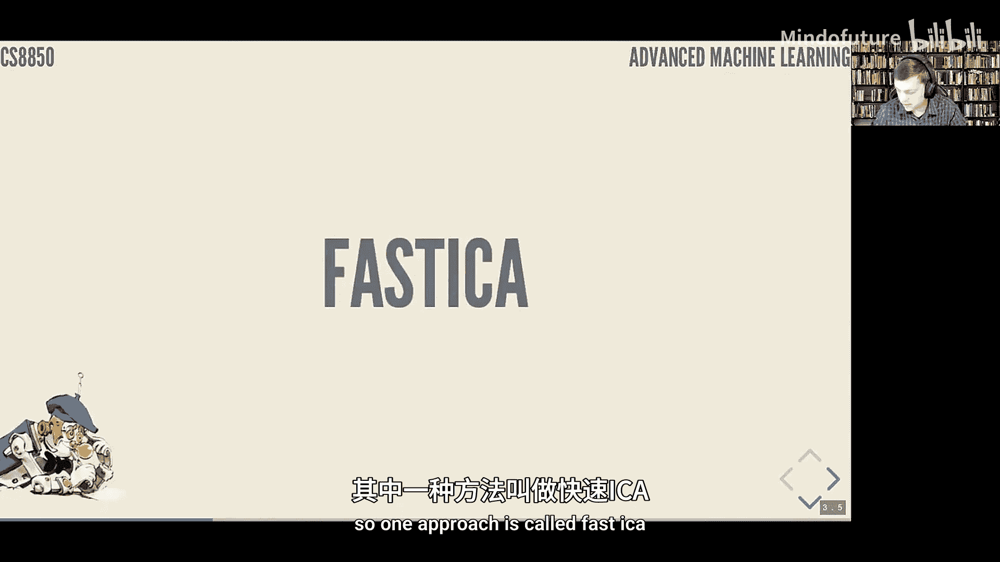

*   **FastICA**： 该方法基于非高斯性最大化。它利用高阶统计量（如峰度）来衡量信号的非高斯程度。算法通过寻找一个解混矩阵 **W**（使得 **S = W X**），使得输出信号 **S** 的各个分量尽可能非高斯，从而接近独立。
*   **Infomax**： 该方法基于信息最大化原理。目标是最大化输入 **X** 与输出 **S** 之间的互信息。可以证明，在输出信号通过一个有界函数（如Sigmoid）映射的情况下，最大化输出熵等价于最大化互信息，从而促使输出分量趋于统计独立。

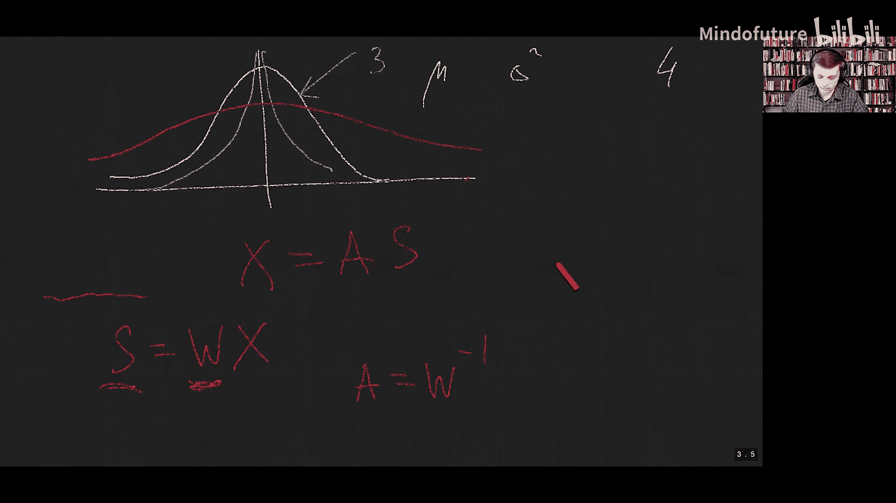

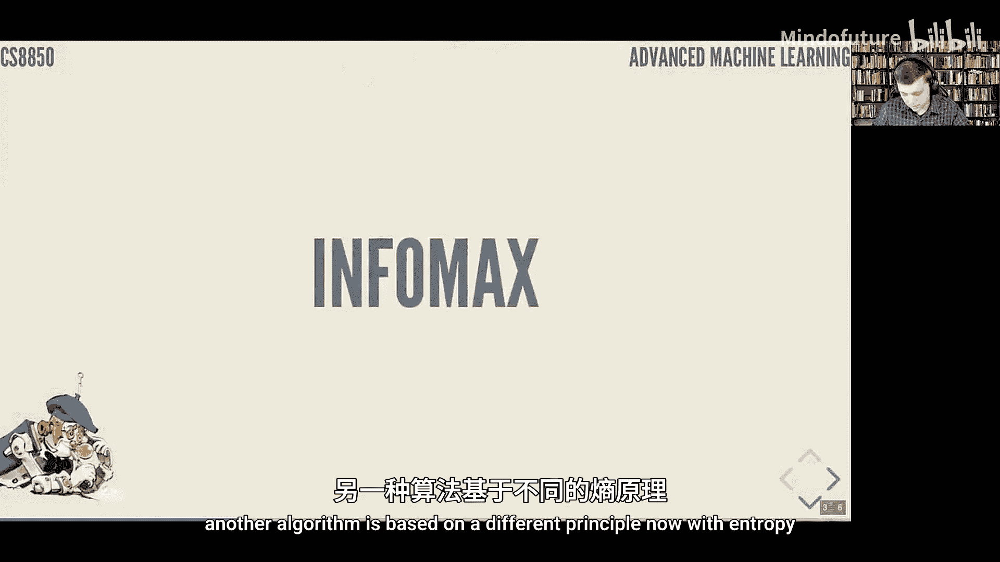

## 非负矩阵分解

上一节我们介绍了基于统计独立性的矩阵分解。本节中我们来看看另一种带有约束的分解方法——非负矩阵分解。NMF要求分解出的所有矩阵元素均为非负值，这使得它特别适合处理由部分叠加构成的数据，如图像像素强度、基因表达谱等。

### 问题定义

给定一个非负数据矩阵 **V**（大小为 m x n），NMF旨在找到两个非负矩阵 **W**（大小为 m x r）和 **H**（大小为 r x n），使得它们的乘积近似于原始矩阵：
**V ≈ W H**
其中，`r` 是一个远小于 `m` 和 `n` 的值，这实现了低秩近似。

### 乘性更新算法

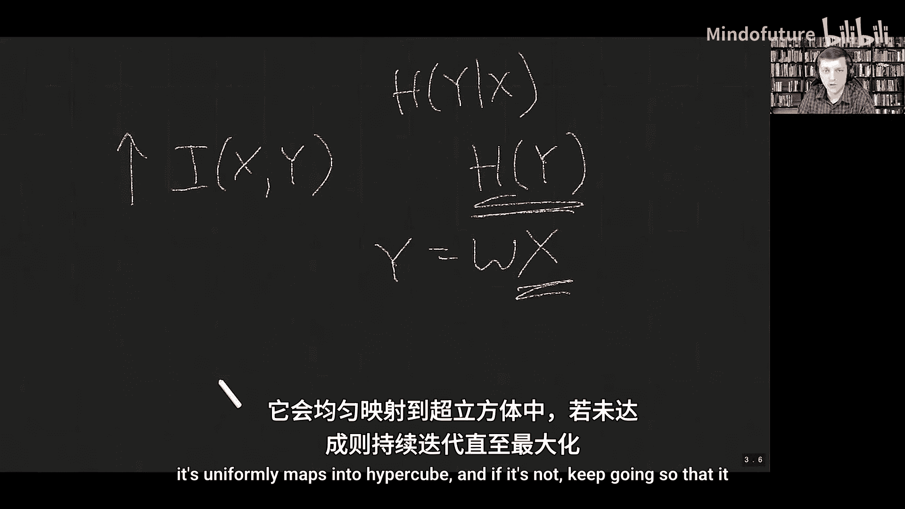

NMF的优化目标是最小化重构误差，例如使用Frobenius范数：`||V - WH||_F^2`。一个巧妙且常用的优化算法是乘性更新规则。

以下是更新 **H** 和 **W** 的规则：
`H <- H .* (W^T V) ./ (W^T W H + epsilon)`
`W <- W .* (V H^T) ./ (W H H^T + epsilon)`
其中 `.*` 和 `./` 表示逐元素乘法和除法，`epsilon` 是一个防止除零的小常数。

该算法的优势在于：
1.  自动保持非负性：只要初始值为非负，迭代过程中所有元素保持非负。
2.  无需设置学习率：更新规则是自适应的。
3.  实现简单，通常能收敛到一个有意义的局部解。

### 应用示例

在人脸图像数据上，**V** 的每一列是一张人脸。NMF分解后，**W** 的每一列可以解释为一种“局部特征”，例如眼睛、鼻子或嘴巴的某种模式；**H** 的对应行则表示了每张人脸中这些特征的权重。通过只使用少数（`r`个）这样的特征进行线性组合（相加），就可以近似重构出原始人脸。

## 字典学习

上一节我们探讨了具有非负约束的低秩分解。本节中我们来看看字典学习，它追求的是信号的稀疏表示，并引入了“过完备”字典的概念。

### 核心思想

字典学习的目标是为数据寻找一组基向量（称为“原子”），构成字典 **D**，使得任何数据样本 **x** 都可以用字典中少数几个原子的线性组合来稀疏表示：
**x ≈ D α**
其中，系数向量 **α** 是稀疏的（即大部分元素为零）。

### 过完备字典

与PCA等使用正交、完备基（基向量个数等于数据维度）的方法不同，字典学习通常使用**过完备字典**，即字典中原子的数量远大于数据的原始维度。虽然这增加了表示的冗余度，但好处是可能用更少的非零系数（更高的稀疏度）来精确表示信号，从而实现更高效的数据压缩或更有意义的特征提取。

### 与NMF和PCA的比较

以下是几种矩阵分解方法在人脸数据上学习到的基向量的对比：
*   **PCA**： 得到的是“特征脸”，是全局的、平滑的，对应数据方差最大的方向。
*   **NMF**： 得到的是局部特征，如眼睛、嘴巴部分，具有部分可解释性。
*   **字典学习**： 可以学习到过完备的基，这些基可能是更局部、更边缘化的特征，能够用更稀疏的方式重构图像，在压缩等任务上性能可能优于通用变换（如JPEG）。

## 与自编码器的联系

矩阵分解的思想与神经网络中的自编码器紧密相关。一个最简单的线性自编码器，其目标是学习一个编码矩阵 **W** 和解码矩阵 **W^T**，通过瓶颈层（低维表示）重构输入：
`损失函数 = ||X - W^T (W X)||^2`
可以证明，这种线性自编码器的最优解本质上就是主成分分析。

当我们在自编码器中引入非线性激活函数和更深的层数时，就得到了非线性深度自编码器。它们能够学习更复杂、更强大的数据表示，并且可以通过重构误差进行无监督预训练，这在深度学习发展史上具有重要意义。去噪自编码器通过向输入添加噪声并尝试重构干净信号，进一步提升了表示的鲁棒性，是当前自监督学习思想的先驱之一。

## 总结

本节课中我们一起学习了矩阵分解的几种核心方法。
1.  **独立成分分析** 通过假设源信号统计独立，解决盲源分离问题，适用于信号解混等场景。
2.  **非负矩阵分解** 通过施加非负约束，得到具有可加性和部分可解释性的局部特征，适用于图像分析、文本挖掘等。
3.  **字典学习** 旨在学习一个过完备字典，以获得数据的稀疏表示，在压缩和特征学习方面有优势。

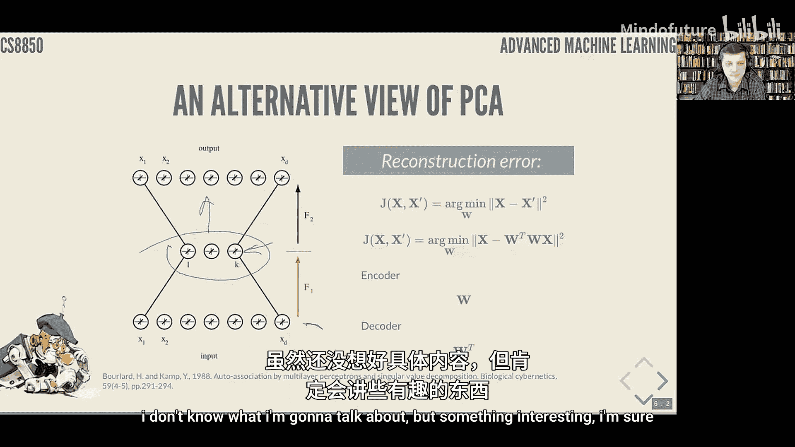

这些方法虽然形式不同，但核心都是将数据矩阵分解为有意义的因子，它们是无监督学习中的强大工具，也是理解许多现代深度学习模型（如自编码器）的基础。掌握这些经典方法有助于我们更深入地理解数据并选择合适的工具。