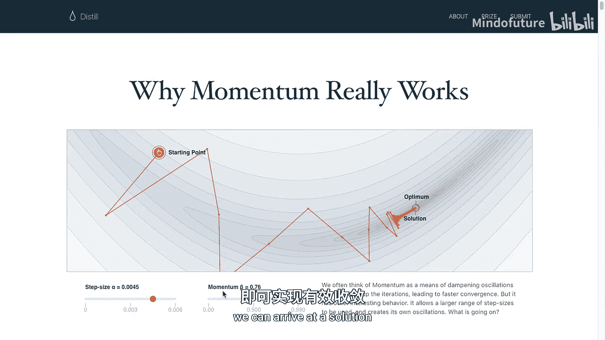
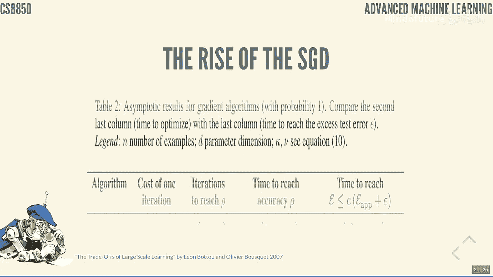

# 039：P39_随机梯度下降 🎯

在本节课中，我们将学习随机梯度下降（SGD）及其变体。我们将探讨其工作原理、与传统批量梯度下降的区别、各自的优缺点，以及如何通过引入动量、自适应学习率等高级技巧来优化SGD的性能，使其能够高效处理大规模数据集并逃离局部极小值。

---

## 梯度下降法回顾 📉

上一节我们介绍了各种机器学习模型及其估计方法。本节中，我们来看看参数优化的核心算法——梯度下降法。

梯度下降法是一种最小化目标函数 \( J(\theta) \) 的方法。其中，\( \theta \) 是模型参数空间中的一个点。例如，在感知机模型中，参数是分离超平面的法向量 \( W \)；在神经网络中，参数是所有连接的权重。目标函数 \( J(\theta) \) 是我们希望最小化的损失函数，它是一个标量值。

更新公式如下：
\[
\theta_{\text{new}} = \theta_{\text{old}} - \eta \cdot \nabla J(\theta)
\]
其中，\( \eta \) 是学习率，决定了参数更新的步长。\( \nabla J(\theta) \) 是目标函数在参数 \( \theta \) 处的梯度。在局部最小值处，梯度为零，更新停止。

---

## 梯度下降的三种变体 🔄

梯度下降的不同变体在于计算梯度 \( \nabla J(\theta) \) 时所使用的数据量不同。目标函数 \( J(\theta) \) 及其梯度 \( \nabla J(\theta) \) 不仅是参数 \( \theta \) 的函数，也是数据 \( X \) 的函数。

以下是三种主要变体：

*   **批量梯度下降**：使用全部数据集 \( X \) 来计算每一次参数更新时的梯度。
*   **随机梯度下降**：每次更新只使用一个数据样本 \( x_i \) 来计算梯度。
*   **小批量梯度下降**：每次更新使用一小批数据样本（例如，从 \( x_i \) 到 \( x_{i+\text{batch size}} \)）来计算梯度。

关键区别在于，批量梯度下降始终在由**全部数据**定义的同一个“误差曲面”上移动。而随机梯度下降的每一步都在一个由**单个样本**定义的、完全不同的曲面上计算梯度。小批量梯度下降则介于两者之间，每一步在一个由**小批量样本**定义的曲面上移动。这种随机性使得SGD的收敛路径与批量梯度下降不同。

---

## 权衡：精度、速度与内存 ⚖️

不同的梯度下降变体在参数更新的精度、速度和内存消耗上存在权衡。

*   **批量梯度下降**：更新最准确，但速度慢，内存消耗高，无法进行在线学习。
*   **随机梯度下降**：更新快，内存消耗低，支持在线学习，但更新方差大，可能导致目标函数剧烈波动。
*   **小批量梯度下降**：速度适中，内存消耗适中，支持在线学习，并通过平均梯度减小了更新方差。

在大数据时代，数据集可能达到TB级别，无法一次性装入内存。批量梯度下降因此变得不可行。随机梯度下降及其变体成为处理大规模数据的关键。

---

## 算法实现细节 💻

以下是三种梯度下降变体的简化伪代码描述。

### 批量梯度下降
批量梯度下降在每个迭代周期（epoch）中使用全部数据计算一次梯度，并进行一次参数更新。
```python
for epoch in range(num_epochs):
    grad = compute_gradient(theta, entire_dataset)
    theta = theta - learning_rate * grad
```

### 随机梯度下降
随机梯度下降在每个epoch中随机打乱数据，并对每一个样本单独计算梯度并更新参数。
```python
for epoch in range(num_epochs):
    shuffle(data)
    for x_i, y_i in data:
        grad = compute_gradient(theta, x_i, y_i)
        theta = theta - learning_rate * grad
```




### 小批量梯度下降
小批量梯度下降是折衷方案，它对每一小批数据计算平均梯度，然后更新参数。这能利用深度学习库的高度优化矩阵运算。
```python
for epoch in range(num_epochs):
    shuffle(data)
    for batch in get_batches(data, batch_size):
        grad = compute_gradient(theta, batch)
        theta = theta - learning_rate * grad
```

---

## 优化SGD：动量与加速 🚀

随机梯度下降的波动性可能阻碍收敛，特别是在“峡谷”形误差曲面中，它可能会在谷壁间震荡，而非沿谷底快速下降。

为了解决这个问题，我们引入了**动量**的概念。其思想类似于让一个重球沿着误差曲面滚动。球具有惯性，能够平滑掉梯度方向上的高频噪声，并加速在平坦方向的移动。

动量更新公式如下：
\[
\begin{aligned}
v_t &= \lambda v_{t-1} + \eta \nabla J(\theta_t) \\
\theta_{t+1} &= \theta_t - v_t
\end{aligned}
\]
其中，\( v_t \) 是当前的速度（动量），\( \lambda \) 是动量衰减系数（通常取0.9）。当前更新方向是历史梯度方向的加权平均。

**Nesterov加速梯度**是动量的一个改进版本。它先根据当前动量“展望”一步，在那个“展望”点计算梯度，然后结合这个梯度进行修正。这种方法通常能获得更快的收敛速度。

---

## 自适应学习率算法 🧠

另一个思路是为每个参数设置自适应的学习率，而不是使用全局统一的学习率。这对于稀疏数据（某些特征很少出现）尤其有用。

**AdaGrad** 为每个参数累积历史梯度的平方，并以此调整学习率：
\[
\theta_{t+1, i} = \theta_{t, i} - \frac{\eta}{\sqrt{G_{t, ii} + \epsilon}} \cdot g_{t, i}
\]
其中，\( G_t \) 是一个对角矩阵，其元素 \( G_{t, ii} \) 是参数 \( \theta_i \) 历史梯度平方的累积和。问题在于，随着训练进行，累积和会变得极大，导致学习率过早衰减至零。

**RMSProp** 通过引入指数衰减平均解决了AdaGrad学习率衰减过快的问题：
\[
\begin{aligned}
E[g^2]_t &= \beta E[g^2]_{t-1} + (1-\beta) g_t^2 \\
\theta_{t+1} &= \theta_t - \frac{\eta}{\sqrt{E[g^2]_t + \epsilon}} \cdot g_t
\end{aligned}
\]

**Adam** 结合了动量（一阶矩估计）和RMSProp（二阶矩估计）的思想，并进行了偏差校正，是目前最流行且通常效果很好的自适应优化算法。
\[
\begin{aligned}
m_t &= \beta_1 m_{t-1} + (1-\beta_1) g_t \\
v_t &= \beta_2 v_{t-1} + (1-\beta_2) g_t^2 \\
\hat{m}_t &= \frac{m_t}{1 - \beta_1^t} \\
\hat{v}_t &= \frac{v_t}{1 - \beta_2^t} \\
\theta_{t+1} &= \theta_t - \frac{\eta}{\sqrt{\hat{v}_t} + \epsilon} \hat{m}_t
\end{aligned}
\]

---

## 逃离鞍点与结论 🏁

在高维参数空间中（如大型神经网络），真正的局部极小值很少见，更常见的是**鞍点**。在鞍点处，梯度为零，但某些方向是上升的，某些方向是下降的。

自适应学习率方法（如Adam）通过为不同参数提供不同的更新幅度，有助于逃离鞍点。即使大多数参数的梯度为零，那些梯度非零的参数仍能获得有效的更新，从而推动模型继续优化。

实践证明，随机梯度下降及其高级变体（尤其是Adam）在大数据场景下不仅计算更快，而且通常能比批量梯度下降更快地收敛到良好的解。这使其成为现代深度学习和大规模机器学习任务中的默认优化器。

---



本节课中我们一起学习了随机梯度下降的核心原理、三种变体的区别与权衡，以及如何通过动量、Nesterov加速和自适应学习率（AdaGrad， RMSProp， Adam）等高级技术来提升其性能，使其能够高效、稳健地训练大规模机器学习模型。