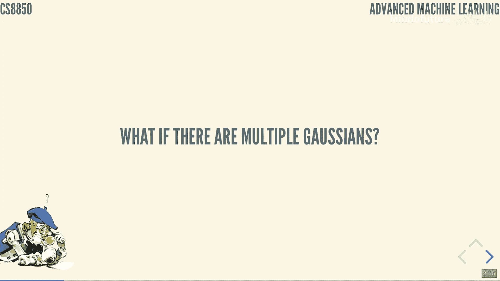

# 040：高斯混合模型与聚类算法 🧮

在本节课中，我们将学习高斯混合模型及其相关的聚类算法。我们将从回顾最大似然估计开始，然后介绍高斯混合模型，并探讨聚类的基本概念。最后，我们将详细讲解K-Means算法及其变体——软聚类。

## 最大似然估计回顾 📊

上一节我们介绍了最大似然估计的基本概念。本节中，我们来看看在处理连续特征时，如何应用最大似然估计。

在第九讲关于最大似然估计的内容中，我们讨论了如何处理连续特征。起初可能觉得困难，但后来发现其实很简单。我们首先构建似然函数，然后最大化它。如果我们用高斯分布来建模似然函数，问题就变得相当容易。

在任何最大似然估计问题中，我们都需要找到能够最大化观测数据概率的参数。我们通过最大化似然函数来实现这一点。假设数据是独立抽取的，那么似然函数可以分解为每个样本独立似然的乘积。因为我们假设数据服从高斯分布，所以每个样本的似然是已知的。

高斯分布包含未知的均值参数和方差参数。由于样本是独立同分布的，我们可以将指数内的乘积合并，进而估计这个高斯分布的均值最大似然估计量。众所周知，它就是样本均值，即所有参数值之和除以N。

同时，方差的最大似然估计量是估计均值与样本值之间差值的平方和。

此外，我们了解到这个最大似然估计量是有偏的。其偏差主要源于我们使用的是均值的最大似然估计量，而非真实均值。如果我们使用真实均值，结果将是准确的。为了纠正最大似然估计量中的偏差，我们需要用n-1而不是n进行归一化。

当只有一个高斯分布，并且数据都从中采样时，上述过程简单明了。我们只需要估计该高斯分布的参数。但是，如果存在多个高斯分布呢？

## 高斯混合模型 🌀

上一节我们回顾了单一高斯分布的最大似然估计。本节中，我们将探讨当数据可能来自多个高斯分布时的情况，即高斯混合模型。

高斯混合模型是多个高斯分布的线性组合。每个高斯分布称为一个“成分”，并有其自身的均值和方差。此外，每个成分还有一个混合权重，表示该成分生成数据的概率。

在高斯混合模型中，我们假设每个数据点是由其中一个高斯成分生成的，但我们不知道具体是哪一个。这引入了“隐变量”的概念，即我们无法直接观测到的变量。在这种情况下，隐变量指示了每个数据点属于哪个高斯成分。

为了估计高斯混合模型的参数（各成分的均值、方差和混合权重），我们需要使用期望最大化算法。EM算法是一种迭代方法，用于在存在隐变量的情况下找到参数的最大似然估计。

EM算法分为两个步骤：期望步骤和最大化步骤。在期望步骤中，我们根据当前参数估计计算每个数据点属于每个成分的后验概率。在最大化步骤中，我们使用这些后验概率更新参数估计，以最大化期望似然。

通过反复迭代这两个步骤，EM算法会收敛到参数的局部最优解。这使得我们能够从数据中学习高斯混合模型，即使我们不知道每个数据点来自哪个成分。

## 聚类简介 🔍

上一节我们介绍了高斯混合模型，它本质上是一种软聚类方法。本节中，我们来看看聚类的一般概念及其意义。

聚类是一种无监督学习技术，旨在将数据点分组到不同的类别或“簇”中，使得同一簇内的数据点彼此相似，而不同簇的数据点则 dissimilar。聚类在许多领域都有应用，例如客户细分、图像分割和异常检测。

聚类的目标是根据数据点的特征发现数据中的内在结构。与分类不同，聚类不需要预先标记的数据。相反，它依赖于数据点之间的相似性度量。

以下是几种常见的聚类算法：

*   **K-Means**：一种基于质心的聚类算法，将数据划分为K个簇，每个簇由其质心表示。
*   **层次聚类**：通过构建树状图（树状结构）来合并或分裂簇，形成聚类的层次结构。
*   **DBSCAN**：一种基于密度的聚类算法，可以发现任意形状的簇，并能识别噪声点。
*   **高斯混合模型**：一种基于概率模型的软聚类方法，假设数据由多个高斯分布混合生成。

聚类在许多实际应用中都非常有用，例如市场分析、社交网络分析和生物信息学。通过将相似的数据点分组在一起，我们可以更好地理解数据并做出有根据的决策。

## K-Means 算法 🎯

上一节我们概述了聚类的基本概念。本节中，我们将深入探讨一种特定的聚类算法——K-Means。

K-Means 是一种基于质心的聚类算法，旨在将数据点划分为K个簇。每个簇由其质心表示，质心是该簇中所有数据点的平均值。K-Means 的目标是最小化每个数据点到其所属簇质心的距离平方和。

K-Means 算法通过迭代以下两个步骤来实现这一目标：

1.  **分配步骤**：将每个数据点分配到距离其最近的质心所属的簇。
2.  **更新步骤**：根据当前分配到每个簇的所有数据点重新计算该簇的质心。

算法开始时随机初始化K个质心，然后重复执行分配和更新步骤，直到质心不再发生显著变化或达到预定的迭代次数。

K-Means 算法简单高效，适用于大规模数据集。然而，它也有一些局限性，例如需要预先指定簇的数量K，并且对初始质心的选择敏感。此外，K-Means 假设簇是凸形的且大小相似，这可能不适用于所有类型的数据。

## 软聚类与软K-Means 🤖

上一节我们介绍了标准的K-Means算法，它是一种硬聚类方法，即每个数据点只属于一个簇。本节中，我们来看看软聚类，特别是软K-Means。

软聚类，也称为模糊聚类，允许数据点以一定的概率属于多个簇。这与硬聚类不同，硬聚类中每个数据点只能完全属于一个簇。软聚类提供了更灵活的数据表示，能够捕捉数据点可能属于多个类别的情况。

软K-Means是K-Means的软聚类版本。在软K-Means中，每个数据点都有一个隶属度向量，表示它属于每个簇的概率。这些概率之和为1。算法的目标是最小化加权距离平方和，其中权重就是数据点属于各簇的隶属度。

软K-Means的迭代过程与标准K-Means类似，但包含软分配：

1.  **软分配步骤**：计算每个数据点属于每个簇的概率（隶属度）。
2.  **更新步骤**：根据当前隶属度加权平均重新计算每个簇的质心。

软K-Means通过引入隶属度的概念，提供了比硬K-Means更丰富的数据结构描述。它对于簇边界模糊或数据点可能具有多重身份的情况特别有用。软K-Means与高斯混合模型有密切的联系，实际上可以看作是高斯混合模型在特定假设下的一个特例。

## 总结 📝

本节课中我们一起学习了高斯混合模型及其相关的聚类算法。我们从最大似然估计的回顾开始，理解了如何估计单一高斯分布的参数。接着，我们探讨了高斯混合模型，它通过引入隐变量和EM算法来处理来自多个高斯分布的数据。

然后，我们介绍了聚类的基本概念，了解了其目标和应用场景。我们详细讲解了K-Means算法，这是一种基于质心的硬聚类方法。最后，我们探讨了软聚类的概念，特别是软K-Means，它允许数据点以概率形式属于多个簇，提供了更灵活的数据分组方式。

这些内容为我们理解无监督学习，特别是基于模型的聚类方法，奠定了坚实的基础。