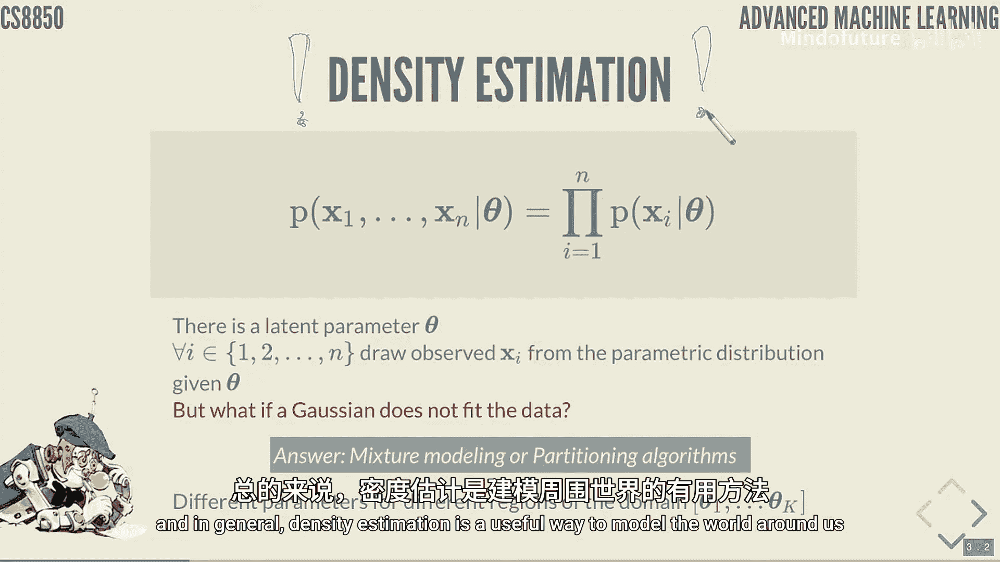
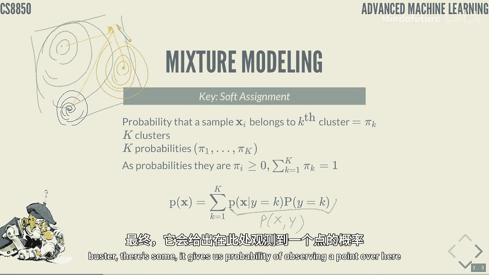
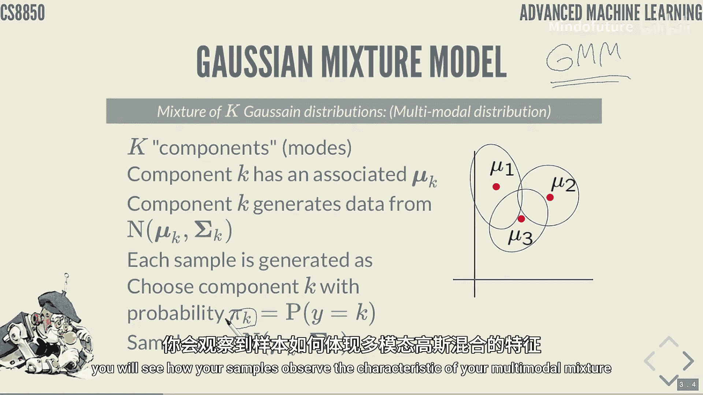
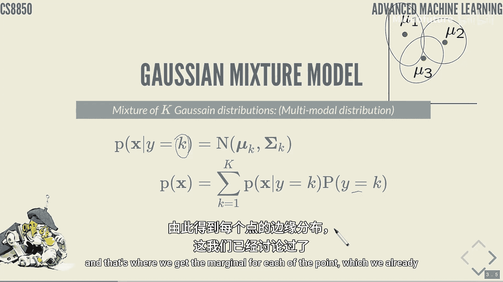
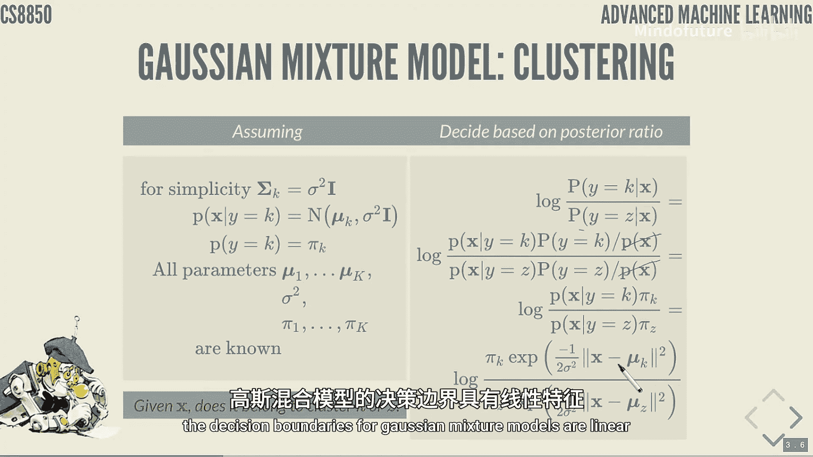
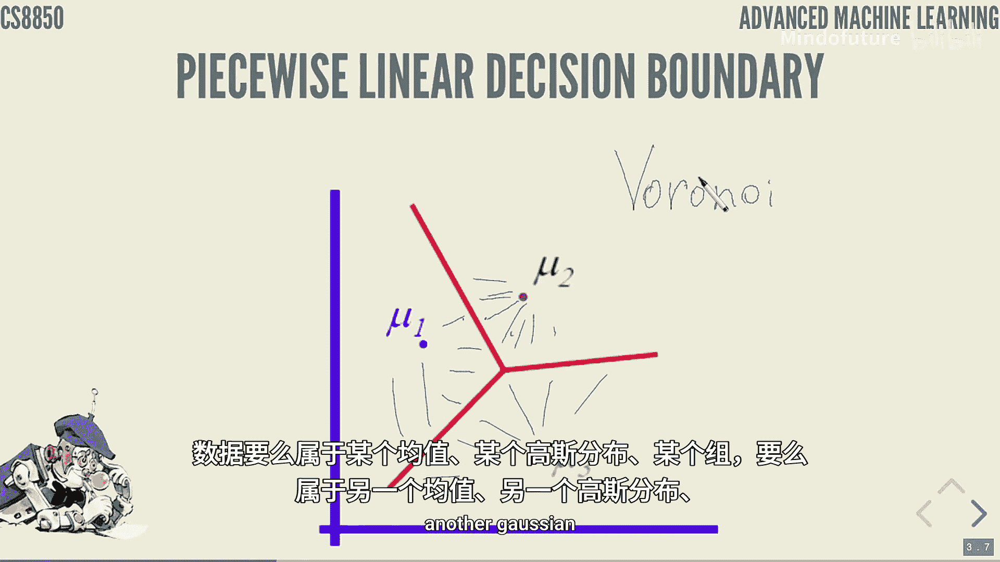

# 041：高斯混合模型 (GMM) 🧮

在本节课中，我们将要学习高斯混合模型。这是一种用于密度估计和聚类的强大工具，它通过组合多个高斯分布来描述复杂的数据分布。

当数据由多个高斯分布表示时，我们称这种组合为高斯混合模型，其概率密度函数称为混合高斯密度。如果只有一个高斯分布，我们只需要知道其均值和协方差矩阵。但在多维情况下，如果我们有两个或k个高斯分布，它们的简单相加并不会构成一个概率分布。为了使其成为一个有效的概率分布，我们需要为每个高斯分量乘以一个权重，这些权重之和为1。这些权重可以看作是先验概率，我们称之为混合权重。本质上，这是高斯分布的一个凸组合。例如，如果均匀地选择左右两个高斯，只需将每个分量乘以0.5再相加，就能得到一个新的分布，这个分布就是高斯混合模型。

## 模型定义与动机

上一节我们介绍了高斯混合模型的基本概念，本节中我们来看看其正式定义和动机。

如果单一的高斯分布无法很好地拟合数据，我们就使用高斯混合模型。这是一种混合建模或分区算法。我们有一个数据集，以及由不同模型（分量）组成的混合模型，然后将数据集划分到属于不同模型（例如不同高斯分布）的子集中。虽然混合建模不限于高斯分布，但高斯分布因其数学上的便利性而被广泛使用。密度估计本身很重要，它帮助我们理解周围世界的概率，并且可以用于构建更好的分类器，例如在朴素贝叶斯中。

## 软分配与概率解释

理解了基本动机后，我们进一步探讨混合建模中的核心思想：软分配。

与将所有样本硬性分配到一个类别或一个高斯不同，我们考虑软分配的概念。即，一个样本 **X_i** 属于第 **k** 个高斯簇的概率。一个样本可能以一定的概率属于这个高斯簇，也以一定的概率属于另一个高斯簇。这个概率就是之前提到的混合权重 **π_k**。作为概率，它们是正的且总和为1。那么，观测到某个特定点 **x** 的概率，就是所有可能类别（高斯分量）下联合概率的加权和。用公式表示，观测到点 **x** 的概率为：
**p(x) = Σ_{k=1}^{K} π_k * N(x | μ_k, Σ_k)**
这实际上是对所有类别进行边缘化（积分）的结果。如果密度函数是高斯混合，那么在某一点的概率就是该点根据橙色簇、品红色簇、紫色簇等各个高斯分量的概率加权和。

## 生成过程与模型参数

现在，我们具体看看高斯混合模型的生成过程和参数。

在高斯混合模型中，分布将具有多个峰值（或称“分量”）。每个分量都有一个关联的均值 **μ_k** 和协方差矩阵 **Σ_k**。每个样本的生成过程如下：
1.  首先，以概率 **π_k** 选择第 **k** 个分量。
2.  然后，从被选中的高斯分布 **N(x | μ_k, Σ_k)** 中生成样本 **x**。

需要指出的是，高斯混合模型是一种**生成模型**。生成模型不仅能描述数据或解决分类问题，还能生成与训练数据分布一致的新样本。例如，在估计完成后，可以从核密度估计器或高斯混合模型中采样新样本。

因此，对于K个高斯分布的混合，数据点 **x** 的似然函数是各个高斯似然的加权和：
**p(x | θ) = Σ_{k=1}^{K} π_k * N(x | μ_k, Σ_k)**
其中 **θ** 代表所有参数 **{π_k, μ_k, Σ_k}** 的集合。

## 与聚类的关系及决策边界

高斯混合模型可以看作是聚类的一种形式。为了简化，我们做一个假设。

假设所有高斯分量具有相同的协方差矩阵 **Σ**，并且是球形的（即 **Σ = σ^2 I**）。这意味着在所有方向上概率密度衰减相同。这些高斯分布的唯一区别在于它们具有不同的均值 **μ_k**。混合概率 **π_k** 是已知的。给定一个样本 **x**，我们需要判断它属于哪个簇（例如簇K还是簇Z）。我们可以基于后验概率的比例来做决策，使用贝叶斯公式。证据项会抵消，归一化常数也会抵消，最终我们会得到一个线性决策边界。特别是在这个球形协方差的例子中，这些线性模型非常接近（或等同于）空间的Voronoi划分。

决策边界一侧的所有点更接近某个均值，另一侧的点则更接近另一个均值。这基本上划定了空间的距离单元或区域，即Voronoi单元。

## 总结

本节课中我们一起学习了高斯混合模型。我们了解到，GMM通过多个高斯分布的凸组合来建模复杂数据分布，是一种强大的密度估计和聚类工具。它引入了软分配的概念，即每个数据点以一定概率属于各个分量。GMM是一个生成模型，可以描述数据的生成过程。在特定假设（如球形等协方差）下，其决策边界是线性的，并与Voronoi图相关。关于如何从数据中估计GMM的参数（如均值、协方差和混合权重），我们将在下一讲中深入探讨。

