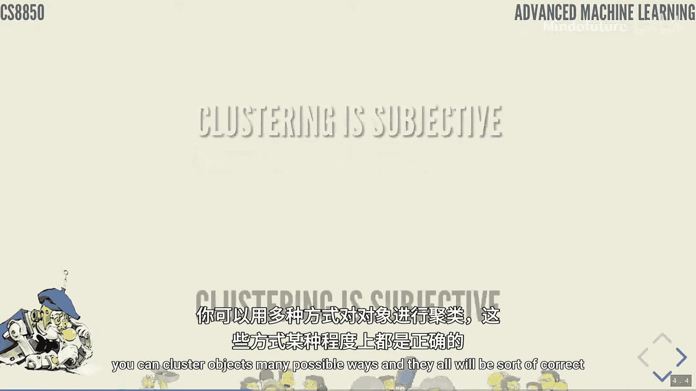
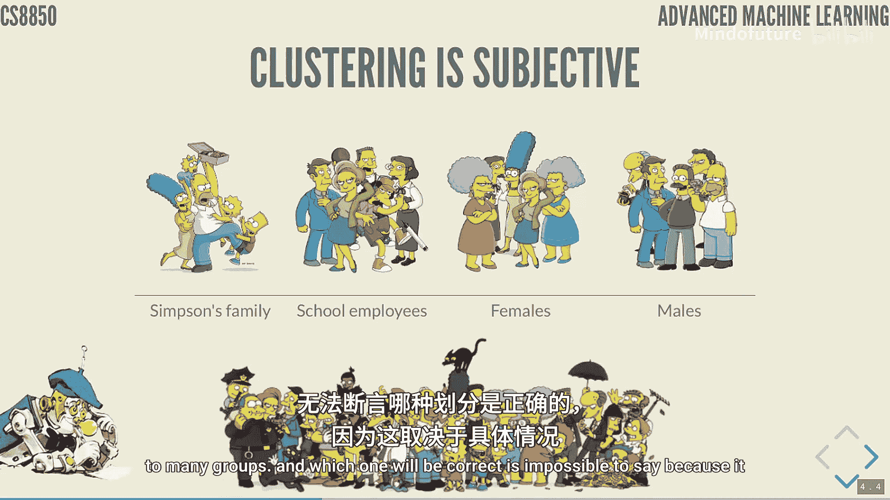
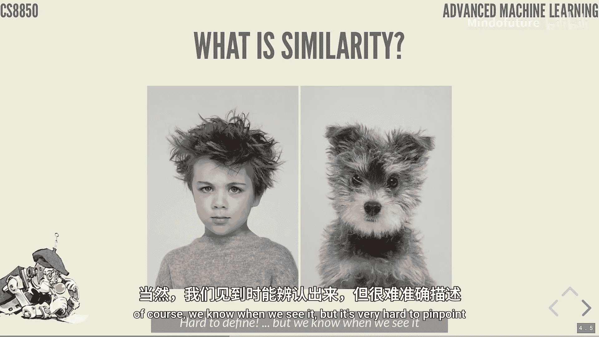

# 042：聚类

在本节课中，我们将要学习聚类分析。聚类是一种将数据分割成不同组别的无监督学习方法。我们将探讨其基本概念、形式化定义、面临的挑战以及它与监督学习的区别。

## 什么是聚类？🤔

上一节我们介绍了课程主题，本节中我们来看看聚类的核心定义。

聚类是一种分割数据的方法。它将一组对象划分到不同的群组中。我们实际上一直在进行聚类，例如当我们命名“树”时，就是在用一个名称标识一个类别。

这个名称意味着什么呢？它是否意味着这个类别中的所有事物都完全相同？答案是既肯定又否定。有些树比其他树更相似，但在我们称为“树”的类别中，确实存在巨大的多样性。聚类也是一种压缩机制。如果我们已经识别并认同了数据中的聚类，那么我们只需要说“树”，其含义就已经很明确了。在给出指示或交流时，我们无需讨论场景中的所有多样性和细节。

因此，聚类是一种发现数据中规律性的方法。你可以将其视为分类的第一步，因为分类在某种意义上就是将观测值分配到不同的类别中。唯一的决定性区别在于，聚类是无监督的。在本讲座中我们将看到，或者你可能已经在混合模型中看到，聚类实际上是混合建模的一种方式。

## 聚类的形式化定义 📝

上一节我们了解了聚类的直观概念，本节中我们来看看如何形式化地定义它。

其定义与混合模型非常相似：一个数据点 **x** 属于哪个成分？属于哪个簇？聚类是通过相似性将对象分组到簇中的过程。我们将相似的对象放入同一个簇。

以下是聚类的核心目标：
*   我们希望簇内的相似性非常高。我们希望簇内的对象或样本彼此高度相似。
*   我们希望不同簇之间或跨簇的样本是不相似的。

因此，聚类是最常见的无监督学习形式。不过，需要说明的是，我们讨论过的PCA、ICA、NMF、核密度估计等方法也是无监督方法，并且应用非常广泛，甚至在监督学习领域也有应用。当我们说机器学习可以分为监督学习和无监督学习时，这已经不是一个完全准确的描述了，但我们通常还是会这样粗略地划分。需要知道还有其他组成部分，但当我们说“无监督”时，通常指的是：如果监督学习是分类，那么无监督学习就一定是聚类。

## 聚类的主观性与挑战 🎯

上一节我们形式化地定义了聚类，本节中我们来看看聚类分析面临的主要挑战。

第一个挑战是聚类具有主观性。你可以用多种可能的方式对对象进行聚类，而这些方式在某种意义上都可能是正确的。

例如，让我们看看辛普森一家及其朋友们。我们可以提取多种分组方式。我们可以提取辛普森家族的分组、学校员工的分组、女性的分组或男性的分组。正如你在女性和学校员工的分组中所见，同一个人可以同时属于多个分组。

因此，你如何定义这些分组，或者你选择将对象划分到哪些分组中，是有些主观的。有些分组集合可能会产生相互冲突的分配。或者，你可以同样合理地将同一个辛普森角色分配到多个组中。哪个是正确的？这很难说，因为这取决于具体情况。

另一个挑战是：相似性是什么？我们希望同一簇内的对象高度相似，并希望不同簇中的对象不相似。但相似性很难定义。当然，我们看到时能认出来，但要精确地定义它却非常困难。

## 总结 📚

本节课中，我们一起学习了聚类分析。我们了解到聚类是一种无监督学习方法，旨在根据相似性将数据对象分组，使得组内对象相似度高，组间对象差异大。我们探讨了其形式化定义，并指出了聚类面临的两个主要挑战：其划分结果具有主观性，以及“相似性”这一核心概念本身难以精确定义。理解这些基础是后续学习具体聚类算法（如K-Means、层次聚类等）的关键。