# 043：硬K均值算法详解 🎯

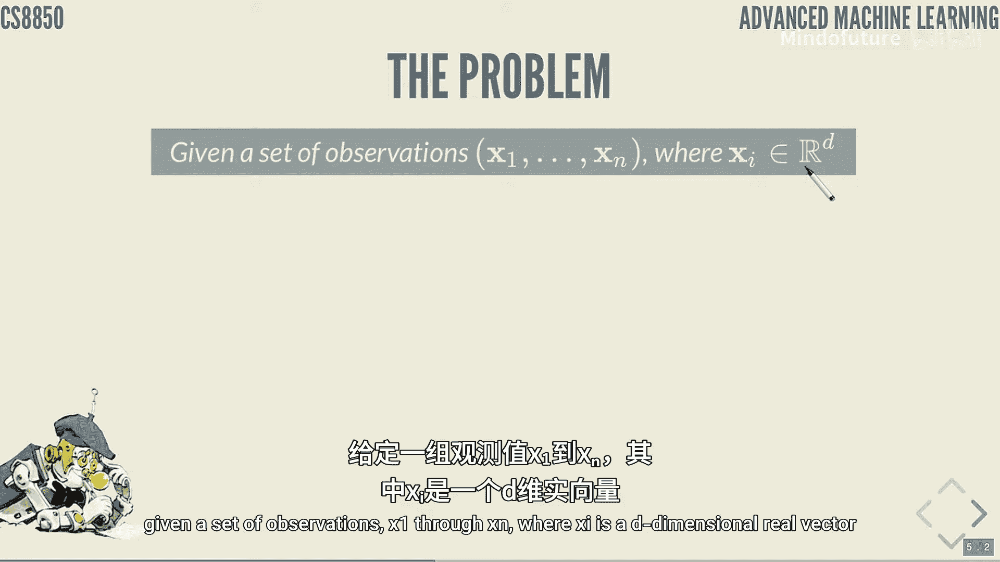

在本节课中，我们将学习一种特定的聚类算法——硬K均值算法。我们将从问题定义开始，逐步讲解其工作原理、算法步骤、优缺点以及一些需要注意的细节。

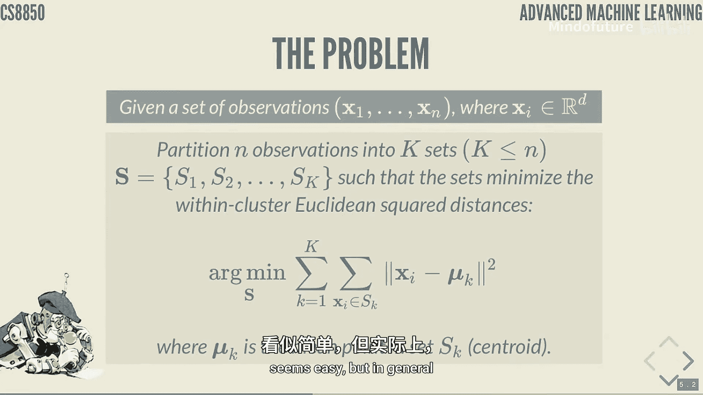

## 概述

给定一组观测数据 **X₁** 到 **Xₙ**，其中每个 **Xᵢ** 是一个 **D** 维的实数向量，即 **Xᵢ ∈ ℝᴰ**。这意味着数据存在于欧几里得空间中。

我们的目标是：将这 **n** 个观测值划分到 **K** 个簇中，其中 **K ≤ n**，以确保有足够的样本分配到各个簇。划分的目标是，使得簇内的平均欧几里得距离平方和最小。换句话说，我们希望每个簇中的点尽可能靠近其中心点（质心）。

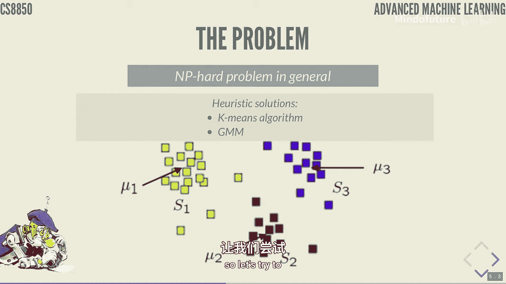

然而，从组合数学的角度看，这是一个 **NP-hard** 问题，因为可能的划分方式数量巨大。因此，我们通常采用启发式算法来寻找近似解。本节课将重点介绍 **K均值算法**，下一讲则会讨论 **高斯混合模型**。

## 算法工作原理演示

让我们通过一个模拟过程来理解K均值算法是如何工作的。

1.  **初始化**：假设我们预设了簇的数量 **K=3**。算法开始时，随机猜测三个簇中心（质心）的位置。
2.  **分配步骤**：计算每个数据点到所有质心的距离，并将其分配到距离最近的质心所在的簇。
3.  **更新步骤**：根据上一步得到的簇分配结果，重新计算每个簇的质心（即计算该簇所有点的平均值）。
4.  **迭代**：重复执行 **分配** 和 **更新** 步骤，直到簇的分配不再发生变化，此时算法收敛。

这个过程可以形象地理解为：我们不断调整质心的位置，并重新划定每个簇的“势力范围”（Voronoi单元），直到系统达到稳定状态。每一次迭代，我们的目标函数（簇内距离平方和）都会减小，这保证了算法最终会收敛。

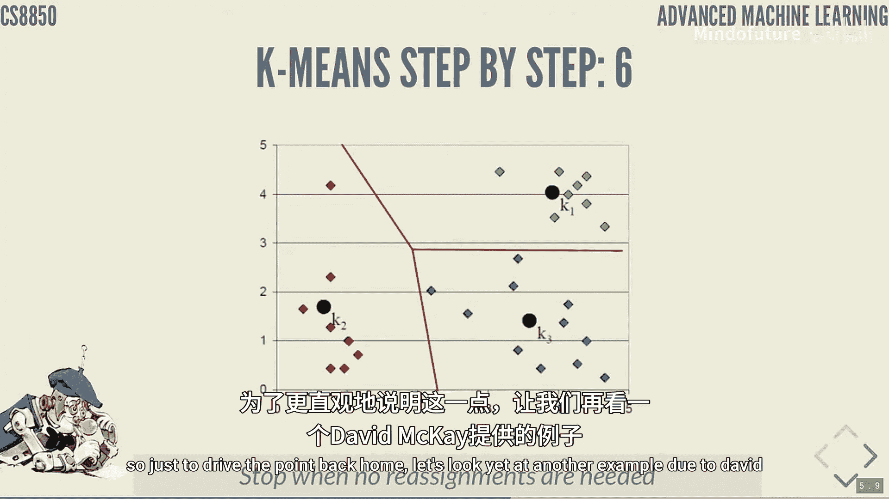

## 完整算法步骤

以下是硬K均值算法的规范化描述。

**输入**：
*   数据集
*   期望的簇数量 **K**
*   距离度量（通常使用欧几里得距离）

**初始化**：随机选择 **K** 个点作为初始簇中心。

**迭代过程**：
1.  **分配步骤**：决定每个数据点的簇归属，将其分配到最近的簇中心。
2.  **更新步骤**：根据当前的簇分配，重新计算每个簇的中心（质心）。

**终止条件**：当没有数据点的簇归属在上一次迭代中发生改变时，算法终止。

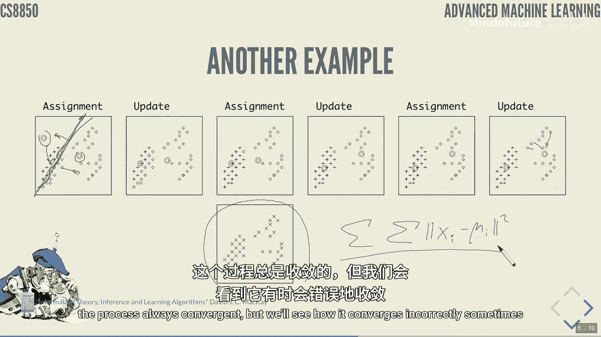

## 算法核心步骤详解

为了更好地形式化算法并便于后续推广，我们引入“责任”（responsibility）的概念。

### 分配步骤的形式化

对于第 **n** 个样本点 **xₙ**，我们为其定义一个 **K** 维的责任向量 **rₙ**。这是一个 **独热编码** 向量，其中只有一个元素为1，其余为0。**rₙᵏ = 1** 表示点 **xₙ** 被分配给了第 **k** 个簇。

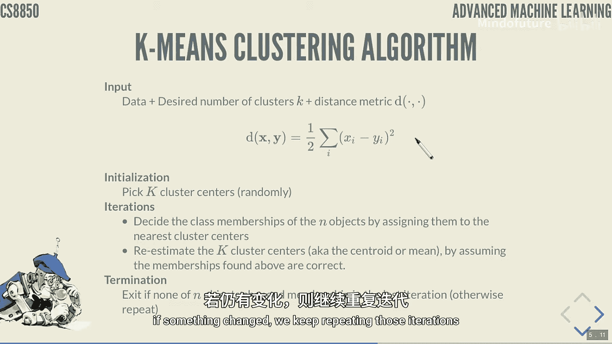

用公式表示分配规则为：
**rₙᵏ = 1** 如果 **k = argminⱼ ||xₙ - μⱼ||²**，否则为 **0**。

将所有样本的责任向量排列起来，就得到一个 **K × N** 的二进制责任矩阵 **R**，它的每一列都只有一个非零元素。

**注意**：如果某个点恰好落在两个簇的决策边界上（距离相等），可以任意选择一个规则来处理，例如将其分配给索引较小的簇。

### 更新步骤的形式化

在获得所有样本的责任分配 **R** 后，我们重新计算每个簇的质心 **μₖ**。计算公式为：

**μₖ = (Σₙ rₙᵏ * xₙ) / (Σₙ rₙᵏ)**

这个公式的含义是：新的质心 **μₖ** 是分配给簇 **k** 的所有点的平均值。分母 **Σₙ rₙᵏ** 就是属于簇 **k** 的点的数量。

## 算法特性分析

上一节我们形式化地定义了算法的核心步骤，现在我们来分析它的一些重要特性。

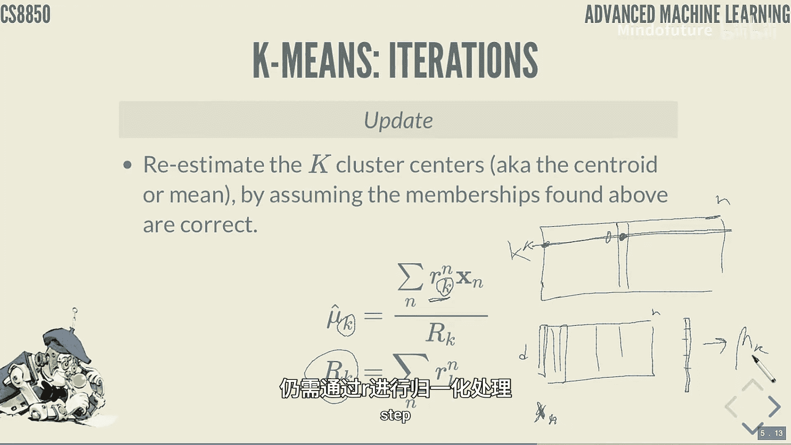

### 计算复杂度

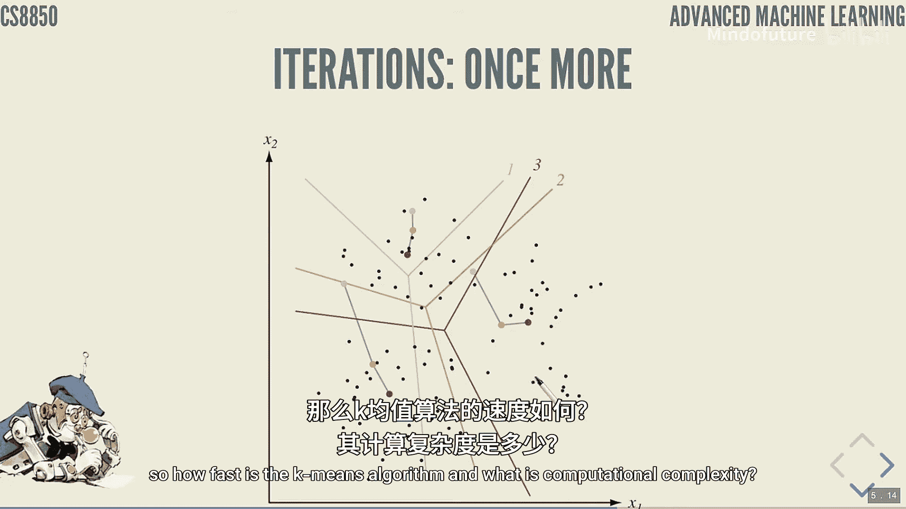

*   **分配步骤**：计算每个点到 **K** 个质心的距离，复杂度为 **O(K * N)**。
*   **更新步骤**：对每个簇求平均值，每个点只参与一次计算，复杂度为 **O(N)**。
假设算法迭代 **L** 次收敛，总复杂度约为 **O(L * K * N)**。这是一个线性复杂度，对于大规模数据，即使线性也可能成为挑战，因此人们开发了各种最近邻搜索数据结构来加速。

### 收敛性保证

算法保证会终止。因为每一步（分配或更新）都会严格减小目标函数（簇内距离平方和）。由于目标函数有下界（≥0），因此算法必然收敛到一个局部最优解。

### 对初始值的依赖性

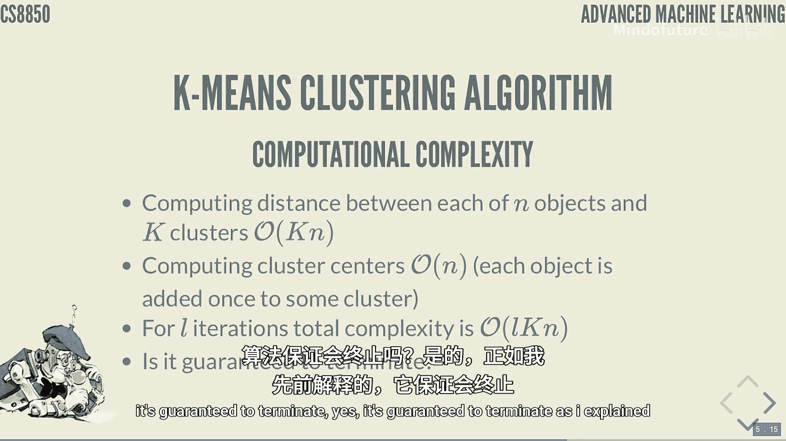

K均值算法的结果**强烈依赖于初始质心的选择**。不同的随机种子可能导致完全不同的聚类结果和收敛到不同的局部最优解。

**解决方案**：常见的做法是多次运行算法（使用不同的随机初始值），然后选择目标函数值最小的那次结果作为最终输出。

## 如何选择K值？

K均值算法有一个关键的超参数：簇的数量 **K**。这个值无法从数据中自动学习得到，必须预先指定。

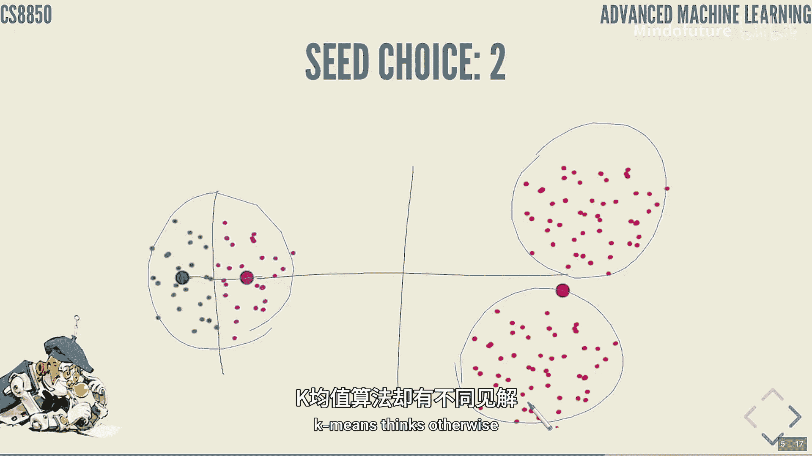

一种常用的启发式方法是 **“肘部法则”**：
1.  尝试不同的 **K** 值（例如从1到10）。
2.  对每个 **K** 运行K均值算法，并记录其目标函数值（簇内距离平方和）。
3.  绘制 **K** 与目标函数值的曲线图。
4.  寻找曲线上的“拐点”或“肘部”，即目标函数下降速度突然变缓的点，对应的 **K** 值通常是一个较好的选择。

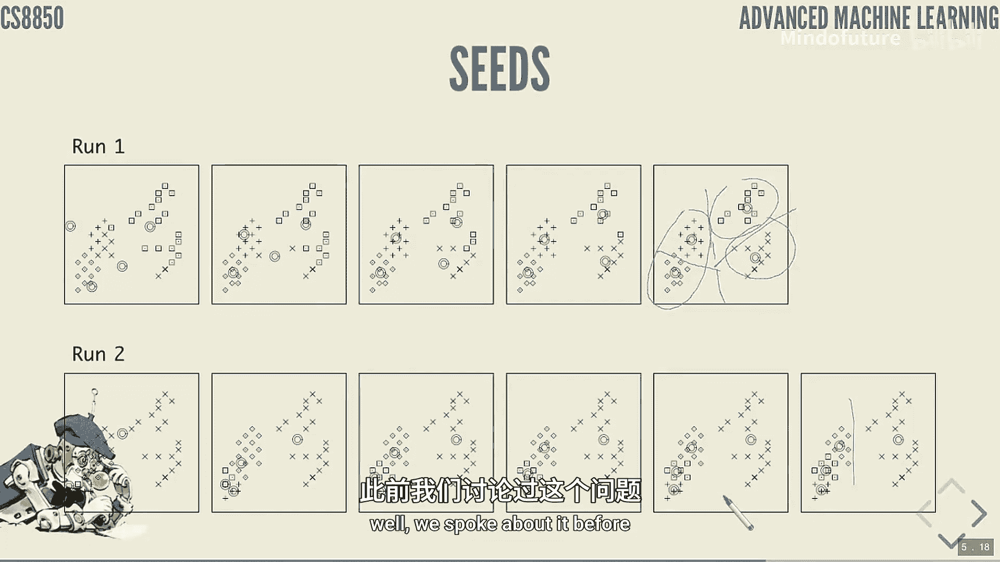

然而，这种方法并非总是有效，尤其是当曲线平滑下降，没有明显的肘部时。

## 算法的局限性

尽管K均值简单有效，但它也存在一些固有的缺陷。

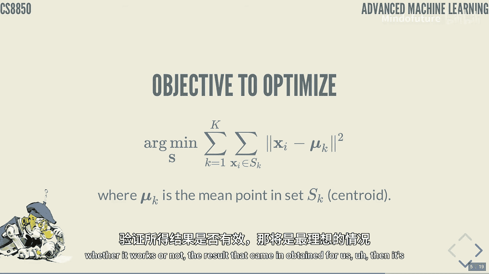

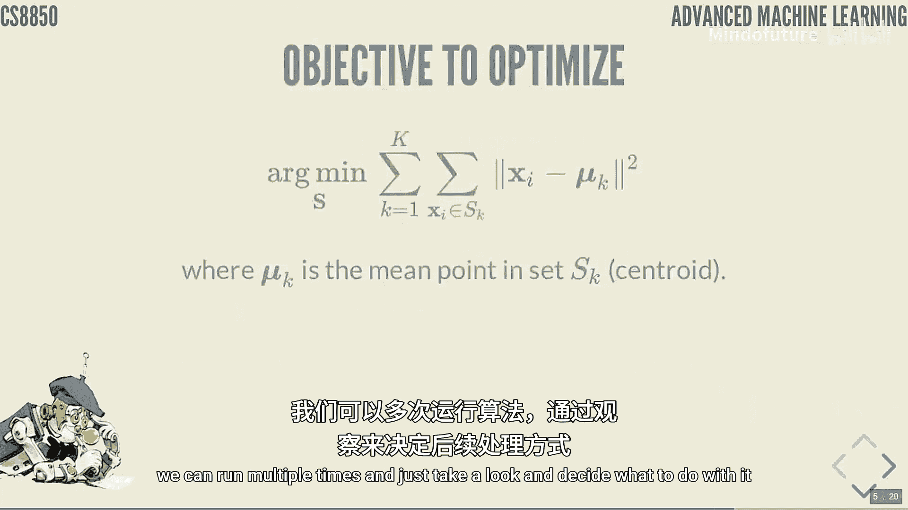

### 对簇形状的假设

K均值隐含地假设簇是**凸形的**、**各向同性的**，并且大小相似。它使用欧氏距离，因此天然倾向于发现**球形**或**超球形**的簇。

**失败案例1：非球形簇**
对于环形、流形或密度不均匀的簇结构，K均值可能无法正确识别。

**失败案例2：不同大小的簇**
当存在一个密集的小簇和一个稀疏的大簇时，K均值可能会将大簇边缘的噪声点错误地划分给小簇，因为它只关心距离，不关心数据分布的密度。

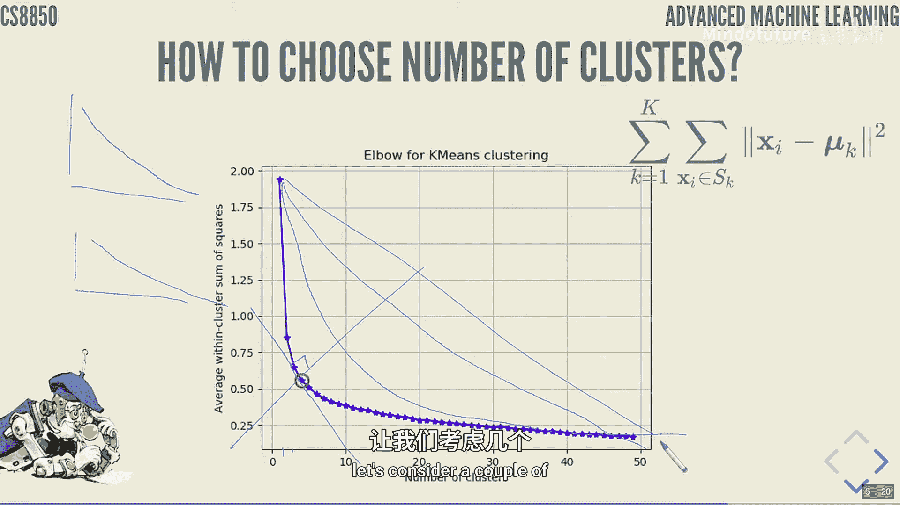

### 对噪声和边界点敏感

每个数据点，无论其是否处于簇的边界或可能是噪声点，在更新质心时都具有**相同的权重**。这可能导致质心被边界点或离群点“拉偏”，影响聚类效果。

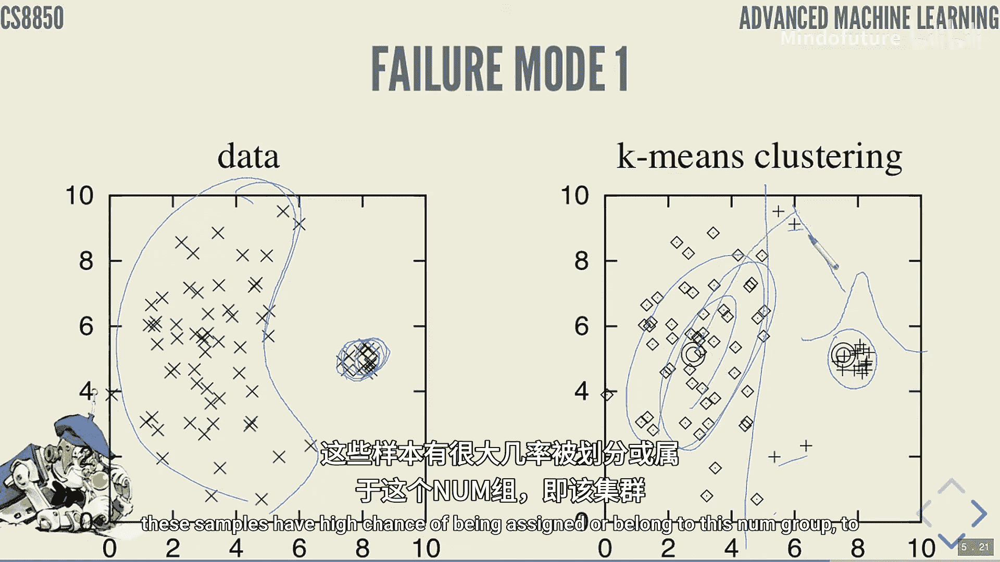

## 总结

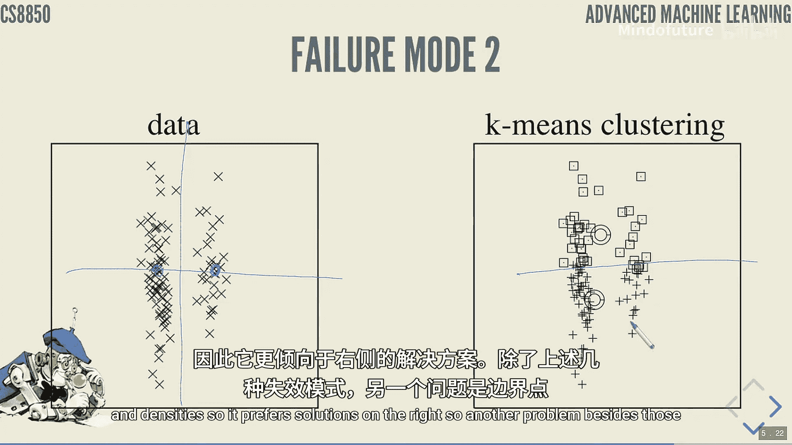

本节课我们一起学习了硬K均值聚类算法。我们首先定义了聚类问题，并指出其组合复杂性。然后，我们详细讲解了K均值算法的工作原理，它是一个通过交替执行 **分配步骤** 和 **更新步骤** 来迭代优化的启发式方法。我们形式化地描述了这两个步骤，并引入了责任向量的概念。

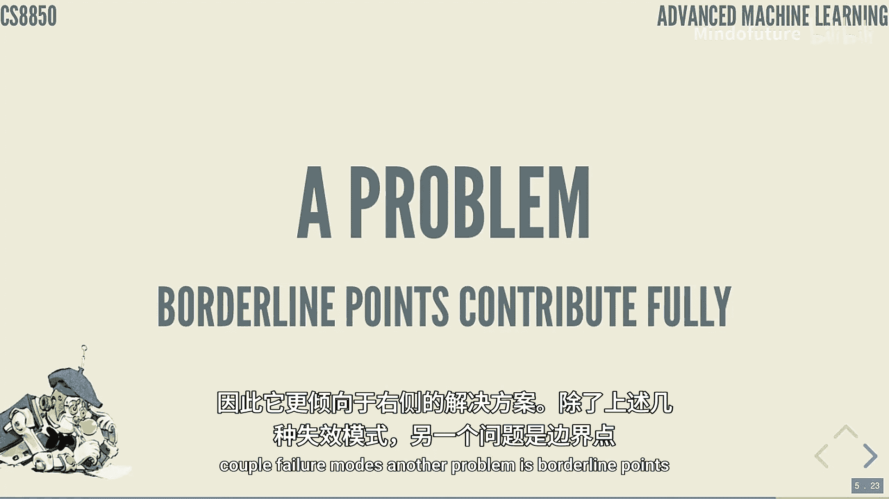

我们分析了算法的计算复杂度、收敛性，并重点讨论了其对**初始值敏感**和需要**预先指定K值**的特点。最后，我们探讨了K均值算法的局限性，包括它对簇形状的假设以及对噪声的敏感性。

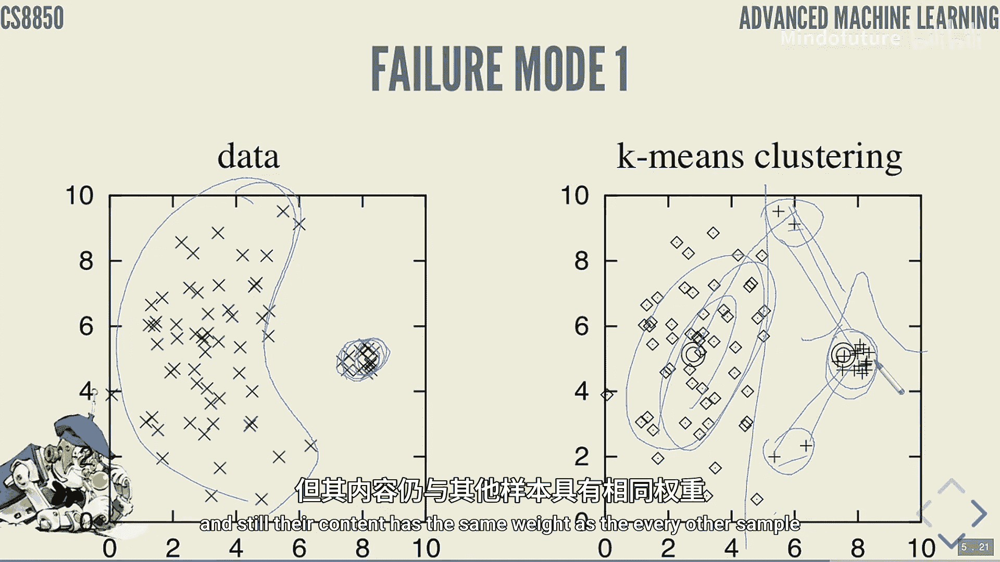

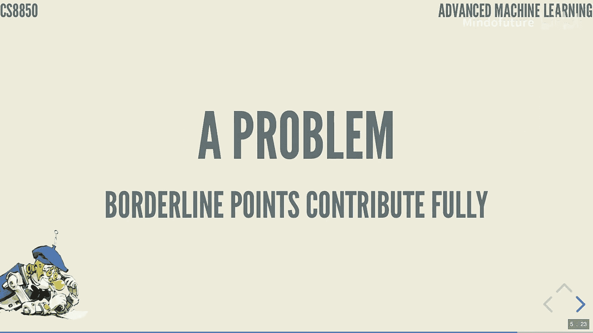

理解这些特性和局限，对于在实践中正确应用和解释K均值算法的结果至关重要。在接下来的课程中，我们将看到如何用高斯混合模型来克服K均值的一些缺点。