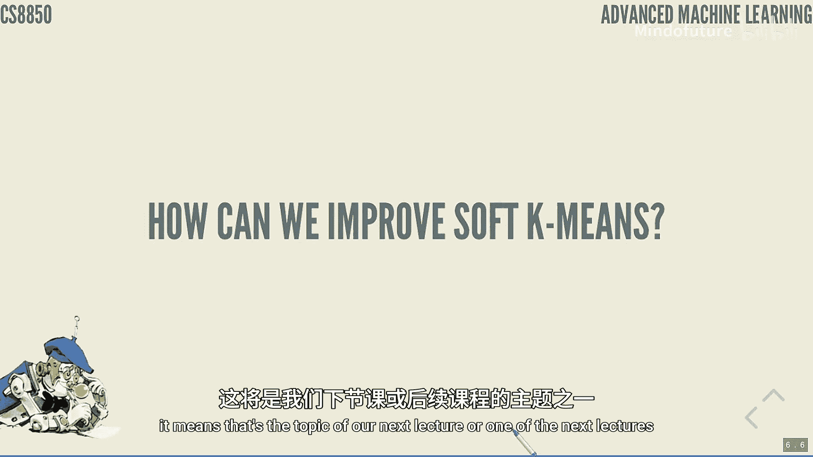

# 044：软K均值 🧮

在本节课中，我们将学习K均值聚类算法的一个改进版本——软K均值。我们将探讨硬K均值存在的问题，理解软K均值的核心思想，并学习其算法步骤。

上一节我们介绍了硬K均值算法，本节中我们来看看它的一个主要问题。硬K均值在处理靠近簇边界的点时，会将其与簇中心附近的点同等对待，强制将其硬性分配给一个簇。这种分配方式可能会影响质心的更新，即使只有少数几个边界点，也可能对最终聚类结果产生不利影响。

为了解决这个问题，研究者们提出了软K均值算法。其核心思想是放松“责任”的分配，使其从二元硬分配变为连续的软分配。

## 核心概念：从硬分配到软分配

在硬K均值中，每个数据点 `x_n` 的归属由一个二元向量表示，例如 `[0, 1, 0]` 表示它属于第二个簇。软K均值将其放松为一个连续的向量，例如 `[0.1, 0.7, 0.2]`，表示它更可能属于第二个簇，但也有较小概率属于第一或第三个簇。

为了使这种分配有意义，我们要求每个数据点的责任向量之和为1，这保证了每个点至少被部分地分配给了某个簇。这让人联想到现代机器学习中的 **Softmax** 函数。

此外，软K均值引入了一个新的参数 `β`（beta），称为**刚度参数**，它控制着分配的“软硬”程度。

## 软K均值算法步骤 📝

软K均值的算法框架与硬K均值保持一致，主要区别在于责任计算和质心更新步骤。

以下是算法的具体步骤：

1.  **初始化**：随机选择K个初始质心 `μ_k`。
2.  **责任计算（E步）**：对于每一个数据点 `x_n` 和每一个质心 `μ_k`，计算其软责任 `r_{nk}`。公式如下：
    `r_{nk} = exp(-β * ||x_n - μ_k||^2) / Σ_j exp(-β * ||x_n - μ_j||^2)`
    这个公式正是 **Softmax** 函数，它确保了对于每个点 `n`，所有簇的责任之和为1：`Σ_k r_{nk} = 1`。
3.  **质心更新（M步）**：利用计算出的软责任来更新每个簇的质心。更新公式为：
    `μ_k = Σ_n r_{nk} * x_n / Σ_n r_{nk}`
    可以看到，更新公式与硬K均值相似，但这里使用的是连续的权重 `r_{nk}`，而不是二元的指示变量。每个数据点根据其属于簇 `k` 的责任大小，对所有质心的更新都做出贡献。
4.  **迭代**：重复步骤2和步骤3，直到质心的变化小于某个阈值或达到最大迭代次数。

## 刚度参数 β 的影响 🔧

刚度参数 `β` 是软K均值的关键。我们可以定义长度尺度 `σ = 1 / sqrt(β)` 来帮助理解。

*   当 `β` 很小（`σ` 很大）时：所有数据点到所有质心的距离差异在指数函数中显得不那么重要，导致责任 `r_{nk}` 对所有簇都趋于相似。这相当于所有质心都收敛到数据的全局中心，无法形成有效的簇。
*   当 `β` 增大（`σ` 减小）时：距离差异被放大。距离质心近的点会被赋予更高的责任，距离远的点责任则很低。这使得质心能够更明确地捕捉数据中紧密的簇结构。
*   当 `β → ∞` 时：软责任 `r_{nk}` 会退化为硬分配（最近簇的责任为1，其余为0），软K均值就变回了硬K均值。

通过逐渐增加 `β`（减小长度尺度），算法可以从一个模糊的全局状态逐步聚焦，最终分离出数据中存在的各个簇。

## 总结与展望 🎯

本节课中我们一起学习了软K均值算法。我们了解到，通过将硬分配松弛为基于Softmax的软分配，并引入刚度参数 `β`，软K均值能够更细腻地处理边界点，使质心更新更稳健。算法保持了期望最大化（EM）的框架，在E步计算软责任，在M步用加权平均更新质心。

软K均值为我们提供了一种更灵活的聚类视角。那么，K均值算法还有哪些可以改进的地方呢？这将是我们下一讲要讨论的主题。

---
**本节课核心公式总结：**
*   **软责任**：`r_{nk} = exp(-β * ||x_n - μ_k||^2) / Σ_j exp(-β * ||x_n - μ_j||^2)`
*   **质心更新**：`μ_k = Σ_n r_{nk} * x_n / Σ_n r_{nk}`