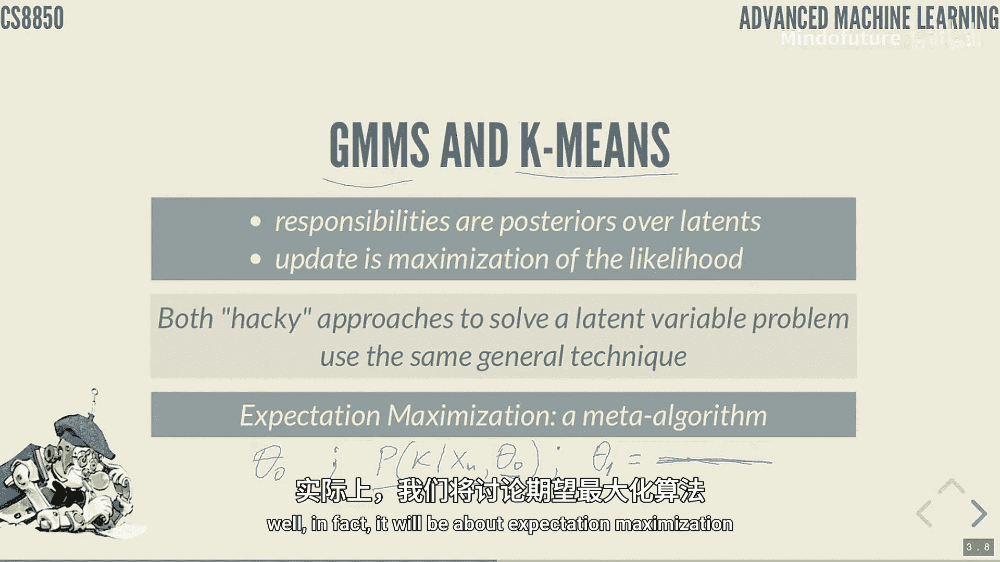

# 046：一种粗略的GMM估计方法 🧮

在本节课中，我们将学习一种用于估计高斯混合模型的“技巧”方法。我们将从一个简化的双高斯混合模型开始，逐步推导其参数更新过程，并将其与K均值算法联系起来，最终引出期望最大化算法的核心思想。

上一节我们介绍了高斯混合模型的基本概念，本节中我们来看看一种具体的参数估计方法。

## 模型设定与假设

我们首先考虑一个由两个高斯分布组成的混合模型。其概率分布（似然函数）由参数决定，这些参数包括每个高斯分量的权重、均值（μ）和协方差（Σ）。

为了简化推导，我们做出以下假设：
*   假设两个高斯分量出现的先验概率相等，即 `π₁ = π₂ = 1/2`。
*   考虑一维数据情况。
*   假设两个高斯分量共享相同的、已知的协方差 Σ，但均值 μ₁ 和 μ₂ 未知。

我们将所有未知参数（μ₁, μ₂）合并为一个参数向量 θ。

## 已知参数下的后验概率

首先，假设所有参数（μ₁, μ₂, Σ）均已知。在这种情况下，给定一个数据点 `x`，它属于类别1（即第一个高斯分量）的后验概率可以推导出来。

以下是推导的关键步骤：
*   根据贝叶斯定理，类别后验概率 `P(class=k | x)` 正比于先验概率与似然函数的乘积。
*   在已知均值和方差、且先验概率相等的假设下，经过代数运算，可以得到 `P(class=1 | x)` 的表达式为 `1 / (1 + exp(-z))`，其中 `z` 是 `x` 的线性函数。

这个表达式 `1 / (1 + exp(-z))` 正是 **Sigmoid函数** 的形式。它描述了一个以 `z=0` 为决策边界的线性分类器，其输出在边界处为0.5，并向两侧分别趋近于0或1。这正是**逻辑回归**模型的核心。

在作业中，你将具体推导线性系数 `w₁` 和偏置 `w₀`，并理解为何这个后验概率分布（作为 `x` 的函数）虽然形状像Sigmoid，但本身并不需要积分为1。

## 未知均值下的参数估计

现在回到我们的核心问题：均值 μ 是未知的，我们需要从数据中估计它们。我们再次写出整个数据集的似然函数。

对于包含 `N` 个独立同分布数据点的数据集 `{xᵢ}`，其联合似然函数是每个数据点似然的乘积：
`L(θ) = ∏ᵢ P(xᵢ | θ) = ∏ᵢ [∑ₖ πₖ N(xᵢ | μₖ, Σ)]`

为了便于优化，我们通常处理其对数似然函数 `ℓ(θ) = log L(θ)`。

在作业中，你将证明，对数似然函数关于均值 μₖ 的一阶导数具有以下形式：
`∂ℓ/∂μₖ = (1/Σ) * ∑ᵢ [P(k | xᵢ, θ) * (xᵢ - μₖ)]`

其中，`P(k | xᵢ, θ)` 正是在上一部分中推导出的、基于当前参数估计 θ 的**类别后验概率**。

接着，你还会计算出关于 μₖ 的二阶导数（海森矩阵），在忽略后验概率对 μₖ 的依赖（这是一个简化或“技巧”）后，其形式非常简单：`∂²ℓ/∂μₖ² ≈ - (1/Σ²) * ∑ᵢ P(k | xᵢ, θ)`。

## 牛顿-拉弗森更新与“技巧”更新公式

有了梯度和（近似的）海森矩阵，我们可以使用**牛顿-拉弗森法**来更新参数估计，寻找最大化对数似然函数的 μ。更新公式为：
`μₖ_new = μₖ_old - (∂ℓ/∂μₖ) / (∂²ℓ/∂μₖ²)`

将我们得到的一阶和二阶导数代入这个更新公式，并进行代数化简。在作业中，你将完成这一步推导，并得到以下简洁的更新规则：
`μₖ_new = [∑ᵢ P(k | xᵢ, θ_old) * xᵢ] / [∑ᵢ P(k | xᵢ, θ_old)]`

这个公式非常直观：新的均值估计是所有数据点的加权平均，权重正是每个数据点属于第 `k` 个分量的（当前估计的）后验概率 `P(k | xᵢ, θ_old)`。

## 与K均值算法的联系

这个更新公式是否让你想起了什么？

是的，它和**K均值算法**的质心更新步骤在形式上完全一致。在K均值中：
`μₖ_new = [∑_{i ∈ Cₖ} xᵢ] / |Cₖ|`

其中 `Cₖ` 是被硬分配到第 `k` 个簇的数据点集合。我们可以将K均值中的“分配”看作是一种特殊的、硬性的“后验概率”：一个点要么完全属于一个簇（概率为1），要么完全不属于（概率为0）。而在我们的GMM推导中，使用的是软的、概率性的后验概率 `P(k | xᵢ)`。

因此，**K均值可以看作是高斯混合模型在假设各分量协方差相同且趋于零、并使用硬分配（最大后验概率）时的一个特例**。两者的核心结构都是：基于当前参数计算数据点的归属（E步的雏形），然后根据这个归属重新估计参数（M步的雏形）。

## 期望最大化（EM）算法的雏形

我们现在所描述的迭代过程，正是**期望最大化（EM）算法**的核心思想。这个“技巧”方法揭示了一个通用框架：

1.  **初始化**：随机设置模型参数 θ 的初始值。
2.  **E步（期望步）**：基于当前的参数估计 θ_old，计算每个数据点属于各个隐变量（如高斯分量）的**后验概率** `P(k | xᵢ, θ_old)`。这可以理解为计算数据点对各个分量的“责任”或“归属度”。
3.  **M步（最大化步）**：将上一步得到的后验概率视为固定权重，重新计算能最大化（完整数据）对数似然函数期望值的参数 θ_new。对于高斯混合模型的均值，这恰好导致了我们推导出的加权平均公式。
4.  **迭代**：用 θ_new 替换 θ_old，重复步骤2和3，直到参数收敛。

我们称其为“技巧”，是因为在推导M步的更新公式时，我们忽略了对数似然函数中后验概率对参数的依赖，从而得到了一个简洁的解析解。更严格的EM算法推导会通过引入一个辅助函数（Q函数）来保证每次迭代都能提升似然函数值，并确保算法收敛。

本节课中我们一起学习了高斯混合模型参数估计的一种启发式方法。我们从已知参数下的后验概率出发，推导了在未知均值情况下，通过迭代更新均值的公式。这个公式与K均值算法高度相似，并自然地引出了期望最大化算法的两个核心步骤：计算后验概率（E步）和更新参数（M步）。在下一节中，我们将正式介绍期望最大化算法，并深入探讨其收敛性等理论性质。