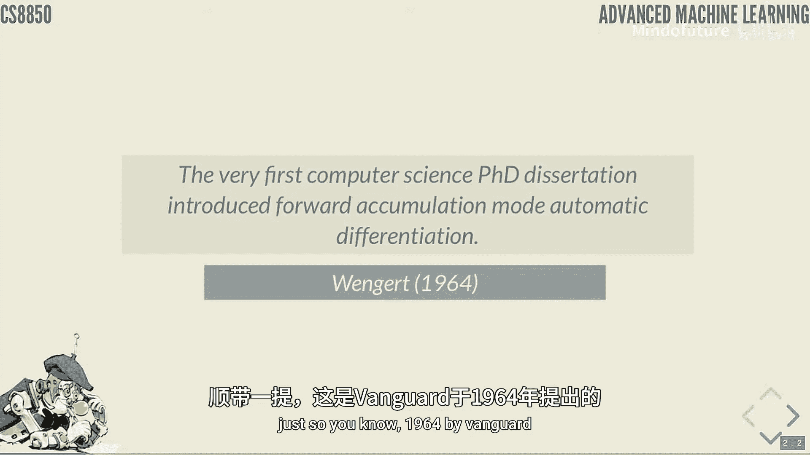
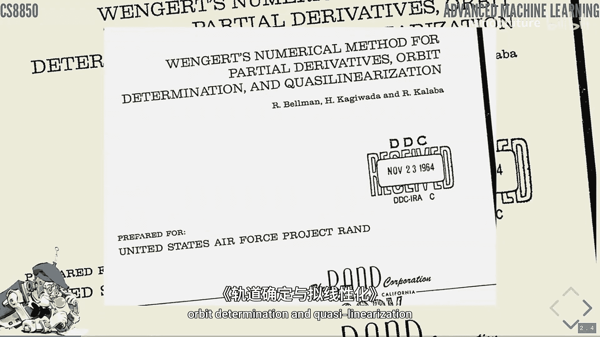
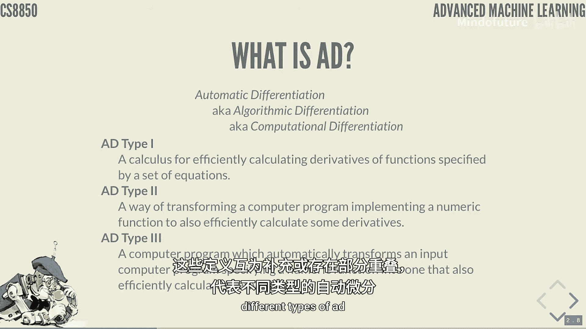
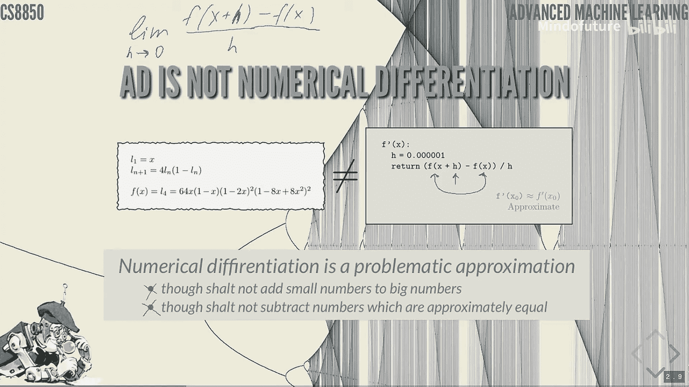
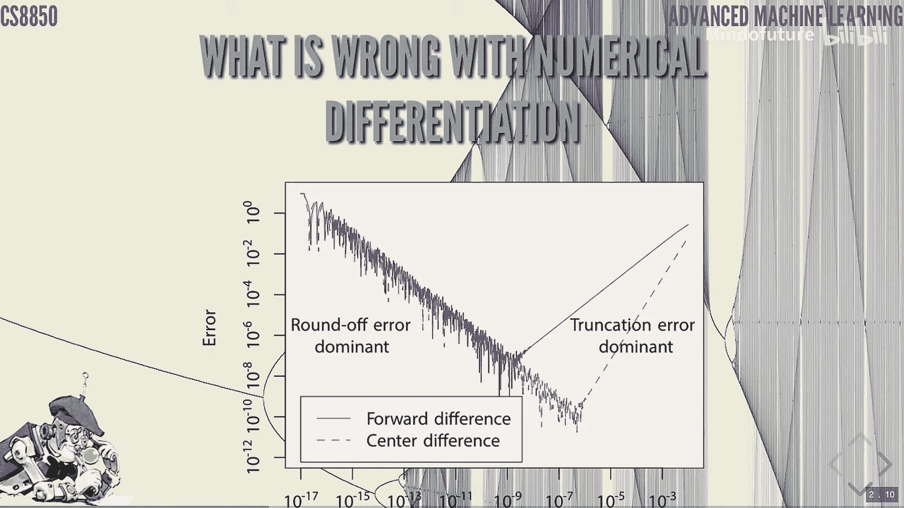
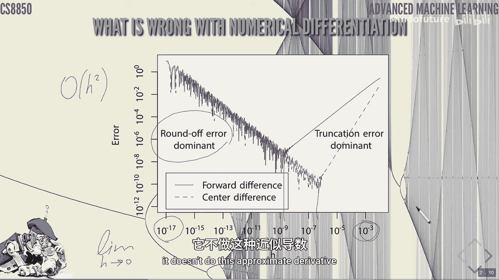
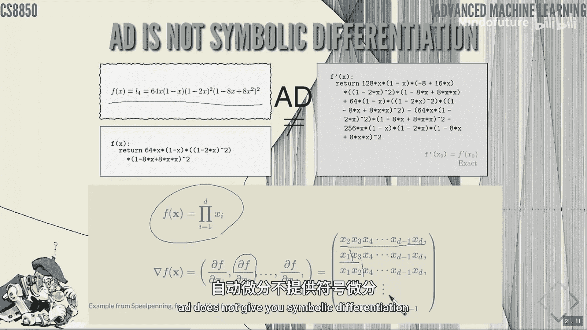
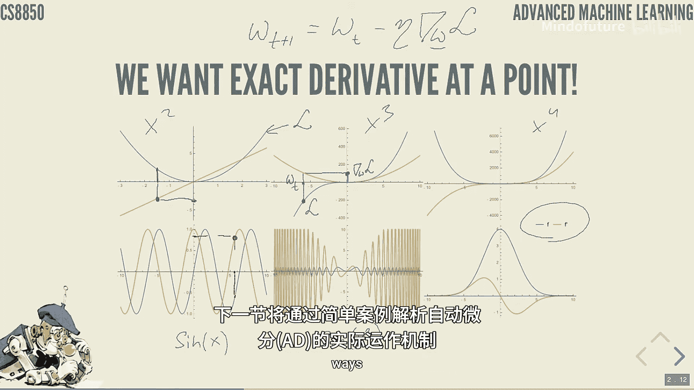

# 048：P48_自动微分简介 🧮

在本节课中，我们将学习自动微分（Algorithmic Differentiation，简称AD）的基本概念。这是一种用于高效、精确计算函数导数的技术，是现代深度学习框架（如PyTorch）的核心。我们将了解它与数值微分、符号微分的区别，并介绍其两种主要模式：前向模式与反向模式。

---

## 概述与历史 📜

上一节我们介绍了在优化模型（如梯度下降法）时，计算梯度是核心需求。本节中，我们来看看一种能高效、精确计算梯度值的方法——自动微分。

自动微分并非数值近似，也非符号推导，而是一种基于计算机程序结构、以机器精度计算导数的技术。它已存在超过50年。1964年，Robert Wengert在其博士论文中首次引入了前向累积模式的自动微分。随后，该领域不断发展，并在1980年由B. Speelpenning引入了反向累积模式，这实质上就是现代反向传播算法更原则化的实现。



以下是自动微分的三种理解视角：
*   **AD类型1**：一种基于方程组高效计算导数的微积分方法。
*   **AD类型2**：一种对实现数值函数的计算机程序进行转换，使其能同时高效计算某些导数的方法。
*   **AD类型3**：一种能自动将输入计算机程序（指定数值函数）转换为也能高效计算导数的程序的计算机程序。

---



## 自动微分不是什么 ❌

在深入自动微分之前，有必要澄清常见的误解，特别是它与数值微分和符号微分的区别。

### 数值微分的问题

数值微分通过有限差分来近似导数，例如使用中心差分公式：
`f'(x) ≈ (f(x+h) - f(x-h)) / (2h)`

这种方法同时违反了两条数值计算的基本原则：
1.  不应将很小的数加到很大的数上（当 `x` 很大而 `h` 很小时）。
2.  不应减去近似相等的数（当 `h` 很小时，`f(x+h)` 与 `f(x-h)` 非常接近）。

这导致了两种误差：
*   **截断误差**：由于使用有限项泰勒展开近似所致。
*   **舍入误差**：由于计算机浮点数精度有限，在 `h` 极小时，减法会放大噪声。

因此，数值微分无法提供机器精度的导数。

### 符号微分的局限



符号微分使用代数规则对函数表达式进行精确求导。然而，对于复杂函数（如大型神经网络），它可能产生极其庞大且冗余的表达式，导致计算效率低下。

考虑一个简单例子：计算函数 `f(x) = Πᵢ xᵢ`（所有 `xᵢ` 的乘积）的梯度。其第 `j` 个分量的导数为 `∂f/∂xⱼ = Πᵢ₌₁, i≠ⱼⁿ xᵢ`。符号微分会为每个分量独立生成这个表达式，导致大量重复计算（`n` 次计算，每次都是 `n-1` 个元素的乘积），效率低下。

---

## 自动微分是什么 ✅

自动微分通过将复杂函数分解为一系列基本运算（如加、乘、指数、对数等）的序列，并系统性地应用链式法则来计算导数。它计算的是在**特定输入点**的导数值，而非导函数表达式。



在优化问题中，例如梯度下降更新公式：
`W_{t+1} = W_t - η * ∇_W L(W_t)`
我们需要的正是在当前参数点 `W_t` 处的梯度值 `∇_W L(W_t)`。自动微分能高效、精确地提供这个数值。



---

## 前向模式自动微分 ⏩

上一节我们明确了自动微分的目标。本节中，我们来看看其第一种实现方式：前向模式。

前向模式自动微分沿着计算图（即函数求值过程）从前向后传播导数。它同时计算函数值及其导数。对于函数 `f: ℝⁿ → ℝᵐ`，其雅可比矩阵 `J` 是一个 `m × n` 矩阵。前向模式一次计算 `J` 与一个向量 `v` 的乘积，即 `J * v`。

考虑一个简单函数 `y = f(x₁, x₂) = x₁ * x₂ + sin(x₁)`。其计算过程可分解为：
```
v₁ = x₁
v₂ = x₂
v₃ = v₁ * v₂
v₄ = sin(v₁)
v₅ = v₃ + v₄
y = v₅
```
前向模式会为每个中间变量 `vᵢ` 同时维护其值 (`vᵢ.val`) 和其对某个输入变量的导数值 (`vᵢ.dot`)。如果我们想计算关于 `x₁` 的导数（即令 `v̇₁ = 1`, `v̇₂ = 0`），则推导如下：
```
v̇₁ = 1
v̇₂ = 0
v̇₃ = v̇₁ * v₂.val + v₁.val * v̇₂ = 1 * x₂ + x₁ * 0 = x₂
v̇₄ = cos(v₁.val) * v̇₁ = cos(x₁) * 1
v̇₅ = v̇₃ + v̇₄ = x₂ + cos(x₁)
```
最终，`ẏ = v̇₅` 即为 `∂f/∂x₁` 在点 `(x₁, x₂)` 处的值。

---



## 反向传播回顾 🔄

在介绍更强大的反向模式自动微分之前，我们先简要回顾熟悉的神经网络反向传播算法。

反向传播是反向模式自动微分在特定计算图（神经网络前向计算）上的一个应用。其核心步骤为：
1.  **前向传播**：计算网络每一层的激活值，直至最终输出和损失函数值。
2.  **反向传播**：从损失函数开始，利用链式法则，反向计算损失相对于每一层参数和输入的梯度。

关键点在于，它**先完成整个函数的前向计算**，保存所有中间结果，然后**从输出向输入反向传播梯度**。这避免了前向模式中为每个输入单独计算导数的开销。

---

## 反向模式自动微分 ⏪

上一节回顾的反向传播，实质是反向模式自动微分的一个特例。本节中，我们正式看看通用的反向模式。



反向模式自动微分先进行一次前向计算，记录所有中间变量和运算（构建计算图），然后从输出开始反向遍历计算图，应用链式法则计算梯度。对于函数 `f: ℝⁿ → ℝ`（输出为标量，如损失函数），反向模式能高效计算其梯度 `∇f`（即雅可比矩阵的转置 `Jᵀ` 与一个标量的乘积）。

沿用前面的例子 `y = x₁ * x₂ + sin(x₁)`。反向模式需要为每个中间变量 `vᵢ` 维护一个**伴随变量** `v̄ᵢ = ∂y/∂vᵢ`。
1.  **前向计算**：记录 `v₁ = x₁`, `v₂ = x₂`, `v₃ = v₁*v₂`, `v₄ = sin(v₁)`, `v₅ = v₃+v₄`, `y = v₅`。
2.  **反向传播**（初始化 `ȳ = ∂y/∂y = 1`）：
    *   `v̄₅ = ȳ = 1`
    *   `v̄₄ = v̄₅ * ∂v₅/∂v₄ = 1 * 1 = 1`
    *   `v̄₃ = v̄₅ * ∂v₅/∂v₃ = 1 * 1 = 1`
    *   `v̄₁ += v̄₃ * ∂v₃/∂v₁ = 1 * v₂` （注意：`v₁` 同时影响 `v₃` 和 `v₄`，梯度需累加）
    *   `v̄₁ += v̄₄ * ∂v₄/∂v₁ = 1 * cos(v₁) = cos(x₁)`
    *   `v̄₂ = v̄₃ * ∂v₃/∂v₂ = 1 * v₁ = x₁`
3.  最终，`x̄₁ = v̄₁ = x₂ + cos(x₁)`，`x̄₂ = v̄₂ = x₁`，即得到了完整的梯度向量 `[x₂+cos(x₁), x₁]`。

反向模式的优势在于，对于具有大量输入（参数）和少量输出（如损失函数）的场景，它只需一次前向和一次反向遍历，就能计算出所有输入参数的梯度，效率远高于前向模式。

---

## 总结 🎯

本节课中，我们一起学习了自动微分（AD）的核心概念。
*   我们首先明确了**自动微分不是数值微分（有误差）也不是符号微分（效率低）**，而是一种基于程序分解和链式法则、能提供机器精度导数值的技术。
*   接着，我们介绍了**前向模式自动微分**，它沿着计算图向前传播，同时计算函数值和指定方向的导数。
*   然后，我们回顾了**反向传播**，它是反向模式AD在神经网络中的特例。
*   最后，我们深入探讨了**反向模式自动微分**，它先进行前向计算构建计算图，然后反向传播梯度，对于多输入、单输出的函数（如机器学习中的损失函数）能极其高效地计算完整梯度。



自动微分是现代深度学习框架的基石，它使得研究人员能够专注于模型设计，而无需手动推导和实现复杂的梯度计算。