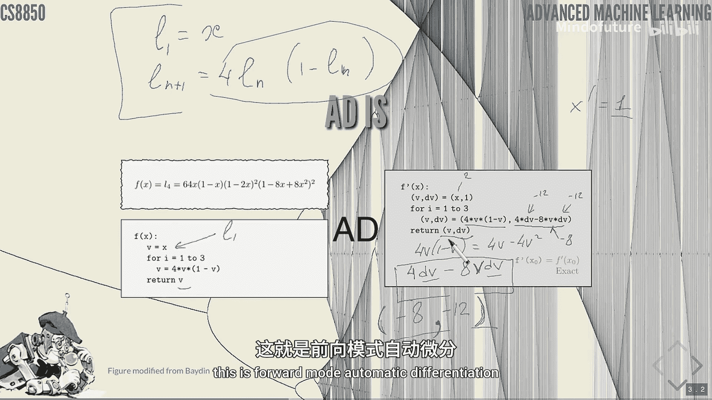
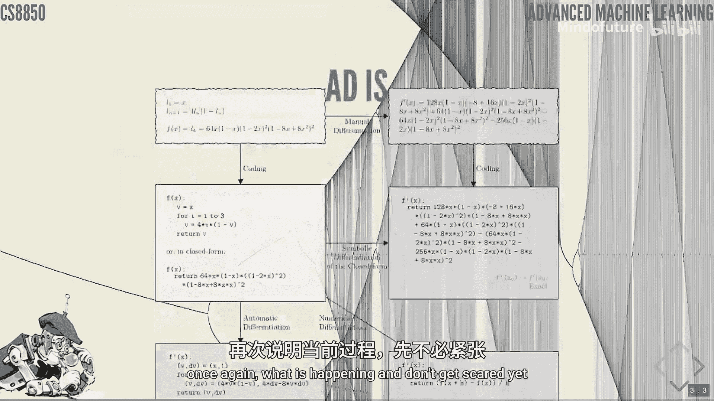
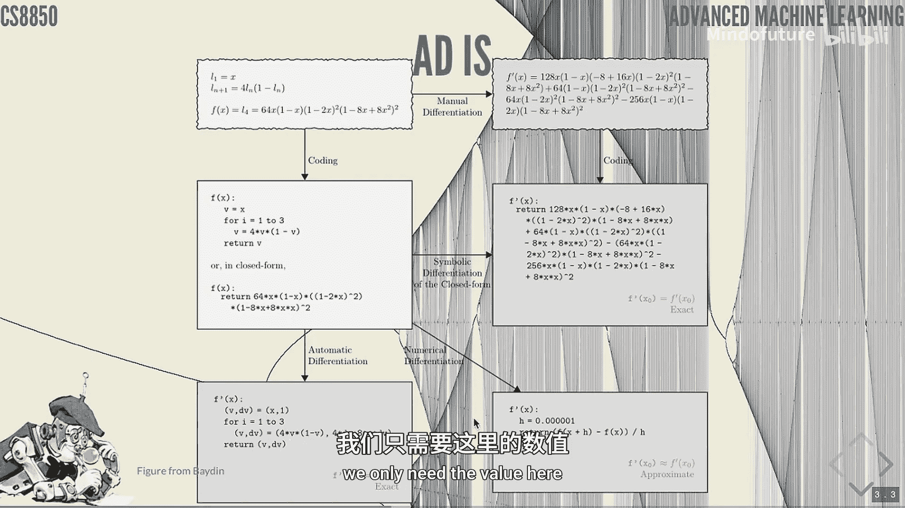
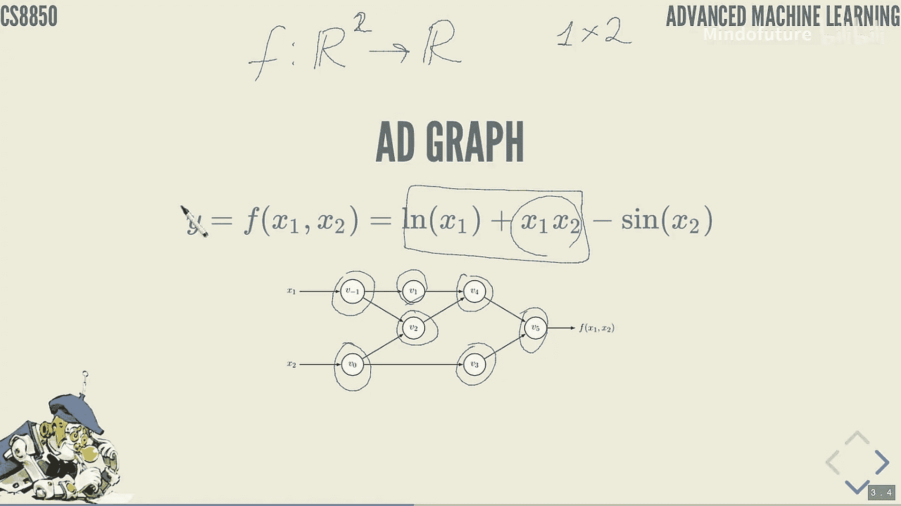
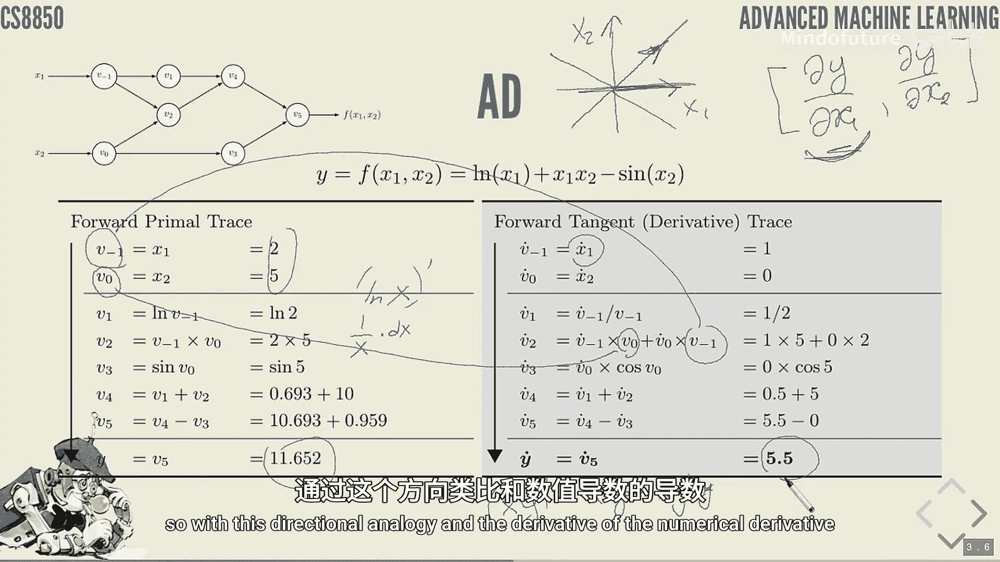
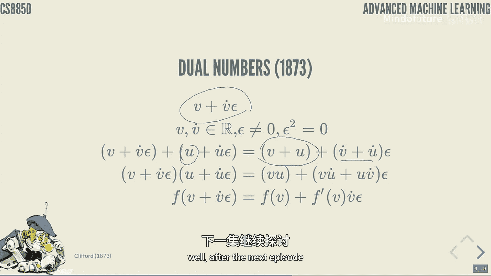

# 049：P49_前向模式自动微分 🧮

在本节课中，我们将要学习自动微分（Automatic Differentiation, AD）中的前向模式。我们将了解它是什么，它如何工作，以及它与数值微分和符号微分的区别。通过具体的例子和计算图，我们将清晰地展示前向模式AD的计算过程。

---

## 什么是前向模式自动微分？ 🤔

上一节我们介绍了自动微分的基本概念，本节中我们来看看其具体实现方式之一——前向模式。

自动微分既不是数值微分（通过有限差分近似），也不是符号微分（生成导数的解析表达式）。它是一种利用链式法则和已知基本函数的导数，在计算函数值的同时，精确计算其导数值的技术。其精度可以达到机器精度。

## 一个简单的动态系统例子 🔄

为了理解前向模式，让我们回到之前讨论过的一个简单动态系统（映射）。其定义如下：

*   `L1 = x`
*   `L_{n+1} = 4 * L_n * (1 - L_n)`

我们可以用循环来实现它，从 `L1` 开始迭代计算，最终得到 `L4` 的值。

自动微分（前向模式）的做法是：我们不是从单个值 `v = x` 开始，而是从一个**元组**（值，导数值）开始。我们知道 `x` 对其自身的导数是 `1`，所以我们从 `(x, 1)` 开始。

然后，我们一步步重复原始的计算过程，但每一步都同时计算函数值和导数值。具体来说，在每一步 `i`，我们：
1.  使用上一步的函数值 `v_{i-1}` 计算当前函数值 `v_i`。
2.  使用上一步的导数值 `dot{v}_{i-1}` 和已知的局部导数规则，计算当前导数值 `dot{v}_i`。

对于我们的映射 `f(v) = 4v(1-v) = 4v - 4v^2`，其关于 `v` 的导数是 `4 - 8v`。根据微分法则，`df = (4 - 8v) * dv`。

因此，在每一步迭代中，我们同时进行以下计算：
*   `v_i = 4 * v_{i-1} * (1 - v_{i-1})`
*   `dot{v}_i = (4 - 8 * v_{i-1}) * dot{v}_{i-1}`

如果我们从 `x = 2` 开始，初始元组为 `(2, 1)`。迭代过程如下：

| 步骤 | `v` (值) | `dot{v}` (导数值) | 计算说明 |
| :--- | :--- | :--- | :--- |
| 初始 | 2 | 1 | `(x, dx/dx)` |
| 1 | `4*2*(1-2) = -8` | `(4-8*2)*1 = -12` | 应用 `f(v)` 和 `df/dv` |
| 2 | `4*(-8)*(1-(-8)) = 288` | `(4-8*(-8))*(-12) = -816` | 继续迭代 |
| 3 | `4*288*(1-288) = -330624` | `(4-8*288)*(-816) = ...` | 继续迭代 |

最终，这个过程会同时返回函数 `L4` 在 `x=2` 处的精确值及其导数的精确值（达到机器精度）。

## 自动微分的核心思想与比较 💡

自动微分**转换**了原始函数。它的接口（输入）相同，但输出改变了：它不仅返回函数值，还返回函数在该点的导数值。

*   **手动/符号微分**：我们可以推导出 `L4(x)` 的解析表达式，然后对其求导得到 `dL4/dx` 的表达式，最后代入数值计算。这属于符号处理。
*   **数值微分（有限差分）**：使用公式 `(f(x+h) - f(x)) / h` 来近似导数。它简单，但存在截断误差和舍入误差，精度受 `h` 选择影响。
*   **自动微分（前向模式）**：通过跟踪计算过程和应用链式法则，在计算 `f(x)` 的同时计算出精确的 `f'(x)`。它返回的是机器精度的数值，而不是一个导函数。

关键点在于：对于优化求解器等应用，我们通常只需要在特定点计算梯度值，而不需要梯度函数本身。自动微分能高效、精确地提供这个值。

## 剖析前向模式：计算图视角 📊

让我们通过一个更具体的例子来深入理解。假设有一个函数：
`y = f(x1, x2) = log(x1) + sin(x2) - x1*x2`

其计算图可以如下构建：

计算过程可以看作是对一系列中间变量 `v_i` 的赋值：
1.  `v_{-1} = x1`
2.  `v_{0} = x2`
3.  `v_1 = log(v_{-1})`
4.  `v_2 = v_{-1} * v_{0}`
5.  `v_3 = sin(v_{0})`
6.  `v_4 = v_1 + v_3`
7.  `v_5 = v_4 - v_2`
8.  `y = v_5`

设 `x1=2`, `x2=5`，我们可以一步步计算出 `y ≈ -8.65`。

现在，看看前向模式自动微分如何并行计算关于 `x1` 的偏导数（即梯度向量的第一个分量）。我们初始化“微分量”：
*   `dot{v}_{-1} = dx1/dx1 = 1` （因为我们对 `x1` 求导）
*   `dot{v}_{0} = dx2/dx1 = 0` （因为 `x2` 相对于 `x1` 是常数）

然后，我们与原始计算**同步地**计算每个中间变量的微分量 `dot{v}_i`：

| 步骤 | 原始计算 (值 `v_i`) | 微分计算 (微分量 `dot{v}_i`) | 规则应用 |
| :--- | :--- | :--- | :--- |
| 1 | `v_{-1}=2` | `dot{v}_{-1}=1` | 输入 |
| 2 | `v_{0}=5` | `dot{v}_{0}=0` | 输入 |
| 3 | `v_1=log(2)` | `dot{v}_1 = (1/v_{-1}) * dot{v}_{-1} = 1/2 * 1 = 0.5` | `d(log(u))/dx = (1/u)*du/dx` |
| 4 | `v_2=2*5=10` | `dot{v}_2 = v_{0}*dot{v}_{-1} + v_{-1}*dot{v}_{0} = 5*1 + 2*0 = 5` | 乘积法则 |
| 5 | `v_3=sin(5)` | `dot{v}_3 = cos(v_{0}) * dot{v}_{0} = cos(5)*0 = 0` | `d(sin(u))/dx = cos(u)*du/dx` |
| 6 | `v_4=log(2)+sin(5)` | `dot{v}_4 = dot{v}_1 + dot{v}_3 = 0.5 + 0 = 0.5` | 和的导数 |
| 7 | `v_5=v_4 - v_2` | `dot{v}_5 = dot{v}_4 - dot{v}_2 = 0.5 - 5 = -4.5` | 差的导数 |
| 8 | `y = v_5 ≈ -8.65` | `∂y/∂x1 = dot{v}_5 = -4.5` | 输出 |

最终，我们得到了函数在点 `(2,5)` 处关于 `x1` 的精确偏导数值 `-4.5`。

## 前向模式的本质：计算雅可比矩阵的一列 🧭

从更高视角看，函数 `f: R^n -> R^m` 的导数是其雅可比矩阵（Jacobian Matrix）`J`，一个 `m x n` 的矩阵。

前向模式自动微分所做的是：**它通过单次前向计算，计算了雅可比矩阵与一个特定向量的乘积，即一个方向导数**。

方向导数公式为：`∇_v f(x) = J(f) * v`

在前面的例子中，我们想求关于 `x1` 的偏导数，相当于计算方向导数 `J(f) * [1, 0]^T`，结果正是雅可比矩阵的第一列。如果我们想求关于 `x2` 的偏导数，就需要设置种子向量为 `[0, 1]^T` 并重新运行一次前向模式。

这引出了前向模式的特点：
*   **优势**：当函数输出维度 `m` 远大于输入维度 `n` 时（例如 `f: R -> R^m`），一次前向传播就能计算出整个雅可比矩阵（此时是 `m x 1` 的梯度向量）。
*   **劣势**：当输入维度 `n` 很大，而输出维度 `m` 很小（尤其是 `m=1`，常见于损失函数）时，我们需要运行 `n` 次前向传播（每次计算一列）来获取完整的梯度，这效率很低。对于这种情况，我们将在下一讲介绍更高效的**反向模式自动微分**。

## 数学背后的优雅：对偶数 📐

一个有趣的历史注记是，前向模式自动微分的理念与**对偶数（Dual Numbers）**密切相关。对偶数由 Clifford 在1873年提出，形式为 `a + bε`，其中 `ε` 是一个满足 `ε^2 = 0` 但 `ε ≠ 0` 的量。

基于对偶数的运算规则能自动产生导数：
*   **加法**: `(a + bε) + (c + dε) = (a+c) + (b+d)ε` （和的导数）
*   **乘法**: `(a + bε) * (c + dε) = ac + (ad + bc)ε` （乘积法则，因为 `ε^2` 项为0）
*   **函数**: `f(a + bε) = f(a) + f'(a)*bε` （链式法则）

这恰好对应了前向模式自动微分中同时传播值和导数的过程。对偶数为前向模式提供了一个优雅的数学框架。

---

## 总结 📝

本节课中我们一起学习了前向模式自动微分（Forward Mode AD）。

*   我们明确了自动微分与数值微分、符号微分的区别。
*   我们通过一个动态系统的例子，逐步演示了前向模式如何通过初始种子向量 `(值, 导数值) = (x, 1)`，在计算函数值的同时，精确计算其导数值。
*   我们引入计算图的概念，详细剖析了前向模式在计算所有中间变量时，如何同步计算它们的微分量，并最终得到目标偏导数。
*   我们认识到前向模式的本质是计算雅可比矩阵与一个向量（种子向量）的乘积，即计算方向导数。因此，它非常适合输出维度高、输入维度低的场景。
*   最后，我们简要介绍了对偶数的概念，揭示了前向模式背后优美的数学原理。

在下一讲中，我们将探讨更适合机器学习优化场景（输入维度高，输出常为单个标量损失）的反向模式自动微分。