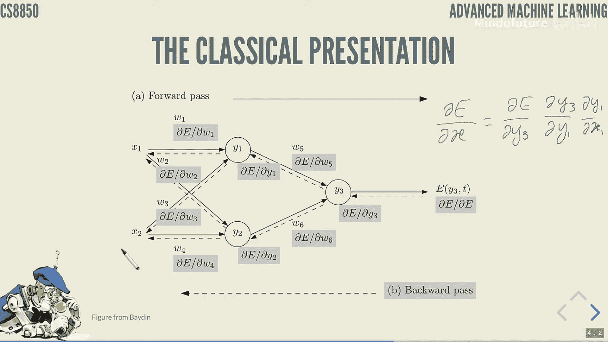

# 050：关于反向传播的一分钟 🧠

在本节中，我们将快速回顾神经网络中一个核心且被广泛研究的算法——反向传播。你已经对它非常熟悉，并且见过多次。我们将通过一个简单的网络结构图，清晰地梳理其前向传播与反向传播的计算过程。

上一节我们介绍了反向传播的基本概念，本节中我们来看看其具体在一个简单网络中的计算流程。

## 前向传播与损失计算

我们来看一张来自论文的示意图。图中展示了一个简单的神经网络。

该网络包含两个隐藏神经元和一个输出神经元。输出位于此处。

在前向传播过程中，我们计算各层的值。然后，我们计算所谓的“损失”。当存在多个输出时，我们仍将它们合并为一个损失函数，并优化这个损失。

## 反向传播的核心机制

通过反向传播，或者称为反向模式自动微分，我们可以同时优化所有参数。但通常，反向传播会将所有计算归结为一个数值——即损失值，并优化这个单一数值。

因此，首先计算损失相对于目标的误差，然后反向传播这个误差。其根本目标是计算损失 `L` 相对于输入 `x` 的梯度。

计算从输出 `y3` 开始，即计算 `∂L/∂y3`。然后，根据链式法则，计算 `∂L/∂y1`，进而计算 `∂y1/∂x1`。这些梯度又依赖于权重 `W` 等参数。

在反向传播的后向过程中，正是计算这些微小的梯度分量。

## 计算步骤简述

以下是反向传播中梯度计算的关键步骤：

1.  **计算输出层误差**：首先计算损失 `L` 对网络输出 `y3` 的梯度，即 `∂L/∂y3`。
2.  **反向传播误差**：利用链式法则，将误差从输出层向隐藏层传递。例如，计算 `∂L/∂y1 = (∂L/∂y3) * (∂y3/∂y1)`。
3.  **计算参数梯度**：根据传播到各层的误差，计算损失相对于各参数（如权重 `W`、偏置 `b`）的梯度，例如 `∂L/∂W1 = (∂L/∂y1) * (∂y1/∂W1)`。
4.  **参数更新**：使用计算得到的梯度，通过优化算法（如随机梯度下降）更新网络参数：`W_new = W_old - η * (∂L/∂W)`，其中 `η` 是学习率。

## 总结

本节课中我们一起回顾了反向传播算法。我们通过一个简单网络图，明确了其前向计算损失、后向利用链式法则计算并传播梯度以更新参数的核心过程。反向传播是训练神经网络，优化其权重参数的基础。