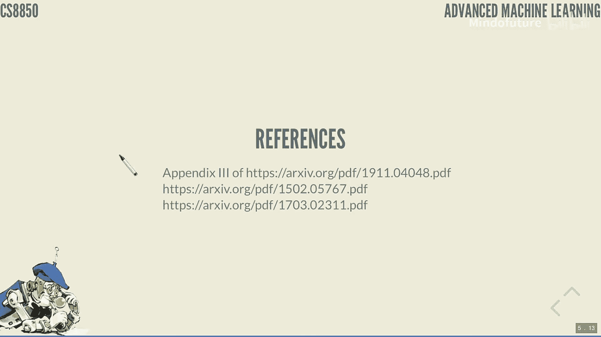

# 051：反向模式自动微分 🧮

在本节课中，我们将学习自动微分（Automatic Differentiation, AD）中的反向模式。这是一种强大的技术，是反向传播算法的泛化。我们将了解其历史背景、核心思想，并通过一个具体例子来理解其工作原理。

## 概述 📖

反向模式自动微分，也称为反向累积模式或自动微分，是一种高效计算函数梯度的方法。它通过一次反向遍历计算所有输入的偏导数，特别适用于输出维度远小于输入维度的场景，例如在神经网络训练中计算损失函数相对于大量参数的梯度。

上一节我们介绍了前向模式自动微分，本节中我们来看看其反向模式。

## 历史背景 🕰️

反向模式自动微分有着悠久而有趣的历史。其发展历程大致可分为几个阶段。

以下是其发展的几个关键类型：

*   **类型1：天才的数学系统变革**。早在1931年和1959年，像费曼这样的天才就发现了相关概念，涉及不动点等有趣内容。
*   **类型2：计算过程的手动转换**。稍晚些时候，Bryson（1962年）、Werblus（1967年）和Leun（1985年）等人研究了手动转换计算过程的方法。随后，Rumelhart在1986年发现了如何为特定计算过程编写代码来实现微分。
*   **类型3：转换其他程序的计算机程序**。真正的突破发生在1980年代，Barth、Speelpenning等人发表了首个能自动完成所需一切任务的系统。Licon和Leun在1988年的工作，以及其前身SN系统，都已内置了此功能。
*   **类型4：一等公民的AD算子**。这是真正的可微分编程，AD算子是一等公民，拥有闭包等特性。例如Stalingrad、R6RS AD、Autograd、DeepSharp等工具。

## 核心人物与贡献 👨‍🔬

我们的主角是Barth Speelpenning。他在1980年实现了名为“Jake”的Fortran系统，致力于“编译由算法给出的函数的快速偏导数”。

他的主要研究成果是：**“为编译快速梯度的问题找到了完整的解决方案；对于编译任意形状的雅可比矩阵的问题，找到了部分解决方案。”**

他描述的方法及其实现能够产生算法，这些算法计算函数 `F(x1, ..., xn)` 梯度所需的时间相当于常数次函数求值，与 `n` 无关。同时，算法的空间需求是适中的，这一点很重要。

## 反向模式AD工作原理 ⚙️

让我们通过一个例子来理解反向模式AD。考虑一个比之前稍复杂的函数：`y = log(sin(x^2))`。

前向计算图（原始轨迹）是从输入 `x` 到输出 `y` 的过程。而反向模式AD则沿着这个计算图反向传播导数。

我们有一个计算图：从 `X` 开始，应用平方运算，然后对结果应用正弦函数 `sin`，最后应用对数函数 `log` 得到输出 `Y`。这是一个没有分支的线性计算图，便于理解。

与前向模式一次计算一个雅可比矩阵元素不同，反向模式的目标是：**对于给定的每个输出 `Yi`，一次性计算其相对于所有输入 `X` 的梯度向量**。

公式表示为：`∇Yi = [∂Yi/∂X1, ∂Yi/∂X2, ..., ∂Yi/∂Xn]`

计算方向是从输出（根节点）反向到输入（叶节点），因此称为“反向累积”。

## 具体计算示例 📝

我们定义中间变量以便追踪：
*   `Z1 = X^2`
*   `Z2 = sin(Z1)`
*   `Y = log(Z2)`

首先完成前向计算，得到所有中间变量和最终输出 `Y` 的值。**注意：反向模式的一个缺点是需要存储所有中间变量的值**，因为反向传播时需要它们。

现在开始反向计算。我们引入“伴随变量”（adjoint）的概念，变量 `V` 的伴随变量记为 `\bar{V}`，其定义为输出 `Y` 对该变量的导数：`\bar{V} = ∂Y/∂V`。

1.  **计算 Y 的伴随变量**：`\bar{Y} = ∂Y/∂Y = 1`
2.  **计算 Z2 的伴随变量**：`\bar{Z2} = ∂Y/∂Z2 = ∂Y/∂Z3 * ∂Z3/∂Z2` （假设 `Z3 = Y`）。这里 `∂Y/∂Z3 = \bar{Y} = 1`，而 `∂Z3/∂Z2 = ∂(log(Z2))/∂Z2 = 1/Z2`。所以 `\bar{Z2} = 1 * (1/Z2) = 1/Z2`。
3.  **计算 Z1 的伴随变量**：`\bar{Z1} = ∂Y/∂Z1 = \bar{Z2} * ∂Z2/∂Z1`。其中 `∂Z2/∂Z1 = ∂(sin(Z1))/∂Z1 = cos(Z1)`。所以 `\bar{Z1} = (1/Z2) * cos(Z1)`。
4.  **计算 X 的伴随变量（即梯度）**：`\bar{X} = ∂Y/∂X = \bar{Z1} * ∂Z1/∂X`。其中 `∂Z1/∂X = ∂(X^2)/∂X = 2X`。所以最终梯度 `\bar{X} = [(1/Z2) * cos(Z1)] * 2X`。

通过这次反向遍历，我们一次性计算出了 `Y` 相对于 `X` 的完整梯度。

## 意义与应用 💡

反向模式AD是可微分计算梦想的核心支撑。它的强大之处在于：
*   **自然支持控制流**：无论前向计算中包含条件语句、循环还是分支，反向模式都能沿着实际执行过的路径（计算轨迹）正确计算导数。
*   **可用于手动微分**：即使不依赖自动化工具，反向模式的思想也能极大简化复杂函数（尤其是矩阵函数）符号微分的手动推导过程，这对理论证明或代码实现都很有帮助。

需要理解的是，像PyTorch、TensorFlow等框架实现的反向传播，其本质就是反向模式自动微分。

## 总结 🎯

本节课我们一起学习了反向模式自动微分（AD）。我们回顾了其发展历史，认识了核心贡献者。最重要的是，我们通过 `y = log(sin(x^2))` 的例子，逐步剖析了反向模式的工作原理：它通过一次反向遍历，利用链式法则和中间变量的伴随变量，高效地计算出输出相对于所有输入的梯度。

你需要掌握前向模式与反向模式AD的区别：前向模式沿计算图正向传播，计算的是方向导数；而反向模式沿计算图反向传播，一次性计算整个梯度。理解这一点对于深入学习机器学习和优化算法至关重要。希望这节课能激发你进一步探索自动微分这一强大而有趣的工具。