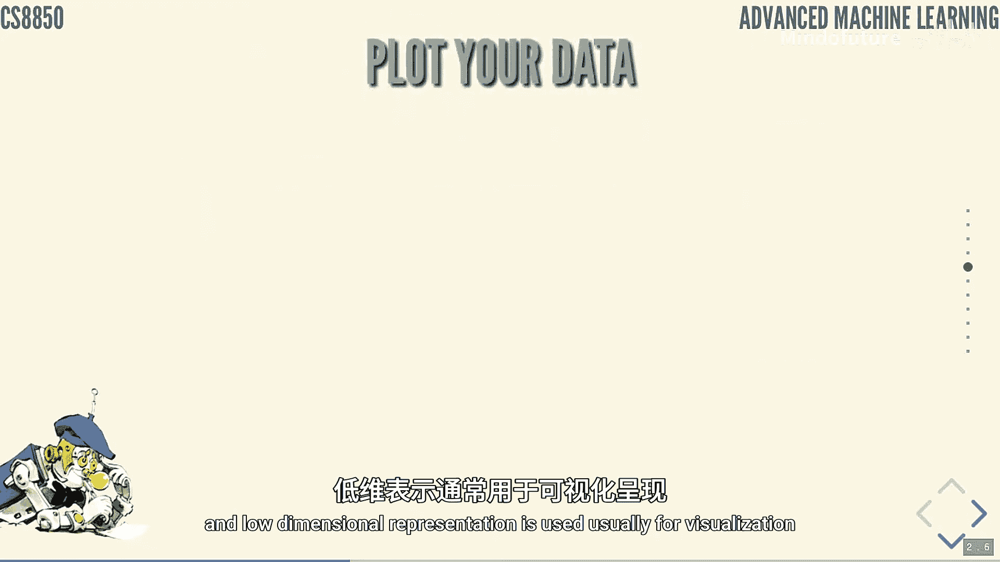
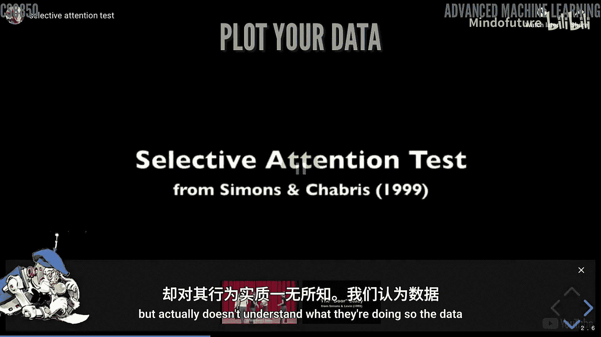
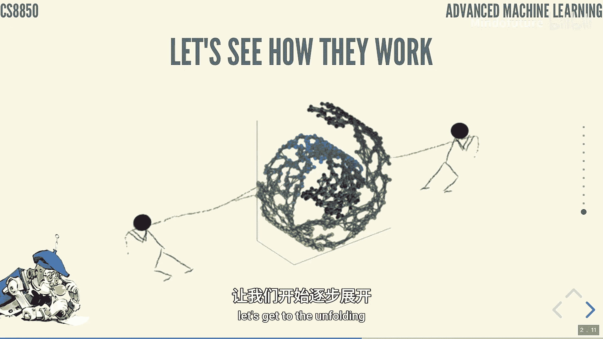

# 052：流形学习 📚

## 概述
在本节课中，我们将学习流形学习。流形学习是一种用于发现高维数据中隐藏的低维结构的技术。我们将探讨其动机、核心方法，并理解如何通过降维来可视化和理解复杂的数据集。

---

## 动机：为什么需要流形学习？🤔

上一节我们概述了课程内容，本节中我们来看看流形学习的核心动机。

数据本质上是低维的。在PCA课程中曾提到，数据的维度并不完全由我们的测量方式决定。我们可能从不同角度测量许多事物，但底层过程通常比实际测量的要简单得多，涉及的变量也更少。

这取决于我们观察的尺度。例如，我们不会同时分析原子尺度和驾驶汽车尺度的运动。我们分析的是原子构成的整体——一辆驶过的汽车。在特定尺度下，数据的内在维度通常很低。

以驾驶场景为例。一张彩色图片可能包含数百万像素，每个像素随时间变化的强度可以被视为一个维度。所有可能的像素值构成了一个极高维的空间。然而，我们真正关心的内在空间信息（如“这是一辆车”、“这是道路”）的维度却很低。我们并不关心道路上每个像素的具体值。

我们的大脑运作方式也类似。大脑接收来自视觉、听觉、嗅觉和触觉的百万级感官输入，这构成了一个百万维的输入空间。但当我们触摸某物时，真正发生的事件维度很低，并非每个传感器都传递独立信息。传感器之间是相关的。

更准确地说，我们认为数据所代表的过程，发生在一个比测量空间维度低得多的“薄层”或“曲面”上，这个曲面就是**流形**。我们假设这个流形在局部是线性的。

那么，我们如何提取信息并观察数据结构呢？我们使用**探索性数据分析**。本节课描述的方法就属于这一范畴。目标是发现数据中隐藏的低维结构，其低维表示通常用于可视化。

有一个著名的“看不见的大猩猩”实验。在数据分析中也有类似实验：两组学生拿到相同的包含X和Y坐标的数据集。一组被要求寻找有趣的东西，另一组被给予更具体的任务（如寻找X和Y的相关性）。如果将X对Y绘图，数据点会呈现一个大猩猩的图案。结果，没有特定任务的那组学生更常绘制散点图并发现了“大猩猩”，而有任务的学生则可能去拟合直线并报告回归系数。

这个故事的启示是：在处理任何数据时，在盲目应用算法之前，最好先从基本原理出发，**观察你的数据**。探索性数据分析提供了工具，帮助我们避免成为“聪明但愚蠢”的人——即懂得很多方法却不理解自己在做什么的人。

---

## 什么是流形？🌀

上一节我们讨论了流形学习的动机，本节我们来正式定义什么是流形。

我们相信数据存在于**流形**上。非正式地说，流形是**在任何小尺度下都近乎平坦的对象**。显然，直线或平面在所有尺度上都是平坦的，它们也是流形。我们可以用切线来近似圆或球面等光滑曲面。因此，一条曲线也是流形，因为在足够小的尺度下，总可以放置一条切线使其看起来是平坦的。

对于三维空间，流形可以是曲面。只要在小尺度下近乎平坦，就可以是流形。

**流形学习**的核心问题是：我们能否在数据中找到这些平坦的区域？想象我们的数据分布在一个流形上，我们能否将这些区域映射到一个二维空间进行可视化？（有时是三维，但超过三维则难以可视化理解。）

---

## 流形学习实例 🔍

上一节我们定义了流形，现在通过一个具体例子来看看流形学习在做什么。

观察这个三维的猛犸象骨架图。图中我用黑点标出的一个点，在三维模型和右侧的二维圆圈中都有对应。这里，三维模型通过某种算法被映射（或投影）到了二维空间。我们通常说的“投影”暗示线性变换，但这里的映射不一定是线性的。

我们可以调整一些参数，例如参与**局部线性**决策的“邻居”数量，即定义什么是“局部”并将其展平。如图所示，猛犸象脚趾和鼻子上的点在二维空间中被分开了。如果增加“最小距离”参数，你会得到不同的图像。通过这个过程，即使原始数据（左侧）是高维的，将其绘制在二维图中也能帮助你发现数据中隐藏的结构。

这是另一种绘图方式，对应点被映射到不同位置。这只是两种不同方法的对比。你可以调整参数，观察结果的敏感性和稳定性。这就是可视化的意义。

在实践中，这些方法都致力于实现相同的目标。上面的例子因为原始数据是三维的，所以不够震撼。但请看下面这个时尚和酵母数据集的可视化。每个点代表一个时尚单品（如衣服、包包），它们在高维空间（每张图片可视为一个高维向量）中的关系被映射到了三维空间。算法并没有进行聚类（它不知道哪个是裤子），它只是将数据在其原本的高维空间中的关系呈现出来。你可以清楚地看到相似物品自然地聚集在一起。

---

## 流形学习算法概览 📊

上一节我们看了实例，本节我们来简要了解有哪些流形学习算法。

存在许多流形学习算法：
*   **PCA**：最简单的一种，但它学习的是线性超平面。
*   **多维缩放**：我们将讨论的方法之一。
*   **等距特征映射**：与多维缩放相关。
*   **最大方差展开**
*   **局部线性嵌入**：一个吸引了大量关注该问题的方法。
*   **拉普拉斯特征映射**
*   **t-SNE**：一个非常出色的方法。
*   **随机投影**：一个简单但相关的方法。
*   以及更多其他方法。

接下来，让我们深入了解其中一些方法，看看它们如何展开那些局部平坦但整体复杂的数据集。

---

## 总结 🎯

本节课我们一起学习了流形学习。我们从理解数据内在低维性的动机开始，介绍了流形的概念——即在小尺度下局部平坦的数据结构。我们通过实例看到了流形学习如何将高维数据映射到低维空间以进行可视化和探索，并列举了PCA、多维缩放、局部线性嵌入、t-SNE等一系列实现这一目标的算法。流形学习是探索性数据分析的强大工具，能帮助我们在应用复杂模型前，先直观地理解数据的底层结构。