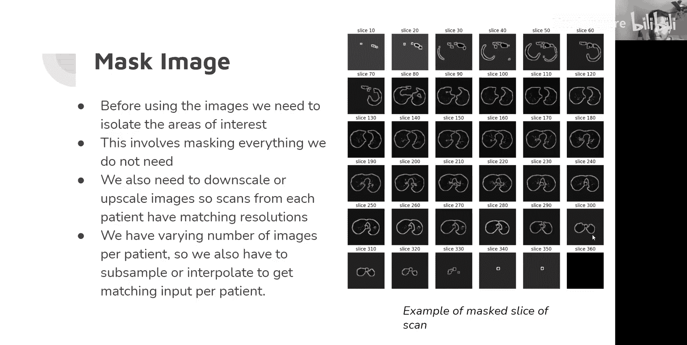
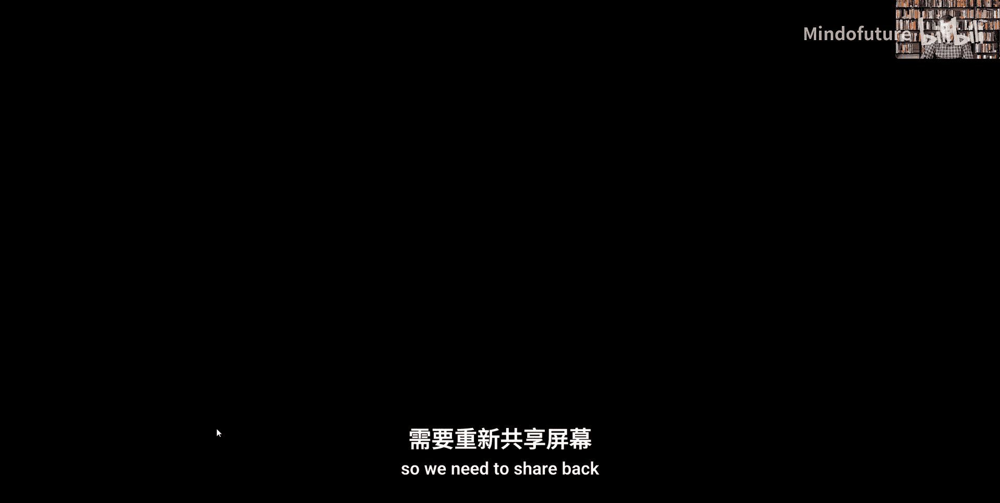
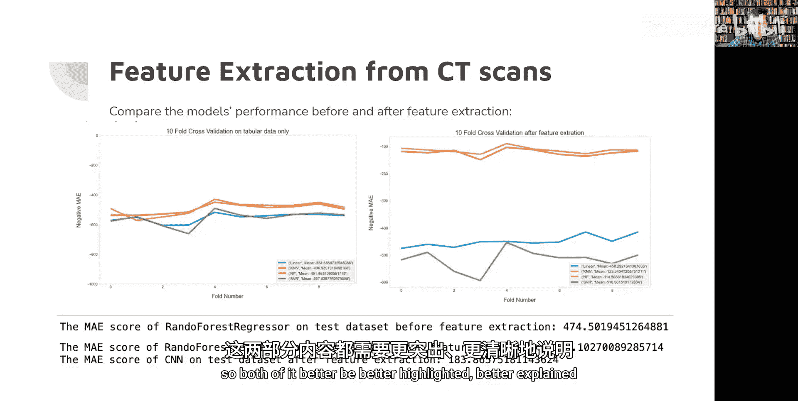

# 054：预测肺纤维化进展 🫁

## 概述
在本节课中，我们将学习一个利用机器学习预测特发性肺纤维化（IPF）患者肺功能下降严重程度的项目。我们将从项目动机、数据处理、基线模型构建，到更复杂的特征提取和卷积神经网络（CNN）方法，系统地了解整个流程。

---

## 项目动机与目标 🎯

特发性肺纤维化是一种病因不明的疾病，由肺部瘢痕形成引起。其诊断结果涵盖从稳定到快速恶化的范围，医生难以准确判断患者所处的阶段，也无法预测肺功能随时间的变化趋势。

现有方法大多难以有效解决这一挑战，尤其是在缺乏胸部CT扫描数据的情况下。因此，本项目的目标是：**基于患者的肺部CT扫描，预测其肺功能（用力肺活量，FVC）下降的严重程度**。我们使用机器学习技术进行预测，成功的预测将帮助患者了解其肺功能的未来变化。

---

## 数据来源与描述 📊

我们使用的数据集来源于**开放源影像联盟（OSIC）**数据库。OSIC是一个致力于对抗IPF及相关疾病的非营利性合作组织。

我们的数据集包含两种类型的数据：
1.  **影像数据**：每位患者的DICOM格式CT扫描切片。
2.  **表格数据**：记录每位患者每次就诊时的临床详细信息，如年龄、性别、吸烟状况、就诊周数及对应的FVC测量值等。

以下是数据集的统计摘要：
*   **患者数量**：176名独特患者。
*   **记录总数**：约1500条就诊记录（每位患者有6到10次就诊）。
*   **CT扫描**：每位患者有12到1018个不等的CT扫描切片，分辨率在512x512到1302x1302之间。
*   **关键预测目标**：用力肺活量（FVC）。

表格数据中的“周数”列表示测量时间点，负值表示基线测量前的周数，正值表示基线测量后的周数。

---

## 数据预处理 ⚙️

为了成功进行实验，我们需要对原始数据进行预处理。

上一节我们介绍了数据来源，本节中我们来看看如何为模型准备数据。

### 表格数据处理
我们处理了表格数据中的异常值，并进行了数据标准化，以确保模型训练的稳定性。

### CT扫描预处理
对于CT扫描图像，我们进行了以下步骤：
1.  **格式转换**：将DICOM文件转换为Hounsfield单位（HU）测量值，以标准化像素强度。
2.  **图像分割**：创建掩膜以聚焦肺部区域，消除其他不相关组织（如骨骼）的干扰。
3.  **尺寸统一**：将所有图像缩放至统一分辨率（例如512x512），以创建一致的数据集。
4.  **采样统一**：由于每位患者的切片数量不同，我们通过子采样或插值使每位患者的输入数据量匹配。

---

## 基线模型与评估指标 📈

在探索复杂模型之前，我们首先建立了一些基线模型作为性能比较的基准。

由于我们的任务是**回归问题**（预测连续的FVC值），我们无法使用分类任务中常见的ROC曲线、AUC等指标。我们采用了以下回归评估指标：

1.  **R²分数**：表示模型可解释的响应变量方差百分比。公式为：
    `R² = 1 - (SS_res / SS_tot)`
    其中 `SS_res` 是残差平方和，`SS_tot` 是总平方和。
2.  **平均绝对误差（MAE）**：预测值与真实值之间绝对差异的平均值。公式为：
    `MAE = (1/n) * Σ|y_i - ŷ_i|`
3.  **均方误差（MSE）**：预测值与真实值之间差异平方的平均值。公式为：
    `MSE = (1/n) * Σ(y_i - ŷ_i)²`

我们尝试了两种基线模型：
*   **支持向量回归（SVR）**：使用RBF核，参数C=1，degree=3。
*   **随机森林回归（Random Forest Regressor）**

初步结果表明，SVR模型在给定数据集上具有更好的验证性能，因此我们将其作为后续比较的基线。

---

## 特征提取方法 🧠

我们面临的一个挑战是：不同患者的CT扫描数量不同。直接使用所有图像进行训练非常困难。

上一节我们介绍了基线模型，本节中我们探讨一种解决方案：从CT扫描中提取有意义的特征，然后用这些特征训练模型。这种方法比直接处理图像更高效。

以下是我们的特征提取流程：
1.  **图像统一**：将所有CT扫描图像调整至512x512分辨率。
2.  **肺部掩膜**：应用掩膜算法聚焦肺部区域。此步骤中有6名患者的掩膜生成失败，为确保数据一致性，我们在所有后续分析中移除了这些患者的记录。
3.  **特征计算**：我们计算了以下两类特征：
    *   **肺部体积**：每位患者的总体积。
    *   **HU统计特征**：如均值、标准差、偏度、峰度等。
    *   **最大切片特征**：我们假设最大的CT切片可能包含更多信息，因此也从中提取了上述特征。
4.  **模型训练**：最终，我们得到了27个特征。我们使用这些特征重新训练了多种模型（包括随机森林、K近邻等），并与仅使用表格数据的模型性能进行对比。

**结果**：特征提取后，所有模型的性能均有显著提升，尤其是随机森林和KNN模型。这证明从CT图像中提取的特征对于预测FVC是有效的。

**潜在改进方向**：
*   使用更精确的肺部掩膜算法。
*   在特征提取后进行特征选择，筛选出最重要的特征。
*   尝试更复杂的模型。

---

## 基于卷积神经网络（CNN）的方法 🤖

除了特征提取，我们还尝试了更直接的深度学习方法，即使用卷积神经网络处理CT扫描图像本身。

我们构建了一个基于**LeNet-5架构的2D CNN模型**。模型结构包含卷积层、池化层和全连接层。
*   **输入**：每位患者经过掩膜和重采样后的CT切片堆叠（约364张346x346的图像）。
*   **目标**：预测一个包含138个FVC值的1D张量，对应模型需要估计的不同时间点的肺功能值。
*   **优化器与损失**：使用Adam优化器（学习率0.001），以均方误差（MSE）作为损失函数。

**面临的挑战**：
1.  **内存限制**：数据集庞大（176名患者，每人数百张图像），在本地机器上训练面临内存压力。
2.  **目标向量稀疏**：目标张量中大部分值为零（因为并非每个时间点都有测量），这可能导致模型训练不稳定，损失值居高不下。
3.  **时间建模**：将不同时间点的预测压缩到一个固定长度的向量中，是一项复杂的任务。

目前，CNN模型的性能（MAE ≈ 183）尚未超越最佳的基线模型（随机森林）。未来可探索**3D CNN**（将CT切片视为3D体积数据）或**结合图像特征与表格数据**的混合模型，以期获得更好的性能。

---

## 项目协作与管理 👥

成功的项目离不开良好的团队协作。我们采用了以下工具和方法：
*   **版本控制**：使用Git和GitHub进行代码管理和协作。
*   **项目管理**：使用Asana和看板（Kanban）来跟踪任务进度、分配工作并管理项目时间线。
*   **沟通**：使用Slack进行日常交流和快速决策。

这些实践确保了工作的有序进行和进度的透明化。

---

## 总结与未来展望 🔮

本节课中，我们一起学习了如何利用机器学习预测肺纤维化进展。

**核心总结**：
1.  **特征提取有效**：从CT图像中提取体积和纹理特征，能显著提升传统机器学习模型（如随机森林）的预测性能。
2.  **数据挑战**：处理医学影像数据时，需应对分辨率不一、切片数量不同、内存消耗大等挑战。
3.  **模型对比**：在本项目中，基于特征提取的随机森林模型表现优于我们目前实现的2D CNN模型。
4.  **严谨评估至关重要**：需要注意数据拆分方式（如按患者而非按记录拆分），以避免过拟合和评估偏差。

**未来工作方向**：
*   探索**3D CNN架构**以更好地利用CT扫描的空间信息。
*   构建**多模态模型**，将提取的影像特征与原始表格数据深度融合。
*   优化数据预处理流程，特别是肺部分割的准确性。
*   尝试更先进的序列或时间序列模型来直接建模肺功能随时间的变化。

通过这个项目，我们展示了机器学习在解决复杂医学预测问题上的潜力与挑战。