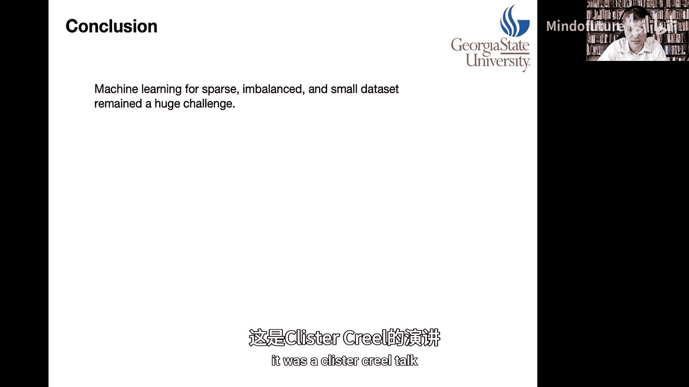

# 055：地震后建筑损伤预测项目演示

在本教程中，我们将学习一个高级机器学习项目的完整流程。该项目旨在预测地震后建筑物的损伤等级。我们将从项目动机开始，逐步介绍数据理解、特征处理、模型选择与实验，并最终总结关键发现。

---

## 项目动机 🏢

地震对建筑物造成的破坏程度评估至关重要。通过机器学习模型预测建筑的损伤可能性，可以为政府决策提供量化依据，例如评估建筑安全、指导灾后重建或拆除高危建筑。对于保险公司，准确的预测有助于制定更合理的保险费率。这项工作既能挽救生命，也具有经济价值。

## 数据描述 📊

我们使用的数据集包含约26万个数据点，每个数据点代表一栋建筑的信息，共有78个特征。数据集总大小约为32MB，属于相对较小的数据集。目标标签是损伤等级，分为1（低损伤）、2（中等损伤）和3（高损伤）三类。

特征主要分为三类：
1.  **数值特征**：例如建筑年龄、高度、地理等级等。
2.  **分类特征**：例如地基类型、地表条件等。
3.  **二元特征**：取值为0或1的特征，例如是否具有某种结构。

数据存在高度不平衡的问题。中等损伤类别的样本约占57%，而低损伤和高损伤类别分别约占9%和34%。这意味着如果简单地将所有样本预测为中等损伤，准确率也能达到约57%，这给建模带来了挑战。

## 方法论与实验 🔬

上一节我们了解了数据的基本情况，本节中我们来看看具体的处理方法和模型实验。

我们首先尝试了多种机器学习模型，然后进行了特征选择，最后对选定的模型进行超参数调优。项目评估指标采用F1分数（F1 Score），而非简单的准确率，以更好地处理类别不平衡问题。

以下是我们在项目中尝试的主要模型及其简要分析：

*   **K近邻（KNN）**：我们尝试了欧几里得距离、曼哈顿距离等不同距离度量。但由于特征重要性不同，且分类特征和二元特征的距离计算方式（通常为0或1）与数值特征的尺度差异巨大，导致模型性能不佳，未能显著超越基线模型。
*   **逻辑回归与神经网络**：逻辑回归模型在本任务上完全失败。我们也尝试了一维卷积神经网络（1D CNN）和全连接神经网络。1D CNN的卷积核假设特征在空间顺序上存在相关性，但我们的特征之间几乎是独立的，因此该假设不成立。全连接神经网络则因为数据量较小、特征经过筛选后维度不高，难以训练收敛，结果甚至未达到70%的F1分数。
*   **随机森林（Random Forest）**：这是我们最终采用并取得最佳效果的模型。我们进行了大量的超参数调优，最终设定的关键参数包括：树的数量（`n_estimators`）为160，树的最大深度（`max_depth`）为20，每次分裂考虑的最大特征数（`max_features`）为16。

### 特征选择

在应用模型之前，特征选择是关键步骤。我们通过可视化和统计测试来筛选特征。

以下是我们的特征选择策略：

1.  **分类特征**：我们使用卡方检验来评估每个分类特征与目标标签之间的统计显著性。根据检验结果，我们剔除了显著性最低的几个特征。
2.  **二元特征**：我们采用了一个简单的过滤规则：如果一个特征中某一类（通常是0）的占比超过95%或低于5%，则认为该特征区分度太低，予以剔除。例如，某个特征超过98%的样本值为0，它对预测的贡献微乎其微，反而可能引入噪声。
3.  **基于模型的重要性**：在训练随机森林后，我们查看了特征重要性排序。地理等级、面积百分比、建筑年龄等数值特征被模型认为是最重要的。

经过特征选择和超参数调优，我们的随机森林模型在交叉验证中取得了约73%的F1分数。

## 结果与总结 🎯

最终，我们的随机森林模型在测试集上取得了73%的F1分数。作为对比，Kaggle竞赛排行榜上目前的最佳成绩约为75.6%，而许多公开的研究（包括一些误用LSTM等时序模型的方法）成绩仅在60%左右。

通过本项目，我们总结了以下关键经验：

1.  **特征理解与选择至关重要**：对于特征稀疏、不平衡且具有明确物理意义的数据集，深入理解特征含义并进行有效的筛选，比盲目使用复杂模型更重要。
2.  **模型选择需贴合数据特性**：最先进的模型（如CNN、LSTM）并非万能。它们的设计基于特定假设（如空间局部性、时间依赖性），如果数据不满足这些假设，其性能可能还不如简单的传统模型（如随机森林）。
3.  **处理不平衡数据需用对指标**：使用F1分数等更能反映模型在各类别上综合性能的指标，比单纯使用准确率更合理。
4.  **随机森林简介**：随机森林是一种集成学习算法。它通过构建多棵决策树（例如我们用了160棵）并进行“投票”来做出最终预测。每棵树在训练时使用了数据的随机子集和特征的随机子集，这种随机性有助于降低过拟合风险，提高模型的泛化能力。

本节课中我们一起学习了如何为一个具体的预测问题（地震建筑损伤评估）构建机器学习解决方案。我们经历了从数据探索、特征工程、模型实验到结果分析的完整流程，并深刻认识到，在机器学习实践中，对数据和问题本质的深刻理解往往比模型本身的复杂度更为关键。