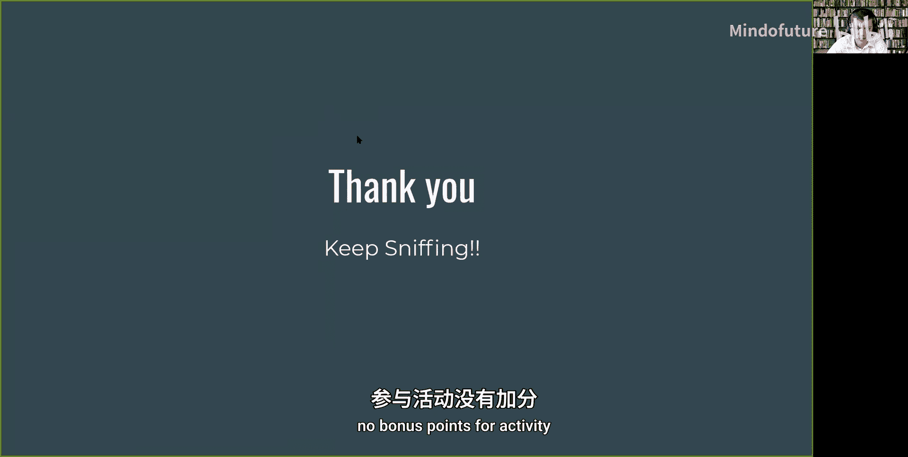

# 056：学习嗅觉 🧪👃


在本教程中，我们将学习如何构建一个机器学习模型，将化学分子结构与其对应的气味描述进行匹配。这是一个多标签分类问题，我们将探索多种方法，包括基于指纹的模型、随机森林和图神经网络。

---

## 数据准备与挑战

我们的数据集包含化学分子的SMILES字符串表示及其对应的气味描述。SMILES代表“简化分子线性输入系统”，它是一种用ASCII字符串描述化学结构的线性表示法。

以下是数据示例：

| SMILES 字符串 | 气味描述 |
| :--- | :--- |
| `CCO` | 果味，花香 |
| `CC(=O)O` | 酸味，刺鼻 |

**挑战**：这是一个多标签分类问题。每个分子可能对应多个气味描述，这些描述以逗号分隔。训练数据包含约4360个分子和19种独特气味。

**提交格式**：模型需要为每个分子预测前5个最可能的气味，预测结果以分号分隔，每个气味描述内的词语以逗号分隔。

---

## 评估指标：谷本相似度指数

由于这是一个化学信息学预测问题，我们使用**谷本相似度指数**来评估模型性能。该指数用于比较由分子指纹表示的两个化学结构的相似性。

**公式**如下：
`T(A, B) = |A ∩ B| / |A ∪ B|`

其中：
*   `A` 和 `B` 是两个分子的指纹集合。
*   `|A ∩ B|` 是交集的大小。
*   `|A ∪ B|` 是并集的大小。

对于每个分子，我们计算其预测的Top 5气味句子与真实气味句子之间的谷本相似度，并取最高分作为该分子的得分。最终的总分是测试集中所有分子得分的平均值。

---

## 数据探索

在开始建模前，我们先了解数据分布。

以下是数据集中最常见和最不常见的气味标签：

**最常见的5种气味**（出现约500次）：
*   果味
*   花香
*   木质香
*   草药香
*   青草香

**最不常见的几种气味**（出现少于10次）：
*   过度成熟味
*   氨味
*   酚味
*   蓝莓味

数据存在明显的类别不平衡。我们还分析了气味之间的关联性，例如，“果味”与多种其他气味共同出现，而“氨味”与“酚味”有50%的概率同时出现。

---

## 方法一：基于Piper的多模型基线

上一节我们了解了数据和评估方式，本节我们来看看第一种建模方法。我们使用了`Piper`库，它集成了多种经典机器学习算法。

**特征提取**：我们使用`Mordred`描述符计算了超过1000种化学分子特征。这些特征直接从SMILES字符串转换的分子结构中计算得出，包括分子量、极性等物理化学属性。

**标签处理**：我们将气味标签进行独热编码。对于每个分子，我们将其与每个气味标签组合，创建多个“分子-单个气味”样本，以适配多分类模型。

**模型与结果**：我们在`Piper`中尝试了K近邻、朴素贝叶斯、逻辑回归、SVM和随机森林。其中，**随机森林表现最佳**。我们的基线模型在排行榜上取得了0.134的分数（当时最高分为0.473）。

---

## 方法二：优化的随机森林模型

基于基线实验，我们选择性能最好的随机森林进行深入优化。

**流程**：
1.  使用`Mordred`提取的1000多个特征。
2.  对多标签进行特殊编码：为每个分子生成一个固定长度的向量，其中包含其所有气味的索引，不足部分用-1填充。
3.  使用网格搜索寻找随机森林的最佳超参数。
4.  训练完成后，模型会输出每个气味标签的概率。我们选择概率最高的前3个气味作为预测结果。

**性能**：通过五折交叉验证，该模型的平均谷本相似度得分约为 **0.21 ± 0.01**。

---

## 方法三：图卷积神经网络

前两种方法基于手工特征，本节我们尝试一种能自动学习分子表示的深度学习方法——图卷积神经网络。图是表示分子的天然数据结构，原子是节点，化学键是边。

**模型架构**：
1.  **原子特征**（如原子类型、电荷）通过**图注意力卷积层**进行消息传递和学习。
2.  **分子级特征**（如整体描述符）直接输入一个前馈神经网络。
3.  将两部分学习到的表示向量连接起来。
4.  最后通过一个前馈网络输出层，预测所有气味标签的概率。

**损失函数**：我们使用了适用于多标签分类的**带Sigmoid的二元交叉熵损失**，其代码实现核心如下：
```python
# 数值稳定的Sigmoid交叉熵损失计算
def stable_sigmoid_cross_entropy(logits, labels):
    max_logits = tf.maximum(logits, 0)
    loss = logits - logits * labels + max_logits + tf.math.log(tf.exp(-max_logits) + tf.exp(-logits - max_logits))
    return tf.reduce_mean(loss)
```

**训练挑战**：
*   **训练不稳定**：模型容易陷入局部最优，对参数初始化敏感。
*   **计算成本高**：训练速度慢，限制了超参数搜索和模型结构实验。
*   **特征有限**：当前仅使用了5个分子特征和7个原子特征，而文献中成功的模型使用了上百个特征。

**结果**：我们最好的GNN模型得分约为0.13，低于随机森林。这表明在当前数据规模和计算资源下，简单模型配合精心设计的特征更具竞争力。

---

## 结果分析与总结

**最终排行榜分析**：有趣的是，排行榜上除社区贡献的基准代码外，第一名及并列第三名的队伍得分完全相同。这些高分模型大多是基于**K近邻**或**随机森林**，并辅以更复杂的特征工程。我们的最佳结果也与此一致。

**核心结论**：
1.  **特征工程至关重要**：在当前任务中，`Mordred`等工具提取的化学描述符特征比我们实现的GNN自动学习到的特征更有效。
2.  **图神经网络训练难度大**：GNN对初始化、超参数敏感，容易陷入局部最优，需要更成熟的框架（如PyTorch Geometric）、更强大的算力和更精细的训练策略。
3.  **经典模型表现稳健**：随机森林和K近邻在这个小规模、多标签的数据集上表现出了良好的鲁棒性和竞争力。
4.  **改进方向**：未来工作可以集中在更深入的特征工程、更广泛的超参数搜索，以及使用更成熟、更强大的GNN架构与训练技巧上。



本节课中，我们一起学习了如何将化学分子匹配到气味描述这一有趣而富有挑战性的任务。我们实践了从数据准备、特征工程到多种模型（传统机器学习与图神经网络）的构建与评估的全流程，并分析了不同方法的优缺点。希望本教程能帮助你理解处理此类多标签、跨模态匹配问题的基本思路。