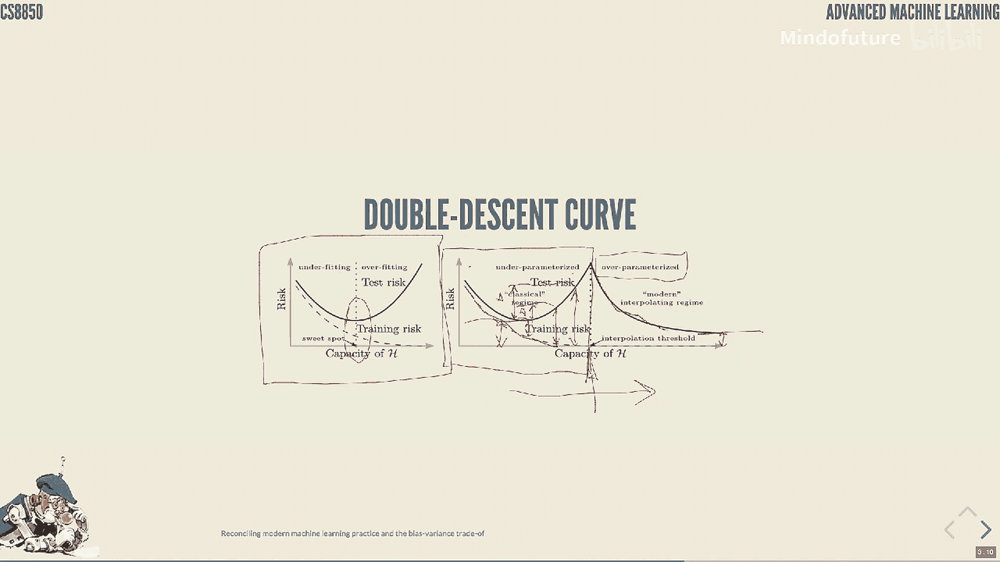

# 057：偏差-方差权衡 📊

在本节课中，我们将要学习机器学习中的一个核心概念：偏差-方差权衡。我们将探讨它如何影响模型性能，以及如何通过理解它来避免过拟合和欠拟合。我们将从数学定义开始，通过图示直观理解，并讨论其在模型选择和复杂度控制中的应用。

## 偏差与方差的定义 📖

上一节我们介绍了偏差-方差权衡是模型选择中的一个关键概念。本节中，我们来看看其数学定义。

在核密度估计等任务中，我们的目标是**最小化估计密度与真实密度之间的误差**。为此，我们通常使用**均方误差**作为衡量标准。

均方误差定义为估计值与真实值之差的平方的期望。其公式如下：
`MSE = E[(θ_hat - θ)^2]`

我们可以对这个公式进行分解。通过展开平方项并利用期望的线性性质，我们可以在表达式中加上再减去估计值的期望的平方。经过整理后，均方误差可以分解为两个部分：

`MSE(θ_hat) = [Bias(θ_hat)]^2 + Var(θ_hat)`

其中：
*   **偏差** 定义为估计值的期望与真实参数值之间的差异：`Bias(θ_hat) = E[θ_hat] - θ`
*   **方差** 定义为估计值与其期望值之差的平方的期望：`Var(θ_hat) = E[(θ_hat - E[θ_hat])^2]`

这个分解清晰地表明，模型的总体误差来源于两个部分：**偏差**（系统性的预测错误）和**方差**（由于数据随机性导致的预测波动）。

## 偏差与方差的直观理解 🎯

理解了数学定义后，我们可以通过一个经典的比喻来直观感受偏差和方差。

想象一个射击靶子，我们的目标是击中靶心（真实值）。每次射击代表一次基于不同数据集的模型预测。

以下是四种典型情况：
*   **低偏差，低方差**：射击点紧密地聚集在靶心周围。模型既准确又稳定。
*   **低偏差，高方差**：射击点中心在靶心附近，但非常分散。模型平均来看是准确的，但预测结果很不稳定。
*   **高偏差，低方差**：射击点紧密地聚集在一起，但偏离了靶心。模型稳定但系统地预测错误。
*   **高偏差，高方差**：射击点既分散又偏离靶心。模型既不准确也不稳定。

**核心要点**：低方差意味着模型确定性高，但这并不等同于正确性（可能偏差很高）。我们的目标是同时降低偏差和方差，但这通常是一个需要权衡的过程。

## 模型复杂度与数据划分 🔧

在现实世界中，我们通常只有有限的数据。为了评估模型并选择最佳的那个，我们需要将数据划分为不同的部分。

如果我们只有一个模型，可以简单地将数据分为**训练集**和**测试集**。我们在训练集上训练模型，在测试集上评估其性能。

然而，模型通常有**超参数**需要调整（例如，K近邻中的K值，或核函数的宽度）。我们不能用测试集来选择超参数，因为这会“窥探”测试集信息，导致对泛化性能的乐观估计（称为“双重 dipping”）。

为了解决这个问题，通常采用**三部分划分**：
1.  **训练集**：用于训练模型参数。
2.  **验证集**：用于调整模型超参数，选择最佳模型。
3.  **测试集**：作为最终评估的“保留集”，仅在模型完全确定后使用一次，以估计真实的泛化误差。

这种划分确保了评估的公正性。

## 泛化误差与过拟合/欠拟合 📈

现在，我们来看看模型复杂度如何通过偏差和方差影响泛化误差。

模型复杂度可以理解为模型参数的数量或容量（例如，多项式的阶数、神经网络的层数）。

以下是模型复杂度与误差的关系：
*   **训练误差**：随着模型复杂度增加，模型能更好地拟合训练数据，因此训练误差持续下降。
*   **泛化误差**：呈现一个U形曲线。
    *   **低复杂度区**：模型过于简单，无法捕捉数据中的基本模式，导致**高偏差、低方差**。此时模型**欠拟合**。
    *   **中等复杂度区**：偏差和方差达到一个较好的平衡，泛化误差最小。这是理想区域。
    *   **高复杂度区**：模型过于复杂，开始完美拟合训练数据（包括噪声），导致**低偏差、高方差**。此时模型**过拟合**，在未见数据上表现变差。

为了避免过拟合，我们引入了**归纳偏置**和**正则化**技术（如L1/L2正则化），目的是惩罚模型复杂度，防止其单纯记忆训练数据，从而提升泛化能力。

## 模型选择问题 🤔

当我们面对多个不同类型的模型时，如何选择泛化能力最好的那个？这就是**模型选择问题**。

我们希望通过有限的数据（验证集）来估计模型在无限未来数据上的性能（真实泛化误差）。这里再次体现了偏差-方差权衡的重要性：
*   一个**低偏差、高方差**的估计量（如复杂模型在验证集上的误差）虽然平均来看是无偏的，但具体到某一次验证集划分时，其估计值可能因方差过高而严重偏离真实值，导致我们做出错误的选择。
*   一个**有偏但低方差**的估计量（如使用交叉验证得到的平均误差）虽然可能不是完全无偏的，但其估计结果更稳定可靠，通常能带来更好的模型选择效果。

因此，在模型选择中，我们不仅要关注估计的准确性（低偏差），也要关注其稳定性（低方差）。

## 现代视角：过参数化模型 🚀

传统的“金科玉律”是：选择参数较少的简约模型，避免过拟合。然而，现代深度学习研究发现了一个有趣的现象，被称为“双重下降”曲线。

在非常庞大的模型（如深度神经网络）中，当模型参数数量远超所需时（即**过参数化**区域），会出现与传统认知不同的情况：
1.  随着复杂度增加，首先会经历经典的过拟合区域（测试误差上升）。
2.  但如果继续增加模型容量，测试误差会**再次下降**，甚至可能低于传统最优复杂度模型所能达到的水平。

这表明，对于某些高度灵活的模型族，**更大的模型容量有时反而能带来更好的泛化性能**。这挑战了传统的偏差-方差权衡的简单解释，是当前研究的前沿领域。

## 总结 📝

本节课中我们一起学习了偏差-方差权衡这一核心概念。
*   我们首先从数学上定义了**偏差**和**方差**，并知道总误差（均方误差）是它们的和。
*   我们通过图示理解了**低/高偏差**与**低/高方差**的不同组合对模型预测的影响。
*   我们讨论了为了可靠评估模型，需要将数据划分为**训练集、验证集和测试集**。
*   我们分析了**模型复杂度**如何影响偏差和方差，从而导致**欠拟合**和**过拟合**。
*   我们探讨了在**模型选择**中，需要同时考虑估计量的偏差和方差。
*   最后，我们了解了现代深度学习中的**过参数化模型**现象，它展示了偏差-方差权衡更复杂的一面。

理解偏差-方差权衡有助于我们诊断模型问题、选择合适模型复杂度，并最终构建泛化能力更强的机器学习系统。