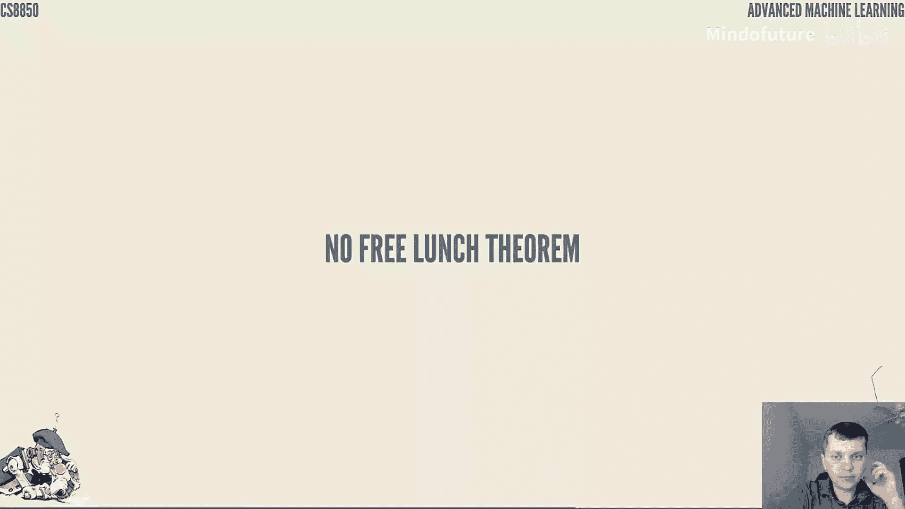
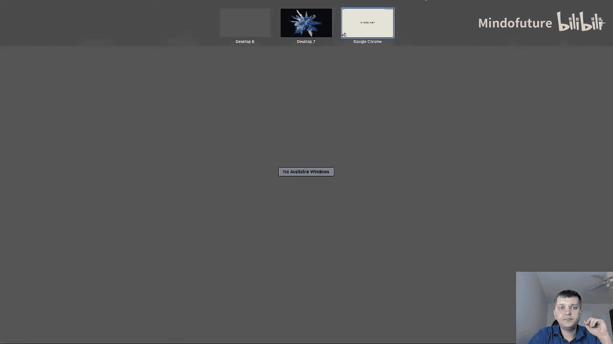
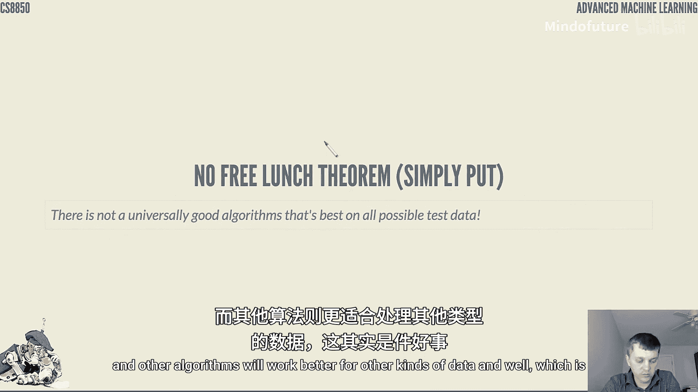

# 058：没有免费午餐定理 🍽️

在本节课中，我们将要学习“没有免费午餐定理”。这个定理是机器学习理论中的一个核心概念，它深刻地阐述了为什么不存在一个适用于所有问题的“万能”学习算法。上一节我们讨论了偏差-方差权衡，它关注的是同一模型类别内不同复杂度的模型。本节中，我们来看看当面对完全不同的模型类别时，我们该如何选择。

## 概述：为什么需要这个定理？

机器学习课程有时会给人一种“算法清单”的感觉，仿佛我们只需要知道在哪种情况下应用哪种算法即可。这自然会引出一个问题：我们能否找到一个终极模型，一劳永逸地解决所有问题？这样就不需要数据科学家去反复选择和调整模型了。

然而，机器学习是一门实验科学。我们通常无法完全知晓数据背后的真实生成过程。例如，在构建医疗诊断模型时，如果我们确切知道某种疾病（如新冠肺炎）在所有情况下的CT影像特征，那么我们根本不需要训练模型，直接匹配规则即可。但现实是，我们不知道，因此必须通过实验来假设已见数据对未来未见数据的代表性。

## 没有免费午餐定理的核心思想

这个定理由大卫·沃尔伯特提出。为了理解它，让我们回顾计算学习理论中的概念：存在一个目标函数 **F**，它为每个样本 **x** 分配标签 **y**。

**F: x → y**

如果这个目标函数 **F** 是完全任意的，或者说它是从所有可能的标签函数中均匀随机采样的，那么对于任意两个学习算法 **A** 和 **B**，以下结论成立：

*   存在许多目标函数，使得算法 **A** 的期望泛化误差低于算法 **B**。
*   同样，也存在许多目标函数，使得算法 **B** 的期望泛化误差低于算法 **A**。

在优化或更高层面上，该定理可以表述为：**对于任意两个算法，它们在一类问题上的性能优势，必然会在另一类问题上被抵消。**

## 定理的启示与我们的选择

这个结论听起来有些令人沮丧，因为它意味着不存在一个在所有可能数据上都表现最好的通用算法。

但这正是机器学习作为实验科学的关键所在。没有免费午餐定理告诉我们，**我们必须做出先验假设**。我们必须假设未来会遇到什么样的数据（测试集），我们需要泛化到什么样的场景。

以下是该定理带来的核心启示：
*   某些算法在特定类型的数据上会工作得更好。
*   而其他算法则更适合其他类型的数据。
*   因此，算法的选择取决于我们对问题领域和数据特性的先验知识。

## 总结

本节课中，我们一起学习了“没有免费午餐定理”。该定理表明，在没有任何关于问题领域的先验假设下，所有学习算法的平均性能是相同的。这解释了为什么机器学习需要实验和领域知识：我们必须根据对数据的理解来选择合适的模型和算法，因为没有单一的算法是免费的“午餐”——能在所有问题上都表现最佳。理解这一点，能帮助我们在实践中更明智地选择和设计解决方案。