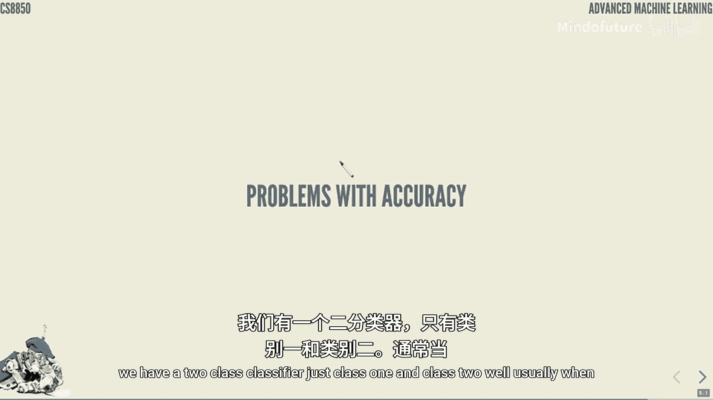

# 059：使用准确率作为性能指标的问题 ⚠️

在本节课中，我们将探讨在机器学习中，尤其是在处理类别不平衡数据时，使用准确率作为性能评估指标所存在的问题。我们将通过一个具体的例子来理解其局限性，并讨论一种简单的解决方案及其潜在陷阱。

## 概述

评估分类器性能时，准确率是最常用的指标之一。准确率的定义是**正确预测的数量**除以**预测总数**。公式如下：

**准确率 = 正确预测数 / 总预测数**

然而，当数据集中不同类别的样本数量差异巨大时，仅依赖准确率可能会产生误导。

## 类别不平衡问题

上一节我们介绍了准确率的基本概念，本节中我们来看看它在特定场景下的问题。让我们设想一个二分类问题，类别为“1”和“0”。

假设我们有一个数据集，其中95%的样本属于类别“1”，只有5%的样本属于类别“0”。在这种情况下，一个非常“懒惰”的分类器可能会简单地**将所有样本都预测为类别“1”**。

这个分类器的准确率会是多少呢？由于95%的样本确实是“1”，所以它的准确率将达到95%。这个数字看起来很高，但分类器实际上完全忽略了占少数的类别“0”。如果类别“0”代表某种关键事件（例如“患者患有疾病”），那么这种分类器将是完全无效且危险的。

## 一个简单的解决方案及其陷阱

认识到准确率在类别不平衡数据上的局限性后，一个直观的解决方案是手动平衡数据集。

以下是具体操作步骤：
1.  确定原始数据集中少数类（例如“0”）的样本数量。
2.  从多数类（例如“1”）中随机抽取相同数量的样本。
3.  使用这个新构建的平衡数据集来训练和评估模型。

例如，如果原始数据有100万个样本（95万个“1”，5万个“0”），我们可以使用全部5万个“0”和随机抽取的5万个“1”，组成一个总共10万个样本的平衡数据集。

现在，我们在这个平衡数据集上比较两个分类器A和B的性能。假设它们的表现如下：

*   **分类器A**：能100%正确分类“0”，但会将17%的“1”误分类为“0”。
*   **分类器B**：能100%正确分类“1”，但会将20%的“0”误分类为“1”。

在平衡数据集上计算整体准确率：
*   分类器A的准确率约为 `(50,000 + 0.83*50,000) / 100,000 = 91.5%`
*   分类器B的准确率约为 `(0.80*50,000 + 50,000) / 100,000 = 90.0%`

根据准确率，我们会选择分类器A。

## 回到现实世界

然而，关键问题在于：我们最终要将模型部署到真实世界中，而真实世界的数据分布仍然是**不平衡的**（95%的“1”，5%的“0”）。

让我们计算两个分类器在原始不平衡数据分布下的真实表现：
*   **分类器A**：对“0”的分类完全正确（5%的数据），但对“1”的分类只有83%正确（95%的数据）。其**真实整体准确率**为 `5%*100% + 95%*83% ≈ 84%`。
*   **分类器B**：对“1”的分类完全正确（95%的数据），但对“0”的分类只有80%正确（5%的数据）。其**真实整体准确率**为 `95%*100% + 5%*80% = 99%`。

结果出现了反转！在平衡数据集上表现“更好”的分类器A，在真实场景下的准确率（84%）远低于分类器B（99%）。我们基于平衡数据做出的选择导致了次优的结果。

## 总结

本节课中我们一起学习了使用准确率作为评估指标的核心问题。当数据类别分布严重不平衡时，高准确率可能具有欺骗性，因为它可能仅仅反映了模型对多数类的预测能力，而完全忽略了对关键少数类的识别。简单地通过下采样来平衡数据集用于模型选择，也可能导致我们在真实的不平衡数据上选择到性能更差的模型。因此，在评估分类器，尤其是处理不平衡数据时，我们需要更细致的指标（如精确率、召回率、F1分数或ROC-AUC）来全面衡量模型性能。