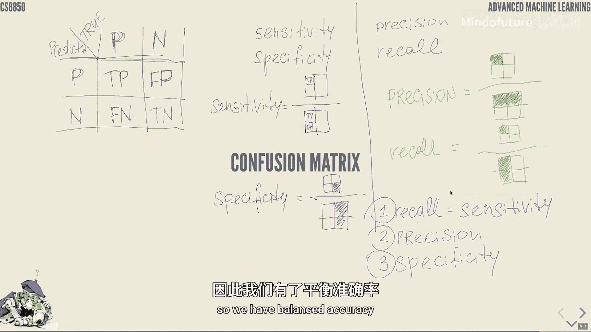
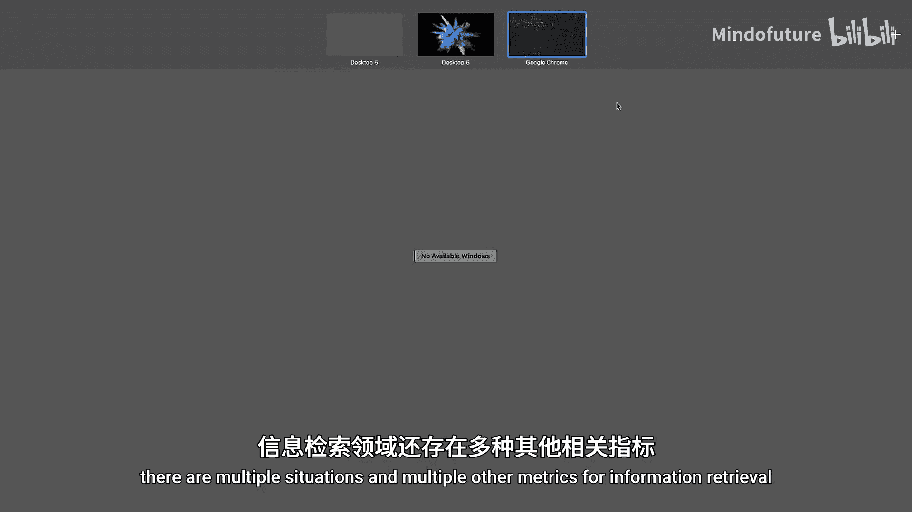
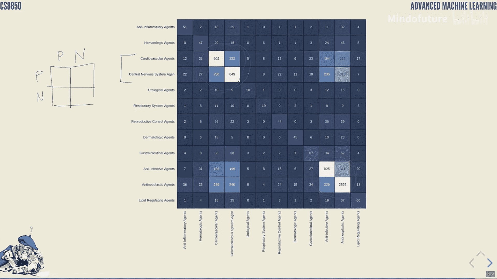

高级机器学习：P60：混淆矩阵与性能评估 🎯

在本节课中，我们将学习一个评估分类模型性能的重要工具——混淆矩阵。我们将了解其结构，并学习如何从中提取关键性能指标，如准确率、召回率和精确率，以全面评估一个分类器的表现。

---

### 混淆矩阵的结构

在深入探讨如何划分数据或评估模型性能之前，我们需要一个非常方便的工具，即混淆矩阵。它以下列方式工作。

想象我们专注于一个二分类问题。我们有两种样本：正例和负例。混淆矩阵的顶部和左侧分别代表真实的标签和模型预测的标签。

*   **真正例**：真实为正例的样本被预测为正例。
*   **假正例**：真实为负例的样本被预测为正例。
*   **真负例**：真实为负例的样本被预测为负例。
*   **假负例**：真实为正例的样本被预测为负例。

这个结构被称为混淆矩阵。理想情况下，我们希望假正例和假负例的数量都为零。但由于理想情况很少出现，我们需要理解这些数字之间的权衡关系。

---

### 核心性能指标

为了更简洁地描述混淆矩阵，人们通常使用两组指标来衡量分类器的性能。

一组指标围绕**敏感度**和**特异度**展开。另一组则围绕**精确率**和**召回率**展开。

首先，敏感度和特异度更容易用混淆矩阵直观描述。

*   **敏感度**：也称为**召回率**或**真正例率**。计算公式为：
    `敏感度 = 真正例 / (真正例 + 假负例)`
    它衡量了模型找出所有正例样本的能力。
*   **特异度**：也称为**真负例率**。计算公式为：
    `特异度 = 真负例 / (真负例 + 假正例)`
    它衡量了模型找出所有负例样本的能力。

另一方面，**精确率**略有不同。其计算公式为：
`精确率 = 真正例 / (真正例 + 假正例)`
它衡量了在所有被预测为正例的样本中，有多少是真正的正例。

请注意，召回率与敏感度是相同的概念，它们源自不同的应用领域。敏感度和特异度常用于评估分类器性能，而精确率和召回率则源于信息检索领域。

---

### 单一指标的局限性

正如你所见，我们只有少数几个指标，而一个分类器如果只优化其中一个指标，就可能“作弊”。

例如，如果一个模型只追求高召回率，它可以将所有样本都预测为正类。这样，它就能找出所有的正例，召回率会很高，但精确率会非常低。

如果一个模型只追求高特异度，它可以将所有样本都预测为负类。这样，真负例率会很高，但召回率会变为零。

同样，如果一个模型只追求高精确率，它可以设置极高的预测阈值，只对确信度极高的样本预测为正类。这样精确率会很高，但会漏掉很多正例，导致召回率很低。

因此，单独使用任何一个指标都不够全面。

---

### 综合评估指标

为了平衡这些指标，人们引入了综合性的评估指标。

**平衡准确率**是敏感度和特异度的算术平均值：
`平衡准确率 = (敏感度 + 特异度) / 2`

考虑一个极不平衡的数据集：有15个正例和10000个负例。一个分类器预测了10个真正例、5个假负例、5个假正例和10000个真负例。
*   普通准确率高达约99.4%，但这具有误导性。
*   敏感度约为33.3%，特异度约为99.5%。
*   平衡准确率约为66.4%，这更能反映模型在两类上的平均表现。

如果一个分类器简单地将所有样本预测为负类，其平衡准确率将是 `(0% + 100%) / 2 = 50%`，这处于随机猜测的水平，表明该模型无效。

对于关注精确率和召回率的场景，常用的综合指标是 **F1分数**，它是精确率和召回率的调和平均数：
`F1分数 = 2 * (精确率 * 召回率) / (精确率 + 召回率)`

选择F1分数还是平衡准确率，取决于你所要解决的问题。信息检索任务更关注精确率和召回率，而分类器评估可能更关注敏感度和特异度。没有放之四海而皆准的“黄金指标”，必须根据具体问题谨慎选择。

---

### 多分类问题的混淆矩阵

混淆矩阵同样适用于多分类问题。以下是一个包含12个类别的真实案例混淆矩阵。

与二分类类似，行代表真实类别，列代表预测类别。通过观察矩阵，我们可以发现模型犯错的规律。

例如，图中标红的部分显示，模型持续地将某两个类别相互混淆，也将另外两个类别相互混淆。这个发现非常有价值。在该研究中，目标是寻找药物重用的机会（即用一种已批准治疗A疾病的药物治疗B疾病）。通过分析模型混淆了心血管类药物和神经系统类药物，研究人员可能发现某些药物具有治疗其他系统疾病的潜力，从而为药物重定位提供线索。

---

### 总结

本节课中，我们一起学习了混淆矩阵这一核心工具。我们了解了它的基本结构，学习了从中衍生出的关键性能指标：敏感度（召回率）、特异度、精确率，并认识了单一指标的局限性。最后，我们介绍了平衡准确率和F1分数这两种综合评估指标，并探讨了混淆矩阵在多分类问题中的应用价值。记住，选择合适的评估指标需要紧密结合实际问题的具体需求。